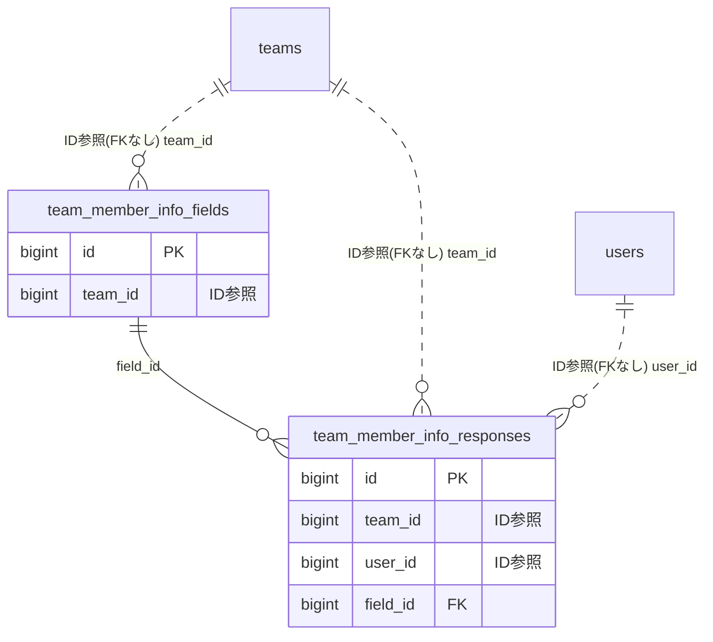

# memberinfo ドメイン ER 図

> このファイルは自動生成されます。手で編集しないでください。再生成: `cd backend && ./gradlew generateErDiagrams`

- テーブル数: 2
- ビュー数: 0

## ER 図

実線 = 外部キー、点線 = ID参照(FKなし)。図中の `FK` は実外部キーの列だけ（ID参照列は `FK` を付けず "ID参照" と注記）。図にはキー列（PK / FK / 参照推定列 / 単一列 UNIQUE）のみを描く。全列は下の「テーブル定義」を参照。

## 被参照（他ドメインから）

このドメインのテーブルを参照している他ドメインの側（実 FK と ID参照のみ。多態参照と推定不能参照は含まない。同一ドメイン内の参照は上の図を参照）。

なし

## テーブル定義

### `team_member_info_fields`

| 列名 | 型 | NULL | 既定値 | コメント |
| --- | --- | --- | --- | --- |
| `id` | `bigint unsigned` | NO | （なし） auto_increment |  |
| `team_id` | `bigint unsigned` | NO | （なし） |  |
| `field_name` | `varchar(100)` | NO | （なし） |  |
| `field_type` | `enum('TEXT','PHONE','EMAIL','DATE')` | NO | `TEXT` |  |
| `is_required` | `tinyint(1)` | NO | `0` |  |
| `is_sensitive` | `tinyint(1)` | NO | `0` | 1=AES-256-GCM暗号化保存 |
| `refresh_interval_months` | `tinyint unsigned` | YES | NULL | NULL=無期限 / 12,36,60 のみ許可 |
| `sort_order` | `int` | NO | `0` |  |
| `is_active` | `tinyint(1)` | NO | `1` |  |
| `created_at` | `datetime` | NO | `CURRENT_TIMESTAMP` （式） |  |
| `updated_at` | `datetime` | NO | `CURRENT_TIMESTAMP` （式） |  |

### `team_member_info_responses`

| 列名 | 型 | NULL | 既定値 | コメント |
| --- | --- | --- | --- | --- |
| `id` | `bigint unsigned` | NO | （なし） auto_increment |  |
| `team_id` | `bigint unsigned` | NO | （なし） |  |
| `user_id` | `bigint unsigned` | NO | （なし） |  |
| `field_id` | `bigint unsigned` | NO | （なし） |  |
| `value_plain` | `text` | YES | NULL | is_sensitive=FALSE の場合のみ使用 |
| `value_encrypted` | `text` | YES | NULL | is_sensitive=TRUE: AES-256-GCM Base64 |
| `encryption_key_version` | `int` | YES | NULL | is_sensitive=TRUE 時のみ設定 |
| `confirmed_at` | `datetime` | YES | NULL | 最終確認日時 |
| `last_reminder_sent_at` | `datetime` | YES | NULL |  |
| `created_at` | `datetime` | NO | `CURRENT_TIMESTAMP` （式） |  |
| `updated_at` | `datetime` | NO | `CURRENT_TIMESTAMP` （式） |  |
