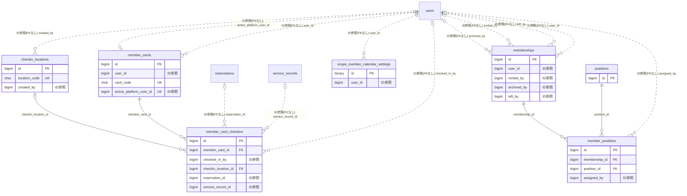

# membership ドメイン ER 図

> このファイルは自動生成されます。手で編集しないでください。再生成: `cd backend && ./gradlew generateErDiagrams`

- テーブル数: 7
- ビュー数: 0

## ER 図

実線 = 外部キー、点線 = ID参照(FKなし)。図中の `FK` は実外部キーの列だけ（ID参照列は `FK` を付けず "ID参照" と注記）。図にはキー列（PK / FK / 参照推定列 / 単一列 UNIQUE）のみを描く。全列は下の「テーブル定義」を参照。

## 被参照（他ドメインから）

このドメインのテーブルを参照している他ドメインの側（実 FK と ID参照のみ。多態参照と推定不能参照は含まない。同一ドメイン内の参照は上の図を参照）。

| 参照元ドメイン | 参照元テーブル | 列 | 種別 | 参照先テーブル |
| --- | --- | --- | --- | --- |
| [role](role.md) | `archived_membership_grants` | `membership_id` | ID参照 | `memberships` |

## 多態参照（線を引かない）

| テーブル | 種別列 | ID列 |
| --- | --- | --- |
| `checkin_locations` | `scope_type` | `scope_id` |
| `member_cards` | `scope_type` | `scope_id` |
| `memberships` | `scope_type` | `scope_id` |
| `positions` | `scope_type` | `scope_id` |
| `scope_member_calendar_settings` | `scope_type` | `scope_id` |

## 推定不能参照

| テーブル | 列 | 理由 |
| --- | --- | --- |
| `member_card_checkins` | `transaction_id` | 参照先テーブルを特定できない |

## テーブル定義

### `checkin_locations`

| 列名 | 型 | NULL | 既定値 | コメント |
| --- | --- | --- | --- | --- |
| `id` | `bigint unsigned` | NO | （なし） auto_increment |  |
| `scope_type` | `varchar(20)` | NO | （なし） | スコープ種別（TEAM / ORGANIZATION） |
| `scope_id` | `bigint unsigned` | NO | （なし） | FK → teams.id or organizations.id |
| `name` | `varchar(100)` | NO | （なし） | 拠点名 |
| `location_code` | `char(36)` | NO | （なし） | 拠点コード（UUID v4） |
| `location_secret` | `varchar(64)` | NO | （なし） | QR署名用シークレット（HMAC-SHA256） |
| `is_active` | `tinyint(1)` | NO | `1` | 有効フラグ |
| `auto_complete_reservation` | `tinyint(1)` | NO | `1` | セルフチェックイン時に当日予約を自動COMPLETEDにするか |
| `created_by` | `bigint unsigned` | YES | NULL | FK → users |
| `created_at` | `datetime` | NO | `CURRENT_TIMESTAMP` （式） |  |
| `updated_at` | `datetime` | NO | `CURRENT_TIMESTAMP` （式） |  |
| `deleted_at` | `datetime` | YES | NULL | 論理削除 |

### `member_card_checkins`

| 列名 | 型 | NULL | 既定値 | コメント |
| --- | --- | --- | --- | --- |
| `id` | `bigint unsigned` | NO | （なし） auto_increment |  |
| `member_card_id` | `bigint unsigned` | NO | （なし） | FK → member_cards |
| `checkin_type` | `varchar(20)` | NO | `STAFF_SCAN` | チェックイン種別（STAFF_SCAN / SELF） |
| `checked_in_by` | `bigint unsigned` | YES | NULL | FK → users（STAFF_SCAN時のスキャンスタッフ） |
| `checkin_location_id` | `bigint unsigned` | YES | NULL | FK → checkin_locations（SELF時の拠点） |
| `checked_in_at` | `datetime` | NO | `CURRENT_TIMESTAMP` （式） | チェックイン日時 |
| `location` | `varchar(200)` | YES | NULL | チェックイン場所 |
| `note` | `varchar(500)` | YES | NULL | ADMIN向けメモ |
| `reservation_id` | `bigint unsigned` | YES | NULL | FK → reservations（Phase 3でFK追加） |
| `service_record_id` | `bigint unsigned` | YES | NULL | FK → service_records（Phase 7でFK追加） |
| `transaction_id` | `bigint unsigned` | YES | NULL | FK → transactions（Phase 8でFK追加） |
| `created_at` | `datetime` | NO | `CURRENT_TIMESTAMP` （式） |  |

### `member_cards`

| 列名 | 型 | NULL | 既定値 | コメント |
| --- | --- | --- | --- | --- |
| `id` | `bigint unsigned` | NO | （なし） auto_increment |  |
| `user_id` | `bigint unsigned` | NO | （なし） |  |
| `scope_type` | `varchar(20)` | NO | （なし） | スコープ種別（PLATFORM / TEAM / ORGANIZATION） |
| `scope_id` | `bigint unsigned` | YES | NULL | FK → teams.id or organizations.id。PLATFORM の場合は NULL |
| `card_code` | `char(36)` | NO | （なし） | 会員証コード（UUID v4） |
| `card_number` | `varchar(20)` | NO | （なし） | 表示用会員番号（例: M-000001） |
| `display_name` | `varchar(100)` | NO | （なし） | 会員証に表示する名前 |
| `status` | `varchar(20)` | NO | `ACTIVE` | ステータス（ACTIVE / SUSPENDED / REVOKED） |
| `issued_at` | `datetime` | NO | `CURRENT_TIMESTAMP` （式） | 発行日時 |
| `suspended_at` | `datetime` | YES | NULL | 一時停止日時 |
| `revoked_at` | `datetime` | YES | NULL | 無効化日時 |
| `last_checkin_at` | `datetime` | YES | NULL | 最終チェックイン日時（denormalize） |
| `checkin_count` | `int unsigned` | NO | `0` | チェックイン回数（denormalize） |
| `total_spend` | `decimal(12,2)` | NO | `0.00` | 累計売上額（Phase 8 で使用開始） |
| `qr_secret` | `varchar(64)` | NO | （なし） | QR署名用シークレット（HMAC-SHA256） |
| `created_at` | `datetime` | NO | `CURRENT_TIMESTAMP` （式） |  |
| `updated_at` | `datetime` | NO | `CURRENT_TIMESTAMP` （式） |  |
| `deleted_at` | `datetime` | YES | NULL | 論理削除 |
| `active_unique_key` | `tinyint` | YES | NULL | パーシャルユニーク用 |
| `active_platform_user_id` | `bigint unsigned` | YES | NULL |  |

### `member_positions`

| 列名 | 型 | NULL | 既定値 | コメント |
| --- | --- | --- | --- | --- |
| `id` | `bigint unsigned` | NO | （なし） auto_increment |  |
| `membership_id` | `bigint unsigned` | NO | （なし） |  |
| `position_id` | `bigint unsigned` | NO | （なし） |  |
| `started_at` | `datetime` | NO | `CURRENT_TIMESTAMP` （式） |  |
| `ended_at` | `datetime` | YES | NULL |  |
| `assigned_by` | `bigint unsigned` | YES | NULL |  |
| `created_at` | `datetime` | NO | `CURRENT_TIMESTAMP` （式） |  |

### `memberships`

| 列名 | 型 | NULL | 既定値 | コメント |
| --- | --- | --- | --- | --- |
| `id` | `bigint unsigned` | NO | （なし） auto_increment |  |
| `user_id` | `bigint unsigned` | YES | NULL |  |
| `scope_type` | `enum('ORGANIZATION','TEAM')` | NO | （なし） |  |
| `scope_id` | `bigint unsigned` | NO | （なし） |  |
| `role_kind` | `enum('MEMBER','SUPPORTER')` | NO | `MEMBER` |  |
| `joined_at` | `datetime` | NO | `CURRENT_TIMESTAMP` （式） |  |
| `left_at` | `datetime` | YES | NULL |  |
| `leave_reason` | `enum('SELF','REMOVED','GDPR','TRANSFER','OTHER','DECEASED','RELOCATED')` | YES | NULL |  |
| `invited_by` | `bigint unsigned` | YES | NULL |  |
| `gdpr_masked_at` | `datetime` | YES | NULL |  |
| `created_at` | `datetime` | NO | `CURRENT_TIMESTAMP` （式） |  |
| `updated_at` | `datetime` | NO | `CURRENT_TIMESTAMP` （式） |  |
| `archived_at` | `datetime(3)` | YES | NULL |  |
| `archive_reason` | `varchar(10)` | YES | NULL |  |
| `archived_by` | `bigint unsigned` | YES | NULL |  |
| `archive_expires_at` | `datetime(3)` | YES | NULL |  |
| `left_trigger` | `varchar(24)` | YES | NULL |  |
| `left_by` | `bigint unsigned` | YES | NULL |  |
| `archive_generation` | `int` | NO | `0` |  |

### `positions`

| 列名 | 型 | NULL | 既定値 | コメント |
| --- | --- | --- | --- | --- |
| `id` | `bigint unsigned` | NO | （なし） auto_increment |  |
| `scope_type` | `enum('ORGANIZATION','TEAM')` | NO | （なし） |  |
| `scope_id` | `bigint unsigned` | NO | （なし） |  |
| `name` | `varchar(50)` | NO | （なし） |  |
| `display_name` | `varchar(100)` | NO | （なし） |  |
| `description` | `varchar(500)` | YES | NULL |  |
| `sort_order` | `int` | NO | `0` |  |
| `is_system` | `tinyint(1)` | NO | `0` |  |
| `deleted_at` | `datetime` | YES | NULL |  |
| `created_at` | `datetime` | NO | `CURRENT_TIMESTAMP` （式） |  |
| `updated_at` | `datetime` | NO | `CURRENT_TIMESTAMP` （式） |  |

### `scope_member_calendar_settings`

| 列名 | 型 | NULL | 既定値 | コメント |
| --- | --- | --- | --- | --- |
| `id` | `binary(16)` | NO | （なし） | UUIDv7 |
| `scope_type` | `varchar(12)` | NO | （なし） |  |
| `scope_id` | `bigint unsigned` | NO | （なし） | team/organization への論理参照。FK禁止 |
| `user_id` | `bigint unsigned` | NO | （なし） | users への論理参照。FK禁止 |
| `calendar_color` | `char(7)` | NO | （なし） | #RRGGBB |
