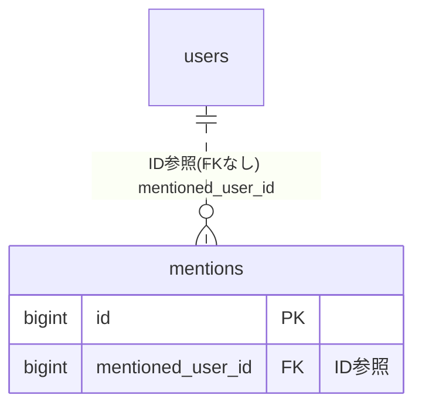

# mention ドメイン ER 図

> このファイルは自動生成されます。手で編集しないでください。再生成: `cd backend && ./gradlew generateErDiagrams`

- テーブル数: 1
- ビュー数: 0

## ER 図

実線 = 外部キー、点線 = ID参照(FKなし)。図にはキー列（PK / FK / 参照推定列 / 単一列 UNIQUE）のみを描く。全列は下の「テーブル定義」を参照。

## 多態参照（線を引かない）

| テーブル | 種別列 | ID列 |
| --- | --- | --- |
| `mentions` | `target_type` | `target_id` |

## 推定不能参照

| テーブル | 列 | 理由 |
| --- | --- | --- |
| `mentions` | `mentioned_by_id` | 参照先テーブルを特定できない |

## テーブル定義

### `mentions`

| 列名 | 型 | NULL | 既定値 | コメント |
| --- | --- | --- | --- | --- |
| `id` | `bigint unsigned` | NO | （なし） auto_increment |  |
| `mentioned_user_id` | `bigint unsigned` | NO | （なし） | メンションされたユーザー |
| `mentioned_by_id` | `bigint unsigned` | NO | （なし） | メンションしたユーザー |
| `target_type` | `varchar(30)` | NO | （なし） | 対象種別 (TIMELINE_POST, CHAT_MESSAGE 等) |
| `target_id` | `bigint unsigned` | NO | （なし） | 対象レコードの ID |
| `content_snippet` | `varchar(200)` | YES | NULL | 本文の抜粋 |
| `is_read` | `tinyint(1)` | NO | `0` |  |
| `created_at` | `datetime` | NO | `CURRENT_TIMESTAMP` （式） |  |
| `read_at` | `datetime` | YES | NULL |  |
