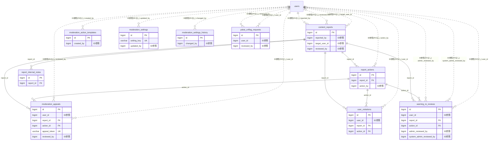

# moderation ドメイン ER 図

> このファイルは自動生成されます。手で編集しないでください。再生成: `cd backend && ./gradlew generateErDiagrams`

- テーブル数: 10
- ビュー数: 0

## ER 図

実線 = 外部キー、点線 = ID参照(FKなし)。図中の `FK` は実外部キーの列だけ（ID参照列は `FK` を付けず "ID参照" と注記）。図にはキー列（PK / FK / 参照推定列 / 単一列 UNIQUE）のみを描く。全列は下の「テーブル定義」を参照。

## 被参照（他ドメインから）

このドメインのテーブルを参照している他ドメインの側（実 FK と ID参照のみ。多態参照と推定不能参照は含まない。同一ドメイン内の参照は上の図を参照）。

なし

## 多態参照（線を引かない）

| テーブル | 種別列 | ID列 |
| --- | --- | --- |
| `content_reports` | `scope_type` | `scope_id` |
| `content_reports` | `target_type` | `target_id` |

## 推定不能参照

| テーブル | 列 | 理由 |
| --- | --- | --- |
| `report_internal_notes` | `author_id` | 参照先テーブルを特定できない |

## テーブル定義

### `content_reports`

| 列名 | 型 | NULL | 既定値 | コメント |
| --- | --- | --- | --- | --- |
| `id` | `bigint unsigned` | NO | （なし） auto_increment |  |
| `target_type` | `varchar(30)` | NO | （なし） |  |
| `target_id` | `bigint unsigned` | NO | （なし） |  |
| `reported_by` | `bigint unsigned` | NO | （なし） |  |
| `scope_type` | `varchar(20)` | NO | `TEAM` |  |
| `scope_id` | `bigint unsigned` | NO | `0` |  |
| `target_user_id` | `bigint unsigned` | YES | NULL |  |
| `reason` | `varchar(20)` | NO | （なし） |  |
| `description` | `text` | YES | NULL |  |
| `content_snapshot` | `json` | YES | NULL |  |
| `status` | `varchar(20)` | NO | `PENDING` |  |
| `reviewed_by` | `bigint unsigned` | YES | NULL |  |
| `reviewed_at` | `datetime` | YES | NULL |  |
| `content_hidden` | `tinyint(1)` | NO | `0` | 通報対象コンテンツを非表示にしたか（モデレーション操作の結果） |
| `created_at` | `datetime` | NO | `CURRENT_TIMESTAMP` （式） |  |
| `updated_at` | `datetime` | NO | `CURRENT_TIMESTAMP` （式） |  |

### `moderation_action_templates`

| 列名 | 型 | NULL | 既定値 | コメント |
| --- | --- | --- | --- | --- |
| `id` | `bigint unsigned` | NO | （なし） auto_increment |  |
| `name` | `varchar(100)` | NO | （なし） |  |
| `action_type` | `varchar(20)` | NO | （なし） |  |
| `reason` | `varchar(30)` | YES | NULL |  |
| `template_text` | `text` | NO | （なし） |  |
| `language` | `varchar(10)` | NO | `ja` |  |
| `is_default` | `tinyint(1)` | NO | `0` |  |
| `created_by` | `bigint unsigned` | NO | （なし） |  |
| `created_at` | `datetime` | NO | `CURRENT_TIMESTAMP` （式） |  |
| `updated_at` | `datetime` | NO | `CURRENT_TIMESTAMP` （式） |  |
| `deleted_at` | `datetime` | YES | NULL |  |

### `moderation_appeals`

| 列名 | 型 | NULL | 既定値 | コメント |
| --- | --- | --- | --- | --- |
| `id` | `bigint unsigned` | NO | （なし） auto_increment |  |
| `user_id` | `bigint unsigned` | NO | （なし） |  |
| `report_id` | `bigint unsigned` | NO | （なし） |  |
| `action_id` | `bigint unsigned` | NO | （なし） |  |
| `appeal_token` | `varchar(64)` | NO | （なし） |  |
| `appeal_token_expires_at` | `datetime` | NO | （なし） |  |
| `appeal_reason` | `text` | YES | NULL |  |
| `status` | `varchar(20)` | NO | `INVITED` |  |
| `reviewed_by` | `bigint unsigned` | YES | NULL |  |
| `review_note` | `text` | YES | NULL |  |
| `reviewed_at` | `datetime` | YES | NULL |  |
| `created_at` | `datetime` | NO | `CURRENT_TIMESTAMP` （式） |  |
| `updated_at` | `datetime` | NO | `CURRENT_TIMESTAMP` （式） |  |

### `moderation_settings`

| 列名 | 型 | NULL | 既定値 | コメント |
| --- | --- | --- | --- | --- |
| `id` | `bigint unsigned` | NO | （なし） auto_increment |  |
| `setting_key` | `varchar(100)` | NO | （なし） |  |
| `setting_value` | `varchar(500)` | NO | （なし） |  |
| `description` | `varchar(500)` | YES | NULL |  |
| `updated_by` | `bigint unsigned` | YES | NULL |  |
| `created_at` | `datetime` | NO | `CURRENT_TIMESTAMP` （式） |  |
| `updated_at` | `datetime` | NO | `CURRENT_TIMESTAMP` （式） |  |

### `moderation_settings_history`

| 列名 | 型 | NULL | 既定値 | コメント |
| --- | --- | --- | --- | --- |
| `id` | `bigint unsigned` | NO | （なし） auto_increment |  |
| `setting_key` | `varchar(100)` | NO | （なし） |  |
| `old_value` | `varchar(500)` | NO | （なし） |  |
| `new_value` | `varchar(500)` | NO | （なし） |  |
| `changed_by` | `bigint unsigned` | NO | （なし） |  |
| `changed_at` | `datetime` | NO | `CURRENT_TIMESTAMP` （式） |  |
| `created_at` | `datetime` | NO | `CURRENT_TIMESTAMP` （式） |  |
| `updated_at` | `datetime` | NO | `CURRENT_TIMESTAMP` （式） |  |

### `report_actions`

| 列名 | 型 | NULL | 既定値 | コメント |
| --- | --- | --- | --- | --- |
| `id` | `bigint unsigned` | NO | （なし） auto_increment |  |
| `report_id` | `bigint unsigned` | NO | （なし） |  |
| `action_type` | `varchar(20)` | NO | （なし） |  |
| `action_by` | `bigint unsigned` | NO | （なし） |  |
| `note` | `text` | YES | NULL |  |
| `freeze_until` | `datetime` | YES | NULL |  |
| `guideline_section` | `varchar(100)` | YES | NULL |  |
| `created_at` | `datetime` | NO | `CURRENT_TIMESTAMP` （式） |  |

### `report_internal_notes`

| 列名 | 型 | NULL | 既定値 | コメント |
| --- | --- | --- | --- | --- |
| `id` | `bigint unsigned` | NO | （なし） auto_increment |  |
| `report_id` | `bigint unsigned` | NO | （なし） |  |
| `author_id` | `bigint unsigned` | NO | （なし） |  |
| `note` | `text` | NO | （なし） |  |
| `created_at` | `datetime` | NO | `CURRENT_TIMESTAMP` （式） |  |
| `updated_at` | `datetime` | NO | `CURRENT_TIMESTAMP` （式） |  |

### `user_violations`

| 列名 | 型 | NULL | 既定値 | コメント |
| --- | --- | --- | --- | --- |
| `id` | `bigint unsigned` | NO | （なし） auto_increment |  |
| `user_id` | `bigint unsigned` | NO | （なし） |  |
| `report_id` | `bigint unsigned` | NO | （なし） |  |
| `action_id` | `bigint unsigned` | NO | （なし） |  |
| `violation_type` | `varchar(20)` | NO | （なし） |  |
| `reason` | `varchar(30)` | NO | （なし） |  |
| `expires_at` | `datetime` | YES | NULL |  |
| `is_active` | `tinyint(1)` | NO | `1` |  |
| `created_at` | `datetime` | NO | `CURRENT_TIMESTAMP` （式） |  |
| `updated_at` | `datetime` | NO | `CURRENT_TIMESTAMP` （式） |  |

### `warning_re_reviews`

| 列名 | 型 | NULL | 既定値 | コメント |
| --- | --- | --- | --- | --- |
| `id` | `bigint unsigned` | NO | （なし） auto_increment |  |
| `user_id` | `bigint unsigned` | NO | （なし） |  |
| `report_id` | `bigint unsigned` | NO | （なし） |  |
| `action_id` | `bigint unsigned` | NO | （なし） |  |
| `reason` | `text` | NO | （なし） |  |
| `status` | `varchar(20)` | NO | `PENDING` |  |
| `admin_reviewed_by` | `bigint unsigned` | YES | NULL |  |
| `admin_review_note` | `text` | YES | NULL |  |
| `admin_reviewed_at` | `datetime` | YES | NULL |  |
| `escalation_reason` | `text` | YES | NULL |  |
| `system_admin_reviewed_by` | `bigint unsigned` | YES | NULL |  |
| `system_admin_review_note` | `text` | YES | NULL |  |
| `system_admin_reviewed_at` | `datetime` | YES | NULL |  |
| `created_at` | `datetime` | NO | `CURRENT_TIMESTAMP` （式） |  |
| `updated_at` | `datetime` | NO | `CURRENT_TIMESTAMP` （式） |  |

### `yabai_unflag_requests`

| 列名 | 型 | NULL | 既定値 | コメント |
| --- | --- | --- | --- | --- |
| `id` | `bigint unsigned` | NO | （なし） auto_increment |  |
| `user_id` | `bigint unsigned` | NO | （なし） |  |
| `reason` | `text` | NO | （なし） |  |
| `status` | `varchar(20)` | NO | `PENDING` |  |
| `reviewed_by` | `bigint unsigned` | YES | NULL |  |
| `review_note` | `text` | YES | NULL |  |
| `reviewed_at` | `datetime` | YES | NULL |  |
| `next_eligible_at` | `datetime` | YES | NULL |  |
| `created_at` | `datetime` | NO | `CURRENT_TIMESTAMP` （式） |  |
| `updated_at` | `datetime` | NO | `CURRENT_TIMESTAMP` （式） |  |
