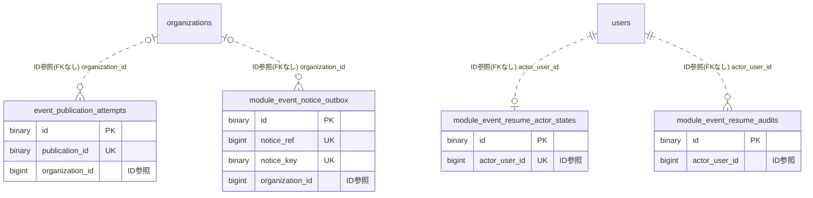

# moduleevent ドメイン ER 図

> このファイルは自動生成されます。手で編集しないでください。再生成: `cd backend && ./gradlew generateErDiagrams`

- テーブル数: 4
- ビュー数: 0

## ER 図

実線 = 外部キー、点線 = ID参照(FKなし)。図中の `FK` は実外部キーの列だけ（ID参照列は `FK` を付けず "ID参照" と注記）。図にはキー列（PK / FK / 参照推定列 / 単一列 UNIQUE）のみを描く。全列は下の「テーブル定義」を参照。

## 被参照（他ドメインから）

このドメインのテーブルを参照している他ドメインの側（実 FK と ID参照のみ。多態参照と推定不能参照は含まない。同一ドメイン内の参照は上の図を参照）。

なし

## 多態参照（線を引かない）

| テーブル | 種別列 | ID列 |
| --- | --- | --- |
| `event_publication_attempts` | `scope_type` | `scope_id` |
| `module_event_notice_outbox` | `scope_type` | `scope_id` |

## 推定不能参照

| テーブル | 列 | 理由 |
| --- | --- | --- |
| `event_publication_attempts` | `episode_id` | 参照先テーブルを特定できない |
| `event_publication_attempts` | `operation_id` | 参照先テーブルを特定できない |
| `event_publication_attempts` | `publication_id` | 参照先テーブルを特定できない |
| `module_event_notice_outbox` | `episode_id` | 参照先テーブルを特定できない |
| `module_event_notice_outbox` | `operation_id` | 参照先テーブルを特定できない |
| `module_event_resume_audits` | `publication_id` | 参照先テーブルを特定できない |

## テーブル定義

### `event_publication_attempts`

| 列名 | 型 | NULL | 既定値 | コメント |
| --- | --- | --- | --- | --- |
| `id` | `binary(16)` | NO | （なし） |  |
| `publication_id` | `binary(16)` | NO | （なし） |  |
| `retry_count` | `int` | NO | `0` |  |
| `status` | `varchar(32)` | NO | （なし） |  |
| `claim_token` | `binary(16)` | NO | （なし） |  |
| `last_attempt_at` | `datetime(6)` | YES | NULL |  |
| `lease_until` | `datetime(6)` | YES | NULL |  |
| `quarantined_at` | `datetime(6)` | YES | NULL |  |
| `failure_code` | `varchar(64)` | YES | NULL |  |
| `resolver_key` | `varchar(100)` | YES | NULL |  |
| `operation_id` | `binary(16)` | YES | NULL |  |
| `episode_id` | `binary(16)` | YES | NULL |  |
| `scope_type` | `varchar(16)` | YES | NULL |  |
| `scope_id` | `bigint unsigned` | YES | NULL |  |
| `organization_id` | `bigint unsigned` | YES | NULL |  |
| `created_at` | `datetime(6)` | NO | （なし） |  |
| `updated_at` | `datetime(6)` | NO | （なし） |  |
| `version` | `bigint` | NO | `0` |  |

### `module_event_notice_outbox`

| 列名 | 型 | NULL | 既定値 | コメント |
| --- | --- | --- | --- | --- |
| `id` | `binary(16)` | NO | （なし） |  |
| `notice_ref` | `bigint` | NO | （なし） auto_increment |  |
| `notice_key` | `binary(16)` | NO | （なし） |  |
| `resolver_key` | `varchar(100)` | NO | （なし） |  |
| `operation_id` | `binary(16)` | NO | （なし） |  |
| `episode_id` | `binary(16)` | NO | （なし） |  |
| `scope_type` | `varchar(16)` | NO | （なし） |  |
| `scope_id` | `bigint unsigned` | NO | （なし） |  |
| `organization_id` | `bigint unsigned` | YES | NULL |  |
| `phase` | `varchar(16)` | NO | （なし） |  |
| `audience` | `varchar(32)` | NO | （なし） |  |
| `descriptor_version` | `int` | NO | （なし） |  |
| `status` | `varchar(16)` | NO | （なし） |  |
| `attempt_count` | `int` | NO | （なし） |  |
| `next_attempt_at` | `datetime(6)` | NO | （なし） |  |
| `claim_token` | `binary(16)` | YES | NULL |  |
| `claimed_at` | `datetime(6)` | YES | NULL |  |
| `relayed_at` | `datetime(6)` | YES | NULL |  |
| `dead_at` | `datetime(6)` | YES | NULL |  |
| `last_error_code` | `varchar(64)` | YES | NULL |  |
| `created_at` | `datetime(6)` | NO | （なし） |  |
| `updated_at` | `datetime(6)` | NO | （なし） |  |

### `module_event_resume_actor_states`

| 列名 | 型 | NULL | 既定値 | コメント |
| --- | --- | --- | --- | --- |
| `id` | `binary(16)` | NO | （なし） | UUIDv7 |
| `actor_user_id` | `bigint unsigned` | NO | （なし） | 実行者ID。匿名参照を保持しusersへのFKは作らない |
| `purged` | `tinyint(1)` | NO | （なし） | 強匿名化済み。trueからfalseへ戻さない |

### `module_event_resume_audits`

| 列名 | 型 | NULL | 既定値 | コメント |
| --- | --- | --- | --- | --- |
| `id` | `binary(16)` | NO | （なし） |  |
| `publication_id` | `binary(16)` | NO | （なし） |  |
| `actor_user_id` | `bigint unsigned` | NO | （なし） |  |
| `reason` | `varchar(500)` | NO | （なし） |  |
| `created_at` | `datetime(6)` | NO | （なし） |  |
