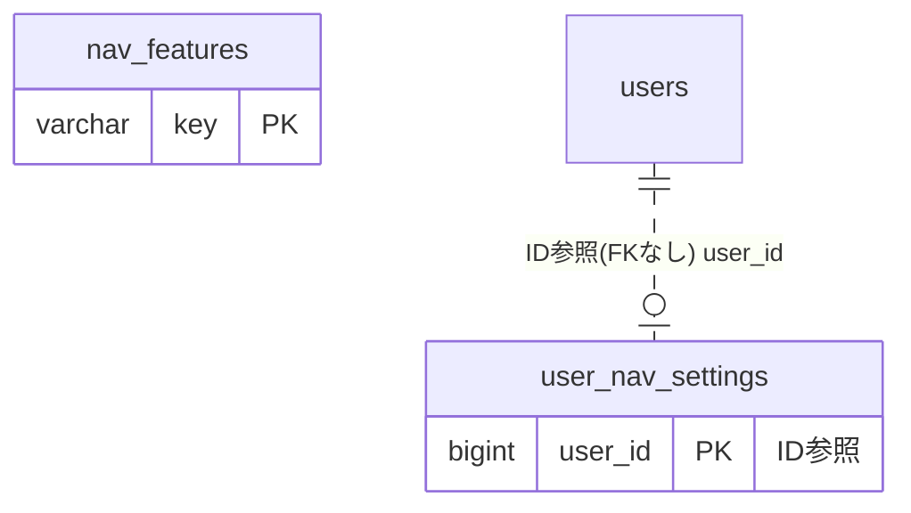

# navsettings ドメイン ER 図

> このファイルは自動生成されます。手で編集しないでください。再生成: `cd backend && ./gradlew generateErDiagrams`

- テーブル数: 2
- ビュー数: 0

## ER 図

実線 = 外部キー、点線 = ID参照(FKなし)。図中の `FK` は実外部キーの列だけ（ID参照列は `FK` を付けず "ID参照" と注記）。図にはキー列（PK / FK / 参照推定列 / 単一列 UNIQUE）のみを描く。全列は下の「テーブル定義」を参照。

## 被参照（他ドメインから）

このドメインのテーブルを参照している他ドメインの側（実 FK と ID参照のみ。多態参照と推定不能参照は含まない。同一ドメイン内の参照は上の図を参照）。

なし

## テーブル定義

### `nav_features`

| 列名 | 型 | NULL | 既定値 | コメント |
| --- | --- | --- | --- | --- |
| `key` | `varchar(50)` | NO | （なし） | ナビ項目識別キー（ケバブケース。例: shift-management） |
| `label_key` | `varchar(100)` | NO | （なし） | フロントエンド i18n キー（例: nav.shiftManagement） |
| `icon` | `varchar(50)` | NO | （なし） | PrimeVue アイコンクラス（例: pi pi-table） |
| `path` | `varchar(200)` | NO | （なし） | Nuxt ルートパス（例: /shift） |
| `is_fixed` | `tinyint(1)` | NO | `0` | TRUE = ユーザーによる非表示不可・削除不可・is_fixed変更不可 |
| `is_enabled` | `tinyint(1)` | NO | `1` | FALSE = 全ユーザーのナビから非表示 |
| `subscription_required` | `tinyint(1)` | NO | `0` | 将来課金フック（現フェーズはカラムのみ） |
| `sort_order` | `int` | NO | `0` | 表示順（昇順） |
| `mobile_visible` | `tinyint(1)` | NO | `1` | FALSE = PCのみ表示 |
| `created_at` | `datetime(6)` | NO | `CURRENT_TIMESTAMP(6)` （式） |  |
| `updated_at` | `datetime(6)` | NO | `CURRENT_TIMESTAMP(6)` （式） |  |

### `user_nav_settings`

| 列名 | 型 | NULL | 既定値 | コメント |
| --- | --- | --- | --- | --- |
| `user_id` | `bigint unsigned` | NO | （なし） | users.id（FK制約なし。クロスドメインFK禁止原則） |
| `hidden_nav_keys` | `json` | NO | （なし） | 非表示にしたnav_features.keyの配列。例: ["todo","my-shift"] |
| `nav_display_order` | `json` | YES | NULL | ユーザー個別ナビ表示順。nav_features.keyの配列。NULL=マスタsort_order順 |
| `updated_at` | `datetime(6)` | NO | `CURRENT_TIMESTAMP(6)` （式） |  |
