# notification ドメイン ER 図

> このファイルは自動生成されます。手で編集しないでください。再生成: `cd backend && ./gradlew generateErDiagrams`

- テーブル数: 20
- ビュー数: 0

## ER 図

実線 = 外部キー、点線 = ID参照(FKなし)。図中の `FK` は実外部キーの列だけ（ID参照列は `FK` を付けず "ID参照" と注記）。図にはキー列（PK / FK / 参照推定列 / 単一列 UNIQUE）のみを描く。全列は下の「テーブル定義」を参照。

```mermaid
erDiagram
    confirmable_notification_recipients {
        bigint id PK
        bigint confirmable_notification_id FK
        bigint user_id "ID参照"
        varchar confirm_token UK
        bigint excluded_by "ID参照"
    }
    confirmable_notification_settings {
        bigint id PK
    }
    confirmable_notification_targets {
        binary id PK
        bigint confirmable_notification_id FK
    }
    confirmable_notification_templates {
        bigint id PK
        bigint created_by "ID参照"
    }
    confirmable_notifications {
        bigint id PK
        bigint cancelled_by "ID参照"
        bigint created_by "ID参照"
        varchar once_per_source_key UK
    }
    confirmable_recipient_group_targets {
        binary id PK
        binary group_id FK
    }
    confirmable_recipient_groups {
        binary id PK
        bigint created_by "ID参照"
    }
    notification_credit_packages {
        bigint id PK
    }
    notification_credit_purchases {
        bigint id PK
        bigint organization_id "ID参照"
        bigint package_id FK
        bigint purchased_by_user_id "ID参照"
        varchar idempotency_key UK
    }
    notification_fanout_audience_teams {
        binary id PK
        binary audience_snapshot_id FK
        bigint team_id "ID参照"
    }
    notification_fanout_audiences {
        binary audience_snapshot_id PK
        bigint organization_id "ID参照"
    }
    notification_fanout_job_messages {
        binary id PK
        binary job_id FK
    }
    notification_fanout_jobs {
        binary id PK
        bigint organization_id "ID参照"
    }
    notification_monthly_usage {
        bigint id PK
        bigint organization_id "ID参照"
    }
    notification_preferences {
        bigint id PK
        bigint user_id "ID参照"
    }
    notification_settings {
        binary id PK
        bigint user_id UK "ID参照"
    }
    notification_type_preferences {
        bigint id PK
        bigint user_id "ID参照"
    }
    notifications {
        bigint id PK
        bigint user_id "ID参照"
        bigint organization_id "ID参照"
    }
    organization_notification_balances {
        bigint id PK
        bigint organization_id UK "ID参照"
    }
    push_subscriptions {
        bigint id PK
        bigint user_id "ID参照"
        varchar endpoint UK
    }
    organizations
    teams
    users
    confirmable_notifications ||--o{ confirmable_notification_recipients : "confirmable_notification_id"
    users |o..o{ confirmable_notification_recipients : "ID参照(FKなし) excluded_by"
    users ||..o{ confirmable_notification_recipients : "ID参照(FKなし) user_id"
    confirmable_notifications ||--o{ confirmable_notification_targets : "confirmable_notification_id"
    users |o..o{ confirmable_notification_templates : "ID参照(FKなし) created_by"
    users |o..o{ confirmable_notifications : "ID参照(FKなし) cancelled_by"
    users |o..o{ confirmable_notifications : "ID参照(FKなし) created_by"
    confirmable_recipient_groups ||--o{ confirmable_recipient_group_targets : "group_id"
    users |o..o{ confirmable_recipient_groups : "ID参照(FKなし) created_by"
    notification_credit_packages ||--o{ notification_credit_purchases : "package_id"
    organizations ||..o{ notification_credit_purchases : "ID参照(FKなし) organization_id"
    users ||..o{ notification_credit_purchases : "ID参照(FKなし) purchased_by_user_id"
    notification_fanout_audiences ||--o{ notification_fanout_audience_teams : "audience_snapshot_id"
    teams ||..o{ notification_fanout_audience_teams : "ID参照(FKなし) team_id"
    organizations ||..o{ notification_fanout_audiences : "ID参照(FKなし) organization_id"
    notification_fanout_jobs ||--o{ notification_fanout_job_messages : "job_id"
    organizations |o..o{ notification_fanout_jobs : "ID参照(FKなし) organization_id"
    organizations ||..o{ notification_monthly_usage : "ID参照(FKなし) organization_id"
    users ||..o{ notification_preferences : "ID参照(FKなし) user_id"
    users ||..o| notification_settings : "ID参照(FKなし) user_id"
    users ||..o{ notification_type_preferences : "ID参照(FKなし) user_id"
    organizations |o..o{ notifications : "ID参照(FKなし) organization_id"
    users ||..o{ notifications : "ID参照(FKなし) user_id"
    organizations ||..o| organization_notification_balances : "ID参照(FKなし) organization_id"
    users ||..o{ push_subscriptions : "ID参照(FKなし) user_id"
```

## 被参照（他ドメインから）

このドメインのテーブルを参照している他ドメインの側（実 FK と ID参照のみ。多態参照と推定不能参照は含まない。同一ドメイン内の参照は上の図を参照）。

| 参照元ドメイン | 参照元テーブル | 列 | 種別 | 参照先テーブル |
| --- | --- | --- | --- | --- |
| [advertising](advertising.md) | `ad_push_deliveries` | `notification_id` | ID参照 | `notifications` |
| [committee](committee.md) | `committee_distribution_logs` | `confirmable_notification_id` | ID参照 | `confirmable_notifications` |
| [payment](payment.md) | `payment_requests` | `confirmable_notification_id` | ID参照 | `confirmable_notifications` |
| [recruitment](recruitment.md) | `recruitment_reminders` | `notification_id` | ID参照 | `notifications` |
| [school](school.md) | `attendance_disclosure_records` | `notification_id` | ID参照 | `notifications` |

## 多態参照（線を引かない）

| テーブル | 種別列 | ID列 |
| --- | --- | --- |
| `confirmable_notification_settings` | `scope_type` | `scope_id` |
| `confirmable_notification_targets` | `target_type` | `target_id` |
| `confirmable_notification_templates` | `scope_type` | `scope_id` |
| `confirmable_notifications` | `scope_type` | `scope_id` |
| `confirmable_notifications` | `source_type` | `source_id` |
| `confirmable_recipient_group_targets` | `target_type` | `target_id` |
| `confirmable_recipient_groups` | `scope_type` | `scope_id` |
| `notification_fanout_jobs` | `source_type` | `source_id` |
| `notification_preferences` | `scope_type` | `scope_id` |
| `notifications` | `scope_type` | `scope_id` |
| `notifications` | `source_type` | `source_id` |

## 推定不能参照

| テーブル | 列 | 理由 |
| --- | --- | --- |
| `confirmable_notification_templates` | `default_recipient_group_id` | 参照先テーブルを特定できない |
| `confirmable_notifications` | `template_id` | 参照先テーブルを特定できない |
| `notification_credit_packages` | `stripe_price_id` | 参照先テーブルを特定できない |
| `notification_credit_purchases` | `stripe_checkout_session_id` | 参照先テーブルを特定できない |
| `notification_credit_purchases` | `stripe_payment_intent_id` | 参照先テーブルを特定できない |
| `notification_fanout_audiences` | `audience_snapshot_id` | 参照先テーブルを特定できない |
| `notification_fanout_jobs` | `actor_id` | 参照先テーブルを特定できない |
| `notification_fanout_jobs` | `cursor_subject_id` | 参照先テーブルを特定できない |
| `notifications` | `actor_id` | 参照先テーブルを特定できない |

## テーブル定義

### `confirmable_notification_recipients`

| 列名 | 型 | NULL | 既定値 | コメント |
| --- | --- | --- | --- | --- |
| `id` | `bigint unsigned` | NO | （なし） auto_increment |  |
| `confirmable_notification_id` | `bigint unsigned` | NO | （なし） |  |
| `user_id` | `bigint unsigned` | NO | （なし） |  |
| `confirm_token` | `varchar(36)` | NO | （なし） | URLトークン確認用UUID |
| `is_confirmed` | `tinyint(1)` | NO | `0` |  |
| `confirmed_at` | `datetime` | YES | NULL |  |
| `confirmed_via` | `enum('APP','TOKEN','BULK')` | YES | NULL | 確認経路 |
| `resolved_first_reminder_minutes` | `int` | YES | NULL | 実際に適用された1回目リマインド（分） |
| `resolved_second_reminder_minutes` | `int` | YES | NULL | 実際に適用された2回目リマインド（分） |
| `first_reminder_sent_at` | `datetime` | YES | NULL |  |
| `second_reminder_sent_at` | `datetime` | YES | NULL |  |
| `excluded_at` | `datetime` | YES | NULL | 除外日時（管理者による確認免除） |
| `excluded_by` | `bigint unsigned` | YES | NULL |  |
| `created_at` | `datetime` | NO | `CURRENT_TIMESTAMP` （式） |  |

### `confirmable_notification_settings`

| 列名 | 型 | NULL | 既定値 | コメント |
| --- | --- | --- | --- | --- |
| `id` | `bigint unsigned` | NO | （なし） auto_increment |  |
| `scope_type` | `varchar(20)` | NO | （なし） | スコープ種別: TEAM / ORGANIZATION / COMMITTEE |
| `scope_id` | `bigint unsigned` | NO | （なし） |  |
| `default_first_reminder_minutes` | `int` | YES | NULL | 1回目リマインド送信タイミング（分）。NULLはリマインドなし |
| `default_second_reminder_minutes` | `int` | YES | NULL | 2回目リマインド送信タイミング（分）。NULLはリマインドなし |
| `sender_alert_threshold_percent` | `int` | NO | `80` | 送信者へのアラート閾値（確認率%） |
| `default_unconfirmed_visibility` | `varchar(30)` | NO | `CREATOR_AND_ADMIN` | スコープのデフォルト公開範囲。通知作成時にリクエスト省略されたら本値を採用 |
| `created_at` | `datetime` | NO | `CURRENT_TIMESTAMP` （式） |  |
| `updated_at` | `datetime` | NO | `CURRENT_TIMESTAMP` （式） |  |

### `confirmable_notification_targets`

| 列名 | 型 | NULL | 既定値 | コメント |
| --- | --- | --- | --- | --- |
| `id` | `binary(16)` | NO | （なし） |  |
| `confirmable_notification_id` | `bigint unsigned` | NO | （なし） | confirmable_notifications.id（同一ドメイン内FK・CASCADE） |
| `target_type` | `enum('ORGANIZATION','TEAM')` | NO | （なし） |  |
| `target_id` | `bigint unsigned` | NO | （なし） |  |
| `created_at` | `datetime(6)` | NO | `CURRENT_TIMESTAMP(6)` （式） |  |

### `confirmable_notification_templates`

| 列名 | 型 | NULL | 既定値 | コメント |
| --- | --- | --- | --- | --- |
| `id` | `bigint unsigned` | NO | （なし） auto_increment |  |
| `scope_type` | `varchar(20)` | NO | （なし） | スコープ種別: TEAM / ORGANIZATION / COMMITTEE |
| `scope_id` | `bigint unsigned` | NO | （なし） |  |
| `name` | `varchar(100)` | NO | （なし） | 管理用テンプレート名 |
| `title` | `varchar(200)` | NO | （なし） |  |
| `body` | `text` | YES | NULL |  |
| `default_priority` | `enum('NORMAL','HIGH','URGENT')` | NO | `NORMAL` |  |
| `default_recipient_group_id` | `binary(16)` | YES | NULL | 既定の宛先グループ（confirmable_recipient_groups.id）。クロスドメインではなく同一ドメイン内参照だがFKは張らない（削除済みグループの無視処理をアプリ層で行うため） |
| `created_by` | `bigint unsigned` | YES | NULL |  |
| `deleted_at` | `datetime` | YES | NULL |  |
| `created_at` | `datetime` | NO | `CURRENT_TIMESTAMP` （式） |  |
| `updated_at` | `datetime` | NO | `CURRENT_TIMESTAMP` （式） |  |

### `confirmable_notifications`

| 列名 | 型 | NULL | 既定値 | コメント |
| --- | --- | --- | --- | --- |
| `id` | `bigint unsigned` | NO | （なし） auto_increment |  |
| `source_type` | `varchar(40)` | NO | `EMERGENCY_CLOSURE` | 通知発生元種別 |
| `source_id` | `bigint unsigned` | YES | NULL | 発生元レコードID（ポリモルフィック参照・FKなし）。MARKET_FINALIZE では recruitment_listings.id |
| `scope_type` | `varchar(20)` | NO | （なし） | スコープ種別: TEAM / ORGANIZATION / COMMITTEE |
| `scope_id` | `bigint unsigned` | NO | （なし） |  |
| `title` | `varchar(200)` | NO | （なし） |  |
| `body` | `text` | YES | NULL |  |
| `priority` | `enum('NORMAL','HIGH','URGENT')` | NO | `NORMAL` |  |
| `status` | `enum('ACTIVE','COMPLETED','EXPIRED','CANCELLED')` | NO | `ACTIVE` |  |
| `delivery_status` | `enum('QUEUED','DELIVERING','DELIVERED','PARTIALLY_FAILED','STOPPED')` | NO | `DELIVERED` | 配信状態。既存行と同期経路はDELIVERED（§3.1）。非同期経路はQUEUEDから開始する |
| `deadline_at` | `datetime` | YES | NULL | 確認期限。NULLは無期限 |
| `first_reminder_minutes` | `int` | YES | NULL | 1回目リマインド（分）。NULLはスコープ設定を継承 |
| `second_reminder_minutes` | `int` | YES | NULL | 2回目リマインド（分）。NULLはスコープ設定を継承 |
| `action_url` | `varchar(500)` | YES | NULL | 確認ボタン遷移先URL |
| `cancelled_at` | `datetime` | YES | NULL |  |
| `cancelled_by` | `bigint unsigned` | YES | NULL |  |
| `completed_at` | `datetime` | YES | NULL |  |
| `expired_at` | `datetime` | YES | NULL |  |
| `total_recipient_count` | `int` | NO | `0` | 送信先人数（受信者追加時に更新） |
| `delivered_count` | `int` | NO | `0` | ワーカーが作った受信者行の数（§3.1） |
| `unconfirmed_visibility` | `varchar(30)` | NO | `CREATOR_AND_ADMIN` | 未確認者リストの公開範囲（HIDDEN / CREATOR_AND_ADMIN / ALL_MEMBERS）。送信時にスナップショット |
| `template_id` | `bigint unsigned` | YES | NULL | 使用したテンプレートID（参照用） |
| `created_by` | `bigint unsigned` | YES | NULL |  |
| `created_at` | `datetime` | NO | `CURRENT_TIMESTAMP` （式） |  |
| `updated_at` | `datetime` | NO | `CURRENT_TIMESTAMP` （式） |  |
| `unconfirmed_count` | `int` | NO | `0` | 未確認件数のカウンタ（§10.1）。親の行をFOR UPDATEでロックしたトランザクションのみ更新してよい |
| `once_per_source_key` | `varchar(80)` | YES | NULL |  |

### `confirmable_recipient_group_targets`

| 列名 | 型 | NULL | 既定値 | コメント |
| --- | --- | --- | --- | --- |
| `id` | `binary(16)` | NO | （なし） |  |
| `group_id` | `binary(16)` | NO | （なし） | confirmable_recipient_groups.id（同一ドメイン内FK・CASCADE） |
| `target_type` | `enum('ORGANIZATION','TEAM')` | NO | （なし） |  |
| `target_id` | `bigint unsigned` | NO | （なし） |  |
| `created_at` | `datetime(6)` | NO | `CURRENT_TIMESTAMP(6)` （式） |  |

### `confirmable_recipient_groups`

| 列名 | 型 | NULL | 既定値 | コメント |
| --- | --- | --- | --- | --- |
| `id` | `binary(16)` | NO | （なし） |  |
| `scope_type` | `enum('TEAM','ORGANIZATION')` | NO | （なし） |  |
| `scope_id` | `bigint unsigned` | NO | （なし） |  |
| `name` | `varchar(100)` | NO | （なし） |  |
| `created_by` | `bigint unsigned` | YES | NULL | users.id（クロスドメイン参照のためFKは張らない。CLAUDE.md DB設計原則#1） |
| `deleted_at` | `datetime(6)` | YES | NULL |  |
| `created_at` | `datetime(6)` | NO | `CURRENT_TIMESTAMP(6)` （式） |  |
| `updated_at` | `datetime(6)` | NO | `CURRENT_TIMESTAMP(6)` （式） |  |

### `notification_credit_packages`

| 列名 | 型 | NULL | 既定値 | コメント |
| --- | --- | --- | --- | --- |
| `id` | `bigint unsigned` | NO | （なし） auto_increment |  |
| `name` | `varchar(100)` | NO | （なし） |  |
| `credits` | `bigint unsigned` | NO | （なし） | 付与通数 |
| `price_jpy` | `decimal(12,0)` | NO | （なし） |  |
| `stripe_price_id` | `varchar(200)` | YES | NULL | 遅延生成: 初回購入時にStripeへ登録する |
| `is_active` | `tinyint(1)` | NO | `1` |  |
| `display_order` | `int` | NO | `0` |  |
| `created_at` | `datetime` | NO | `CURRENT_TIMESTAMP` （式） |  |
| `updated_at` | `datetime` | NO | `CURRENT_TIMESTAMP` （式） |  |

### `notification_credit_purchases`

| 列名 | 型 | NULL | 既定値 | コメント |
| --- | --- | --- | --- | --- |
| `id` | `bigint unsigned` | NO | （なし） auto_increment |  |
| `organization_id` | `bigint unsigned` | NO | （なし） |  |
| `package_id` | `bigint unsigned` | NO | （なし） |  |
| `purchased_by_user_id` | `bigint unsigned` | NO | （なし） |  |
| `credits_granted` | `bigint` | NO | （なし） | 購入時の付与通数スナップショット |
| `remaining_credits` | `bigint` | NO | （なし） | FIFO消費追跡用残クレジット |
| `price_jpy` | `decimal(12,0)` | NO | （なし） | 購入時の価格スナップショット |
| `stripe_checkout_session_id` | `varchar(200)` | YES | NULL |  |
| `stripe_payment_intent_id` | `varchar(200)` | YES | NULL |  |
| `payment_status` | `enum('PENDING','PAID','CANCELLED','REFUNDED')` | NO | `PENDING` |  |
| `paid_at` | `datetime` | YES | NULL |  |
| `receipt_url` | `varchar(500)` | YES | NULL |  |
| `expires_at` | `datetime` | YES | NULL | paid_at + 2年 |
| `alert_sent_30d` | `tinyint(1)` | NO | `0` | 有効期限30日前アラート送信済みフラグ |
| `alert_sent_7d` | `tinyint(1)` | NO | `0` | 有効期限7日前アラート送信済みフラグ |
| `expired_at` | `datetime` | YES | NULL | 失効処理実施日時 |
| `idempotency_key` | `varchar(100)` | YES | NULL | Webhook冪等キー（UUID） |
| `created_at` | `datetime` | NO | `CURRENT_TIMESTAMP` （式） |  |
| `updated_at` | `datetime` | NO | `CURRENT_TIMESTAMP` （式） |  |

### `notification_fanout_audience_teams`

| 列名 | 型 | NULL | 既定値 | コメント |
| --- | --- | --- | --- | --- |
| `id` | `binary(16)` | NO | （なし） |  |
| `audience_snapshot_id` | `binary(16)` | NO | （なし） | 宛先集合のID（notification_fanout_audiences と同一ドメイン） |
| `team_id` | `bigint unsigned` | NO | （なし） | 宛先チームID（クロスドメインFKなし） |

### `notification_fanout_audiences`

| 列名 | 型 | NULL | 既定値 | コメント |
| --- | --- | --- | --- | --- |
| `audience_snapshot_id` | `binary(16)` | NO | （なし） | 宛先集合のID（送信時に確定。ジョブ行の scope_ref に UUID 文字列で入る） |
| `organization_id` | `bigint unsigned` | NO | （なし） | 宛先の組織ID（直属メンバーの解決と加盟の再確認に使う。クロスドメインFKなし） |
| `created_at` | `datetime(6)` | NO | `utc_timestamp(6)` （式） |  |

### `notification_fanout_job_messages`

| 列名 | 型 | NULL | 既定値 | コメント |
| --- | --- | --- | --- | --- |
| `id` | `binary(16)` | NO | （なし） | UUIDv7 主キー |
| `job_id` | `binary(16)` | NO | （なし） | 親 notification_fanout_jobs.id（同一ドメイン内 FK） |
| `locale` | `varchar(10)` | NO | （なし） | 配信ロケール（ja/en/zh/ko/es/de の 6 種） |
| `title` | `varchar(200)` | NO | （なし） | 描画済みタイトル（enqueue 時にコードポイント境界で切り詰め済み） |
| `body` | `varchar(1000)` | YES | NULL | 描画済み本文（enqueue 時にコードポイント境界で切り詰め済み） |

### `notification_fanout_jobs`

| 列名 | 型 | NULL | 既定値 | コメント |
| --- | --- | --- | --- | --- |
| `id` | `binary(16)` | NO | （なし） | UUIDv7 主キー |
| `source_event_uuid` | `binary(16)` | NO | （なし） | 発生元イベント UUID（村行事 UUID 等・冪等キーの一部） |
| `scope_type` | `varchar(20)` | NO | （なし） | 受信者解決の戦略キー（VILLAGE / TEAM / ... FanoutRecipientSource.scopeType） |
| `scope_ref` | `varchar(36)` | NO | （なし） | 受信者解決に渡す多型スコープ参照（村=UUID 文字列 / チーム・組織=ID 文字列・論理参照・FK なし） |
| `notification_type` | `varchar(50)` | NO | （なし） | 通知種別 |
| `organization_id` | `bigint unsigned` | YES | NULL | テナント（論理参照・FK なし。SYSTEM 通知は NULL） |
| `priority` | `varchar(10)` | NO | `NORMAL` | LOW/NORMAL/HIGH/URGENT |
| `source_type` | `varchar(50)` | YES | NULL | ソース種別（VILLAGE_EVENT 等） |
| `source_id` | `bigint unsigned` | YES | NULL | ソースID（論理参照・FK なし） |
| `action_url` | `varchar(500)` | YES | NULL | 通知タップ先の相対 URL |
| `actor_id` | `bigint unsigned` | YES | NULL | 実行者ID（論理参照・FK なし・システム発火は NULL） |
| `status` | `varchar(16)` | NO | `PENDING` | PENDING/RUNNING/DONE/FAILED/DEAD_LETTER |
| `cursor_subject_id` | `bigint unsigned` | NO | `0` | キーセット再開カーソル（処理済み受信者 subject_id 上端。クラッシュ再開の要・AC-2） |
| `inserted_count` | `bigint` | NO | `0` | 生成済み通知行数（可観測性・再開時の重複検知補助） |
| `retry_count` | `int` | NO | `0` | リトライ回数（上限超で DEAD_LETTER・AC-3） |
| `next_attempt_at` | `datetime(3)` | NO | （なし） | 次回実行時刻（enqueue 時＝NOW(3)。リトライで指数バックオフ） |
| `last_error` | `varchar(500)` | YES | NULL | 直近エラー（例外クラス名＋メッセージ冒頭） |
| `created_at` | `datetime(3)` | NO | `CURRENT_TIMESTAMP(3)` （式） |  |
| `updated_at` | `datetime(3)` | NO | `CURRENT_TIMESTAMP(3)` （式） |  |
| `include_supporters` | `tinyint(1)` | NO | `1` | Wave-2: SUPPORTER（応援者）を配信対象に含めるか（既定 TRUE=旧経路と同じ全員配信） |
| `shard_index` | `smallint` | NO | `0` | このジョブが属するシャード番号（0始まり）。既定 0=単一ワーカー担当（後方互換） |
| `shard_count` | `smallint` | NO | `1` | enqueue 時点の総シャード数。既定 1=シャーディング未使用（後方互換） |

### `notification_monthly_usage`

| 列名 | 型 | NULL | 既定値 | コメント |
| --- | --- | --- | --- | --- |
| `id` | `bigint unsigned` | NO | （なし） auto_increment |  |
| `organization_id` | `bigint unsigned` | NO | （なし） |  |
| `month` | `date` | NO | （なし） | 集計月（YYYY-MM-01） |
| `source_type` | `enum('NOTIFY_ALL','DIRECT_MAIL','CONFIRMABLE')` | NO | （なし） | 通知発生源 |
| `used_count` | `bigint` | NO | `0` | 合計使用通数 |
| `free_count` | `bigint` | NO | `0` | 無料枠から消費した通数 |
| `credit_count` | `bigint` | NO | `0` | クレジット残高から消費した通数 |
| `grace_count` | `bigint` | NO | `0` | 猶予期間中の送信通数（翌月相殺予定） |
| `created_at` | `datetime` | NO | `CURRENT_TIMESTAMP` （式） |  |
| `updated_at` | `datetime` | NO | `CURRENT_TIMESTAMP` （式） |  |

### `notification_preferences`

| 列名 | 型 | NULL | 既定値 | コメント |
| --- | --- | --- | --- | --- |
| `id` | `bigint unsigned` | NO | （なし） auto_increment |  |
| `user_id` | `bigint unsigned` | NO | （なし） |  |
| `scope_type` | `varchar(20)` | YES | NULL |  |
| `scope_id` | `bigint unsigned` | YES | NULL |  |
| `is_enabled` | `tinyint(1)` | NO | `1` |  |
| `created_at` | `datetime` | NO | `CURRENT_TIMESTAMP` （式） |  |
| `updated_at` | `datetime` | NO | `CURRENT_TIMESTAMP` （式） |  |

### `notification_settings`

| 列名 | 型 | NULL | 既定値 | コメント |
| --- | --- | --- | --- | --- |
| `id` | `binary(16)` | NO | （なし） |  |
| `user_id` | `bigint unsigned` | NO | （なし） |  |
| `priority_auto_delivery` | `tinyint(1)` | NO | `1` |  |
| `created_at` | `datetime` | NO | `CURRENT_TIMESTAMP` （式） |  |
| `updated_at` | `datetime` | NO | `CURRENT_TIMESTAMP` （式） |  |

### `notification_type_preferences`

| 列名 | 型 | NULL | 既定値 | コメント |
| --- | --- | --- | --- | --- |
| `id` | `bigint unsigned` | NO | （なし） auto_increment |  |
| `user_id` | `bigint unsigned` | NO | （なし） |  |
| `notification_type` | `varchar(50)` | YES | NULL |  |
| `is_enabled` | `tinyint(1)` | NO | `1` |  |
| `channel_override` | `tinyint(1)` | NO | `0` | チャネル個別（Dual）モードに展開しているか。FALSE=単一モード、TRUE=Dualモード |
| `in_app_enabled` | `tinyint(1)` | NO | `1` | Dualモード時のアプリ内（WebSocket）配信の可否 |
| `push_enabled` | `tinyint(1)` | NO | `1` | Dualモード時のプッシュ（PWA Push）配信の可否 |
| `created_at` | `datetime` | NO | `CURRENT_TIMESTAMP` （式） |  |
| `updated_at` | `datetime` | NO | `CURRENT_TIMESTAMP` （式） |  |

### `notifications`

| 列名 | 型 | NULL | 既定値 | コメント |
| --- | --- | --- | --- | --- |
| `id` | `bigint unsigned` | NO | （なし） auto_increment |  |
| `user_id` | `bigint unsigned` | NO | （なし） |  |
| `organization_id` | `bigint unsigned` | YES | NULL |  |
| `notification_type` | `varchar(50)` | NO | （なし） |  |
| `priority` | `varchar(10)` | NO | `NORMAL` |  |
| `title` | `varchar(200)` | NO | （なし） |  |
| `body` | `varchar(1000)` | YES | NULL |  |
| `source_type` | `varchar(50)` | NO | （なし） |  |
| `source_id` | `bigint unsigned` | YES | NULL |  |
| `scope_type` | `varchar(20)` | NO | （なし） |  |
| `scope_id` | `bigint unsigned` | YES | NULL |  |
| `action_url` | `varchar(500)` | YES | NULL |  |
| `actor_id` | `bigint unsigned` | YES | NULL |  |
| `is_read` | `tinyint(1)` | NO | `0` |  |
| `read_at` | `datetime` | YES | NULL |  |
| `channels_sent` | `json` | YES | NULL |  |
| `snoozed_until` | `datetime` | YES | NULL |  |
| `created_at` | `datetime` | NO | `CURRENT_TIMESTAMP` （式） |  |

### `organization_notification_balances`

| 列名 | 型 | NULL | 既定値 | コメント |
| --- | --- | --- | --- | --- |
| `id` | `bigint unsigned` | NO | （なし） auto_increment |  |
| `organization_id` | `bigint unsigned` | NO | （なし） |  |
| `free_used_this_month` | `bigint` | NO | `0` | 今月の無料枠使用通数 |
| `free_quota_month` | `date` | NO | （なし） | 無料枠リセット月（YYYY-MM-01） |
| `alert_sent_this_month` | `tinyint(1)` | NO | `0` | 月間9000通アラート送信済みフラグ |
| `credit_balance` | `bigint` | NO | `0` | クレジット残高（マイナスあり：負債） |
| `grace_period_start_at` | `datetime` | YES | NULL | 残高不足による猶予期間開始日時 |
| `grace_period_debt` | `bigint` | NO | `0` | 猶予期間中の累積負債（翌月1日に相殺） |
| `version` | `bigint` | NO | `0` | JPA楽観的ロック用バージョン |
| `created_at` | `datetime` | NO | `CURRENT_TIMESTAMP` （式） |  |
| `updated_at` | `datetime` | NO | `CURRENT_TIMESTAMP` （式） |  |

### `push_subscriptions`

| 列名 | 型 | NULL | 既定値 | コメント |
| --- | --- | --- | --- | --- |
| `id` | `bigint unsigned` | NO | （なし） auto_increment |  |
| `user_id` | `bigint unsigned` | NO | （なし） |  |
| `endpoint` | `varchar(2000)` | NO | （なし） |  |
| `p256dh_key` | `varchar(500)` | NO | （なし） |  |
| `auth_key` | `varchar(500)` | NO | （なし） |  |
| `user_agent` | `varchar(500)` | YES | NULL |  |
| `created_at` | `datetime` | NO | `CURRENT_TIMESTAMP` （式） |  |
| `last_used_at` | `datetime` | YES | NULL |  |
