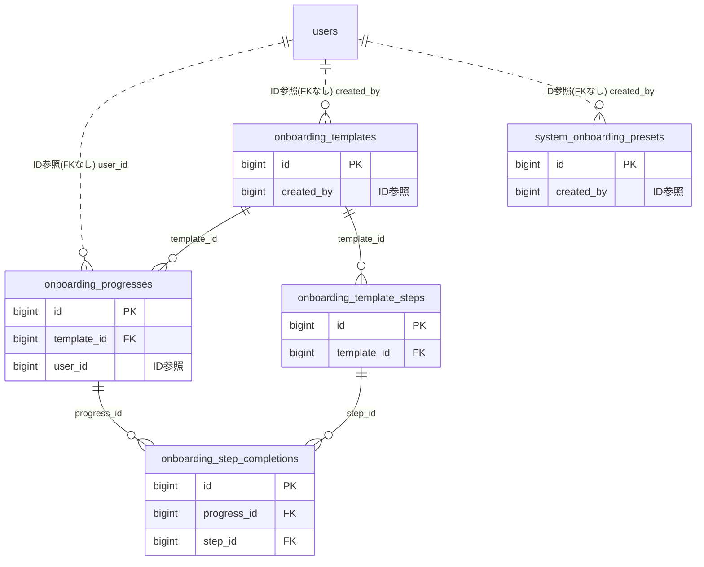

# onboarding ドメイン ER 図

> このファイルは自動生成されます。手で編集しないでください。再生成: `cd backend && ./gradlew generateErDiagrams`

- テーブル数: 5
- ビュー数: 0

## ER 図

実線 = 外部キー、点線 = ID参照(FKなし)。図中の `FK` は実外部キーの列だけ（ID参照列は `FK` を付けず "ID参照" と注記）。図にはキー列（PK / FK / 参照推定列 / 単一列 UNIQUE）のみを描く。全列は下の「テーブル定義」を参照。

## 被参照（他ドメインから）

このドメインのテーブルを参照している他ドメインの側（実 FK と ID参照のみ。多態参照と推定不能参照は含まない。同一ドメイン内の参照は上の図を参照）。

なし

## 多態参照（線を引かない）

| テーブル | 種別列 | ID列 |
| --- | --- | --- |
| `onboarding_progresses` | `scope_type` | `scope_id` |
| `onboarding_templates` | `scope_type` | `scope_id` |

## 推定不能参照

| テーブル | 列 | 理由 |
| --- | --- | --- |
| `onboarding_template_steps` | `reference_id` | 参照先テーブルを特定できない |
| `onboarding_templates` | `preset_id` | 参照先テーブルを特定できない |

## テーブル定義

### `onboarding_progresses`

| 列名 | 型 | NULL | 既定値 | コメント |
| --- | --- | --- | --- | --- |
| `id` | `bigint unsigned` | NO | （なし） auto_increment |  |
| `template_id` | `bigint unsigned` | NO | （なし） |  |
| `user_id` | `bigint unsigned` | NO | （なし） |  |
| `scope_type` | `varchar(20)` | NO | （なし） |  |
| `scope_id` | `bigint unsigned` | NO | （なし） |  |
| `status` | `varchar(20)` | NO | `IN_PROGRESS` |  |
| `total_steps` | `smallint` | NO | （なし） |  |
| `completed_steps` | `smallint` | NO | `0` |  |
| `deadline_at` | `datetime` | YES | NULL |  |
| `started_at` | `datetime` | NO | `CURRENT_TIMESTAMP` （式） |  |
| `completed_at` | `datetime` | YES | NULL |  |
| `last_reminded_at` | `datetime` | YES | NULL |  |
| `created_at` | `datetime` | NO | `CURRENT_TIMESTAMP` （式） |  |
| `updated_at` | `datetime` | NO | `CURRENT_TIMESTAMP` （式） |  |

### `onboarding_step_completions`

| 列名 | 型 | NULL | 既定値 | コメント |
| --- | --- | --- | --- | --- |
| `id` | `bigint unsigned` | NO | （なし） auto_increment |  |
| `progress_id` | `bigint unsigned` | NO | （なし） |  |
| `step_id` | `bigint unsigned` | NO | （なし） |  |
| `completion_type` | `varchar(20)` | NO | （なし） |  |
| `completed_at` | `datetime` | NO | `CURRENT_TIMESTAMP` （式） |  |
| `created_at` | `datetime` | NO | `CURRENT_TIMESTAMP` （式） |  |
| `updated_at` | `datetime` | NO | `CURRENT_TIMESTAMP` （式） |  |

### `onboarding_template_steps`

| 列名 | 型 | NULL | 既定値 | コメント |
| --- | --- | --- | --- | --- |
| `id` | `bigint unsigned` | NO | （なし） auto_increment |  |
| `template_id` | `bigint unsigned` | NO | （なし） |  |
| `title` | `varchar(100)` | NO | （なし） |  |
| `description` | `varchar(1000)` | YES | NULL |  |
| `step_type` | `varchar(20)` | NO | （なし） |  |
| `reference_id` | `bigint unsigned` | YES | NULL |  |
| `reference_url` | `varchar(500)` | YES | NULL |  |
| `deadline_offset_days` | `smallint` | YES | NULL |  |
| `sort_order` | `int` | NO | `0` |  |
| `created_at` | `datetime` | NO | `CURRENT_TIMESTAMP` （式） |  |
| `updated_at` | `datetime` | NO | `CURRENT_TIMESTAMP` （式） |  |

### `onboarding_templates`

| 列名 | 型 | NULL | 既定値 | コメント |
| --- | --- | --- | --- | --- |
| `id` | `bigint unsigned` | NO | （なし） auto_increment |  |
| `scope_type` | `varchar(20)` | NO | （なし） |  |
| `scope_id` | `bigint unsigned` | NO | （なし） |  |
| `name` | `varchar(100)` | NO | （なし） |  |
| `description` | `varchar(500)` | YES | NULL |  |
| `welcome_message` | `varchar(1000)` | YES | NULL |  |
| `status` | `varchar(20)` | NO | `DRAFT` |  |
| `is_order_enforced` | `tinyint(1)` | NO | `0` |  |
| `deadline_days` | `smallint` | YES | NULL |  |
| `reminder_days_before` | `smallint` | YES | `3` |  |
| `is_admin_notified_on_complete` | `tinyint(1)` | NO | `1` |  |
| `is_timeline_posted_on_complete` | `tinyint(1)` | NO | `0` |  |
| `preset_id` | `bigint unsigned` | YES | NULL |  |
| `created_by` | `bigint unsigned` | NO | （なし） |  |
| `version` | `bigint` | NO | `0` |  |
| `created_at` | `datetime` | NO | `CURRENT_TIMESTAMP` （式） |  |
| `updated_at` | `datetime` | NO | `CURRENT_TIMESTAMP` （式） |  |
| `deleted_at` | `datetime` | YES | NULL |  |

### `system_onboarding_presets`

| 列名 | 型 | NULL | 既定値 | コメント |
| --- | --- | --- | --- | --- |
| `id` | `bigint unsigned` | NO | （なし） auto_increment |  |
| `name` | `varchar(100)` | NO | （なし） |  |
| `description` | `varchar(500)` | YES | NULL |  |
| `category` | `varchar(30)` | NO | （なし） |  |
| `welcome_message` | `varchar(1000)` | YES | NULL |  |
| `is_order_enforced` | `tinyint(1)` | NO | `0` |  |
| `deadline_days` | `smallint` | YES | NULL |  |
| `steps_json` | `json` | NO | （なし） |  |
| `is_active` | `tinyint(1)` | NO | `1` |  |
| `sort_order` | `int` | NO | `0` |  |
| `created_by` | `bigint unsigned` | NO | （なし） |  |
| `version` | `bigint` | NO | `0` |  |
| `created_at` | `datetime` | NO | `CURRENT_TIMESTAMP` （式） |  |
| `updated_at` | `datetime` | NO | `CURRENT_TIMESTAMP` （式） |  |
| `deleted_at` | `datetime` | YES | NULL |  |
