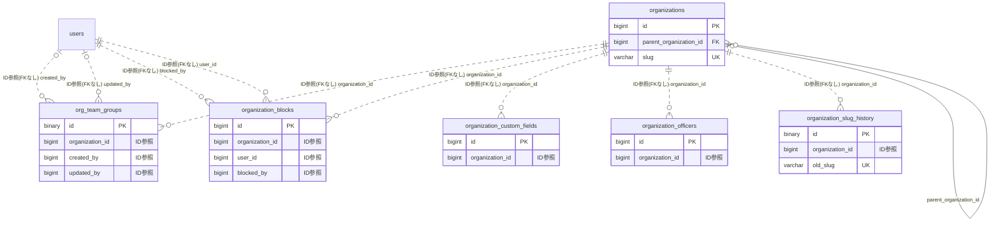

# organization ドメイン ER 図

> このファイルは自動生成されます。手で編集しないでください。再生成: `cd backend && ./gradlew generateErDiagrams`

- テーブル数: 6
- ビュー数: 0

## ER 図

実線 = 外部キー、点線 = ID参照(FKなし)。図中の `FK` は実外部キーの列だけ（ID参照列は `FK` を付けず "ID参照" と注記）。図にはキー列（PK / FK / 参照推定列 / 単一列 UNIQUE）のみを描く。全列は下の「テーブル定義」を参照。

## 被参照（他ドメインから）

このドメインのテーブルを参照している他ドメインの側（実 FK と ID参照のみ。多態参照と推定不能参照は含まない。同一ドメイン内の参照は上の図を参照）。

| 参照元ドメイン | 参照元テーブル | 列 | 種別 | 参照先テーブル |
| --- | --- | --- | --- | --- |
| [_unmapped](_unmapped.md) | `billing_customer_migrations` | `organization_id` | ID参照 | `organizations` |
| [_unmapped](_unmapped.md) | `billing_membership_price_adjustments` | `organization_id` | ID参照 | `organizations` |
| [_unmapped](_unmapped.md) | `notifications_archive` | `organization_id` | ID参照 | `organizations` |
| [actionmemo](actionmemo.md) | `action_memos` | `organization_id` | ID参照 | `organizations` |
| [auth](auth.md) | `audit_logs` | `organization_id` | ID参照 | `organizations` |
| [billing](billing.md) | `active_contract_pointers` | `organization_id` | ID参照 | `organizations` |
| [billing](billing.md) | `beta_grants` | `organization_id` | ID参照 | `organizations` |
| [billing](billing.md) | `billing_change_previews` | `organization_id` | ID参照 | `organizations` |
| [billing](billing.md) | `billing_contract_changes` | `organization_id` | ID参照 | `organizations` |
| [billing](billing.md) | `billing_contract_operations` | `organization_id` | ID参照 | `organizations` |
| [billing](billing.md) | `billing_contracts` | `organization_id` | ID参照 | `organizations` |
| [billing](billing.md) | `billing_customers` | `organization_id` | ID参照 | `organizations` |
| [billing](billing.md) | `billing_invoice_adjustments` | `organization_id` | ID参照 | `organizations` |
| [billing](billing.md) | `billing_invoice_lines` | `organization_id` | ID参照 | `organizations` |
| [billing](billing.md) | `billing_invoices` | `organization_id` | ID参照 | `organizations` |
| [billing](billing.md) | `billing_price_versions` | `organization_id` | ID参照 | `organizations` |
| [billing](billing.md) | `billing_quotes` | `organization_id` | ID参照 | `organizations` |
| [billing](billing.md) | `billing_return_state_nonces` | `organization_id` | ID参照 | `organizations` |
| [billing](billing.md) | `entitlements` | `organization_id` | ID参照 | `organizations` |
| [chat](chat.md) | `chat_channels` | `organization_id` | ID参照 | `organizations` |
| [cms](cms.md) | `blog_post_series` | `organization_id` | ID参照 | `organizations` |
| [cms](cms.md) | `blog_post_shares` | `organization_id` | ID参照 | `organizations` |
| [cms](cms.md) | `blog_posts` | `organization_id` | ID参照 | `organizations` |
| [cms](cms.md) | `blog_tags` | `organization_id` | ID参照 | `organizations` |
| [committee](committee.md) | `committees` | `organization_id` | ID参照 | `organizations` |
| [equipment](equipment.md) | `equipment_items` | `organization_id` | ID参照 | `organizations` |
| [errorreport](errorreport.md) | `error_reports` | `organization_id` | ID参照 | `organizations` |
| [event](event.md) | `event_delegations` | `organization_id` | ID参照 | `organizations` |
| [filesharing](filesharing.md) | `shared_folders` | `organization_id` | ID参照 | `organizations` |
| [gallery](gallery.md) | `photo_albums` | `organization_id` | ID参照 | `organizations` |
| [joinrequest](joinrequest.md) | `join_requests` | `organization_id` | ID参照 | `organizations` |
| [mail](mail.md) | `email_outbox` | `organization_id` | ID参照 | `organizations` |
| [match](match.md) | `matches` | `organization_id` | ID参照 | `organizations` |
| [member](member.md) | `member_profile_fields` | `organization_id` | ID参照 | `organizations` |
| [member](member.md) | `team_pages` | `organization_id` | ID参照 | `organizations` |
| [notification](notification.md) | `notification_credit_purchases` | `organization_id` | ID参照 | `organizations` |
| [notification](notification.md) | `notification_fanout_audiences` | `organization_id` | ID参照 | `organizations` |
| [notification](notification.md) | `notification_fanout_jobs` | `organization_id` | ID参照 | `organizations` |
| [notification](notification.md) | `notification_monthly_usage` | `organization_id` | ID参照 | `organizations` |
| [notification](notification.md) | `notifications` | `organization_id` | ID参照 | `organizations` |
| [notification](notification.md) | `organization_notification_balances` | `organization_id` | ID参照 | `organizations` |
| [payment](payment.md) | `connect_accounts` | `organization_id` | ID参照 | `organizations` |
| [payment](payment.md) | `escrow_transactions` | `organization_id` | ID参照 | `organizations` |
| [payment](payment.md) | `fee_policy_assignments` | `organization_id` | ID参照 | `organizations` |
| [payment](payment.md) | `fee_recovery_balances` | `organization_id` | ID参照 | `organizations` |
| [payment](payment.md) | `membership_subscriptions` | `organization_id` | ID参照 | `organizations` |
| [payment](payment.md) | `organization_access_requirements` | `organization_id` | ID参照 | `organizations` |
| [payment](payment.md) | `payment_beneficiary_settings` | `organization_id` | ID参照 | `organizations` |
| [payment](payment.md) | `payment_items` | `organization_id` | ID参照 | `organizations` |
| [payment](payment.md) | `payment_request_payment_attempts` | `organization_id` | ID参照 | `organizations` |
| [payment](payment.md) | `payment_requests` | `organization_id` | ID参照 | `organizations` |
| [payment](payment.md) | `team_payment_advances` | `organization_id` | ID参照 | `organizations` |
| [pointcard](pointcard.md) | `point_card_balance_events` | `organization_id` | ID参照 | `organizations` |
| [pointcard](pointcard.md) | `point_card_providers` | `organization_id` | ID参照 | `organizations` |
| [pointcard](pointcard.md) | `point_card_stamp_events` | `organization_id` | ID参照 | `organizations` |
| [provisioning](provisioning.md) | `provisioning_invitations` | `organization_id` | ID参照 | `organizations` |
| [proxy](proxy.md) | `proxy_input_consents` | `organization_id` | ID参照 | `organizations` |
| [proxyvote](proxyvote.md) | `proxy_vote_sessions` | `organization_id` | ID参照 | `organizations` |
| [publicview](publicview.md) | `organization_name_disclosure_change_logs` | `organization_id` | ID参照 | `organizations` |
| [repairplan](repairplan.md) | `board_handover_packs` | `organization_id` | ID参照 | `organizations` |
| [repairplan](repairplan.md) | `external_agent_delegations` | `organization_id` | ID参照 | `organizations` |
| [repairplan](repairplan.md) | `repair_plan_items` | `organization_id` | ID参照 | `organizations` |
| [repairplan](repairplan.md) | `repair_plan_templates` | `organization_id` | ID参照 | `organizations` |
| [repairplan](repairplan.md) | `repair_quote_cards` | `organization_id` | ID参照 | `organizations` |
| [repairplan](repairplan.md) | `repair_quote_kanbans` | `organization_id` | ID参照 | `organizations` |
| [repairplan](repairplan.md) | `repair_simulation_scenario_versions` | `organization_id` | ID参照 | `organizations` |
| [repairplan](repairplan.md) | `repair_simulation_scenarios` | `organization_id` | ID参照 | `organizations` |
| [repairplan](repairplan.md) | `team_member_terms` | `organization_id` | ID参照 | `organizations` |
| [residencestatus](residencestatus.md) | `annual_review_responses` | `organization_id` | ID参照 | `organizations` |
| [residencestatus](residencestatus.md) | `annual_reviews` | `organization_id` | ID参照 | `organizations` |
| [residencestatus](residencestatus.md) | `monitoring_committee_visits` | `organization_id` | ID参照 | `organizations` |
| [residencestatus](residencestatus.md) | `org_wide_safety_checks` | `organization_id` | ID参照 | `organizations` |
| [residencestatus](residencestatus.md) | `resident_activity_snapshots` | `organization_id` | ID参照 | `organizations` |
| [resident](resident.md) | `dwelling_units` | `organization_id` | ID参照 | `organizations` |
| [role](role.md) | `invite_tokens` | `organization_id` | ID参照 | `organizations` |
| [role](role.md) | `ownership_transfer_offers` | `organization_id` | ID参照 | `organizations` |
| [role](role.md) | `permission_groups` | `organization_id` | ID参照 | `organizations` |
| [role](role.md) | `user_roles` | `organization_id` | ID参照 | `organizations` |
| [schedule](schedule.md) | `schedule_annual_copy_logs` | `organization_id` | ID参照 | `organizations` |
| [schedule](schedule.md) | `schedule_delegations` | `organization_id` | ID参照 | `organizations` |
| [schedule](schedule.md) | `schedule_event_categories` | `organization_id` | ID参照 | `organizations` |
| [schedule](schedule.md) | `schedule_keeps` | `organization_id` | ID参照 | `organizations` |
| [schedule](schedule.md) | `schedule_scheduled_tasks` | `organization_id` | ID参照 | `organizations` |
| [schedule](schedule.md) | `schedules` | `organization_id` | ID参照 | `organizations` |
| [school](school.md) | `attendance_requirement_rules` | `organization_id` | ID参照 | `organizations` |
| [service](service.md) | `service_record_templates` | `organization_id` | ID参照 | `organizations` |
| [shiftbudget](shiftbudget.md) | `shift_budget_allocations` | `organization_id` | ID参照 | `organizations` |
| [shiftbudget](shiftbudget.md) | `shift_budget_failed_events` | `organization_id` | ID参照 | `organizations` |
| [social](social.md) | `social_notification_outbox` | `organization_id` | ID参照 | `organizations` |
| [succession](succession.md) | `delinquency_escalations` | `organization_id` | ID参照 | `organizations` |
| [succession](succession.md) | `legal_filings` | `organization_id` | ID参照 | `organizations` |
| [succession](succession.md) | `succession_covenants` | `organization_id` | ID参照 | `organizations` |
| [succession](succession.md) | `succession_pre_registrations` | `organization_id` | ID参照 | `organizations` |
| [succession](succession.md) | `unseal_audit_views` | `organization_id` | ID参照 | `organizations` |
| [succession](succession.md) | `unseal_requests` | `organization_id` | ID参照 | `organizations` |
| [team](team.md) | `team_notification_outbox` | `organization_id` | ID参照 | `organizations` |
| [team](team.md) | `team_org_affiliation_restrictions` | `organization_id` | ID参照 | `organizations` |
| [team](team.md) | `team_org_memberships` | `organization_id` | ID参照 | `organizations` |
| [template](template.md) | `organization_enabled_modules` | `organization_id` | ID参照 | `organizations` |
| [timetable](timetable.md) | `timetable_period_templates` | `organization_id` | ID参照 | `organizations` |
| [timetable](timetable.md) | `timetable_terms` | `organization_id` | ID参照 | `organizations` |
| [tournament](tournament.md) | `league_transfer` | `from_organization_id` | ID参照 | `organizations` |
| [tournament](tournament.md) | `league_transfer` | `to_organization_id` | ID参照 | `organizations` |
| [tournament](tournament.md) | `tournament_fee` | `organization_id` | ID参照 | `organizations` |
| [tournament](tournament.md) | `tournament_submission_requirement` | `organization_id` | ID参照 | `organizations` |
| [tournament](tournament.md) | `tournament_templates` | `organization_id` | ID参照 | `organizations` |
| [tournament](tournament.md) | `tournaments` | `organization_id` | ID参照 | `organizations` |

## 自己参照

mermaid は同一テーブルの自己参照を複数描けず 1 本に畳むため、図に線が欠けることがある。自己参照はこの表を正とする。

| テーブル | 列 | 種別 |
| --- | --- | --- |
| `organizations` | `parent_organization_id` | 外部キー |

## テーブル定義

### `org_team_groups`

| 列名 | 型 | NULL | 既定値 | コメント |
| --- | --- | --- | --- | --- |
| `id` | `binary(16)` | NO | （なし） | UUIDv7 |
| `organization_id` | `bigint unsigned` | NO | （なし） | 組織ID（クロスドメインFKなし） |
| `name` | `varchar(50)` | NO | （なし） | 表示名 |
| `description` | `varchar(200)` | YES | NULL | 補足説明 |
| `sort_order` | `int` | NO | （なし） | 並び順（昇順） |
| `created_by` | `bigint unsigned` | YES | NULL |  |
| `updated_by` | `bigint unsigned` | YES | NULL |  |
| `created_at` | `datetime` | NO | `CURRENT_TIMESTAMP` （式） |  |
| `updated_at` | `datetime` | NO | `CURRENT_TIMESTAMP` （式） |  |
| `deleted_at` | `datetime` | YES | NULL |  |
| `active_name` | `varchar(50)` | YES | NULL | 生存行だけの名前（一意制約用の生成列） |

### `organization_blocks`

| 列名 | 型 | NULL | 既定値 | コメント |
| --- | --- | --- | --- | --- |
| `id` | `bigint unsigned` | NO | （なし） auto_increment |  |
| `organization_id` | `bigint unsigned` | NO | （なし） |  |
| `user_id` | `bigint unsigned` | NO | （なし） |  |
| `blocked_by` | `bigint unsigned` | NO | （なし） |  |
| `reason` | `varchar(500)` | YES | NULL |  |
| `created_at` | `datetime` | NO | （なし） |  |

### `organization_custom_fields`

| 列名 | 型 | NULL | 既定値 | コメント |
| --- | --- | --- | --- | --- |
| `id` | `bigint unsigned` | NO | （なし） auto_increment |  |
| `organization_id` | `bigint unsigned` | NO | （なし） | FK → organizations |
| `label` | `varchar(100)` | NO | （なし） | 項目ラベル |
| `value` | `text` | NO | （なし） | 項目値（最大1000文字） |
| `display_order` | `int unsigned` | NO | `0` | 並び順 |
| `is_visible` | `tinyint(1)` | NO | `1` | 個別表示可否 |
| `created_at` | `datetime` | NO | `CURRENT_TIMESTAMP` （式） |  |
| `updated_at` | `datetime` | NO | `CURRENT_TIMESTAMP` （式） |  |

### `organization_officers`

| 列名 | 型 | NULL | 既定値 | コメント |
| --- | --- | --- | --- | --- |
| `id` | `bigint unsigned` | NO | （なし） auto_increment |  |
| `organization_id` | `bigint unsigned` | NO | （なし） | FK → organizations |
| `name` | `varchar(100)` | NO | （なし） | 役員名 |
| `title` | `varchar(100)` | NO | （なし） | 役職名 |
| `display_order` | `int unsigned` | NO | `0` | 並び順 |
| `is_visible` | `tinyint(1)` | NO | `1` | 個別表示可否 |
| `created_at` | `datetime` | NO | `CURRENT_TIMESTAMP` （式） |  |
| `updated_at` | `datetime` | NO | `CURRENT_TIMESTAMP` （式） |  |

### `organization_slug_history`

| 列名 | 型 | NULL | 既定値 | コメント |
| --- | --- | --- | --- | --- |
| `id` | `binary(16)` | NO | （なし） | UUIDv7（原則6） |
| `organization_id` | `bigint unsigned` | NO | （なし） | リネーム対象組織（organizations.id・FK なし／原則1） |
| `old_slug` | `varchar(30)` | NO | （なし） | リネーム前の旧 slug（恒久予約・301 解決のキー） |
| `created_at` | `datetime` | NO | `CURRENT_TIMESTAMP` （式） | リネーム実施日時 |

### `organizations`

| 列名 | 型 | NULL | 既定値 | コメント |
| --- | --- | --- | --- | --- |
| `id` | `bigint unsigned` | NO | （なし） auto_increment |  |
| `name` | `varchar(100)` | NO | （なし） |  |
| `icon_url` | `varchar(512)` | YES | NULL | アイコン画像R2キー |
| `banner_url` | `varchar(512)` | YES | NULL | バナー画像R2キー |
| `name_kana` | `varchar(100)` | YES | NULL |  |
| `nickname1` | `varchar(50)` | YES | NULL |  |
| `nickname2` | `varchar(50)` | YES | NULL |  |
| `org_type` | `enum('GOVERNMENT','MUNICIPALITY','COMPANY','HOSPITAL','ASSOCIATION','SCHOOL','NPO','COMMUNITY','OTHER')` | NO | `OTHER` |  |
| `parent_organization_id` | `bigint unsigned` | YES | NULL |  |
| `prefecture` | `varchar(20)` | YES | NULL |  |
| `city` | `varchar(50)` | YES | NULL |  |
| `visibility` | `varchar(20)` | NO | `PUBLIC` |  |
| `hierarchy_visibility` | `varchar(20)` | NO | `NONE` |  |
| `supporter_enabled` | `tinyint(1)` | NO | `1` |  |
| `version` | `bigint` | NO | `0` |  |
| `archived_at` | `datetime` | YES | NULL |  |
| `deleted_at` | `datetime` | YES | NULL |  |
| `created_at` | `datetime` | NO | （なし） |  |
| `updated_at` | `datetime` | NO | （なし） |  |
| `homepage_url` | `varchar(512)` | YES | NULL | ホームページURL（http/https のみ） |
| `established_date` | `date` | YES | NULL | 設立年月日（日不明時は01で埋める） |
| `established_date_precision` | `enum('YEAR','YEAR_MONTH','FULL')` | YES | NULL | 設立日精度 |
| `philosophy` | `text` | YES | NULL | 組織理念・フィロソフィー（最大2000文字） |
| `profile_visibility` | `json` | YES | NULL | プロフィール項目ごとの公開可否フラグ |
| `supporter_name_disclosure` | `enum('DISPLAY_NAME','REAL_NAME')` | NO | `DISPLAY_NAME` | サポーター向け氏名表示モード（F19.1 Phase 2 で機能活性化、Phase 1 ではカラム追加のみ） |
| `map_embed_url` | `varchar(2048)` | YES | NULL | Google Maps 等の埋め込み URL（F19.1 Phase 1 で organizations の公開ページに表示） |
| `elderly_care_threshold_age` | `tinyint` | NO | `75` | 高齢ケア提案のしきい値年齢（組織別カスタマイズ可） |
| `timeline_posts_public` | `tinyint(1)` | NO | `0` | タイムライン投稿を公開ページに表示するか |
| `public_events_enabled` | `tinyint(1)` | NO | `0` | イベントを公開ページに表示するか（当初「常時公開」としていたが 2026-05-23 方針変更） |
| `slug` | `varchar(30)` | NO | （なし） |  |
| `lifecycle_status` | `varchar(20)` | NO | `ACTIVE` | PROVISIONED/ACTIVE。承諾前の事前作成状態 |
| `name_trimmed` | `varchar(100)` | YES | NULL | 柱③-A 同名確認フロー用: TRIM(name)の生成列（索引対象） |
| `team_application_enabled` | `tinyint(1)` | NO | `0` | チームからの加盟申請を受け付けるか（既定 off） |
| `team_groups_enabled` | `tinyint(1)` | NO | `0` | チームグループ機能を使うか |
| `team_application_group_mode` | `varchar(10)` | NO | `OFF` | 申請時のグループ選択: OFF / OPTIONAL / REQUIRED |
| `team_application_guidance` | `varchar(500)` | YES | NULL | 申請フォームに表示する案内文 |
| `closure_generation` | `bigint` | NO | `0` | 閉鎖の世代番号。アーカイブ・論理削除のたびに +1（解除・復元では変えない） |
