# parking ドメイン ER 図

> このファイルは自動生成されます。手で編集しないでください。再生成: `cd backend && ./gradlew generateErDiagrams`

- テーブル数: 14
- ビュー数: 0

## ER 図

実線 = 外部キー、点線 = ID参照(FKなし)。図中の `FK` は実外部キーの列だけ（ID参照列は `FK` を付けず "ID参照" と注記）。図にはキー列（PK / FK / 参照推定列 / 単一列 UNIQUE）のみを描く。全列は下の「テーブル定義」を参照。

```mermaid
erDiagram
    parking_applications {
        bigint id PK
        bigint user_id "ID参照"
        bigint proxy_input_record_id "ID参照"
    }
    parking_assignments {
        bigint id PK
        bigint user_id "ID参照"
        bigint assigned_by "ID参照"
        bigint released_by "ID参照"
    }
    parking_listings {
        bigint id PK
        bigint listed_by "ID参照"
        bigint transferee_user_id "ID参照"
    }
    parking_settings {
        bigint id PK
    }
    parking_space_price_history {
        bigint id PK
        bigint changed_by "ID参照"
    }
    parking_spaces {
        bigint id PK
        bigint created_by "ID参照"
    }
    parking_sublease_applications {
        bigint id PK
        bigint user_id "ID参照"
    }
    parking_sublease_payments {
        bigint id PK
        bigint payer_user_id "ID参照"
        bigint payee_user_id "ID参照"
    }
    parking_subleases {
        bigint id PK
        bigint offered_by "ID参照"
    }
    parking_visitor_recurring {
        bigint id PK
        bigint user_id "ID参照"
    }
    parking_visitor_reservations {
        bigint id PK
        bigint reserved_by "ID参照"
        bigint approved_by "ID参照"
    }
    parking_watchlist {
        bigint id PK
        bigint user_id "ID参照"
    }
    registered_vehicles {
        bigint id PK
        bigint user_id "ID参照"
    }
    stripe_connect_accounts {
        bigint id PK
        bigint user_id UK "ID参照"
        varchar stripe_account_id UK
    }
    proxy_input_records
    users
    proxy_input_records |o..o{ parking_applications : "ID参照(FKなし) proxy_input_record_id"
    users ||..o{ parking_applications : "ID参照(FKなし) user_id"
    users ||..o{ parking_assignments : "ID参照(FKなし) assigned_by"
    users |o..o{ parking_assignments : "ID参照(FKなし) released_by"
    users ||..o{ parking_assignments : "ID参照(FKなし) user_id"
    users ||..o{ parking_listings : "ID参照(FKなし) listed_by"
    users |o..o{ parking_listings : "ID参照(FKなし) transferee_user_id"
    users ||..o{ parking_space_price_history : "ID参照(FKなし) changed_by"
    users ||..o{ parking_spaces : "ID参照(FKなし) created_by"
    users ||..o{ parking_sublease_applications : "ID参照(FKなし) user_id"
    users ||..o{ parking_sublease_payments : "ID参照(FKなし) payee_user_id"
    users ||..o{ parking_sublease_payments : "ID参照(FKなし) payer_user_id"
    users ||..o{ parking_subleases : "ID参照(FKなし) offered_by"
    users ||..o{ parking_visitor_recurring : "ID参照(FKなし) user_id"
    users |o..o{ parking_visitor_reservations : "ID参照(FKなし) approved_by"
    users ||..o{ parking_visitor_reservations : "ID参照(FKなし) reserved_by"
    users ||..o{ parking_watchlist : "ID参照(FKなし) user_id"
    users ||..o{ registered_vehicles : "ID参照(FKなし) user_id"
    users ||..o| stripe_connect_accounts : "ID参照(FKなし) user_id"
```

## 被参照（他ドメインから）

このドメインのテーブルを参照している他ドメインの側（実 FK と ID参照のみ。多態参照と推定不能参照は含まない。同一ドメイン内の参照は上の図を参照）。

なし

## 多態参照（線を引かない）

| テーブル | 種別列 | ID列 |
| --- | --- | --- |
| `parking_settings` | `scope_type` | `scope_id` |
| `parking_spaces` | `scope_type` | `scope_id` |
| `parking_visitor_recurring` | `scope_type` | `scope_id` |
| `parking_watchlist` | `scope_type` | `scope_id` |

## 推定不能参照

| テーブル | 列 | 理由 |
| --- | --- | --- |
| `parking_applications` | `listing_id` | 参照先テーブルを特定できない |
| `parking_applications` | `space_id` | 参照先テーブルを特定できない |
| `parking_applications` | `vehicle_id` | 参照先テーブルを特定できない |
| `parking_assignments` | `space_id` | 参照先テーブルを特定できない |
| `parking_assignments` | `vehicle_id` | 参照先テーブルを特定できない |
| `parking_listings` | `assignment_id` | 参照先テーブルを特定できない |
| `parking_listings` | `space_id` | 参照先テーブルを特定できない |
| `parking_listings` | `transferee_vehicle_id` | 参照先テーブルを特定できない |
| `parking_space_price_history` | `space_id` | 参照先テーブルを特定できない |
| `parking_sublease_applications` | `sublease_id` | 参照先テーブルを特定できない |
| `parking_sublease_applications` | `vehicle_id` | 参照先テーブルを特定できない |
| `parking_sublease_payments` | `stripe_payment_intent_id` | 参照先テーブルを特定できない |
| `parking_sublease_payments` | `stripe_transfer_id` | 参照先テーブルを特定できない |
| `parking_sublease_payments` | `sublease_id` | 参照先テーブルを特定できない |
| `parking_subleases` | `assignment_id` | 参照先テーブルを特定できない |
| `parking_subleases` | `matched_application_id` | 参照先テーブルを特定できない |
| `parking_subleases` | `space_id` | 参照先テーブルを特定できない |
| `parking_visitor_recurring` | `space_id` | 参照先テーブルを特定できない |
| `parking_visitor_reservations` | `space_id` | 参照先テーブルを特定できない |
| `stripe_connect_accounts` | `stripe_account_id` | 参照先テーブルを特定できない |

## テーブル定義

### `parking_applications`

| 列名 | 型 | NULL | 既定値 | コメント |
| --- | --- | --- | --- | --- |
| `id` | `bigint unsigned` | NO | （なし） auto_increment |  |
| `space_id` | `bigint unsigned` | NO | （なし） |  |
| `user_id` | `bigint unsigned` | NO | （なし） |  |
| `vehicle_id` | `bigint unsigned` | NO | （なし） |  |
| `source_type` | `enum('VACANCY','LISTING')` | NO | `VACANCY` |  |
| `listing_id` | `bigint unsigned` | YES | NULL |  |
| `status` | `enum('PENDING','APPROVED','REJECTED','CANCELLED','LOTTERY_PENDING')` | NO | `PENDING` |  |
| `priority` | `smallint unsigned` | NO | `0` |  |
| `message` | `varchar(500)` | YES | NULL |  |
| `is_proxy_input` | `tinyint(1)` | NO | `0` | 代理入力フラグ（0=本人, 1=代理） |
| `proxy_input_record_id` | `bigint unsigned` | YES | NULL | 代理入力記録ID（proxy_input_records.id） |
| `rejection_reason` | `varchar(500)` | YES | NULL |  |
| `lottery_number` | `int unsigned` | YES | NULL |  |
| `decided_at` | `datetime` | YES | NULL |  |
| `created_at` | `datetime` | NO | `CURRENT_TIMESTAMP` （式） |  |
| `updated_at` | `datetime` | NO | `CURRENT_TIMESTAMP` （式） |  |

### `parking_assignments`

| 列名 | 型 | NULL | 既定値 | コメント |
| --- | --- | --- | --- | --- |
| `id` | `bigint unsigned` | NO | （なし） auto_increment |  |
| `space_id` | `bigint unsigned` | NO | （なし） |  |
| `vehicle_id` | `bigint unsigned` | YES | NULL |  |
| `user_id` | `bigint unsigned` | NO | （なし） |  |
| `assigned_by` | `bigint unsigned` | NO | （なし） |  |
| `assigned_at` | `datetime` | NO | `CURRENT_TIMESTAMP` （式） |  |
| `contract_start_date` | `date` | YES | NULL |  |
| `contract_end_date` | `date` | YES | NULL |  |
| `released_at` | `datetime` | YES | NULL |  |
| `released_by` | `bigint unsigned` | YES | NULL |  |
| `release_reason` | `varchar(200)` | YES | NULL |  |
| `created_at` | `datetime` | NO | `CURRENT_TIMESTAMP` （式） |  |
| `updated_at` | `datetime` | NO | `CURRENT_TIMESTAMP` （式） |  |

### `parking_listings`

| 列名 | 型 | NULL | 既定値 | コメント |
| --- | --- | --- | --- | --- |
| `id` | `bigint unsigned` | NO | （なし） auto_increment |  |
| `space_id` | `bigint unsigned` | NO | （なし） |  |
| `assignment_id` | `bigint unsigned` | NO | （なし） |  |
| `listed_by` | `bigint unsigned` | NO | （なし） |  |
| `reason` | `varchar(500)` | YES | NULL |  |
| `desired_transfer_date` | `date` | YES | NULL |  |
| `status` | `enum('OPEN','RESERVED','TRANSFERRED','CANCELLED')` | NO | `OPEN` |  |
| `transferee_user_id` | `bigint unsigned` | YES | NULL |  |
| `transferee_vehicle_id` | `bigint unsigned` | YES | NULL |  |
| `transferred_at` | `datetime` | YES | NULL |  |
| `created_at` | `datetime` | NO | `CURRENT_TIMESTAMP` （式） |  |
| `updated_at` | `datetime` | NO | `CURRENT_TIMESTAMP` （式） |  |
| `deleted_at` | `datetime` | YES | NULL |  |

### `parking_settings`

| 列名 | 型 | NULL | 既定値 | コメント |
| --- | --- | --- | --- | --- |
| `id` | `bigint unsigned` | NO | （なし） auto_increment |  |
| `scope_type` | `varchar(20)` | NO | （なし） |  |
| `scope_id` | `bigint unsigned` | NO | （なし） |  |
| `max_spaces_per_user` | `smallint unsigned` | NO | `1` |  |
| `max_visitor_reservations_per_day` | `smallint unsigned` | NO | `2` |  |
| `visitor_reservation_max_days_ahead` | `smallint unsigned` | NO | `30` |  |
| `visitor_reservation_requires_approval` | `tinyint(1)` | NO | `1` |  |
| `created_at` | `datetime` | NO | `CURRENT_TIMESTAMP` （式） |  |
| `updated_at` | `datetime` | NO | `CURRENT_TIMESTAMP` （式） |  |

### `parking_space_price_history`

| 列名 | 型 | NULL | 既定値 | コメント |
| --- | --- | --- | --- | --- |
| `id` | `bigint unsigned` | NO | （なし） auto_increment |  |
| `space_id` | `bigint unsigned` | NO | （なし） |  |
| `old_price` | `decimal(10,0)` | YES | NULL |  |
| `new_price` | `decimal(10,0)` | YES | NULL |  |
| `changed_by` | `bigint unsigned` | NO | （なし） |  |
| `changed_at` | `datetime` | NO | `CURRENT_TIMESTAMP` （式） |  |
| `created_at` | `datetime` | NO | `CURRENT_TIMESTAMP` （式） |  |
| `updated_at` | `datetime` | NO | `CURRENT_TIMESTAMP` （式） |  |

### `parking_spaces`

| 列名 | 型 | NULL | 既定値 | コメント |
| --- | --- | --- | --- | --- |
| `id` | `bigint unsigned` | NO | （なし） auto_increment |  |
| `scope_type` | `varchar(20)` | NO | （なし） |  |
| `scope_id` | `bigint unsigned` | NO | （なし） |  |
| `space_number` | `varchar(20)` | NO | （なし） |  |
| `space_type` | `enum('INDOOR','OUTDOOR','ACCESSIBLE','MOTORCYCLE','BICYCLE','VISITOR','OTHER')` | NO | （なし） |  |
| `space_type_label` | `varchar(50)` | YES | NULL |  |
| `price_per_month` | `decimal(10,0)` | YES | NULL |  |
| `status` | `enum('VACANT','OCCUPIED','MAINTENANCE')` | NO | `VACANT` |  |
| `floor` | `varchar(10)` | YES | NULL |  |
| `notes` | `varchar(500)` | YES | NULL |  |
| `application_status` | `enum('NOT_ACCEPTING','ACCEPTING','LOTTERY_CLOSED')` | NO | `NOT_ACCEPTING` |  |
| `allocation_method` | `enum('FIRST_COME','LOTTERY')` | YES | NULL |  |
| `application_deadline` | `datetime` | YES | NULL |  |
| `created_by` | `bigint unsigned` | NO | （なし） |  |
| `created_at` | `datetime` | NO | `CURRENT_TIMESTAMP` （式） |  |
| `updated_at` | `datetime` | NO | `CURRENT_TIMESTAMP` （式） |  |
| `deleted_at` | `datetime` | YES | NULL |  |

### `parking_sublease_applications`

| 列名 | 型 | NULL | 既定値 | コメント |
| --- | --- | --- | --- | --- |
| `id` | `bigint unsigned` | NO | （なし） auto_increment |  |
| `sublease_id` | `bigint unsigned` | NO | （なし） |  |
| `user_id` | `bigint unsigned` | NO | （なし） |  |
| `vehicle_id` | `bigint unsigned` | NO | （なし） |  |
| `message` | `varchar(500)` | YES | NULL |  |
| `status` | `enum('PENDING','APPROVED','REJECTED','CANCELLED')` | NO | `PENDING` |  |
| `decided_at` | `datetime` | YES | NULL |  |
| `created_at` | `datetime` | NO | `CURRENT_TIMESTAMP` （式） |  |
| `updated_at` | `datetime` | NO | `CURRENT_TIMESTAMP` （式） |  |

### `parking_sublease_payments`

| 列名 | 型 | NULL | 既定値 | コメント |
| --- | --- | --- | --- | --- |
| `id` | `bigint unsigned` | NO | （なし） auto_increment |  |
| `sublease_id` | `bigint unsigned` | NO | （なし） |  |
| `payer_user_id` | `bigint unsigned` | NO | （なし） |  |
| `payee_user_id` | `bigint unsigned` | NO | （なし） |  |
| `amount` | `decimal(10,0)` | NO | （なし） |  |
| `stripe_fee` | `decimal(10,0)` | NO | （なし） |  |
| `platform_fee` | `decimal(10,0)` | NO | （なし） |  |
| `platform_fee_rate` | `decimal(5,4)` | NO | （なし） |  |
| `net_amount` | `decimal(10,0)` | NO | （なし） |  |
| `billing_month` | `char(7)` | NO | （なし） |  |
| `stripe_payment_intent_id` | `varchar(100)` | YES | NULL |  |
| `stripe_transfer_id` | `varchar(100)` | YES | NULL |  |
| `status` | `enum('PENDING','SUCCEEDED','FAILED','REFUNDED')` | NO | `PENDING` |  |
| `failed_reason` | `varchar(500)` | YES | NULL |  |
| `paid_at` | `datetime` | YES | NULL |  |
| `created_at` | `datetime` | NO | `CURRENT_TIMESTAMP` （式） |  |
| `updated_at` | `datetime` | NO | `CURRENT_TIMESTAMP` （式） |  |

### `parking_subleases`

| 列名 | 型 | NULL | 既定値 | コメント |
| --- | --- | --- | --- | --- |
| `id` | `bigint unsigned` | NO | （なし） auto_increment |  |
| `space_id` | `bigint unsigned` | NO | （なし） |  |
| `assignment_id` | `bigint unsigned` | NO | （なし） |  |
| `offered_by` | `bigint unsigned` | NO | （なし） |  |
| `title` | `varchar(100)` | NO | （なし） |  |
| `description` | `text` | YES | NULL |  |
| `price_per_month` | `decimal(10,0)` | NO | （なし） |  |
| `payment_method` | `enum('DIRECT','STRIPE')` | NO | `DIRECT` |  |
| `available_from` | `date` | NO | （なし） |  |
| `available_to` | `date` | YES | NULL |  |
| `status` | `enum('OPEN','MATCHED','CANCELLED')` | NO | `OPEN` |  |
| `matched_application_id` | `bigint unsigned` | YES | NULL |  |
| `created_at` | `datetime` | NO | `CURRENT_TIMESTAMP` （式） |  |
| `updated_at` | `datetime` | NO | `CURRENT_TIMESTAMP` （式） |  |
| `deleted_at` | `datetime` | YES | NULL |  |

### `parking_visitor_recurring`

| 列名 | 型 | NULL | 既定値 | コメント |
| --- | --- | --- | --- | --- |
| `id` | `bigint unsigned` | NO | （なし） auto_increment |  |
| `user_id` | `bigint unsigned` | NO | （なし） |  |
| `space_id` | `bigint unsigned` | NO | （なし） |  |
| `scope_type` | `varchar(20)` | NO | （なし） |  |
| `scope_id` | `bigint unsigned` | NO | （なし） |  |
| `recurrence_type` | `enum('WEEKLY','BIWEEKLY','MONTHLY')` | NO | （なし） |  |
| `day_of_week` | `tinyint unsigned` | YES | NULL |  |
| `day_of_month` | `tinyint unsigned` | YES | NULL |  |
| `time_from` | `time` | NO | （なし） |  |
| `time_to` | `time` | NO | （なし） |  |
| `visitor_name` | `varchar(100)` | YES | NULL |  |
| `visitor_plate_number` | `varchar(30)` | YES | NULL |  |
| `purpose` | `varchar(200)` | YES | NULL |  |
| `is_active` | `tinyint(1)` | NO | `1` |  |
| `next_generate_date` | `date` | NO | （なし） |  |
| `created_at` | `datetime` | NO | `CURRENT_TIMESTAMP` （式） |  |
| `updated_at` | `datetime` | NO | `CURRENT_TIMESTAMP` （式） |  |

### `parking_visitor_reservations`

| 列名 | 型 | NULL | 既定値 | コメント |
| --- | --- | --- | --- | --- |
| `id` | `bigint unsigned` | NO | （なし） auto_increment |  |
| `space_id` | `bigint unsigned` | NO | （なし） |  |
| `reserved_by` | `bigint unsigned` | NO | （なし） |  |
| `visitor_name` | `varchar(100)` | YES | NULL |  |
| `visitor_plate_number` | `varchar(30)` | YES | NULL |  |
| `reserved_date` | `date` | NO | （なし） |  |
| `time_from` | `time` | NO | （なし） |  |
| `time_to` | `time` | NO | （なし） |  |
| `purpose` | `varchar(200)` | YES | NULL |  |
| `admin_comment` | `varchar(500)` | YES | NULL |  |
| `approved_by` | `bigint unsigned` | YES | NULL |  |
| `approved_at` | `datetime` | YES | NULL |  |
| `status` | `enum('PENDING_APPROVAL','CONFIRMED','CHECKED_IN','COMPLETED','CANCELLED','REJECTED','NO_SHOW')` | NO | `PENDING_APPROVAL` |  |
| `created_at` | `datetime` | NO | `CURRENT_TIMESTAMP` （式） |  |
| `updated_at` | `datetime` | NO | `CURRENT_TIMESTAMP` （式） |  |

### `parking_watchlist`

| 列名 | 型 | NULL | 既定値 | コメント |
| --- | --- | --- | --- | --- |
| `id` | `bigint unsigned` | NO | （なし） auto_increment |  |
| `user_id` | `bigint unsigned` | NO | （なし） |  |
| `scope_type` | `varchar(20)` | NO | （なし） |  |
| `scope_id` | `bigint unsigned` | NO | （なし） |  |
| `space_type` | `enum('INDOOR','OUTDOOR','ACCESSIBLE','MOTORCYCLE','BICYCLE','OTHER')` | YES | NULL |  |
| `floor` | `varchar(10)` | YES | NULL |  |
| `max_price` | `decimal(10,0)` | YES | NULL |  |
| `is_active` | `tinyint(1)` | NO | `1` |  |
| `created_at` | `datetime` | NO | `CURRENT_TIMESTAMP` （式） |  |
| `updated_at` | `datetime` | NO | `CURRENT_TIMESTAMP` （式） |  |

### `registered_vehicles`

| 列名 | 型 | NULL | 既定値 | コメント |
| --- | --- | --- | --- | --- |
| `id` | `bigint unsigned` | NO | （なし） auto_increment |  |
| `user_id` | `bigint unsigned` | NO | （なし） |  |
| `vehicle_type` | `enum('CAR','MOTORCYCLE','BICYCLE')` | NO | （なし） |  |
| `plate_number` | `varbinary(512)` | NO | （なし） |  |
| `plate_number_hash` | `char(64)` | NO | （なし） |  |
| `nickname` | `varchar(50)` | YES | NULL |  |
| `created_at` | `datetime` | NO | `CURRENT_TIMESTAMP` （式） |  |
| `updated_at` | `datetime` | NO | `CURRENT_TIMESTAMP` （式） |  |
| `deleted_at` | `datetime` | YES | NULL |  |

### `stripe_connect_accounts`

| 列名 | 型 | NULL | 既定値 | コメント |
| --- | --- | --- | --- | --- |
| `id` | `bigint unsigned` | NO | （なし） auto_increment |  |
| `user_id` | `bigint unsigned` | NO | （なし） |  |
| `stripe_account_id` | `varchar(100)` | NO | （なし） |  |
| `charges_enabled` | `tinyint(1)` | NO | `0` |  |
| `payouts_enabled` | `tinyint(1)` | NO | `0` |  |
| `onboarding_completed` | `tinyint(1)` | NO | `0` |  |
| `created_at` | `datetime` | NO | `CURRENT_TIMESTAMP` （式） |  |
| `updated_at` | `datetime` | NO | `CURRENT_TIMESTAMP` （式） |  |
