# payment ドメイン ER 図

> このファイルは自動生成されます。手で編集しないでください。再生成: `cd backend && ./gradlew generateErDiagrams`

- テーブル数: 22
- ビュー数: 0

## ER 図

実線 = 外部キー、点線 = ID参照(FKなし)。図中の `FK` は実外部キーの列だけ（ID参照列は `FK` を付けず "ID参照" と注記）。図にはキー列（PK / FK / 参照推定列 / 単一列 UNIQUE）のみを描く。全列は下の「テーブル定義」を参照。

```mermaid
erDiagram
    connect_accounts {
        binary id PK
        bigint organization_id "ID参照"
        varchar stripe_account_id UK
    }
    content_payment_gates {
        bigint id PK
        bigint payment_item_id FK
        bigint created_by "ID参照"
    }
    escrow_transactions {
        binary id PK
        binary payee_connect_account_id "ID参照"
        bigint organization_id "ID参照"
        varchar stripe_payment_intent_id UK
        varchar stripe_idempotency_key UK
    }
    fee_policies {
        varchar policy_key PK
    }
    fee_policy_assignments {
        binary id PK
        bigint organization_id "ID参照"
    }
    fee_recovery_balances {
        binary id PK
        binary connect_account_id "ID参照"
        bigint organization_id "ID参照"
    }
    ledger_entries {
        binary id PK
        binary escrow_transaction_id FK
    }
    member_payments {
        bigint id PK
        bigint user_id "ID参照"
        bigint payment_item_id FK
        varchar stripe_checkout_session_id UK
        varchar stripe_payment_intent_id UK
        bigint recorded_by "ID参照"
        varchar stripe_refund_id UK
        bigint payer_user_id "ID参照"
        binary escrow_transaction_id UK "ID参照"
        binary membership_subscription_id "ID参照"
    }
    membership_beneficiary_withdrawal_cancellations {
        binary id PK
        binary subscription_id UK
        bigint beneficiary_user_id "ID参照"
    }
    membership_payer_withdrawal_cancellations {
        binary id PK
        binary subscription_id UK
        bigint payer_user_id "ID参照"
    }
    membership_subscriptions {
        binary id PK
        bigint organization_id "ID参照"
        bigint payment_item_id "ID参照"
        bigint beneficiary_user_id "ID参照"
        bigint payer_user_id "ID参照"
        binary payee_connect_account_id "ID参照"
        varchar stripe_subscription_id UK
    }
    organization_access_requirements {
        bigint id PK
        bigint organization_id "ID参照"
        bigint payment_item_id FK
    }
    payment_beneficiary_settings {
        binary id PK
        bigint team_id UK "ID参照"
        bigint organization_id UK "ID参照"
    }
    payment_items {
        bigint id PK
        bigint team_id "ID参照"
        bigint organization_id "ID参照"
        bigint created_by "ID参照"
    }
    payment_request_payment_attempts {
        binary id PK
        bigint organization_id "ID参照"
        binary payment_request_id "ID参照"
        bigint payer_user_id "ID参照"
        varchar stripe_idempotency_key UK
        varchar stripe_payment_intent_id UK
        binary escrow_transaction_id UK "ID参照"
    }
    payment_requests {
        binary id PK
        bigint organization_id "ID参照"
        binary payee_connect_account_id "ID参照"
        binary escrow_transaction_id "ID参照"
        bigint confirmable_notification_id "ID参照"
        bigint created_by "ID参照"
    }
    refunds {
        binary id PK
        binary escrow_transaction_id FK
        varchar stripe_refund_id UK
        bigint refunded_by_user_id "ID参照"
    }
    stripe_customers {
        bigint id PK
        bigint user_id UK "ID参照"
        varchar stripe_customer_id UK
    }
    stripe_webhook_events {
        binary id PK
        varchar event_id UK
        binary billing_contract_id "ID参照"
        binary billing_customer_id "ID参照"
    }
    team_access_requirements {
        bigint id PK
        bigint team_id "ID参照"
        bigint payment_item_id FK
    }
    team_payment_advances {
        binary id PK
        bigint organization_id "ID参照"
        bigint team_id "ID参照"
        bigint payer_user_id "ID参照"
        binary escrow_transaction_id "ID参照"
        binary payment_request_id UK "ID参照"
        bigint settled_confirmed_by "ID参照"
    }
    team_subscriptions {
        bigint id PK
        bigint team_id "ID参照"
    }
    billing_contracts
    billing_customers
    confirmable_notifications
    organizations
    teams
    users
    organizations |o..o{ connect_accounts : "ID参照(FKなし) organization_id"
    payment_items ||--o{ content_payment_gates : "payment_item_id"
    users |o..o{ content_payment_gates : "ID参照(FKなし) created_by"
    connect_accounts ||..o{ escrow_transactions : "ID参照(FKなし) payee_connect_account_id"
    organizations |o..o{ escrow_transactions : "ID参照(FKなし) organization_id"
    organizations |o..o{ fee_policy_assignments : "ID参照(FKなし) organization_id"
    connect_accounts ||..o{ fee_recovery_balances : "ID参照(FKなし) connect_account_id"
    organizations |o..o{ fee_recovery_balances : "ID参照(FKなし) organization_id"
    escrow_transactions ||--o{ ledger_entries : "escrow_transaction_id"
    escrow_transactions |o..o| member_payments : "ID参照(FKなし) escrow_transaction_id"
    membership_subscriptions |o..o{ member_payments : "ID参照(FKなし) membership_subscription_id"
    payment_items ||--o{ member_payments : "payment_item_id"
    users |o..o{ member_payments : "ID参照(FKなし) payer_user_id"
    users |o..o{ member_payments : "ID参照(FKなし) recorded_by"
    users ||..o{ member_payments : "ID参照(FKなし) user_id"
    users ||..o{ membership_beneficiary_withdrawal_cancellations : "ID参照(FKなし) beneficiary_user_id"
    users ||..o{ membership_payer_withdrawal_cancellations : "ID参照(FKなし) payer_user_id"
    connect_accounts ||..o{ membership_subscriptions : "ID参照(FKなし) payee_connect_account_id"
    organizations |o..o{ membership_subscriptions : "ID参照(FKなし) organization_id"
    payment_items ||..o{ membership_subscriptions : "ID参照(FKなし) payment_item_id"
    users ||..o{ membership_subscriptions : "ID参照(FKなし) beneficiary_user_id"
    users ||..o{ membership_subscriptions : "ID参照(FKなし) payer_user_id"
    organizations ||..o{ organization_access_requirements : "ID参照(FKなし) organization_id"
    payment_items ||--o{ organization_access_requirements : "payment_item_id"
    organizations |o..o| payment_beneficiary_settings : "ID参照(FKなし) organization_id"
    teams |o..o| payment_beneficiary_settings : "ID参照(FKなし) team_id"
    organizations |o..o{ payment_items : "ID参照(FKなし) organization_id"
    teams |o..o{ payment_items : "ID参照(FKなし) team_id"
    users |o..o{ payment_items : "ID参照(FKなし) created_by"
    escrow_transactions |o..o| payment_request_payment_attempts : "ID参照(FKなし) escrow_transaction_id"
    organizations ||..o{ payment_request_payment_attempts : "ID参照(FKなし) organization_id"
    payment_requests ||..o{ payment_request_payment_attempts : "ID参照(FKなし) payment_request_id"
    users ||..o{ payment_request_payment_attempts : "ID参照(FKなし) payer_user_id"
    confirmable_notifications |o..o{ payment_requests : "ID参照(FKなし) confirmable_notification_id"
    connect_accounts ||..o{ payment_requests : "ID参照(FKなし) payee_connect_account_id"
    escrow_transactions |o..o{ payment_requests : "ID参照(FKなし) escrow_transaction_id"
    organizations ||..o{ payment_requests : "ID参照(FKなし) organization_id"
    users |o..o{ payment_requests : "ID参照(FKなし) created_by"
    escrow_transactions ||--o{ refunds : "escrow_transaction_id"
    users |o..o{ refunds : "ID参照(FKなし) refunded_by_user_id"
    users ||..o| stripe_customers : "ID参照(FKなし) user_id"
    billing_contracts |o..o{ stripe_webhook_events : "ID参照(FKなし) billing_contract_id"
    billing_customers |o..o{ stripe_webhook_events : "ID参照(FKなし) billing_customer_id"
    payment_items ||--o{ team_access_requirements : "payment_item_id"
    teams ||..o{ team_access_requirements : "ID参照(FKなし) team_id"
    escrow_transactions |o..o{ team_payment_advances : "ID参照(FKなし) escrow_transaction_id"
    organizations |o..o{ team_payment_advances : "ID参照(FKなし) organization_id"
    payment_requests |o..o| team_payment_advances : "ID参照(FKなし) payment_request_id"
    teams ||..o{ team_payment_advances : "ID参照(FKなし) team_id"
    users ||..o{ team_payment_advances : "ID参照(FKなし) payer_user_id"
    users |o..o{ team_payment_advances : "ID参照(FKなし) settled_confirmed_by"
    teams ||..o{ team_subscriptions : "ID参照(FKなし) team_id"
```

## 被参照（他ドメインから）

このドメインのテーブルを参照している他ドメインの側（実 FK と ID参照のみ。多態参照と推定不能参照は含まない。同一ドメイン内の参照は上の図を参照）。

| 参照元ドメイン | 参照元テーブル | 列 | 種別 | 参照先テーブル |
| --- | --- | --- | --- | --- |
| [receipt](receipt.md) | `receipt_queue` | `member_payment_id` | ID参照 | `member_payments` |
| [receipt](receipt.md) | `receipts` | `member_payment_id` | ID参照 | `member_payments` |
| [tournament](tournament.md) | `tournament_fee` | `payment_item_id` | ID参照 | `payment_items` |

## 多態参照（線を引かない）

| テーブル | 種別列 | ID列 |
| --- | --- | --- |
| `content_payment_gates` | `content_type` | `content_id` |

## 推定不能参照

| テーブル | 列 | 理由 |
| --- | --- | --- |
| `connect_accounts` | `scope_id` | 参照先テーブルを特定できない |
| `connect_accounts` | `stripe_account_id` | 参照先テーブルを特定できない |
| `escrow_transactions` | `payer_scope_id` | 参照先テーブルを特定できない |
| `escrow_transactions` | `payer_stripe_customer_id` | 型が参照先 stripe_customers.id と不一致（varchar ≠ bigint） |
| `escrow_transactions` | `source_id` | 参照先テーブルを特定できない |
| `escrow_transactions` | `source_participant_id` | 参照先テーブルを特定できない |
| `escrow_transactions` | `stripe_payment_intent_id` | 参照先テーブルを特定できない |
| `ledger_entries` | `stripe_object_id` | 参照先テーブルを特定できない |
| `member_payments` | `stripe_checkout_session_id` | 参照先テーブルを特定できない |
| `member_payments` | `stripe_payment_intent_id` | 参照先テーブルを特定できない |
| `member_payments` | `stripe_refund_id` | 型が参照先 refunds.id と不一致（varchar ≠ binary） |
| `membership_beneficiary_withdrawal_cancellations` | `stripe_subscription_id` | 参照先テーブルを特定できない |
| `membership_beneficiary_withdrawal_cancellations` | `subscription_id` | 参照先テーブルを特定できない |
| `membership_beneficiary_withdrawal_cancellations` | `withdrawal_attempt_id` | 参照先テーブルを特定できない |
| `membership_payer_withdrawal_cancellations` | `stripe_subscription_id` | 参照先テーブルを特定できない |
| `membership_payer_withdrawal_cancellations` | `subscription_id` | 参照先テーブルを特定できない |
| `membership_payer_withdrawal_cancellations` | `withdrawal_attempt_id` | 参照先テーブルを特定できない |
| `membership_subscriptions` | `scope_id` | 参照先テーブルを特定できない |
| `membership_subscriptions` | `stripe_customer_id` | 型が参照先 stripe_customers.id と不一致（varchar ≠ bigint） |
| `membership_subscriptions` | `stripe_price_id` | 参照先テーブルを特定できない |
| `membership_subscriptions` | `stripe_subscription_id` | 参照先テーブルを特定できない |
| `membership_subscriptions` | `stripe_surcharge_price_id` | 参照先テーブルを特定できない |
| `payment_items` | `stripe_price_id` | 参照先テーブルを特定できない |
| `payment_items` | `stripe_product_id` | 参照先テーブルを特定できない |
| `payment_request_payment_attempts` | `stripe_payment_intent_id` | 参照先テーブルを特定できない |
| `payment_requests` | `current_payment_attempt_id` | 参照先テーブルを特定できない |
| `payment_requests` | `issuer_scope_id` | 参照先テーブルを特定できない |
| `payment_requests` | `payer_scope_id` | 参照先テーブルを特定できない |
| `payment_requests` | `superseded_by_id` | 参照先テーブルを特定できない |
| `refunds` | `stripe_refund_id` | 型が参照先 refunds.id と不一致（varchar ≠ binary） |
| `stripe_customers` | `stripe_customer_id` | 型が参照先 stripe_customers.id と不一致（varchar ≠ bigint） |
| `stripe_webhook_events` | `event_id` | 型が参照先 events.id と不一致（varchar ≠ bigint） |
| `team_subscriptions` | `stripe_subscription_id` | 参照先テーブルを特定できない |

## テーブル定義

### `connect_accounts`

| 列名 | 型 | NULL | 既定値 | コメント |
| --- | --- | --- | --- | --- |
| `id` | `binary(16)` | NO | （なし） | PK (UUIDv7) |
| `scope_kind` | `varchar(8)` | NO | （なし） | USER/TEAM/ORG（受領主体の種別） |
| `scope_id` | `bigint unsigned` | NO | （なし） | 主体ID（論理参照・FKなし） |
| `organization_id` | `bigint unsigned` | YES | NULL | テナント絞り込み用（シャードキー候補） |
| `stripe_account_id` | `varchar(32)` | NO | （なし） | Stripe Connect アカウントID（acct_xxx） |
| `onboarding_status` | `varchar(16)` | NO | `PENDING` | PENDING/ONBOARDING/READY/RESTRICTED/DISABLED |
| `charges_enabled` | `tinyint(1)` | NO | `0` | Stripe charges_enabled の鏡像 |
| `payouts_enabled` | `tinyint(1)` | NO | `0` | Stripe payouts_enabled の鏡像（払出可否） |
| `tax_registration_number` | `varchar(20)` | YES | NULL | 適格請求書登録番号（インボイス制度） |
| `tax_status` | `varchar(20)` | YES | NULL | 税務ステータス（PENDING/REGISTERED/EXEMPT） |
| `requirements_due` | `json` | YES | NULL | Stripe requirements.currently_due の鏡像（最小化） |
| `country` | `char(2)` | NO | `JP` | アカウント国（当面 JP 固定） |
| `default_currency` | `char(3)` | NO | `JPY` | 既定通貨 |
| `created_at` | `datetime` | NO | `CURRENT_TIMESTAMP` （式） |  |
| `updated_at` | `datetime` | NO | `CURRENT_TIMESTAMP` （式） |  |
| `deleted_at` | `datetime` | YES | NULL | 論理削除（退会/解約時の切離し） |

### `content_payment_gates`

| 列名 | 型 | NULL | 既定値 | コメント |
| --- | --- | --- | --- | --- |
| `id` | `bigint unsigned` | NO | （なし） auto_increment |  |
| `payment_item_id` | `bigint unsigned` | NO | （なし） |  |
| `content_type` | `varchar(50)` | NO | （なし） |  |
| `content_id` | `bigint unsigned` | NO | （なし） |  |
| `is_title_hidden` | `tinyint(1)` | NO | `0` |  |
| `created_by` | `bigint unsigned` | YES | NULL |  |
| `created_at` | `datetime` | NO | `CURRENT_TIMESTAMP` （式） |  |

### `escrow_transactions`

| 列名 | 型 | NULL | 既定値 | コメント |
| --- | --- | --- | --- | --- |
| `id` | `binary(16)` | NO | （なし） | PK (UUIDv7) |
| `source_kind` | `varchar(12)` | NO | （なし） | RECRUITMENT/JOBMATCHING/FLEAMARKET |
| `capture_mode` | `varchar(10)` | NO | `MANUAL` | MANUAL(エスクロー=謝礼)/AUTOMATIC(即時=会費) |
| `source_id` | `bigint unsigned` | NO | （なし） | 出所ID（論理参照） |
| `source_participant_id` | `bigint unsigned` | YES | NULL | 個別応募の特定用（論理参照） |
| `payer_scope_kind` | `varchar(8)` | NO | （なし） | 支払者種別 USER/TEAM/ORG |
| `payer_scope_id` | `bigint unsigned` | NO | （なし） | 支払者ID（論理参照） |
| `payer_stripe_customer_id` | `varchar(32)` | YES | NULL | 支払者の Stripe Customer（cus_xxx） |
| `payee_kind` | `varchar(8)` | NO | （なし） | 受領者種別 USER/TEAM/ORG |
| `payee_connect_account_id` | `binary(16)` | NO | （なし） | connect_accounts.id（論理参照・FKなし） |
| `organization_id` | `bigint unsigned` | YES | NULL | テナント絞り込み（シャードキー候補） |
| `stripe_payment_intent_id` | `varchar(32)` | YES | NULL | pi_xxx（与信作成後にセット） |
| `stripe_idempotency_key` | `varchar(255)` | YES | NULL | Idempotency-Key ヘッダ起源の業務冪等キー（即時 charge の二重起票防止・R2-2）。Stripe へも橋渡し |
| `face_amount` | `int unsigned` | NO | （なし） | 額面（受取側設定・円整数）。amount = face_amount + round(face_amount × 0.025) |
| `amount` | `int unsigned` | NO | （なし） | 支払総額（JPY＝円整数・最小単位） |
| `currency` | `char(3)` | NO | `JPY` | ISO 4217 |
| `application_fee_amount` | `int unsigned` | NO | `0` | プラットフォーム手数料（円整数） |
| `fee_policy_key` | `varchar(40)` | NO | `DEFAULT` | 適用した手数料パターンの自然キー（fee_policies.policy_key 論理参照・遡及防止の焼き付け） |
| `status` | `varchar(20)` | NO | `AUTHORIZED` | 取引状態（CHECK 7値） |
| `authorized_at` | `datetime` | YES | NULL | 与信成立日時（UTC） |
| `captured_at` | `datetime` | YES | NULL | capture（払出確定）日時（UTC） |
| `cancelled_at` | `datetime` | YES | NULL | 与信取消日時（UTC） |
| `hold_expires_at` | `datetime` | YES | NULL | authorization hold 失効予定（最大7日） |
| `created_at` | `datetime` | NO | `CURRENT_TIMESTAMP` （式） |  |
| `updated_at` | `datetime` | NO | `CURRENT_TIMESTAMP` （式） |  |

### `fee_policies`

| 列名 | 型 | NULL | 既定値 | コメント |
| --- | --- | --- | --- | --- |
| `policy_key` | `varchar(40)` | NO | （なし） | PK・自然キー（DEFAULT / RECRUITMENT_HELPER 等） |
| `display_name` | `varchar(80)` | NO | （なし） | 管理画面表示名（管理者向け） |
| `percent_rate` | `decimal(6,4)` | NO | （なし） | 総手数料の率（0.0500=5%・0 ≤ rate &lt; 1） |
| `flat_fee_minor` | `int unsigned` | NO | `0` | 総手数料の固定額（円・最小単位・0 で率のみ） |
| `enabled` | `tinyint(1)` | NO | `1` | 無効化フラグ（新規割当・解決から除外） |
| `description` | `varchar(500)` | YES | NULL | 補足説明（運用メモ） |
| `created_at` | `datetime` | NO | `CURRENT_TIMESTAMP` （式） |  |
| `updated_at` | `datetime` | NO | `CURRENT_TIMESTAMP` （式） | 料率改定時刻（改定は新規徴収のみ反映・遡及しない） |

### `fee_policy_assignments`

| 列名 | 型 | NULL | 既定値 | コメント |
| --- | --- | --- | --- | --- |
| `id` | `binary(16)` | NO | （なし） | PK (UUIDv7) |
| `source_kind` | `varchar(12)` | NO | （なし） | RECRUITMENT/MEMBERSHIP/TOURNAMENT/JOBMATCHING/FLEAMARKET（解決キー） |
| `sub_key` | `varchar(40)` | YES | NULL | 任意の細分キー（助っ人=recruitment_category 値 等）。NULL=source_kind 既定 |
| `policy_key` | `varchar(40)` | NO | （なし） | 適用する fee_policies.policy_key（論理参照） |
| `organization_id` | `bigint unsigned` | YES | NULL | 将来テナント別上書きの拡張点（R1 は NULL のみ） |
| `enabled` | `tinyint(1)` | NO | `1` | 割当の有効/無効 |
| `created_at` | `datetime` | NO | `CURRENT_TIMESTAMP` （式） |  |
| `updated_at` | `datetime` | NO | `CURRENT_TIMESTAMP` （式） |  |
| `deleted_at` | `datetime` | YES | NULL | 論理削除 |

### `fee_recovery_balances`

| 列名 | 型 | NULL | 既定値 | コメント |
| --- | --- | --- | --- | --- |
| `id` | `binary(16)` | NO | （なし） | PK (UUIDv7) |
| `connect_account_id` | `binary(16)` | NO | （なし） | connect_accounts.id（論理参照・FKなし） |
| `organization_id` | `bigint unsigned` | YES | NULL | テナント絞り込み用（シャードキー候補） |
| `outstanding_amount` | `bigint` | NO | `0` | ModeB 返金で一時負担した Stripe 実手数料の未回収残高（minor 単位・将来の符号反転に備え署名付き BIGINT） |
| `currency` | `char(3)` | NO | `jpy` | 通貨（minor 単位の母数） |
| `created_at` | `datetime(6)` | NO | `CURRENT_TIMESTAMP(6)` （式） |  |
| `updated_at` | `datetime(6)` | NO | `CURRENT_TIMESTAMP(6)` （式） |  |
| `deleted_at` | `datetime(6)` | YES | NULL | 論理削除（連結口座切離し時の残高リセット用） |

### `ledger_entries`

| 列名 | 型 | NULL | 既定値 | コメント |
| --- | --- | --- | --- | --- |
| `id` | `binary(16)` | NO | （なし） | PK (UUIDv7) |
| `escrow_transaction_id` | `binary(16)` | NO | （なし） | escrow_transactions.id（payment 内 FK・CASCADE） |
| `entry_type` | `varchar(24)` | NO | （なし） | AUTHORIZE/CAPTURE/TRANSFER_OUT/FEE/REFUND/CANCEL |
| `account` | `varchar(16)` | NO | （なし） | 勘定 ESCROW/PAYEE/PLATFORM_FEE/PAYER |
| `direction` | `char(1)` | NO | （なし） | D（借方）/C（貸方） |
| `amount` | `int unsigned` | NO | （なし） | 金額（円整数・最小単位） |
| `currency` | `char(3)` | NO | `JPY` |  |
| `running_balance` | `bigint` | NO | （なし） | 当該取引の累積残高（署名付き・整合検算用） |
| `stripe_object_id` | `varchar(48)` | YES | NULL | 対応する Stripe オブジェクト（tr_xxx/re_xxx/txn_xxx） |
| `recovery_kind` | `varchar(16)` | YES | NULL | RECOVERY 仕訳の経路識別（C1_ACCRUAL/C2_COMPLETION/A_EXECUTION/A_RECAPITALIZE・非 RECOVERY は NULL） |
| `created_at` | `datetime` | NO | `CURRENT_TIMESTAMP` （式） | 追記時刻（不変） |

### `member_payments`

| 列名 | 型 | NULL | 既定値 | コメント |
| --- | --- | --- | --- | --- |
| `id` | `bigint unsigned` | NO | （なし） auto_increment |  |
| `user_id` | `bigint unsigned` | NO | （なし） |  |
| `payment_item_id` | `bigint unsigned` | NO | （なし） |  |
| `amount_paid` | `decimal(10,2)` | NO | （なし） |  |
| `currency` | `char(3)` | NO | `JPY` |  |
| `payment_method` | `enum('STRIPE','MANUAL','CASH','BANK_TRANSFER')` | NO | （なし） | 決済手段: STRIPE=オンライン決済 / CASH=現金 / BANK_TRANSFER=銀行振込 / MANUAL=その他・不明（手動記録の既定値） |
| `status` | `enum('PENDING','PAID','REFUNDED','CANCELLED')` | NO | `PENDING` |  |
| `valid_from` | `date` | YES | NULL |  |
| `valid_until` | `date` | YES | NULL |  |
| `stripe_checkout_session_id` | `varchar(100)` | YES | NULL |  |
| `stripe_payment_intent_id` | `varchar(100)` | YES | NULL |  |
| `paid_at` | `datetime` | YES | NULL |  |
| `recorded_by` | `bigint unsigned` | YES | NULL |  |
| `note` | `varchar(500)` | YES | NULL |  |
| `stripe_refund_id` | `varchar(100)` | YES | NULL |  |
| `stripe_receipt_url` | `varchar(512)` | YES | NULL |  |
| `refunded_at` | `datetime` | YES | NULL |  |
| `created_at` | `datetime` | NO | `CURRENT_TIMESTAMP` （式） |  |
| `updated_at` | `datetime` | NO | `CURRENT_TIMESTAMP` （式） |  |
| `payer_user_id` | `bigint unsigned` | YES | NULL | 払い手ユーザーID（受益者と別人の場合に設定。論理参照・FKなし） |
| `payer_relationship` | `varchar(16)` | YES | NULL | 払い手と受益者の関係スナップショット: SELF/GUARDIAN/GUARDIAN_PROXY/PROXY_GRANT/ADMIN_MANUAL |
| `escrow_transaction_id` | `binary(16)` | YES | NULL | F22.1 money rail 連結 escrow_transactions.id（論理参照・FKなし）。手動記録はNULL |
| `membership_subscription_id` | `binary(16)` | YES | NULL | 継続課金親サブスク membership_subscriptions.id（論理参照・FKなし） |

### `membership_beneficiary_withdrawal_cancellations`

| 列名 | 型 | NULL | 既定値 | コメント |
| --- | --- | --- | --- | --- |
| `id` | `binary(16)` | NO | （なし） |  |
| `subscription_id` | `binary(16)` | NO | （なし） |  |
| `beneficiary_user_id` | `bigint unsigned` | NO | （なし） |  |
| `withdrawal_attempt_id` | `binary(16)` | NO | （なし） |  |
| `stripe_subscription_id` | `varchar(255)` | YES | NULL |  |
| `status` | `varchar(16)` | NO | （なし） |  |
| `last_error` | `varchar(1000)` | YES | NULL |  |
| `created_at` | `datetime(6)` | NO | `CURRENT_TIMESTAMP(6)` （式） |  |
| `updated_at` | `datetime(6)` | NO | `CURRENT_TIMESTAMP(6)` （式） |  |

### `membership_payer_withdrawal_cancellations`

| 列名 | 型 | NULL | 既定値 | コメント |
| --- | --- | --- | --- | --- |
| `id` | `binary(16)` | NO | （なし） | UUIDv7 |
| `subscription_id` | `binary(16)` | NO | （なし） | membership_subscriptions.id への論理参照 |
| `payer_user_id` | `bigint unsigned` | NO | （なし） | 退会申請した払い手（users.id への論理参照） |
| `withdrawal_attempt_at` | `datetime(6)` | NO | （なし） | 退会申請時刻（処理時点の users.deleted_at）。診断・ログ用であり世代の判定には使わない（本番は DATETIME で秒精度のため同一秒内の再退会を区別できない） |
| `withdrawal_attempt_id` | `binary(16)` | NO | （なし） | この作業行が属する退会試行（users.withdrawal_attempt_id）。世代の同一性はこの値だけで判定する（時刻・行の状態から推測しない） |
| `withdrawal_attempt_token` | `binary(16)` | NO | （なし） | 退会試行ごとに一度だけ払い出す不変の識別子（UUID）。Stripe の冪等キーに使う。再試行では変わらず、退会試行が変われば必ず新しくなる |
| `stripe_subscription_id` | `varchar(255)` | YES | NULL | 予約時点の Stripe Subscription ID（未連結なら NULL） |
| `status` | `varchar(16)` | NO | （なし） | PENDING/SUCCEEDED/FAILED/RESTORING/RESTORED/SUPERSEDED（6値）。非終端は PENDING・FAILED・RESTORING |
| `attempt_count` | `int` | NO | `0` | 試行回数。PR-4 の再試行バッチが上限判定に使う |
| `last_error` | `varchar(1000)` | YES | NULL | 直近の失敗理由（再試行の切り分け用・PII は含めない） |
| `scheduled_at` | `datetime(6)` | YES | NULL | Stripe と DB の双方で期末解約予約が確定した瞬間（SUCCEEDED と同時に埋まる） |
| `restored_at` | `datetime(6)` | YES | NULL | 退会取消により予約を解除した瞬間。NULL の SUCCEEDED 行だけが復旧対象 |
| `created_at` | `datetime(6)` | NO | `CURRENT_TIMESTAMP(6)` （式） |  |
| `updated_at` | `datetime(6)` | NO | `CURRENT_TIMESTAMP(6)` （式） |  |

### `membership_subscriptions`

| 列名 | 型 | NULL | 既定値 | コメント |
| --- | --- | --- | --- | --- |
| `id` | `binary(16)` | NO | （なし） | PK (UUIDv7) |
| `organization_id` | `bigint unsigned` | YES | NULL | テナント（シャードキー候補）。論理参照・FKなし |
| `payment_item_id` | `bigint unsigned` | NO | （なし） | 対象会費項目。論理参照・FKなし |
| `beneficiary_user_id` | `bigint unsigned` | NO | （なし） | 受益者（会員）。論理参照・FKなし |
| `payer_user_id` | `bigint unsigned` | NO | （なし） | 払い手。論理参照・FKなし |
| `scope_kind` | `varchar(8)` | NO | （なし） | 受領主体の種別: TEAM/ORG |
| `scope_id` | `bigint unsigned` | NO | （なし） | 受領主体 ID（team_id/org_id）。論理参照・FKなし |
| `payee_connect_account_id` | `binary(16)` | NO | （なし） | 受領 Connect 口座 connect_accounts.id。論理参照・FKなし |
| `stripe_subscription_id` | `varchar(64)` | YES | NULL | Stripe Subscription ID (sub_xxx)。退避策（自前バッチ）採用時は NULL |
| `stripe_price_id` | `varchar(64)` | YES | NULL | 会費分の Stripe recurring Price ID（price_xxx） |
| `stripe_surcharge_price_id` | `varchar(64)` | YES | NULL | 支払側手数料分の Stripe recurring Price ID（payerFee=0 なら NULL） |
| `fee_model_version` | `tinyint` | NO | `1` | 手数料モデル世代（1=旧:額面のみ / 2=折半上乗せ済） |
| `stripe_customer_id` | `varchar(64)` | YES | NULL | 払い手の platform Customer ID (cus_xxx) |
| `billing_interval` | `varchar(8)` | NO | （なし） | 課金周期: MONTHLY/YEARLY |
| `billing_anchor_day` | `tinyint unsigned` | YES | NULL | ユーザ指定決済日（1-28 等） |
| `status` | `varchar(16)` | NO | `PENDING` | 状態: PENDING/ACTIVE/PAST_DUE/CANCELLED/EXPIRED |
| `fee_policy_key` | `varchar(40)` | NO | `DEFAULT` | 加入時に解決した手数料パターン（遡及防止の焼き付け・F22.1 fee_policies） |
| `face_amount` | `int unsigned` | NO | （なし） | 額面（円整数・最小通貨単位・加入時に固定＝price-lock） |
| `currency` | `char(3)` | NO | `JPY` | 通貨（加入時に固定） |
| `current_period_start` | `date` | YES | NULL | 現サイクル開始日 |
| `current_period_end` | `date` | YES | NULL | 現サイクル終了日（= 受益者の valid_until 同期） |
| `cancel_at_period_end` | `tinyint(1)` | NO | `0` | 期末解約フラグ（ACTIVE 内の利用者操作・status と独立） |
| `cancelled_at` | `datetime` | YES | NULL | CANCELLED 遷移日時 |
| `skip_until` | `date` | YES | NULL | 今月スキップ（pause_collection resumes_at）。NULL=スキップなし（README §4.5） |
| `created_at` | `datetime` | NO | `CURRENT_TIMESTAMP` （式） |  |
| `updated_at` | `datetime` | NO | `CURRENT_TIMESTAMP` （式） |  |
| `deleted_at` | `datetime` | YES | NULL | 論理削除（GDPR/退会）。テナント基底 AbstractTenantAwareRepository の deleted_at 規約に対応。業務状態(status)とは独立 |

### `organization_access_requirements`

| 列名 | 型 | NULL | 既定値 | コメント |
| --- | --- | --- | --- | --- |
| `id` | `bigint unsigned` | NO | （なし） auto_increment |  |
| `organization_id` | `bigint unsigned` | NO | （なし） |  |
| `payment_item_id` | `bigint unsigned` | NO | （なし） |  |
| `created_at` | `datetime` | NO | `CURRENT_TIMESTAMP` （式） |  |

### `payment_beneficiary_settings`

| 列名 | 型 | NULL | 既定値 | コメント |
| --- | --- | --- | --- | --- |
| `id` | `binary(16)` | NO | （なし） |  |
| `team_id` | `bigint unsigned` | YES | NULL |  |
| `organization_id` | `bigint unsigned` | YES | NULL |  |
| `beneficiary_member_only` | `tinyint(1)` | NO | `1` |  |
| `created_at` | `datetime(6)` | NO | （なし） |  |
| `updated_at` | `datetime(6)` | NO | （なし） |  |

### `payment_items`

| 列名 | 型 | NULL | 既定値 | コメント |
| --- | --- | --- | --- | --- |
| `id` | `bigint unsigned` | NO | （なし） auto_increment |  |
| `team_id` | `bigint unsigned` | YES | NULL |  |
| `organization_id` | `bigint unsigned` | YES | NULL |  |
| `name` | `varchar(100)` | NO | （なし） |  |
| `description` | `varchar(500)` | YES | NULL |  |
| `type` | `enum('ANNUAL_FEE','MONTHLY_FEE','ITEM','DONATION','TERM')` | NO | （なし） |  |
| `amount` | `decimal(10,2)` | NO | （なし） |  |
| `currency` | `char(3)` | NO | `JPY` |  |
| `stripe_product_id` | `varchar(100)` | YES | NULL |  |
| `stripe_price_id` | `varchar(100)` | YES | NULL |  |
| `is_active` | `tinyint(1)` | NO | `1` |  |
| `display_order` | `smallint unsigned` | NO | `0` |  |
| `grace_period_days` | `smallint unsigned` | NO | `0` |  |
| `created_by` | `bigint unsigned` | YES | NULL |  |
| `created_at` | `datetime` | NO | `CURRENT_TIMESTAMP` （式） |  |
| `updated_at` | `datetime` | NO | `CURRENT_TIMESTAMP` （式） |  |
| `deleted_at` | `datetime` | YES | NULL |  |
| `is_recurring` | `tinyint(1)` | NO | `0` | 継続課金（Stripe Subscription 管理）か。TRUE の項目は P5 で Subscription を作成する対象 |
| `billing_interval` | `varchar(8)` | YES | NULL | 課金周期: MONTHLY/YEARLY（is_recurring=TRUE 時）。MONTHLY_FEE/ANNUAL_FEE と整合 |
| `term_starts_on` | `date` | YES | NULL | 期別有効開始日（type=TERM のみ使用） |
| `term_ends_on` | `date` | YES | NULL | 期別有効終了日（type=TERM のみ使用） |
| `tax_category` | `varchar(30)` | YES | NULL | 税区分（例: STANDARD_10 / REDUCED_8 / EXEMPT） |
| `tax_rate` | `decimal(5,4)` | YES | NULL | 税率（0.1000=10%） |
| `price_includes_tax` | `tinyint(1)` | YES | `0` | 税込み価格フラグ |

### `payment_request_payment_attempts`

| 列名 | 型 | NULL | 既定値 | コメント |
| --- | --- | --- | --- | --- |
| `id` | `binary(16)` | NO | （なし） |  |
| `organization_id` | `bigint unsigned` | NO | （なし） |  |
| `payment_request_id` | `binary(16)` | NO | （なし） |  |
| `payer_user_id` | `bigint unsigned` | NO | （なし） |  |
| `client_key_hash` | `char(64)` | NO | （なし） |  |
| `stripe_idempotency_key` | `varchar(64)` | NO | （なし） |  |
| `stripe_payment_intent_id` | `varchar(255)` | YES | NULL |  |
| `escrow_transaction_id` | `binary(16)` | YES | NULL |  |
| `previous_status` | `varchar(12)` | NO | （なし） |  |
| `status` | `varchar(24)` | NO | （なし） |  |
| `completed_at` | `datetime` | YES | NULL |  |
| `failure_code` | `varchar(64)` | YES | NULL |  |
| `created_at` | `datetime` | NO | （なし） |  |
| `updated_at` | `datetime` | NO | （なし） |  |

### `payment_requests`

| 列名 | 型 | NULL | 既定値 | コメント |
| --- | --- | --- | --- | --- |
| `id` | `binary(16)` | NO | （なし） | PK (UUIDv7) |
| `organization_id` | `bigint unsigned` | NO | （なし） | テナント（請求元の協会）。論理参照・FKなし |
| `issuer_scope_kind` | `varchar(8)` | NO | （なし） | 請求元 scope 種別: ORG（将来 TEAM 内請求も） |
| `issuer_scope_id` | `bigint unsigned` | NO | （なし） | 請求元 ID（協会）。論理参照・FKなし |
| `payer_scope_kind` | `varchar(8)` | NO | （なし） | 請求先 scope 種別: TEAM |
| `payer_scope_id` | `bigint unsigned` | NO | （なし） | 請求先チーム ID。論理参照・FKなし |
| `payee_connect_account_id` | `binary(16)` | NO | （なし） | 着金先（協会の Connect 口座）。論理参照・FKなし |
| `title` | `varchar(120)` | NO | （なし） | 請求タイトル |
| `description` | `varchar(1000)` | YES | NULL | 請求の説明 |
| `face_amount` | `int unsigned` | NO | （なし） | 額面（円整数・最小通貨単位） |
| `currency` | `char(3)` | NO | `JPY` | 通貨 |
| `tax_category` | `varchar(16)` | YES | NULL | 税からくり（NULL=税なし扱い・NoOpTaxPolicy） |
| `due_date` | `date` | NO | （なし） | 支払期限 |
| `status` | `varchar(12)` | NO | `DRAFT` | 状態: DRAFT/SENT/VIEWED/PAID/OVERDUE/CANCELLED |
| `escrow_transaction_id` | `binary(16)` | YES | NULL | 支払い時に money rail へ連結（F22.1）。論理参照・FKなし |
| `confirmable_notification_id` | `bigint unsigned` | YES | NULL | 配信した確認必須通知（F04.9）。論理参照・FKなし |
| `superseded_by_id` | `binary(16)` | YES | NULL | CANCELLED 後の再請求で新請求を指す（再発行の追跡・自己参照）。論理参照・FKなし |
| `sent_at` | `datetime` | YES | NULL | SENT 遷移日時（配信日時） |
| `viewed_at` | `datetime` | YES | NULL | VIEWED 遷移日時（チーム閲覧日時） |
| `paid_at` | `datetime` | YES | NULL | PAID 遷移日時（支払い日時） |
| `created_by` | `bigint unsigned` | YES | NULL | 発行者ユーザーID。論理参照・FKなし |
| `created_at` | `datetime` | NO | `CURRENT_TIMESTAMP` （式） |  |
| `updated_at` | `datetime` | NO | `CURRENT_TIMESTAMP` （式） |  |
| `deleted_at` | `datetime` | YES | NULL | 論理削除（GDPR/退会）。テナント基底 AbstractTenantAwareRepository の deleted_at 規約に対応。業務状態(status)とは独立 |
| `current_payment_attempt_id` | `binary(16)` | YES | NULL |  |

### `refunds`

| 列名 | 型 | NULL | 既定値 | コメント |
| --- | --- | --- | --- | --- |
| `id` | `binary(16)` | NO | （なし） | PK (UUIDv7) |
| `escrow_transaction_id` | `binary(16)` | NO | （なし） | escrow_transactions.id（payment 内 FK・CASCADE） |
| `stripe_refund_id` | `varchar(32)` | NO | （なし） | re_xxx（一意） |
| `amount` | `int unsigned` | NO | （なし） | 返金額（円整数・最小単位） |
| `currency` | `char(3)` | NO | `JPY` |  |
| `reason` | `varchar(32)` | NO | （なし） | requested_by_customer/duplicate/dispute_resolution/cancellation 等 |
| `reason_detail` | `varchar(500)` | YES | NULL | 運営・札主の補足（PII 非含意） |
| `refunded_by_user_id` | `bigint unsigned` | YES | NULL | 返金操作者（論理参照・監査） |
| `status` | `varchar(12)` | NO | `PENDING` | PENDING/SUCCEEDED/FAILED |
| `created_at` | `datetime` | NO | `CURRENT_TIMESTAMP` （式） |  |
| `updated_at` | `datetime` | NO | `CURRENT_TIMESTAMP` （式） |  |

### `stripe_customers`

| 列名 | 型 | NULL | 既定値 | コメント |
| --- | --- | --- | --- | --- |
| `id` | `bigint unsigned` | NO | （なし） auto_increment |  |
| `user_id` | `bigint unsigned` | NO | （なし） |  |
| `stripe_customer_id` | `varchar(100)` | NO | （なし） |  |
| `created_at` | `datetime` | NO | `CURRENT_TIMESTAMP` （式） |  |
| `default_payment_method` | `varchar(64)` | YES | NULL | off_session 既定の Stripe PaymentMethod ID (pm_xxx)。SetupIntent confirm 後に attach＋default 設定して焼付。NULL=未保存 |

### `stripe_webhook_events`

| 列名 | 型 | NULL | 既定値 | コメント |
| --- | --- | --- | --- | --- |
| `id` | `binary(16)` | NO | （なし） | PK (UUIDv7) |
| `event_id` | `varchar(64)` | NO | （なし） | Stripe イベントID（evt_xxx）。冪等性キー（UNIQUE） |
| `type` | `varchar(64)` | NO | （なし） | イベント種別（account.updated 等） |
| `livemode` | `tinyint(1)` | NO | `0` | 本番/テスト区分 |
| `received_at` | `datetime` | NO | `CURRENT_TIMESTAMP` （式） | 受信時刻 |
| `processed_at` | `datetime` | YES | NULL | 処理完了時刻（NULL=受信のみ・再試行対象） |
| `process_status` | `varchar(12)` | NO | `RECEIVED` | RECEIVED/PROCESSED/IGNORED/FAILED |
| `billing_contract_id` | `binary(16)` | YES | NULL |  |
| `billing_customer_id` | `binary(16)` | YES | NULL |  |
| `stripe_object_ref` | `varchar(255)` | YES | NULL |  |
| `payload_sha256` | `char(64)` | YES | NULL |  |
| `failed_at` | `datetime(6)` | YES | NULL |  |
| `attempt_count` | `int` | NO | `0` |  |

### `team_access_requirements`

| 列名 | 型 | NULL | 既定値 | コメント |
| --- | --- | --- | --- | --- |
| `id` | `bigint unsigned` | NO | （なし） auto_increment |  |
| `team_id` | `bigint unsigned` | NO | （なし） |  |
| `payment_item_id` | `bigint unsigned` | NO | （なし） |  |
| `created_at` | `datetime` | NO | `CURRENT_TIMESTAMP` （式） |  |

### `team_payment_advances`

| 列名 | 型 | NULL | 既定値 | コメント |
| --- | --- | --- | --- | --- |
| `id` | `binary(16)` | NO | （なし） | PK (UUIDv7) |
| `organization_id` | `bigint unsigned` | YES | NULL | テナント（シャードキー候補）。論理参照・FKなし |
| `team_id` | `bigint unsigned` | NO | （なし） | 立替の主体チーム。論理参照・FKなし |
| `payer_user_id` | `bigint unsigned` | NO | （なし） | 立替えた ADMIN 個人。論理参照・FKなし |
| `escrow_transaction_id` | `binary(16)` | YES | NULL | F22.1 money rail への連結。論理参照・FKなし |
| `payment_request_id` | `binary(16)` | YES | NULL | 対象の協会請求。論理参照・FKなし |
| `advanced_amount` | `int unsigned` | NO | （なし） | 立替額（円整数・払い手が課金された請求額） |
| `currency` | `char(3)` | NO | `JPY` | 通貨 |
| `advanced_at` | `datetime` | NO | `CURRENT_TIMESTAMP` （式） | 立替（協会請求支払い）日時 |
| `settlement_status` | `varchar(12)` | NO | `PENDING` | チームからの精算状態: PENDING/SETTLED |
| `settled_at` | `datetime` | YES | NULL | 精算完了日時 |
| `settled_confirmed_by` | `bigint unsigned` | YES | NULL | 精算を確認した者（チーム ADMIN・F04.9 確認）。論理参照・FKなし |
| `created_at` | `datetime` | NO | `CURRENT_TIMESTAMP` （式） |  |
| `updated_at` | `datetime` | NO | `CURRENT_TIMESTAMP` （式） |  |
| `deleted_at` | `datetime` | YES | NULL | 論理削除（GDPR/退会）。テナント基底 AbstractTenantAwareRepository の deleted_at 規約に対応。業務状態(settlement_status)とは独立 |

### `team_subscriptions`

| 列名 | 型 | NULL | 既定値 | コメント |
| --- | --- | --- | --- | --- |
| `id` | `bigint unsigned` | NO | （なし） auto_increment |  |
| `team_id` | `bigint unsigned` | NO | （なし） |  |
| `plan_type` | `varchar(30)` | NO | `FREE` | FREE / MODULE / PACKAGE / ORGANIZATION |
| `status` | `varchar(20)` | NO | `ACTIVE` | ACTIVE / CANCELLED / EXPIRED / PAST_DUE |
| `stripe_subscription_id` | `varchar(200)` | YES | NULL | Stripe Subscription ID |
| `current_period_start` | `date` | YES | NULL |  |
| `current_period_end` | `date` | YES | NULL |  |
| `cancelled_at` | `datetime` | YES | NULL |  |
| `created_at` | `datetime` | NO | `CURRENT_TIMESTAMP` （式） |  |
| `updated_at` | `datetime` | NO | `CURRENT_TIMESTAMP` （式） |  |
