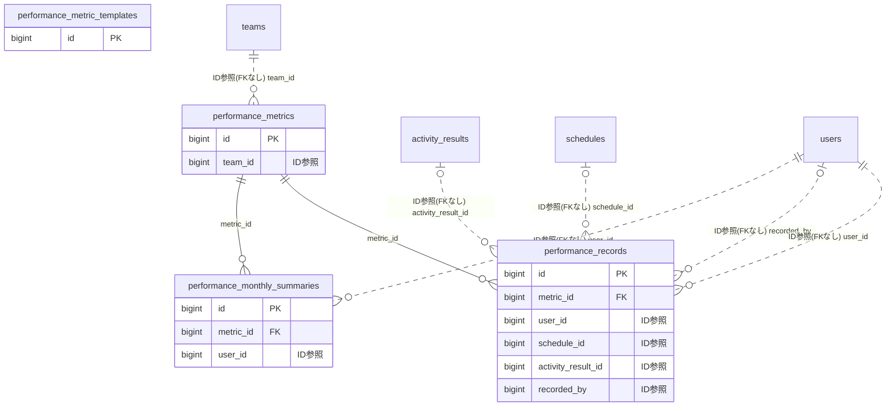

# performance ドメイン ER 図

> このファイルは自動生成されます。手で編集しないでください。再生成: `cd backend && ./gradlew generateErDiagrams`

- テーブル数: 4
- ビュー数: 0

## ER 図

実線 = 外部キー、点線 = ID参照(FKなし)。図中の `FK` は実外部キーの列だけ（ID参照列は `FK` を付けず "ID参照" と注記）。図にはキー列（PK / FK / 参照推定列 / 単一列 UNIQUE）のみを描く。全列は下の「テーブル定義」を参照。

## 被参照（他ドメインから）

このドメインのテーブルを参照している他ドメインの側（実 FK と ID参照のみ。多態参照と推定不能参照は含まない。同一ドメイン内の参照は上の図を参照）。

なし

## 推定不能参照

| テーブル | 列 | 理由 |
| --- | --- | --- |
| `performance_metrics` | `linked_activity_field_id` | 参照先テーブルを特定できない |

## テーブル定義

### `performance_metric_templates`

| 列名 | 型 | NULL | 既定値 | コメント |
| --- | --- | --- | --- | --- |
| `id` | `bigint unsigned` | NO | （なし） auto_increment |  |
| `sport_category` | `varchar(50)` | NO | （なし） |  |
| `group_name` | `varchar(50)` | YES | NULL |  |
| `name` | `varchar(100)` | NO | （なし） |  |
| `unit` | `varchar(30)` | YES | NULL |  |
| `data_type` | `enum('INTEGER','DECIMAL','TIME')` | NO | `DECIMAL` |  |
| `aggregation_type` | `enum('SUM','AVG','MAX','MIN','LATEST')` | NO | `SUM` |  |
| `description` | `varchar(500)` | YES | NULL |  |
| `sort_order` | `int` | NO | `0` |  |
| `min_value` | `decimal(15,4)` | YES | NULL |  |
| `max_value` | `decimal(15,4)` | YES | NULL |  |
| `is_self_recordable` | `tinyint(1)` | NO | `0` |  |
| `created_at` | `datetime` | NO | `CURRENT_TIMESTAMP` （式） |  |
| `updated_at` | `datetime` | NO | `CURRENT_TIMESTAMP` （式） |  |

### `performance_metrics`

| 列名 | 型 | NULL | 既定値 | コメント |
| --- | --- | --- | --- | --- |
| `id` | `bigint unsigned` | NO | （なし） auto_increment |  |
| `team_id` | `bigint unsigned` | NO | （なし） |  |
| `name` | `varchar(100)` | NO | （なし） |  |
| `unit` | `varchar(30)` | YES | NULL |  |
| `data_type` | `enum('INTEGER','DECIMAL','TIME')` | NO | `DECIMAL` |  |
| `aggregation_type` | `enum('SUM','AVG','MAX','MIN','LATEST')` | NO | `SUM` |  |
| `description` | `varchar(500)` | YES | NULL |  |
| `group_name` | `varchar(50)` | YES | NULL |  |
| `target_value` | `decimal(15,4)` | YES | NULL |  |
| `target_achieved_notified` | `tinyint(1)` | NO | `0` |  |
| `min_value` | `decimal(15,4)` | YES | NULL |  |
| `max_value` | `decimal(15,4)` | YES | NULL |  |
| `sort_order` | `int` | NO | `0` |  |
| `is_visible_to_members` | `tinyint(1)` | NO | `1` |  |
| `is_self_recordable` | `tinyint(1)` | NO | `0` |  |
| `linked_activity_field_id` | `bigint unsigned` | YES | NULL |  |
| `is_active` | `tinyint(1)` | NO | `1` |  |
| `created_at` | `datetime` | NO | `CURRENT_TIMESTAMP` （式） |  |
| `updated_at` | `datetime` | NO | `CURRENT_TIMESTAMP` （式） |  |

### `performance_monthly_summaries`

| 列名 | 型 | NULL | 既定値 | コメント |
| --- | --- | --- | --- | --- |
| `id` | `bigint unsigned` | NO | （なし） auto_increment |  |
| `metric_id` | `bigint unsigned` | NO | （なし） |  |
| `user_id` | `bigint unsigned` | NO | （なし） |  |
| `year_month` | `char(7)` | NO | （なし） |  |
| `sum_value` | `decimal(15,4)` | NO | `0.0000` |  |
| `avg_value` | `decimal(15,4)` | NO | `0.0000` |  |
| `max_value` | `decimal(15,4)` | YES | NULL |  |
| `min_value` | `decimal(15,4)` | YES | NULL |  |
| `latest_value` | `decimal(15,4)` | YES | NULL |  |
| `record_count` | `int unsigned` | NO | `0` |  |
| `created_at` | `datetime` | NO | `CURRENT_TIMESTAMP` （式） |  |
| `updated_at` | `datetime` | NO | `CURRENT_TIMESTAMP` （式） |  |

### `performance_records`

| 列名 | 型 | NULL | 既定値 | コメント |
| --- | --- | --- | --- | --- |
| `id` | `bigint unsigned` | NO | （なし） auto_increment |  |
| `metric_id` | `bigint unsigned` | NO | （なし） |  |
| `user_id` | `bigint unsigned` | NO | （なし） |  |
| `schedule_id` | `bigint unsigned` | YES | NULL |  |
| `activity_result_id` | `bigint unsigned` | YES | NULL |  |
| `recorded_date` | `date` | NO | （なし） |  |
| `value` | `decimal(15,4)` | NO | （なし） |  |
| `note` | `varchar(300)` | YES | NULL |  |
| `source` | `enum('ADMIN','SELF','SCHEDULE','ACTIVITY')` | NO | `ADMIN` |  |
| `recorded_by` | `bigint unsigned` | YES | NULL |  |
| `created_at` | `datetime` | NO | `CURRENT_TIMESTAMP` （式） |  |
| `updated_at` | `datetime` | NO | `CURRENT_TIMESTAMP` （式） |  |
