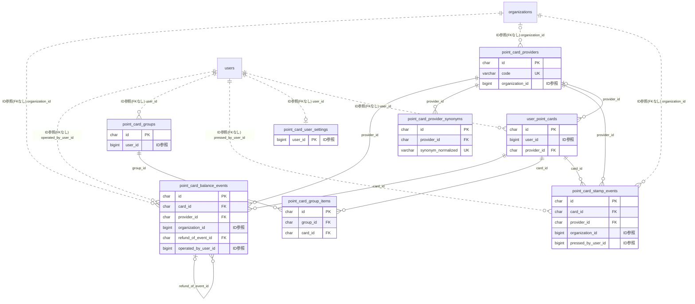

# pointcard ドメイン ER 図

> このファイルは自動生成されます。手で編集しないでください。再生成: `cd backend && ./gradlew generateErDiagrams`

- テーブル数: 8
- ビュー数: 0

## ER 図

実線 = 外部キー、点線 = ID参照(FKなし)。図中の `FK` は実外部キーの列だけ（ID参照列は `FK` を付けず "ID参照" と注記）。図にはキー列（PK / FK / 参照推定列 / 単一列 UNIQUE）のみを描く。全列は下の「テーブル定義」を参照。

## 被参照（他ドメインから）

このドメインのテーブルを参照している他ドメインの側（実 FK と ID参照のみ。多態参照と推定不能参照は含まない。同一ドメイン内の参照は上の図を参照）。

なし

## 自己参照

mermaid は同一テーブルの自己参照を複数描けず 1 本に畳むため、図に線が欠けることがある。自己参照はこの表を正とする。

| テーブル | 列 | 種別 |
| --- | --- | --- |
| `point_card_balance_events` | `refund_of_event_id` | 外部キー |

## テーブル定義

### `point_card_balance_events`

| 列名 | 型 | NULL | 既定値 | コメント |
| --- | --- | --- | --- | --- |
| `id` | `char(36)` | NO | （なし） |  |
| `card_id` | `char(36)` | NO | （なし） |  |
| `provider_id` | `char(36)` | NO | （なし） |  |
| `organization_id` | `bigint unsigned` | NO | （なし） |  |
| `operation_type` | `varchar(20)` | NO | （なし） |  |
| `delta` | `decimal(12,2)` | NO | （なし） |  |
| `balance_after` | `decimal(12,2)` | NO | （なし） |  |
| `refund_of_event_id` | `char(36)` | YES | NULL |  |
| `operated_by_user_id` | `bigint unsigned` | NO | （なし） |  |
| `operated_at` | `datetime(6)` | NO | `CURRENT_TIMESTAMP(6)` （式） |  |
| `note` | `varchar(200)` | YES | NULL |  |
| `created_at` | `datetime(6)` | NO | `CURRENT_TIMESTAMP(6)` （式） |  |

### `point_card_group_items`

| 列名 | 型 | NULL | 既定値 | コメント |
| --- | --- | --- | --- | --- |
| `id` | `char(36)` | NO | （なし） |  |
| `group_id` | `char(36)` | NO | （なし） |  |
| `card_id` | `char(36)` | NO | （なし） |  |
| `display_order` | `int unsigned` | NO | `0` |  |
| `created_at` | `datetime(6)` | NO | `CURRENT_TIMESTAMP(6)` （式） |  |

### `point_card_groups`

| 列名 | 型 | NULL | 既定値 | コメント |
| --- | --- | --- | --- | --- |
| `id` | `char(36)` | NO | （なし） |  |
| `user_id` | `bigint unsigned` | NO | （なし） |  |
| `name` | `varchar(64)` | NO | （なし） |  |
| `emoji` | `varchar(8)` | YES | NULL |  |
| `display_order` | `int unsigned` | NO | `0` |  |
| `created_at` | `datetime(6)` | NO | `CURRENT_TIMESTAMP(6)` （式） |  |
| `updated_at` | `datetime(6)` | NO | `CURRENT_TIMESTAMP(6)` （式） |  |

### `point_card_provider_synonyms`

| 列名 | 型 | NULL | 既定値 | コメント |
| --- | --- | --- | --- | --- |
| `id` | `char(36)` | NO | （なし） |  |
| `provider_id` | `char(36)` | NO | （なし） |  |
| `synonym_display` | `varchar(100)` | NO | （なし） |  |
| `synonym_normalized` | `varchar(100)` | NO | （なし） |  |
| `memo` | `varchar(200)` | YES | NULL |  |
| `created_at` | `datetime(6)` | NO | `CURRENT_TIMESTAMP(6)` （式） |  |
| `updated_at` | `datetime(6)` | NO | `CURRENT_TIMESTAMP(6)` （式） |  |

### `point_card_providers`

| 列名 | 型 | NULL | 既定値 | コメント |
| --- | --- | --- | --- | --- |
| `id` | `char(36)` | NO | （なし） |  |
| `code` | `varchar(50)` | NO | （なし） |  |
| `display_name` | `varchar(100)` | NO | （なし） |  |
| `category` | `varchar(20)` | NO | （なし） |  |
| `type` | `varchar(30)` | NO | `EXTERNAL` |  |
| `organization_id` | `bigint unsigned` | YES | NULL |  |
| `logo_url` | `varchar(500)` | YES | NULL |  |
| `brand_color` | `char(7)` | YES | NULL |  |
| `default_barcode_format` | `varchar(20)` | YES | NULL |  |
| `card_number_regex` | `varchar(200)` | YES | NULL |  |
| `card_number_length_hint` | `varchar(50)` | YES | NULL |  |
| `is_active` | `tinyint(1)` | NO | `1` |  |
| `legal_notice` | `text` | YES | NULL |  |
| `created_at` | `datetime(6)` | NO | `CURRENT_TIMESTAMP(6)` （式） |  |
| `updated_at` | `datetime(6)` | NO | `CURRENT_TIMESTAMP(6)` （式） |  |

### `point_card_stamp_events`

| 列名 | 型 | NULL | 既定値 | コメント |
| --- | --- | --- | --- | --- |
| `id` | `char(36)` | NO | （なし） |  |
| `card_id` | `char(36)` | NO | （なし） |  |
| `provider_id` | `char(36)` | NO | （なし） |  |
| `organization_id` | `bigint unsigned` | NO | （なし） |  |
| `delta` | `int` | NO | （なし） |  |
| `pressed_by_user_id` | `bigint unsigned` | NO | （なし） |  |
| `pressed_at` | `datetime(6)` | NO | `CURRENT_TIMESTAMP(6)` （式） |  |
| `memo` | `varchar(200)` | YES | NULL |  |
| `created_at` | `datetime(6)` | NO | `CURRENT_TIMESTAMP(6)` （式） |  |

### `point_card_user_settings`

| 列名 | 型 | NULL | 既定値 | コメント |
| --- | --- | --- | --- | --- |
| `user_id` | `bigint unsigned` | NO | （なし） |  |
| `is_enabled` | `tinyint(1)` | NO | `0` |  |
| `terms_accepted_at` | `datetime(6)` | YES | NULL |  |
| `terms_version` | `varchar(20)` | YES | NULL |  |
| `require_biometric_on_show` | `tinyint(1)` | NO | `0` |  |
| `created_at` | `datetime(6)` | NO | `CURRENT_TIMESTAMP(6)` （式） |  |
| `updated_at` | `datetime(6)` | NO | `CURRENT_TIMESTAMP(6)` （式） |  |

### `user_point_cards`

| 列名 | 型 | NULL | 既定値 | コメント |
| --- | --- | --- | --- | --- |
| `id` | `char(36)` | NO | （なし） |  |
| `user_id` | `bigint unsigned` | NO | （なし） |  |
| `provider_id` | `char(36)` | YES | NULL |  |
| `display_name` | `varbinary(1024)` | NO | （なし） |  |
| `nickname` | `varbinary(1024)` | YES | NULL |  |
| `barcode_value` | `varbinary(1024)` | NO | （なし） |  |
| `barcode_format` | `varchar(20)` | NO | `CODE128` |  |
| `last4` | `varchar(4)` | YES | NULL |  |
| `memo` | `varbinary(2048)` | YES | NULL |  |
| `is_favorite` | `tinyint(1)` | NO | `0` |  |
| `display_order` | `int unsigned` | NO | `0` |  |
| `balance` | `decimal(12,2)` | YES | NULL |  |
| `stamp_count` | `int unsigned` | YES | NULL |  |
| `last_used_at` | `datetime(6)` | YES | NULL |  |
| `created_at` | `datetime(6)` | NO | `CURRENT_TIMESTAMP(6)` （式） |  |
| `updated_at` | `datetime(6)` | NO | `CURRENT_TIMESTAMP(6)` （式） |  |
