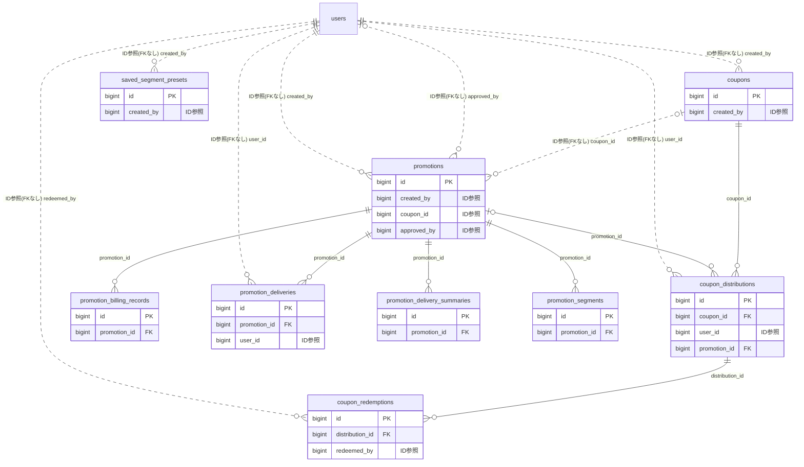

# promotion ドメイン ER 図

> このファイルは自動生成されます。手で編集しないでください。再生成: `cd backend && ./gradlew generateErDiagrams`

- テーブル数: 9
- ビュー数: 0

## ER 図

実線 = 外部キー、点線 = ID参照(FKなし)。図中の `FK` は実外部キーの列だけ（ID参照列は `FK` を付けず "ID参照" と注記）。図にはキー列（PK / FK / 参照推定列 / 単一列 UNIQUE）のみを描く。全列は下の「テーブル定義」を参照。

## 被参照（他ドメインから）

このドメインのテーブルを参照している他ドメインの側（実 FK と ID参照のみ。多態参照と推定不能参照は含まない。同一ドメイン内の参照は上の図を参照）。

なし

## 多態参照（線を引かない）

| テーブル | 種別列 | ID列 |
| --- | --- | --- |
| `coupons` | `scope_type` | `scope_id` |
| `promotion_billing_records` | `scope_type` | `scope_id` |
| `promotions` | `scope_type` | `scope_id` |
| `saved_segment_presets` | `scope_type` | `scope_id` |

## 推定不能参照

| テーブル | 列 | 理由 |
| --- | --- | --- |
| `promotion_billing_records` | `stripe_charge_id` | 参照先テーブルを特定できない |

## テーブル定義

### `coupon_distributions`

| 列名 | 型 | NULL | 既定値 | コメント |
| --- | --- | --- | --- | --- |
| `id` | `bigint unsigned` | NO | （なし） auto_increment |  |
| `coupon_id` | `bigint unsigned` | NO | （なし） |  |
| `user_id` | `bigint unsigned` | NO | （なし） |  |
| `promotion_id` | `bigint unsigned` | YES | NULL |  |
| `status` | `varchar(20)` | NO | `ACTIVE` |  |
| `distributed_at` | `datetime` | NO | （なし） |  |
| `expires_at` | `datetime` | NO | （なし） |  |
| `created_at` | `datetime` | NO | `CURRENT_TIMESTAMP` （式） |  |

### `coupon_redemptions`

| 列名 | 型 | NULL | 既定値 | コメント |
| --- | --- | --- | --- | --- |
| `id` | `bigint unsigned` | NO | （なし） auto_increment |  |
| `distribution_id` | `bigint unsigned` | NO | （なし） |  |
| `redeemed_by` | `bigint unsigned` | NO | （なし） |  |
| `redeemed_at` | `datetime` | NO | （なし） |  |
| `redemption_detail` | `json` | YES | NULL |  |
| `created_at` | `datetime` | NO | `CURRENT_TIMESTAMP` （式） |  |

### `coupons`

| 列名 | 型 | NULL | 既定値 | コメント |
| --- | --- | --- | --- | --- |
| `id` | `bigint unsigned` | NO | （なし） auto_increment |  |
| `scope_type` | `enum('TEAM','ORGANIZATION')` | NO | （なし） |  |
| `scope_id` | `bigint unsigned` | NO | （なし） |  |
| `created_by` | `bigint unsigned` | NO | （なし） |  |
| `title` | `varchar(200)` | NO | （なし） |  |
| `description` | `text` | YES | NULL |  |
| `coupon_type` | `varchar(20)` | NO | （なし） |  |
| `discount_value` | `decimal(10,2)` | YES | NULL |  |
| `min_purchase_amount` | `decimal(10,0)` | YES | NULL |  |
| `max_issues` | `int unsigned` | YES | NULL |  |
| `issued_count` | `int unsigned` | NO | `0` |  |
| `max_uses_per_user` | `smallint unsigned` | NO | `1` |  |
| `valid_from` | `datetime` | NO | （なし） |  |
| `valid_until` | `datetime` | NO | （なし） |  |
| `is_active` | `tinyint(1)` | NO | `1` |  |
| `created_at` | `datetime` | NO | `CURRENT_TIMESTAMP` （式） |  |
| `updated_at` | `datetime` | NO | `CURRENT_TIMESTAMP` （式） |  |
| `deleted_at` | `datetime` | YES | NULL |  |

### `promotion_billing_records`

| 列名 | 型 | NULL | 既定値 | コメント |
| --- | --- | --- | --- | --- |
| `id` | `bigint unsigned` | NO | （なし） auto_increment |  |
| `promotion_id` | `bigint unsigned` | NO | （なし） |  |
| `scope_type` | `varchar(20)` | NO | （なし） |  |
| `scope_id` | `bigint unsigned` | NO | （なし） |  |
| `delivery_count` | `int unsigned` | NO | （なし） |  |
| `unit_price` | `decimal(6,2)` | NO | （なし） |  |
| `total_amount` | `decimal(10,0)` | NO | （なし） |  |
| `billing_status` | `varchar(20)` | NO | `PENDING` |  |
| `stripe_charge_id` | `varchar(100)` | YES | NULL |  |
| `billed_at` | `datetime` | YES | NULL |  |
| `created_at` | `datetime` | NO | `CURRENT_TIMESTAMP` （式） |  |

### `promotion_deliveries`

| 列名 | 型 | NULL | 既定値 | コメント |
| --- | --- | --- | --- | --- |
| `id` | `bigint unsigned` | NO | （なし） auto_increment |  |
| `promotion_id` | `bigint unsigned` | NO | （なし） |  |
| `user_id` | `bigint unsigned` | NO | （なし） |  |
| `channel` | `varchar(20)` | NO | （なし） |  |
| `status` | `varchar(20)` | NO | `PENDING` |  |
| `delivered_at` | `datetime` | YES | NULL |  |
| `opened_at` | `datetime` | YES | NULL |  |
| `failed_reason` | `varchar(200)` | YES | NULL |  |
| `created_at` | `datetime` | NO | `CURRENT_TIMESTAMP` （式） |  |

### `promotion_delivery_summaries`

| 列名 | 型 | NULL | 既定値 | コメント |
| --- | --- | --- | --- | --- |
| `id` | `bigint unsigned` | NO | （なし） auto_increment |  |
| `promotion_id` | `bigint unsigned` | NO | （なし） |  |
| `summary_date` | `date` | NO | （なし） |  |
| `delivered_count` | `int unsigned` | NO | `0` |  |
| `opened_count` | `int unsigned` | NO | `0` |  |
| `failed_count` | `int unsigned` | NO | `0` |  |
| `created_at` | `datetime` | NO | `CURRENT_TIMESTAMP` （式） |  |

### `promotion_segments`

| 列名 | 型 | NULL | 既定値 | コメント |
| --- | --- | --- | --- | --- |
| `id` | `bigint unsigned` | NO | （なし） auto_increment |  |
| `promotion_id` | `bigint unsigned` | NO | （なし） |  |
| `segment_type` | `varchar(30)` | NO | （なし） |  |
| `segment_value` | `json` | NO | （なし） |  |
| `created_at` | `datetime` | NO | `CURRENT_TIMESTAMP` （式） |  |

### `promotions`

| 列名 | 型 | NULL | 既定値 | コメント |
| --- | --- | --- | --- | --- |
| `id` | `bigint unsigned` | NO | （なし） auto_increment |  |
| `scope_type` | `varchar(20)` | NO | （なし） |  |
| `scope_id` | `bigint unsigned` | NO | （なし） |  |
| `created_by` | `bigint unsigned` | NO | （なし） |  |
| `title` | `varchar(200)` | NO | （なし） |  |
| `body` | `text` | YES | NULL |  |
| `image_url` | `varchar(500)` | YES | NULL |  |
| `coupon_id` | `bigint unsigned` | YES | NULL |  |
| `status` | `enum('DRAFT','PENDING_APPROVAL','APPROVED','SCHEDULED','PUBLISHING','PUBLISHED','CANCELLED','FAILED')` | NO | `DRAFT` |  |
| `approved_by` | `bigint unsigned` | YES | NULL |  |
| `approved_at` | `datetime` | YES | NULL |  |
| `scheduled_at` | `datetime` | YES | NULL |  |
| `published_at` | `datetime` | YES | NULL |  |
| `expires_at` | `datetime` | YES | NULL |  |
| `target_count` | `int unsigned` | NO | `0` |  |
| `delivered_count` | `int unsigned` | NO | `0` |  |
| `opened_count` | `int unsigned` | NO | `0` |  |
| `skipped_count` | `int unsigned` | NO | `0` |  |
| `failed_count` | `int unsigned` | NO | `0` |  |
| `created_at` | `datetime` | NO | `CURRENT_TIMESTAMP` （式） |  |
| `updated_at` | `datetime` | NO | `CURRENT_TIMESTAMP` （式） |  |
| `deleted_at` | `datetime` | YES | NULL |  |

### `saved_segment_presets`

| 列名 | 型 | NULL | 既定値 | コメント |
| --- | --- | --- | --- | --- |
| `id` | `bigint unsigned` | NO | （なし） auto_increment |  |
| `scope_type` | `varchar(20)` | NO | （なし） |  |
| `scope_id` | `bigint unsigned` | NO | （なし） |  |
| `name` | `varchar(100)` | NO | （なし） |  |
| `conditions` | `json` | NO | （なし） |  |
| `created_by` | `bigint unsigned` | NO | （なし） |  |
| `deleted_at` | `datetime` | YES | NULL |  |
| `created_at` | `datetime` | NO | `CURRENT_TIMESTAMP` （式） |  |
| `updated_at` | `datetime` | NO | `CURRENT_TIMESTAMP` （式） |  |
