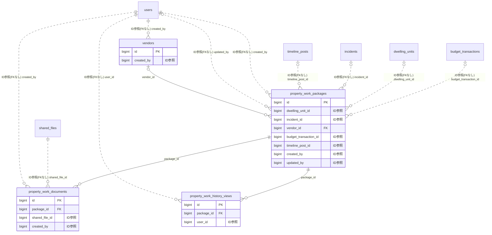

# property ドメイン ER 図

> このファイルは自動生成されます。手で編集しないでください。再生成: `cd backend && ./gradlew generateErDiagrams`

- テーブル数: 4
- ビュー数: 0

## ER 図

実線 = 外部キー、点線 = ID参照(FKなし)。図中の `FK` は実外部キーの列だけ（ID参照列は `FK` を付けず "ID参照" と注記）。図にはキー列（PK / FK / 参照推定列 / 単一列 UNIQUE）のみを描く。全列は下の「テーブル定義」を参照。

## 被参照（他ドメインから）

このドメインのテーブルを参照している他ドメインの側（実 FK と ID参照のみ。多態参照と推定不能参照は含まない。同一ドメイン内の参照は上の図を参照）。

| 参照元ドメイン | 参照元テーブル | 列 | 種別 | 参照先テーブル |
| --- | --- | --- | --- | --- |
| [repairplan](repairplan.md) | `repair_quote_cards` | `vendor_id` | ID参照 | `vendors` |

## 多態参照（線を引かない）

| テーブル | 種別列 | ID列 |
| --- | --- | --- |
| `property_work_packages` | `scope_type` | `scope_id` |
| `vendors` | `scope_type` | `scope_id` |

## テーブル定義

### `property_work_documents`

| 列名 | 型 | NULL | 既定値 | コメント |
| --- | --- | --- | --- | --- |
| `id` | `bigint unsigned` | NO | （なし） auto_increment |  |
| `package_id` | `bigint unsigned` | NO | （なし） |  |
| `shared_file_id` | `bigint unsigned` | NO | （なし） |  |
| `document_kind` | `varchar(30)` | NO | （なし） |  |
| `display_order` | `int` | NO | `0` |  |
| `note` | `varchar(500)` | YES | NULL |  |
| `created_by` | `bigint unsigned` | NO | （なし） |  |
| `created_at` | `datetime` | NO | （なし） |  |

### `property_work_history_views`

| 列名 | 型 | NULL | 既定値 | コメント |
| --- | --- | --- | --- | --- |
| `id` | `bigint unsigned` | NO | （なし） auto_increment |  |
| `package_id` | `bigint unsigned` | NO | （なし） |  |
| `user_id` | `bigint unsigned` | NO | （なし） |  |
| `action` | `varchar(20)` | NO | （なし） |  |
| `viewed_at` | `datetime` | NO | `CURRENT_TIMESTAMP` （式） |  |
| `ip_address` | `varchar(45)` | YES | NULL |  |
| `user_agent` | `varchar(255)` | YES | NULL |  |

### `property_work_packages`

| 列名 | 型 | NULL | 既定値 | コメント |
| --- | --- | --- | --- | --- |
| `id` | `bigint unsigned` | NO | （なし） auto_increment |  |
| `scope_type` | `varchar(20)` | NO | （なし） |  |
| `scope_id` | `bigint unsigned` | NO | （なし） |  |
| `dwelling_unit_id` | `bigint unsigned` | YES | NULL |  |
| `work_type` | `varchar(20)` | NO | （なし） |  |
| `category` | `varchar(50)` | YES | NULL |  |
| `title` | `varchar(200)` | NO | （なし） |  |
| `description` | `text` | YES | NULL |  |
| `incident_id` | `bigint unsigned` | YES | NULL |  |
| `incident_date` | `date` | YES | NULL |  |
| `incident_narrative` | `text` | YES | NULL |  |
| `planned_start_date` | `date` | YES | NULL |  |
| `planned_end_date` | `date` | YES | NULL |  |
| `actual_start_date` | `date` | YES | NULL |  |
| `actual_end_date` | `date` | YES | NULL |  |
| `vendor_id` | `bigint unsigned` | YES | NULL |  |
| `vendor_name_snapshot` | `varchar(150)` | YES | NULL |  |
| `estimated_amount` | `bigint` | YES | NULL |  |
| `contract_amount` | `bigint` | YES | NULL |  |
| `actual_amount` | `bigint` | YES | NULL |  |
| `currency` | `varchar(3)` | NO | `JPY` |  |
| `budget_transaction_id` | `bigint unsigned` | YES | NULL |  |
| `timeline_post_id` | `bigint unsigned` | YES | NULL |  |
| `warranty_until` | `date` | YES | NULL |  |
| `is_disclosable` | `tinyint(1)` | NO | `1` |  |
| `visibility` | `varchar(20)` | NO | `ADMINS_ONLY` |  |
| `status` | `varchar(20)` | NO | `PLANNED` |  |
| `attachment_count` | `int` | NO | `0` |  |
| `comment_count` | `int` | NO | `0` |  |
| `tags` | `json` | YES | NULL |  |
| `created_by` | `bigint unsigned` | NO | （なし） |  |
| `updated_by` | `bigint unsigned` | YES | NULL |  |
| `version` | `bigint` | NO | `0` |  |
| `created_at` | `datetime` | NO | （なし） |  |
| `updated_at` | `datetime` | NO | （なし） |  |
| `deleted_at` | `datetime` | YES | NULL |  |

### `vendors`

| 列名 | 型 | NULL | 既定値 | コメント |
| --- | --- | --- | --- | --- |
| `id` | `bigint unsigned` | NO | （なし） auto_increment |  |
| `scope_type` | `varchar(20)` | NO | （なし） |  |
| `scope_id` | `bigint unsigned` | NO | （なし） |  |
| `name` | `varchar(150)` | NO | （なし） |  |
| `name_kana` | `varchar(200)` | YES | NULL |  |
| `category` | `varchar(30)` | YES | NULL |  |
| `phone` | `varchar(30)` | YES | NULL |  |
| `email` | `varchar(255)` | YES | NULL |  |
| `website` | `varchar(500)` | YES | NULL |  |
| `postal_code` | `varchar(10)` | YES | NULL |  |
| `address` | `varchar(255)` | YES | NULL |  |
| `representative` | `varchar(100)` | YES | NULL |  |
| `contact_person` | `varchar(100)` | YES | NULL |  |
| `license_number` | `varchar(100)` | YES | NULL |  |
| `license_expiry` | `date` | YES | NULL |  |
| `note` | `text` | YES | NULL |  |
| `is_active` | `tinyint(1)` | NO | `1` |  |
| `created_by` | `bigint unsigned` | NO | （なし） |  |
| `version` | `bigint` | NO | `0` |  |
| `created_at` | `datetime` | NO | （なし） |  |
| `updated_at` | `datetime` | NO | （なし） |  |
| `compliance_check_status` | `varchar(20)` | NO | `UNCHECKED` | 反社チェック状態 |
| `compliance_checked_at` | `datetime` | YES | NULL | 反社チェック実施日時 |
| `deleted_at` | `datetime` | YES | NULL |  |
