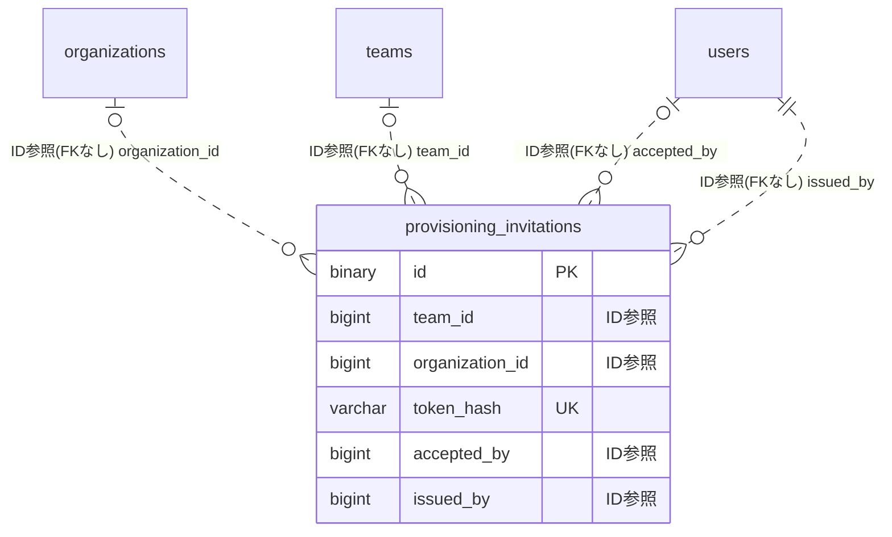

# provisioning ドメイン ER 図

> このファイルは自動生成されます。手で編集しないでください。再生成: `cd backend && ./gradlew generateErDiagrams`

- テーブル数: 1
- ビュー数: 0

## ER 図

実線 = 外部キー、点線 = ID参照(FKなし)。図中の `FK` は実外部キーの列だけ（ID参照列は `FK` を付けず "ID参照" と注記）。図にはキー列（PK / FK / 参照推定列 / 単一列 UNIQUE）のみを描く。全列は下の「テーブル定義」を参照。

## 被参照（他ドメインから）

このドメインのテーブルを参照している他ドメインの側（実 FK と ID参照のみ。多態参照と推定不能参照は含まない。同一ドメイン内の参照は上の図を参照）。

なし

## テーブル定義

### `provisioning_invitations`

| 列名 | 型 | NULL | 既定値 | コメント |
| --- | --- | --- | --- | --- |
| `id` | `binary(16)` | NO | （なし） | UUIDv7 PK（原則6） |
| `team_id` | `bigint unsigned` | YES | NULL | プロビジョニング対象がチームの場合（FK 張らない・原則1） |
| `organization_id` | `bigint unsigned` | YES | NULL | プロビジョニング対象が組織の場合（FK 張らない・原則1） |
| `invite_email` | `varchar(255)` | NO | （なし） | 招待先メールアドレス |
| `token_hash` | `varchar(64)` | NO | （なし） | トークンのSHA-256ハッシュ(hex)。平文トークンは保存しない |
| `status` | `varchar(20)` | NO | `PENDING` | PENDING/ACCEPTED/CANCELLED/EXPIRED |
| `expires_at` | `timestamp(6)` | NO | （なし） | 有効期限 |
| `accepted_at` | `timestamp(6)` | YES | NULL | 承諾日時（ACCEPTED 時のみ） |
| `accepted_by` | `bigint unsigned` | YES | NULL | 承諾した user ID（FK 張らない） |
| `resolved_at` | `timestamp(6)` | YES | NULL | 取消/期限確定の処理日時 |
| `issued_by` | `bigint unsigned` | NO | （なし） | 発行者の user ID（FK 張らない） |
| `created_at` | `timestamp(6)` | NO | `CURRENT_TIMESTAMP(6)` （式） |  |
| `updated_at` | `timestamp(6)` | NO | `CURRENT_TIMESTAMP(6)` （式） |  |
