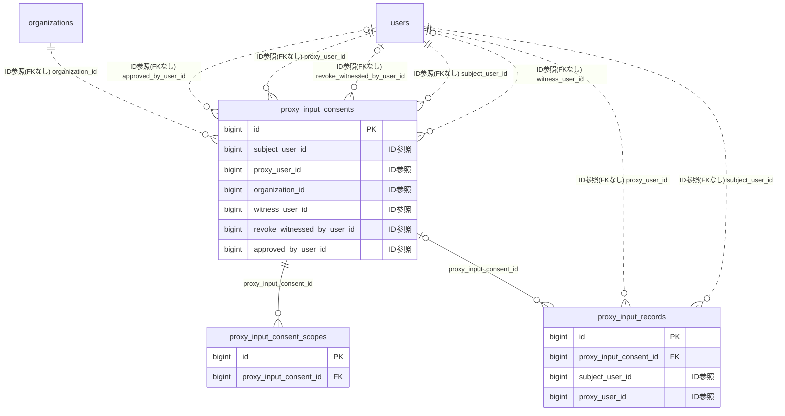

# proxy ドメイン ER 図

> このファイルは自動生成されます。手で編集しないでください。再生成: `cd backend && ./gradlew generateErDiagrams`

- テーブル数: 3
- ビュー数: 0

## ER 図

実線 = 外部キー、点線 = ID参照(FKなし)。図中の `FK` は実外部キーの列だけ（ID参照列は `FK` を付けず "ID参照" と注記）。図にはキー列（PK / FK / 参照推定列 / 単一列 UNIQUE）のみを描く。全列は下の「テーブル定義」を参照。

## 被参照（他ドメインから）

このドメインのテーブルを参照している他ドメインの側（実 FK と ID参照のみ。多態参照と推定不能参照は含まない。同一ドメイン内の参照は上の図を参照）。

| 参照元ドメイン | 参照元テーブル | 列 | 種別 | 参照先テーブル |
| --- | --- | --- | --- | --- |
| [circulation](circulation.md) | `circulation_recipients` | `proxy_input_record_id` | ID参照 | `proxy_input_records` |
| [parking](parking.md) | `parking_applications` | `proxy_input_record_id` | ID参照 | `proxy_input_records` |
| [schedule](schedule.md) | `schedule_attendances` | `proxy_input_record_id` | ID参照 | `proxy_input_records` |
| [shift](shift.md) | `shift_requests` | `proxy_input_record_id` | ID参照 | `proxy_input_records` |
| [social](social.md) | `announcement_read_status` | `proxy_input_record_id` | ID参照 | `proxy_input_records` |
| [survey](survey.md) | `survey_responses` | `proxy_input_record_id` | ID参照 | `proxy_input_records` |

## 多態参照（線を引かない）

| テーブル | 種別列 | ID列 |
| --- | --- | --- |
| `proxy_input_records` | `target_entity_type` | `target_entity_id` |

## 推定不能参照

| テーブル | 列 | 理由 |
| --- | --- | --- |
| `proxy_input_records` | `audit_log_id` | 参照先 audit_logs が単一列の主キーでない |

## テーブル定義

### `proxy_input_consent_scopes`

| 列名 | 型 | NULL | 既定値 | コメント |
| --- | --- | --- | --- | --- |
| `id` | `bigint unsigned` | NO | （なし） auto_increment |  |
| `proxy_input_consent_id` | `bigint unsigned` | NO | （なし） | FK→proxy_input_consents.id |
| `feature_scope` | `varchar(64)` | NO | （なし） | SURVEY / SCHEDULE_ATTENDANCE / SHIFT_REQUEST / ANNOUNCEMENT_READ / PARKING_APPLICATION / CIRCULAR / SUPPORTER_VIEW |
| `created_at` | `datetime` | NO | `CURRENT_TIMESTAMP` （式） |  |

### `proxy_input_consents`

| 列名 | 型 | NULL | 既定値 | コメント |
| --- | --- | --- | --- | --- |
| `id` | `bigint unsigned` | NO | （なし） auto_increment |  |
| `subject_user_id` | `bigint unsigned` | NO | （なし） | 代理される本人 FK→users.id |
| `proxy_user_id` | `bigint unsigned` | NO | （なし） | 代理者 FK→users.id |
| `organization_id` | `bigint unsigned` | NO | （なし） | 同意の有効範囲（組合） FK→organizations.id |
| `consent_method` | `varchar(32)` | NO | （なし） | PAPER_SIGNED / WITNESSED_ORAL / DIGITAL_SIGNATURE / GUARDIAN_BY_COURT |
| `scanned_document_s3_key` | `varchar(512)` | YES | NULL | 同意書スキャンPDFのS3オブジェクトキー（presigned URLは閲覧時都度発行） |
| `guardian_certificate_s3_key` | `varchar(512)` | YES | NULL | GUARDIAN_BY_COURT時の後見登記事項証明書S3キー |
| `witness_user_id` | `bigint unsigned` | YES | NULL | WITNESSED_ORAL時の立会人（ADMIN必須）FK→users.id |
| `effective_from` | `date` | NO | （なし） | 有効開始日 |
| `effective_until` | `date` | NO | （なし） | 有効期限（最長1年・更新要） |
| `revoked_at` | `datetime` | YES | NULL | 撤回日時 |
| `revoke_method` | `varchar(32)` | YES | NULL | API_BY_SUBJECT / PAPER_BY_SUBJECT / AUTO_BY_LIFE_EVENT / AUTO_BY_TENURE_END |
| `revoke_witnessed_by_user_id` | `bigint unsigned` | YES | NULL | 紙撤回届の立会ADMIN FK→users.id |
| `revoke_reason` | `varchar(255)` | YES | NULL |  |
| `approved_by_user_id` | `bigint unsigned` | YES | NULL | 承認した管理者（proxy_user_idとは別のADMINまたはSYSTEM_ADMIN）FK→users.id |
| `approved_at` | `datetime` | YES | NULL |  |
| `created_at` | `datetime` | NO | `CURRENT_TIMESTAMP` （式） |  |
| `updated_at` | `datetime` | NO | `CURRENT_TIMESTAMP` （式） |  |
| `deleted_at` | `datetime` | YES | NULL |  |

### `proxy_input_records`

| 列名 | 型 | NULL | 既定値 | コメント |
| --- | --- | --- | --- | --- |
| `id` | `bigint unsigned` | NO | （なし） auto_increment |  |
| `proxy_input_consent_id` | `bigint unsigned` | YES | NULL | 根拠となる同意書 FK→proxy_input_consents.id（後見切替=GUARDIANSHIP_SWITCH 由来は NULL） |
| `subject_user_id` | `bigint unsigned` | NO | （なし） | 本人（集計用冗長保持）FK→users.id |
| `proxy_user_id` | `bigint unsigned` | NO | （なし） | 代理者 FK→users.id |
| `feature_scope` | `varchar(64)` | NO | （なし） | 操作対象機能（FeatureScopeと連動） |
| `target_entity_type` | `varchar(64)` | NO | （なし） | SURVEY_RESPONSE / SCHEDULE_ATTENDANCE_RESPONSE 等 |
| `target_entity_id` | `bigint unsigned` | NO | （なし） | 操作対象レコードID |
| `input_source` | `varchar(32)` | NO | （なし） | PAPER_FORM / PHONE_INTERVIEW / IN_PERSON |
| `original_storage_location` | `varchar(255)` | NO | （なし） | 紙原本の保管場所（紛争時証跡・必須） |
| `audit_log_id` | `bigint unsigned` | YES | NULL | 同期作成されたaudit_logs.idへの参照 |
| `created_at` | `datetime` | NO | `CURRENT_TIMESTAMP` （式） |  |
| `retention_expires_at` | `date` | YES | NULL | 保管期限満了日（作成日+5年、自動計算） |
