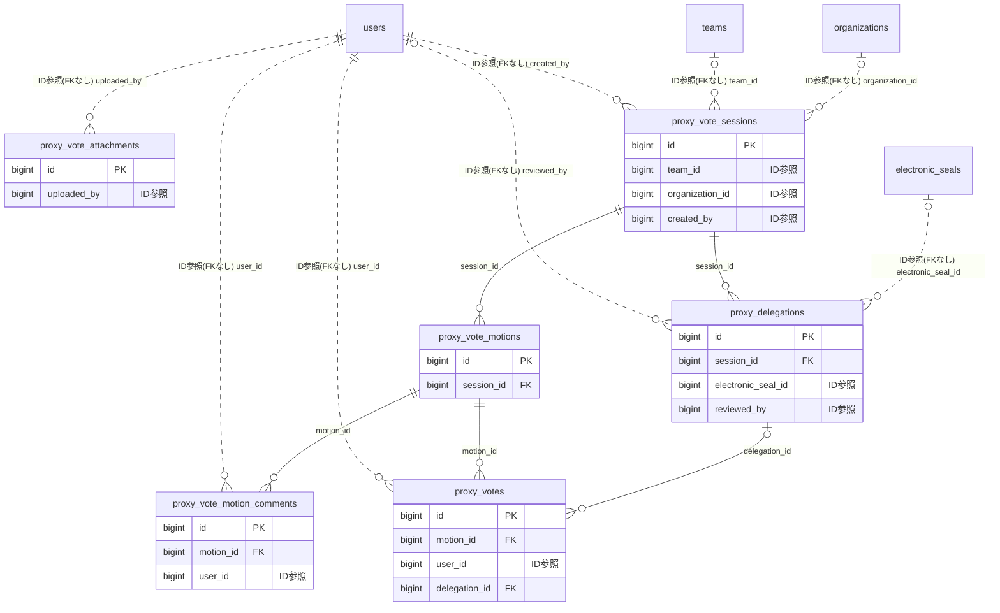

# proxyvote ドメイン ER 図

> このファイルは自動生成されます。手で編集しないでください。再生成: `cd backend && ./gradlew generateErDiagrams`

- テーブル数: 6
- ビュー数: 0

## ER 図

実線 = 外部キー、点線 = ID参照(FKなし)。図中の `FK` は実外部キーの列だけ（ID参照列は `FK` を付けず "ID参照" と注記）。図にはキー列（PK / FK / 参照推定列 / 単一列 UNIQUE）のみを描く。全列は下の「テーブル定義」を参照。

## 被参照（他ドメインから）

このドメインのテーブルを参照している他ドメインの側（実 FK と ID参照のみ。多態参照と推定不能参照は含まない。同一ドメイン内の参照は上の図を参照）。

| 参照元ドメイン | 参照元テーブル | 列 | 種別 | 参照先テーブル |
| --- | --- | --- | --- | --- |
| [event](event.md) | `event_delegations` | `proxy_delegation_id` | ID参照 | `proxy_delegations` |
| [event](event.md) | `event_delegations` | `proxy_vote_session_id` | ID参照 | `proxy_vote_sessions` |

## 多態参照（線を引かない）

| テーブル | 種別列 | ID列 |
| --- | --- | --- |
| `proxy_vote_attachments` | `target_type` | `target_id` |

## 推定不能参照

| テーブル | 列 | 理由 |
| --- | --- | --- |
| `proxy_delegations` | `delegate_id` | 参照先テーブルを特定できない |
| `proxy_delegations` | `delegator_id` | 参照先テーブルを特定できない |

## テーブル定義

### `proxy_delegations`

| 列名 | 型 | NULL | 既定値 | コメント |
| --- | --- | --- | --- | --- |
| `id` | `bigint unsigned` | NO | （なし） auto_increment |  |
| `session_id` | `bigint unsigned` | NO | （なし） | FK → proxy_vote_sessions |
| `delegator_id` | `bigint unsigned` | NO | （なし） | FK → users。委任者 |
| `delegate_id` | `bigint unsigned` | YES | NULL | FK → users。代理人。NULL = 白紙委任 |
| `is_blank` | `tinyint(1)` | NO | `0` | 白紙委任フラグ |
| `electronic_seal_id` | `bigint unsigned` | YES | NULL | FK → electronic_seals |
| `reason` | `varchar(500)` | YES | NULL | 委任理由 |
| `status` | `varchar(20)` | NO | `SUBMITTED` | ステータス（SUBMITTED / ACCEPTED / REJECTED / CANCELLED） |
| `reviewed_by` | `bigint unsigned` | YES | NULL | FK → users。承認/却下した管理者 |
| `reviewed_at` | `datetime` | YES | NULL | 承認/却下日時 |
| `created_at` | `datetime` | NO | `CURRENT_TIMESTAMP` （式） |  |
| `updated_at` | `datetime` | NO | `CURRENT_TIMESTAMP` （式） |  |

### `proxy_vote_attachments`

| 列名 | 型 | NULL | 既定値 | コメント |
| --- | --- | --- | --- | --- |
| `id` | `bigint unsigned` | NO | （なし） auto_increment |  |
| `target_type` | `varchar(20)` | NO | （なし） | 添付先種別（SESSION / MOTION） |
| `target_id` | `bigint unsigned` | NO | （なし） | SESSION → proxy_vote_sessions.id / MOTION → proxy_vote_motions.id |
| `file_key` | `varchar(500)` | NO | （なし） | S3 オブジェクトキー |
| `original_filename` | `varchar(255)` | NO | （なし） | アップロード時の元ファイル名 |
| `file_size` | `int` | NO | （なし） | ファイルサイズ（バイト） |
| `mime_type` | `varchar(100)` | NO | （なし） | MIMEタイプ |
| `attachment_type` | `varchar(20)` | NO | `DOCUMENT` | 種別（MINUTES / DOCUMENT / OTHER） |
| `sort_order` | `smallint` | NO | `0` | 表示順 |
| `uploaded_by` | `bigint unsigned` | NO | （なし） | FK → users。アップロード者 |
| `created_at` | `datetime` | NO | `CURRENT_TIMESTAMP` （式） |  |
| `updated_at` | `datetime` | NO | `CURRENT_TIMESTAMP` （式） |  |

### `proxy_vote_motion_comments`

| 列名 | 型 | NULL | 既定値 | コメント |
| --- | --- | --- | --- | --- |
| `id` | `bigint unsigned` | NO | （なし） auto_increment |  |
| `motion_id` | `bigint unsigned` | NO | （なし） | FK → proxy_vote_motions |
| `user_id` | `bigint unsigned` | NO | （なし） | FK → users |
| `body` | `text` | NO | （なし） | コメント本文（最大1,000文字） |
| `created_at` | `datetime` | NO | `CURRENT_TIMESTAMP` （式） |  |
| `updated_at` | `datetime` | NO | `CURRENT_TIMESTAMP` （式） |  |
| `deleted_at` | `datetime` | YES | NULL | 論理削除日時 |

### `proxy_vote_motions`

| 列名 | 型 | NULL | 既定値 | コメント |
| --- | --- | --- | --- | --- |
| `id` | `bigint unsigned` | NO | （なし） auto_increment |  |
| `session_id` | `bigint unsigned` | NO | （なし） | FK → proxy_vote_sessions |
| `motion_number` | `int unsigned` | NO | （なし） | 議案番号（表示順。1始まり） |
| `title` | `varchar(200)` | NO | （なし） | 議案タイトル |
| `description` | `text` | YES | NULL | 議案の詳細説明 |
| `voting_status` | `varchar(20)` | NO | `PENDING` | 議案別投票状態（PENDING / VOTING / VOTED） |
| `vote_deadline_at` | `datetime` | YES | NULL | 投票自動終了日時 |
| `required_approval` | `varchar(20)` | NO | `MAJORITY` | 可決要件（MAJORITY / TWO_THIRDS / UNANIMOUS） |
| `result` | `varchar(20)` | YES | NULL | 採決結果（APPROVED / REJECTED） |
| `approve_count` | `int unsigned` | NO | `0` | 賛成票数 |
| `reject_count` | `int unsigned` | NO | `0` | 反対票数 |
| `abstain_count` | `int unsigned` | NO | `0` | 棄権票数 |
| `created_at` | `datetime` | NO | `CURRENT_TIMESTAMP` （式） |  |
| `updated_at` | `datetime` | NO | `CURRENT_TIMESTAMP` （式） |  |

### `proxy_vote_sessions`

| 列名 | 型 | NULL | 既定値 | コメント |
| --- | --- | --- | --- | --- |
| `id` | `bigint unsigned` | NO | （なし） auto_increment |  |
| `scope_type` | `varchar(20)` | NO | （なし） | スコープ（TEAM / ORGANIZATION） |
| `team_id` | `bigint unsigned` | YES | NULL | FK → teams。TEAM の場合に設定 |
| `organization_id` | `bigint unsigned` | YES | NULL | FK → organizations。ORGANIZATION の場合に設定 |
| `title` | `varchar(200)` | NO | （なし） | セッション名 |
| `description` | `text` | YES | NULL | セッション概要・議事要旨 |
| `resolution_mode` | `varchar(20)` | NO | （なし） | 決議モード（MEETING / WRITTEN） |
| `status` | `varchar(20)` | NO | `DRAFT` | ステータス（DRAFT / OPEN / CLOSED / FINALIZED） |
| `meeting_date` | `date` | YES | NULL | 総会開催日。MEETING モードの場合に設定 |
| `voting_start_at` | `datetime` | YES | NULL | 投票受付開始日時 |
| `voting_end_at` | `datetime` | YES | NULL | 投票受付締切日時 |
| `is_anonymous` | `tinyint(1)` | NO | `0` | 無記名投票フラグ |
| `quorum_type` | `varchar(20)` | NO | `MAJORITY` | 定足数算出方式（MAJORITY / TWO_THIRDS / CUSTOM） |
| `quorum_threshold` | `decimal(5,2)` | YES | NULL | カスタム定足数の閾値（%） |
| `eligible_count` | `int unsigned` | NO | （なし） | 議決権総数（スナップショット） |
| `is_auto_accept_delegation` | `tinyint(1)` | NO | `0` | 委任状の自動承認 |
| `remind_before_hours` | `json` | YES | NULL | 自動リマインドスケジュール（配列。例: [72, 24]） |
| `last_remind_hour` | `int` | YES | NULL | 最後に通知した時間ポイント |
| `created_by` | `bigint unsigned` | NO | （なし） | FK → users。作成者 |
| `version` | `bigint` | NO | `0` | 楽観的ロックバージョン |
| `created_at` | `datetime` | NO | `CURRENT_TIMESTAMP` （式） |  |
| `updated_at` | `datetime` | NO | `CURRENT_TIMESTAMP` （式） |  |
| `deleted_at` | `datetime` | YES | NULL | 論理削除日時 |

### `proxy_votes`

| 列名 | 型 | NULL | 既定値 | コメント |
| --- | --- | --- | --- | --- |
| `id` | `bigint unsigned` | NO | （なし） auto_increment |  |
| `motion_id` | `bigint unsigned` | NO | （なし） | FK → proxy_vote_motions |
| `user_id` | `bigint unsigned` | NO | （なし） | FK → users。投票権の所有者（本人投票 = 本人 / 代理投票 = 委任者） |
| `vote_type` | `varchar(20)` | NO | （なし） | 投票内容（APPROVE / REJECT / ABSTAIN） |
| `is_proxy_vote` | `tinyint(1)` | NO | `0` | 委任による代理投票か |
| `delegation_id` | `bigint unsigned` | YES | NULL | FK → proxy_delegations。代理投票の場合に紐付け |
| `voted_at` | `datetime` | NO | `CURRENT_TIMESTAMP` （式） | 投票日時 |
| `created_at` | `datetime` | NO | `CURRENT_TIMESTAMP` （式） |  |
| `updated_at` | `datetime` | NO | `CURRENT_TIMESTAMP` （式） |  |
