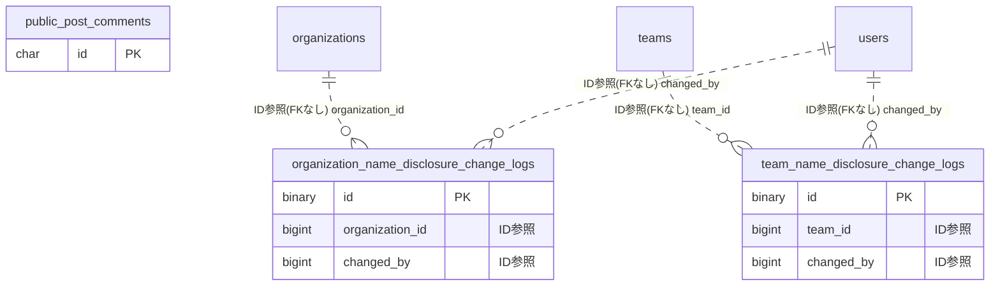

# publicview ドメイン ER 図

> このファイルは自動生成されます。手で編集しないでください。再生成: `cd backend && ./gradlew generateErDiagrams`

- テーブル数: 3
- ビュー数: 0

## ER 図

実線 = 外部キー、点線 = ID参照(FKなし)。図中の `FK` は実外部キーの列だけ（ID参照列は `FK` を付けず "ID参照" と注記）。図にはキー列（PK / FK / 参照推定列 / 単一列 UNIQUE）のみを描く。全列は下の「テーブル定義」を参照。

## 被参照（他ドメインから）

このドメインのテーブルを参照している他ドメインの側（実 FK と ID参照のみ。多態参照と推定不能参照は含まない。同一ドメイン内の参照は上の図を参照）。

なし

## 推定不能参照

| テーブル | 列 | 理由 |
| --- | --- | --- |
| `public_post_comments` | `author_id` | 参照先テーブルを特定できない |
| `public_post_comments` | `post_id` | 参照先テーブルを特定できない |

## テーブル定義

### `organization_name_disclosure_change_logs`

| 列名 | 型 | NULL | 既定値 | コメント |
| --- | --- | --- | --- | --- |
| `id` | `binary(16)` | NO | （なし） |  |
| `organization_id` | `bigint unsigned` | NO | （なし） |  |
| `changed_by` | `bigint` | NO | （なし） |  |
| `old_mode` | `enum('DISPLAY_NAME','REAL_NAME')` | NO | （なし） |  |
| `new_mode` | `enum('DISPLAY_NAME','REAL_NAME')` | NO | （なし） |  |
| `confirmed` | `tinyint(1)` | NO | `0` |  |
| `changed_at` | `datetime(6)` | NO | `CURRENT_TIMESTAMP(6)` （式） |  |

### `public_post_comments`

| 列名 | 型 | NULL | 既定値 | コメント |
| --- | --- | --- | --- | --- |
| `id` | `char(36)` | NO | （なし） | UUIDv7 |
| `post_id` | `bigint unsigned` | NO | （なし） | 対象 BlogPost の ID |
| `author_id` | `bigint unsigned` | NO | （なし） | 投稿者ユーザー ID（users.id） |
| `content` | `text` | NO | （なし） | コメント本文（最大 1000 文字） |
| `author_real_name_snapshot` | `varchar(100)` | YES | NULL | 投稿者本名スナップショット（REAL_NAME モード時のみ設定） |
| `created_at` | `datetime(6)` | NO | （なし） |  |
| `deleted_at` | `datetime(6)` | YES | NULL |  |

### `team_name_disclosure_change_logs`

| 列名 | 型 | NULL | 既定値 | コメント |
| --- | --- | --- | --- | --- |
| `id` | `binary(16)` | NO | （なし） |  |
| `team_id` | `bigint unsigned` | NO | （なし） |  |
| `changed_by` | `bigint` | NO | （なし） |  |
| `old_mode` | `enum('DISPLAY_NAME','REAL_NAME')` | NO | （なし） |  |
| `new_mode` | `enum('DISPLAY_NAME','REAL_NAME')` | NO | （なし） |  |
| `confirmed` | `tinyint(1)` | NO | `0` |  |
| `changed_at` | `datetime(6)` | NO | `CURRENT_TIMESTAMP(6)` （式） |  |
