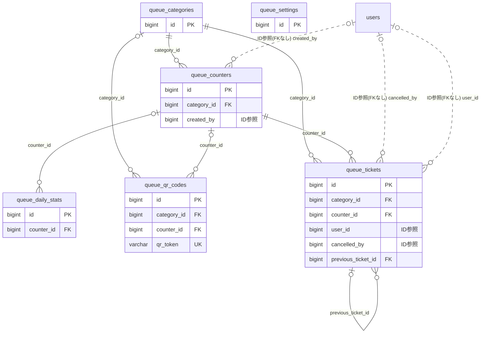

# queue ドメイン ER 図

> このファイルは自動生成されます。手で編集しないでください。再生成: `cd backend && ./gradlew generateErDiagrams`

- テーブル数: 6
- ビュー数: 0

## ER 図

実線 = 外部キー、点線 = ID参照(FKなし)。図中の `FK` は実外部キーの列だけ（ID参照列は `FK` を付けず "ID参照" と注記）。図にはキー列（PK / FK / 参照推定列 / 単一列 UNIQUE）のみを描く。全列は下の「テーブル定義」を参照。

## 被参照（他ドメインから）

このドメインのテーブルを参照している他ドメインの側（実 FK と ID参照のみ。多態参照と推定不能参照は含まない。同一ドメイン内の参照は上の図を参照）。

なし

## 自己参照

mermaid は同一テーブルの自己参照を複数描けず 1 本に畳むため、図に線が欠けることがある。自己参照はこの表を正とする。

| テーブル | 列 | 種別 |
| --- | --- | --- |
| `queue_tickets` | `previous_ticket_id` | 外部キー |

## 多態参照（線を引かない）

| テーブル | 種別列 | ID列 |
| --- | --- | --- |
| `queue_categories` | `scope_type` | `scope_id` |
| `queue_daily_stats` | `scope_type` | `scope_id` |
| `queue_settings` | `scope_type` | `scope_id` |

## テーブル定義

### `queue_categories`

| 列名 | 型 | NULL | 既定値 | コメント |
| --- | --- | --- | --- | --- |
| `id` | `bigint unsigned` | NO | （なし） auto_increment |  |
| `scope_type` | `varchar(20)` | NO | （なし） |  |
| `scope_id` | `bigint unsigned` | NO | （なし） |  |
| `name` | `varchar(50)` | NO | （なし） |  |
| `queue_mode` | `varchar(10)` | NO | `INDIVIDUAL` |  |
| `prefix_char` | `varchar(5)` | YES | NULL |  |
| `max_queue_size` | `smallint unsigned` | NO | `50` |  |
| `display_order` | `smallint unsigned` | NO | `0` |  |
| `created_at` | `datetime` | NO | `CURRENT_TIMESTAMP` （式） |  |
| `updated_at` | `datetime` | NO | `CURRENT_TIMESTAMP` （式） |  |
| `deleted_at` | `datetime` | YES | NULL |  |

### `queue_counters`

| 列名 | 型 | NULL | 既定値 | コメント |
| --- | --- | --- | --- | --- |
| `id` | `bigint unsigned` | NO | （なし） auto_increment |  |
| `category_id` | `bigint unsigned` | NO | （なし） |  |
| `name` | `varchar(100)` | NO | （なし） |  |
| `description` | `varchar(500)` | YES | NULL |  |
| `accept_mode` | `varchar(20)` | NO | `BOTH` |  |
| `avg_service_minutes` | `smallint unsigned` | NO | `10` |  |
| `avg_service_minutes_manual` | `tinyint(1)` | NO | `0` |  |
| `max_queue_size` | `smallint unsigned` | NO | `50` |  |
| `is_active` | `tinyint(1)` | NO | `1` |  |
| `is_accepting` | `tinyint(1)` | NO | `1` |  |
| `operating_time_from` | `time` | YES | NULL |  |
| `operating_time_to` | `time` | YES | NULL |  |
| `display_order` | `smallint unsigned` | NO | `0` |  |
| `created_by` | `bigint unsigned` | YES | NULL |  |
| `created_at` | `datetime` | NO | `CURRENT_TIMESTAMP` （式） |  |
| `updated_at` | `datetime` | NO | `CURRENT_TIMESTAMP` （式） |  |
| `deleted_at` | `datetime` | YES | NULL |  |

### `queue_daily_stats`

| 列名 | 型 | NULL | 既定値 | コメント |
| --- | --- | --- | --- | --- |
| `id` | `bigint unsigned` | NO | （なし） auto_increment |  |
| `scope_type` | `varchar(20)` | NO | （なし） |  |
| `scope_id` | `bigint unsigned` | NO | （なし） |  |
| `counter_id` | `bigint unsigned` | YES | NULL |  |
| `stat_date` | `date` | NO | （なし） |  |
| `total_tickets` | `smallint unsigned` | NO | `0` |  |
| `completed_count` | `smallint unsigned` | NO | `0` |  |
| `cancelled_count` | `smallint unsigned` | NO | `0` |  |
| `no_show_count` | `smallint unsigned` | NO | `0` |  |
| `avg_wait_minutes` | `decimal(5,1)` | YES | NULL |  |
| `avg_service_minutes` | `decimal(5,1)` | YES | NULL |  |
| `peak_hour` | `tinyint unsigned` | YES | NULL |  |
| `qr_count` | `smallint unsigned` | NO | `0` |  |
| `online_count` | `smallint unsigned` | NO | `0` |  |
| `created_at` | `datetime` | NO | `CURRENT_TIMESTAMP` （式） |  |
| `updated_at` | `datetime` | NO | `CURRENT_TIMESTAMP` （式） |  |

### `queue_qr_codes`

| 列名 | 型 | NULL | 既定値 | コメント |
| --- | --- | --- | --- | --- |
| `id` | `bigint unsigned` | NO | （なし） auto_increment |  |
| `category_id` | `bigint unsigned` | YES | NULL |  |
| `counter_id` | `bigint unsigned` | YES | NULL |  |
| `qr_token` | `varchar(64)` | NO | （なし） |  |
| `is_active` | `tinyint(1)` | NO | `1` |  |
| `created_at` | `datetime` | NO | `CURRENT_TIMESTAMP` （式） |  |
| `updated_at` | `datetime` | NO | `CURRENT_TIMESTAMP` （式） |  |

### `queue_settings`

| 列名 | 型 | NULL | 既定値 | コメント |
| --- | --- | --- | --- | --- |
| `id` | `bigint unsigned` | NO | （なし） auto_increment |  |
| `scope_type` | `varchar(20)` | NO | （なし） |  |
| `scope_id` | `bigint unsigned` | NO | （なし） |  |
| `no_show_timeout_minutes` | `smallint unsigned` | NO | `5` |  |
| `no_show_penalty_enabled` | `tinyint(1)` | NO | `0` |  |
| `no_show_penalty_threshold` | `smallint unsigned` | NO | `3` |  |
| `no_show_penalty_days` | `smallint unsigned` | NO | `14` |  |
| `max_active_tickets_per_user` | `smallint unsigned` | NO | `1` |  |
| `allow_guest_queue` | `tinyint(1)` | NO | `1` |  |
| `almost_ready_threshold` | `smallint unsigned` | NO | `3` |  |
| `hold_extension_minutes` | `smallint unsigned` | NO | `5` |  |
| `auto_adjust_service_minutes` | `tinyint(1)` | NO | `0` |  |
| `display_board_public` | `tinyint(1)` | NO | `0` |  |
| `created_at` | `datetime` | NO | `CURRENT_TIMESTAMP` （式） |  |
| `updated_at` | `datetime` | NO | `CURRENT_TIMESTAMP` （式） |  |

### `queue_tickets`

| 列名 | 型 | NULL | 既定値 | コメント |
| --- | --- | --- | --- | --- |
| `id` | `bigint unsigned` | NO | （なし） auto_increment |  |
| `category_id` | `bigint unsigned` | NO | （なし） |  |
| `counter_id` | `bigint unsigned` | NO | （なし） |  |
| `ticket_number` | `varchar(20)` | NO | （なし） |  |
| `user_id` | `bigint unsigned` | YES | NULL |  |
| `guest_name` | `varchar(50)` | YES | NULL |  |
| `guest_phone` | `text` | YES | NULL | ゲスト電話番号（AES-256-GCM暗号化・Base64。ゲスト以外は NULL） |
| `party_size` | `smallint unsigned` | NO | `1` |  |
| `source` | `varchar(10)` | NO | （なし） |  |
| `status` | `varchar(20)` | NO | `WAITING` |  |
| `position` | `int unsigned` | NO | （なし） |  |
| `estimated_wait_minutes` | `smallint unsigned` | YES | NULL |  |
| `called_at` | `datetime` | YES | NULL |  |
| `serving_at` | `datetime` | YES | NULL |  |
| `completed_at` | `datetime` | YES | NULL |  |
| `cancelled_at` | `datetime` | YES | NULL |  |
| `cancelled_by` | `bigint unsigned` | YES | NULL |  |
| `no_show_at` | `datetime` | YES | NULL |  |
| `hold_until` | `datetime` | YES | NULL |  |
| `hold_used` | `tinyint(1)` | NO | `0` |  |
| `actual_service_minutes` | `smallint unsigned` | YES | NULL |  |
| `note` | `varchar(300)` | YES | NULL |  |
| `previous_ticket_id` | `bigint unsigned` | YES | NULL |  |
| `issued_date` | `date` | NO | （なし） |  |
| `created_at` | `datetime` | NO | `CURRENT_TIMESTAMP` （式） |  |
| `updated_at` | `datetime` | NO | `CURRENT_TIMESTAMP` （式） |  |
