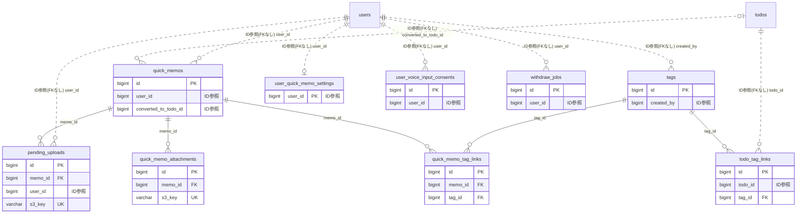

# quickmemo ドメイン ER 図

> このファイルは自動生成されます。手で編集しないでください。再生成: `cd backend && ./gradlew generateErDiagrams`

- テーブル数: 9
- ビュー数: 0

## ER 図

実線 = 外部キー、点線 = ID参照(FKなし)。図中の `FK` は実外部キーの列だけ（ID参照列は `FK` を付けず "ID参照" と注記）。図にはキー列（PK / FK / 参照推定列 / 単一列 UNIQUE）のみを描く。全列は下の「テーブル定義」を参照。

## 被参照（他ドメインから）

このドメインのテーブルを参照している他ドメインの側（実 FK と ID参照のみ。多態参照と推定不能参照は含まない。同一ドメイン内の参照は上の図を参照）。

なし

## 多態参照（線を引かない）

| テーブル | 種別列 | ID列 |
| --- | --- | --- |
| `tags` | `scope_type` | `scope_id` |

## テーブル定義

### `pending_uploads`

| 列名 | 型 | NULL | 既定値 | コメント |
| --- | --- | --- | --- | --- |
| `id` | `bigint unsigned` | NO | （なし） auto_increment |  |
| `memo_id` | `bigint unsigned` | NO | （なし） | FK -&gt; quick_memos.id (ON DELETE CASCADE) |
| `user_id` | `bigint unsigned` | NO | （なし） | FK -&gt; users.id (ON DELETE CASCADE) |
| `s3_key` | `varchar(512)` | NO | （なし） |  |
| `declared_size_bytes` | `int` | NO | （なし） |  |
| `content_type` | `varchar(100)` | NO | （なし） |  |
| `presigned_url_expires_at` | `datetime(6)` | NO | （なし） |  |
| `confirmed_at` | `datetime(6)` | YES | NULL | NULL = 未確認（孤立URL） |
| `created_at` | `datetime(6)` | NO | `CURRENT_TIMESTAMP(6)` （式） |  |

### `quick_memo_attachments`

| 列名 | 型 | NULL | 既定値 | コメント |
| --- | --- | --- | --- | --- |
| `id` | `bigint unsigned` | NO | （なし） auto_increment |  |
| `memo_id` | `bigint unsigned` | NO | （なし） | FK -&gt; quick_memos.id (ON DELETE CASCADE) |
| `s3_key` | `varchar(512)` | NO | （なし） | quick-memo/{yyyymm}/{uuid}.{ext} |
| `original_filename` | `varchar(255)` | YES | NULL |  |
| `content_type` | `varchar(100)` | NO | （なし） | image/jpeg, image/png, image/webp, image/gif |
| `file_size_bytes` | `int` | NO | （なし） |  |
| `width_px` | `int` | YES | NULL |  |
| `height_px` | `int` | YES | NULL |  |
| `sort_order` | `int` | NO | `0` |  |
| `created_at` | `datetime(6)` | NO | `CURRENT_TIMESTAMP(6)` （式） |  |

### `quick_memo_tag_links`

| 列名 | 型 | NULL | 既定値 | コメント |
| --- | --- | --- | --- | --- |
| `id` | `bigint unsigned` | NO | （なし） auto_increment |  |
| `memo_id` | `bigint unsigned` | NO | （なし） | FK -&gt; quick_memos.id (ON DELETE CASCADE) |
| `tag_id` | `bigint unsigned` | NO | （なし） | FK -&gt; tags.id (ON DELETE CASCADE) |
| `created_at` | `datetime(6)` | NO | `CURRENT_TIMESTAMP(6)` （式） |  |

### `quick_memos`

| 列名 | 型 | NULL | 既定値 | コメント |
| --- | --- | --- | --- | --- |
| `id` | `bigint unsigned` | NO | （なし） auto_increment |  |
| `user_id` | `bigint unsigned` | NO | （なし） | FK -&gt; users.id (ON DELETE CASCADE) |
| `title` | `varchar(200)` | NO | （なし） |  |
| `body` | `text` | YES | NULL |  |
| `status` | `varchar(20)` | NO | `UNSORTED` | UNSORTED / ARCHIVED / CONVERTED |
| `reminder_uses_default` | `tinyint(1)` | NO | `1` |  |
| `reminder_1_scheduled_at` | `datetime(6)` | YES | NULL |  |
| `reminder_1_sent_at` | `datetime(6)` | YES | NULL |  |
| `reminder_2_scheduled_at` | `datetime(6)` | YES | NULL |  |
| `reminder_2_sent_at` | `datetime(6)` | YES | NULL |  |
| `reminder_3_scheduled_at` | `datetime(6)` | YES | NULL |  |
| `reminder_3_sent_at` | `datetime(6)` | YES | NULL |  |
| `converted_to_todo_id` | `bigint unsigned` | YES | NULL | TODO 昇格先の todos.id（非FK） |
| `converted_at` | `datetime(6)` | YES | NULL |  |
| `user_timezone_at_creation` | `varchar(50)` | NO | `Asia/Tokyo` |  |
| `deleted_at` | `datetime(6)` | YES | NULL | 論理削除（90日後に物理削除バッチが実行） |
| `created_at` | `datetime(6)` | NO | `CURRENT_TIMESTAMP(6)` （式） |  |
| `updated_at` | `datetime(6)` | NO | `CURRENT_TIMESTAMP(6)` （式） |  |

### `tags`

| 列名 | 型 | NULL | 既定値 | コメント |
| --- | --- | --- | --- | --- |
| `id` | `bigint unsigned` | NO | （なし） auto_increment |  |
| `scope_type` | `varchar(20)` | NO | （なし） | PERSONAL / TEAM / ORGANIZATION |
| `scope_id` | `bigint unsigned` | NO | （なし） | PERSONAL=user_id / TEAM=team_id / ORGANIZATION=organization_id |
| `name` | `varchar(30)` | NO | （なし） |  |
| `color` | `varchar(7)` | YES | NULL | HEX カラーコード (#RRGGBB) |
| `usage_count` | `int` | NO | `0` |  |
| `created_by` | `bigint unsigned` | NO | （なし） | FK -&gt; users.id (ON DELETE RESTRICT) |
| `created_at` | `datetime(6)` | NO | `CURRENT_TIMESTAMP(6)` （式） |  |
| `updated_at` | `datetime(6)` | NO | `CURRENT_TIMESTAMP(6)` （式） |  |

### `todo_tag_links`

| 列名 | 型 | NULL | 既定値 | コメント |
| --- | --- | --- | --- | --- |
| `id` | `bigint unsigned` | NO | （なし） auto_increment |  |
| `todo_id` | `bigint unsigned` | NO | （なし） | FK -&gt; todos.id (ON DELETE CASCADE) |
| `tag_id` | `bigint unsigned` | NO | （なし） | FK -&gt; tags.id (ON DELETE CASCADE) |
| `created_at` | `datetime(6)` | NO | `CURRENT_TIMESTAMP(6)` （式） |  |

### `user_quick_memo_settings`

| 列名 | 型 | NULL | 既定値 | コメント |
| --- | --- | --- | --- | --- |
| `user_id` | `bigint unsigned` | NO | （なし） | PK / FK -&gt; users.id (ON DELETE CASCADE) |
| `reminder_enabled` | `tinyint(1)` | NO | `0` |  |
| `default_offset_1_days` | `int` | YES | NULL | 1枠目: 何日後か（1-90） |
| `default_time_1` | `time` | YES | NULL | 1枠目: 時刻（HH:00 or HH:30） |
| `default_offset_2_days` | `int` | YES | NULL | 2枠目: 何日後か（1-90） |
| `default_time_2` | `time` | YES | NULL | 2枠目: 時刻（HH:00 or HH:30） |
| `default_offset_3_days` | `int` | YES | NULL | 3枠目: 何日後か（1-90） |
| `default_time_3` | `time` | YES | NULL | 3枠目: 時刻（HH:00 or HH:30） |
| `created_at` | `datetime(6)` | NO | `CURRENT_TIMESTAMP(6)` （式） |  |
| `updated_at` | `datetime(6)` | NO | `CURRENT_TIMESTAMP(6)` （式） |  |

### `user_voice_input_consents`

| 列名 | 型 | NULL | 既定値 | コメント |
| --- | --- | --- | --- | --- |
| `id` | `bigint unsigned` | NO | （なし） auto_increment |  |
| `user_id` | `bigint unsigned` | NO | （なし） | FK -&gt; users.id (ON DELETE CASCADE) |
| `version` | `int` | NO | （なし） | 同意した音声ポリシーのバージョン番号 |
| `consented_at` | `datetime(6)` | NO | `CURRENT_TIMESTAMP(6)` （式） |  |
| `revoked_at` | `datetime(6)` | YES | NULL | NULL = 有効、非NULL = 取消済み |
| `user_agent` | `varchar(512)` | YES | NULL |  |
| `ip_address` | `varchar(45)` | YES | NULL | IPv4 or IPv6 |

### `withdraw_jobs`

| 列名 | 型 | NULL | 既定値 | コメント |
| --- | --- | --- | --- | --- |
| `id` | `bigint` | NO | （なし） auto_increment |  |
| `user_id` | `bigint unsigned` | NO | （なし） | users テーブルとは非FK（退会処理中に削除される） |
| `status` | `varchar(20)` | NO | `PENDING` | PENDING / IN_PROGRESS / COMPLETED / FAILED / BLOCKED_MANUAL |
| `current_step` | `int` | NO | `1` | 1-7 |
| `step_1_completed` | `tinyint(1)` | NO | `0` | PERSONAL タグ削除 |
| `step_2_completed` | `tinyint(1)` | NO | `0` | TEAM タグ移譲 |
| `step_3_completed` | `tinyint(1)` | NO | `0` | ORGANIZATION タグ移譲 |
| `step_4_completed` | `tinyint(1)` | NO | `0` | quick_memos 物理削除（S3含む） |
| `step_5_completed` | `tinyint(1)` | NO | `0` | user_quick_memo_settings 物理削除 |
| `step_6_completed` | `tinyint(1)` | NO | `0` | 監査ログ匿名化 |
| `step_7_completed` | `tinyint(1)` | NO | `0` | users 物理削除 |
| `last_error_message` | `text` | YES | NULL |  |
| `last_error_step` | `int` | YES | NULL |  |
| `retry_count` | `int` | NO | `0` |  |
| `started_at` | `datetime(6)` | YES | NULL |  |
| `completed_at` | `datetime(6)` | YES | NULL |  |
| `created_at` | `datetime(6)` | NO | `CURRENT_TIMESTAMP(6)` （式） |  |
| `updated_at` | `datetime(6)` | NO | `CURRENT_TIMESTAMP(6)` （式） |  |
