# ranch ドメイン ER 図

> このファイルは自動生成されます。手で編集しないでください。再生成: `cd backend && ./gradlew generateErDiagrams`

- テーブル数: 18
- ビュー数: 0

## ER 図

実線 = 外部キー、点線 = ID参照(FKなし)。図中の `FK` は実外部キーの列だけ（ID参照列は `FK` を付けず "ID参照" と注記）。図にはキー列（PK / FK / 参照推定列 / 単一列 UNIQUE）のみを描く。全列は下の「テーブル定義」を参照。

```mermaid
erDiagram
    ranch_admin_commands {
        binary id PK
        bigint actor_user_id "ID参照"
    }
    ranch_affinity_units {
        binary id PK
        binary owner_id FK
        bigint user_id "ID参照"
    }
    ranch_care_rules {
        binary id PK
        bigint version_number UK
        datetime effective_at UK
        bigint published_by "ID参照"
    }
    ranch_care_week_budgets {
        binary id PK
        binary owner_id FK
        bigint user_id "ID参照"
    }
    ranch_collectible_catalog {
        varchar collectible_key PK
    }
    ranch_collectible_inventory {
        binary id PK
        binary owner_id FK
        bigint user_id "ID参照"
        varchar collectible_key FK
    }
    ranch_commands {
        binary id PK
        binary owner_id FK
        bigint user_id "ID参照"
    }
    ranch_dinosaurs {
        binary id PK
        binary owner_id FK, UK
        bigint user_id "ID参照"
    }
    ranch_operational_controls {
        tinyint id PK
        bigint updated_by "ID参照"
    }
    ranch_owners {
        binary id PK
        bigint user_id UK "ID参照"
    }
    ranch_participation_periods {
        binary id PK
        binary owner_id FK
        bigint user_id "ID参照"
    }
    ranch_point_ledger {
        binary id PK
        binary owner_id FK
        bigint user_id "ID参照"
        binary decision_id UK
    }
    ranch_reward_decisions {
        binary id PK
        binary owner_id FK
        bigint user_id "ID参照"
        binary event_id UK
    }
    ranch_reward_pause_periods {
        binary id PK
        bigint changed_by "ID参照"
    }
    ranch_reward_policies {
        binary id PK
        bigint version_number UK
        datetime effective_at UK
        bigint published_by "ID参照"
    }
    ranch_room_placements {
        binary id PK
        binary owner_id FK
        bigint user_id "ID参照"
        binary inventory_id FK
    }
    ranch_shop_items {
        binary id PK
        varchar collectible_key FK
    }
    ranch_week_budgets {
        binary id PK
        binary owner_id FK
        bigint user_id "ID参照"
    }
    users
    users ||..o{ ranch_admin_commands : "ID参照(FKなし) actor_user_id"
    ranch_owners ||--o{ ranch_affinity_units : "owner_id"
    users ||..o{ ranch_affinity_units : "ID参照(FKなし) user_id"
    users ||..o{ ranch_care_rules : "ID参照(FKなし) published_by"
    ranch_owners ||--o{ ranch_care_week_budgets : "owner_id"
    users ||..o{ ranch_care_week_budgets : "ID参照(FKなし) user_id"
    ranch_collectible_catalog ||--o{ ranch_collectible_inventory : "collectible_key"
    ranch_owners ||--o{ ranch_collectible_inventory : "owner_id"
    users ||..o{ ranch_collectible_inventory : "ID参照(FKなし) user_id"
    ranch_owners ||--o{ ranch_commands : "owner_id"
    users ||..o{ ranch_commands : "ID参照(FKなし) user_id"
    ranch_owners ||--o| ranch_dinosaurs : "owner_id"
    users ||..o{ ranch_dinosaurs : "ID参照(FKなし) user_id"
    users |o..o{ ranch_operational_controls : "ID参照(FKなし) updated_by"
    users ||..o| ranch_owners : "ID参照(FKなし) user_id"
    ranch_owners ||--o{ ranch_participation_periods : "owner_id"
    users ||..o{ ranch_participation_periods : "ID参照(FKなし) user_id"
    ranch_owners ||--o{ ranch_point_ledger : "owner_id"
    users ||..o{ ranch_point_ledger : "ID参照(FKなし) user_id"
    ranch_owners ||--o{ ranch_reward_decisions : "owner_id"
    users ||..o{ ranch_reward_decisions : "ID参照(FKなし) user_id"
    users ||..o{ ranch_reward_pause_periods : "ID参照(FKなし) changed_by"
    users ||..o{ ranch_reward_policies : "ID参照(FKなし) published_by"
    ranch_collectible_inventory |o--o{ ranch_room_placements : "owner_id, inventory_id"
    ranch_owners ||--o{ ranch_room_placements : "owner_id"
    users ||..o{ ranch_room_placements : "ID参照(FKなし) user_id"
    ranch_collectible_catalog ||--o{ ranch_shop_items : "collectible_key"
    ranch_owners ||--o{ ranch_week_budgets : "owner_id"
    users ||..o{ ranch_week_budgets : "ID参照(FKなし) user_id"
```

## 被参照（他ドメインから）

このドメインのテーブルを参照している他ドメインの側（実 FK と ID参照のみ。多態参照と推定不能参照は含まない。同一ドメイン内の参照は上の図を参照）。

なし

## 推定不能参照

| テーブル | 列 | 理由 |
| --- | --- | --- |
| `ranch_affinity_units` | `dinosaur_id` | 参照先テーブルを特定できない |
| `ranch_care_week_budgets` | `rule_id` | 参照先テーブルを特定できない |
| `ranch_collectible_inventory` | `legacy_badge_id` | 型が参照先 badges.id と不一致（varchar ≠ bigint） |
| `ranch_dinosaurs` | `assignment_result_id` | 参照先テーブルを特定できない |
| `ranch_point_ledger` | `command_id` | 参照先テーブルを特定できない |
| `ranch_point_ledger` | `decision_id` | 参照先テーブルを特定できない |
| `ranch_point_ledger` | `dinosaur_id` | 参照先テーブルを特定できない |
| `ranch_reward_decisions` | `event_id` | 型が参照先 events.id と不一致（binary ≠ bigint） |
| `ranch_reward_decisions` | `policy_id` | 参照先テーブルを特定できない |
| `ranch_week_budgets` | `policy_id` | 参照先テーブルを特定できない |

## テーブル定義

### `ranch_admin_commands`

| 列名 | 型 | NULL | 既定値 | コメント |
| --- | --- | --- | --- | --- |
| `id` | `binary(16)` | NO | （なし） |  |
| `created_at` | `datetime(6)` | NO | （なし） |  |
| `updated_at` | `datetime(6)` | NO | （なし） |  |
| `actor_user_id` | `bigint unsigned` | NO | （なし） |  |
| `idempotency_key` | `binary(16)` | NO | （なし） |  |
| `command_type` | `varchar(30)` | NO | （なし） |  |
| `body_hash` | `binary(32)` | NO | （なし） |  |
| `result_json` | `json` | NO | （なし） |  |
| `completed_at` | `datetime(6)` | NO | （なし） |  |

### `ranch_affinity_units`

| 列名 | 型 | NULL | 既定値 | コメント |
| --- | --- | --- | --- | --- |
| `id` | `binary(16)` | NO | （なし） |  |
| `created_at` | `datetime(6)` | NO | （なし） |  |
| `updated_at` | `datetime(6)` | NO | （なし） |  |
| `owner_id` | `binary(16)` | NO | （なし） |  |
| `user_id` | `bigint unsigned` | NO | （なし） |  |
| `dinosaur_id` | `binary(16)` | NO | （なし） |  |
| `earned_on` | `date` | NO | （なし） |  |
| `kind` | `varchar(10)` | NO | （なし） |  |
| `gain` | `bigint` | NO | （なし） |  |

### `ranch_care_rules`

| 列名 | 型 | NULL | 既定値 | コメント |
| --- | --- | --- | --- | --- |
| `id` | `binary(16)` | NO | （なし） |  |
| `created_at` | `datetime(6)` | NO | （なし） |  |
| `updated_at` | `datetime(6)` | NO | （なし） |  |
| `version_number` | `bigint` | NO | （なし） |  |
| `effective_at` | `datetime(6)` | NO | （なし） |  |
| `amount_xp` | `bigint` | NO | （なし） |  |
| `weekly_cap_xp` | `bigint` | NO | （なし） |  |
| `juvenile_xp` | `bigint` | NO | （なし） |  |
| `adult_xp` | `bigint` | NO | （なし） |  |
| `content_hash` | `binary(32)` | NO | （なし） |  |
| `published_by` | `bigint unsigned` | NO | （なし） |  |
| `published_at` | `datetime(6)` | NO | （なし） |  |

### `ranch_care_week_budgets`

| 列名 | 型 | NULL | 既定値 | コメント |
| --- | --- | --- | --- | --- |
| `id` | `binary(16)` | NO | （なし） |  |
| `created_at` | `datetime(6)` | NO | （なし） |  |
| `updated_at` | `datetime(6)` | NO | （なし） |  |
| `owner_id` | `binary(16)` | NO | （なし） |  |
| `user_id` | `bigint unsigned` | NO | （なし） |  |
| `week_starts_on` | `date` | NO | （なし） |  |
| `rule_id` | `binary(16)` | NO | （なし） |  |
| `rule_snapshot` | `json` | NO | （なし） |  |
| `weekly_cap_xp` | `bigint` | NO | （なし） |  |
| `awarded_xp` | `bigint` | NO | （なし） |  |
| `version` | `bigint` | NO | （なし） |  |

### `ranch_collectible_catalog`

| 列名 | 型 | NULL | 既定値 | コメント |
| --- | --- | --- | --- | --- |
| `collectible_key` | `varchar(80)` | NO | （なし） |  |
| `label_key` | `varchar(120)` | NO | （なし） |  |
| `asset_key` | `varchar(160)` | NO | （なし） |  |
| `source_kind` | `varchar(30)` | NO | （なし） |  |
| `is_active` | `tinyint(1)` | NO | `0` |  |
| `created_at` | `datetime(6)` | NO | （なし） |  |
| `updated_at` | `datetime(6)` | NO | （なし） |  |

### `ranch_collectible_inventory`

| 列名 | 型 | NULL | 既定値 | コメント |
| --- | --- | --- | --- | --- |
| `id` | `binary(16)` | NO | （なし） |  |
| `created_at` | `datetime(6)` | NO | （なし） |  |
| `updated_at` | `datetime(6)` | NO | （なし） |  |
| `owner_id` | `binary(16)` | NO | （なし） |  |
| `user_id` | `bigint unsigned` | NO | （なし） |  |
| `collectible_key` | `varchar(80)` | NO | （なし） |  |
| `acquisition_kind` | `varchar(20)` | NO | （なし） |  |
| `acquisition_key` | `varbinary(160)` | NO | （なし） |  |
| `legacy_badge_id` | `varchar(80)` | YES | NULL |  |
| `legacy_award_period` | `varchar(40)` | YES | NULL |  |
| `sku_key` | `varchar(80)` | YES | NULL |  |
| `price_version` | `bigint` | YES | NULL |  |
| `awarded_at` | `datetime(6)` | NO | （なし） |  |
| `is_revoked` | `tinyint(1)` | NO | `0` |  |

### `ranch_commands`

| 列名 | 型 | NULL | 既定値 | コメント |
| --- | --- | --- | --- | --- |
| `id` | `binary(16)` | NO | （なし） |  |
| `created_at` | `datetime(6)` | NO | （なし） |  |
| `updated_at` | `datetime(6)` | NO | （なし） |  |
| `owner_id` | `binary(16)` | NO | （なし） |  |
| `user_id` | `bigint unsigned` | NO | （なし） |  |
| `idempotency_key` | `binary(16)` | NO | （なし） |  |
| `command_type` | `varchar(30)` | NO | （なし） |  |
| `body_hash` | `binary(32)` | NO | （なし） |  |
| `result_json` | `json` | NO | （なし） |  |
| `completed_at` | `datetime(6)` | NO | （なし） |  |

### `ranch_dinosaurs`

| 列名 | 型 | NULL | 既定値 | コメント |
| --- | --- | --- | --- | --- |
| `id` | `binary(16)` | NO | （なし） |  |
| `created_at` | `datetime(6)` | NO | （なし） |  |
| `updated_at` | `datetime(6)` | NO | （なし） |  |
| `owner_id` | `binary(16)` | NO | （なし） |  |
| `user_id` | `bigint unsigned` | NO | （なし） |  |
| `habitat` | `varchar(8)` | YES | NULL |  |
| `species_key` | `varchar(60)` | YES | NULL |  |
| `variant_key` | `varchar(32)` | YES | NULL |  |
| `species_catalog_version` | `bigint` | YES | NULL |  |
| `assignment_method` | `varchar(30)` | YES | NULL |  |
| `selection_confirmed_at` | `datetime(6)` | YES | NULL |  |
| `assignment_rule_version` | `varchar(80)` | YES | NULL |  |
| `assignment_result_id` | `binary(16)` | YES | NULL |  |
| `assignment_input_hash` | `varchar(64)` | YES | NULL |  |
| `egg_started_at` | `datetime(6)` | NO | （なし） |  |
| `egg_ready_at` | `datetime(6)` | NO | （なし） |  |
| `egg_rule_snapshot` | `json` | NO | （なし） |  |
| `hatched_at` | `datetime(6)` | YES | NULL |  |
| `name` | `varchar(160)` | YES | NULL |  |
| `named_at` | `datetime(6)` | YES | NULL |  |
| `stage` | `varchar(20)` | NO | （なし） |  |
| `xp` | `bigint` | NO | （なし） |  |
| `growth_rule_snapshot` | `json` | NO | （なし） |  |
| `affinity` | `bigint` | NO | （なし） |  |
| `affinity_rule_snapshot` | `json` | NO | （なし） |  |
| `version` | `bigint` | NO | （なし） |  |

### `ranch_operational_controls`

| 列名 | 型 | NULL | 既定値 | コメント |
| --- | --- | --- | --- | --- |
| `id` | `tinyint` | NO | （なし） |  |
| `is_care_enabled` | `tinyint(1)` | NO | （なし） |  |
| `is_shop_enabled` | `tinyint(1)` | NO | （なし） |  |
| `is_delivery_paused` | `tinyint(1)` | NO | （なし） |  |
| `version` | `bigint` | NO | （なし） |  |
| `updated_by` | `bigint unsigned` | YES | NULL |  |
| `created_at` | `datetime(6)` | NO | （なし） |  |
| `updated_at` | `datetime(6)` | NO | （なし） |  |

### `ranch_owners`

| 列名 | 型 | NULL | 既定値 | コメント |
| --- | --- | --- | --- | --- |
| `id` | `binary(16)` | NO | （なし） |  |
| `created_at` | `datetime(6)` | NO | （なし） |  |
| `updated_at` | `datetime(6)` | NO | （なし） |  |
| `user_id` | `bigint unsigned` | NO | （なし） |  |
| `status` | `varchar(20)` | NO | （なし） |  |
| `balance` | `bigint` | NO | （なし） |  |
| `view_mode` | `varchar(20)` | NO | （なし） |  |
| `render_style` | `varchar(20)` | NO | （なし） |  |
| `motion_mode` | `varchar(20)` | NO | （なし） |  |
| `is_sound_enabled` | `tinyint(1)` | NO | （なし） |  |
| `sound_volume` | `int` | NO | （なし） |  |
| `version` | `bigint` | NO | （なし） |  |

### `ranch_participation_periods`

| 列名 | 型 | NULL | 既定値 | コメント |
| --- | --- | --- | --- | --- |
| `id` | `binary(16)` | NO | （なし） |  |
| `created_at` | `datetime(6)` | NO | （なし） |  |
| `updated_at` | `datetime(6)` | NO | （なし） |  |
| `owner_id` | `binary(16)` | NO | （なし） |  |
| `user_id` | `bigint unsigned` | NO | （なし） |  |
| `starts_at` | `datetime(6)` | NO | （なし） |  |
| `ends_at` | `datetime(6)` | YES | NULL |  |

### `ranch_point_ledger`

| 列名 | 型 | NULL | 既定値 | コメント |
| --- | --- | --- | --- | --- |
| `id` | `binary(16)` | NO | （なし） |  |
| `created_at` | `datetime(6)` | NO | （なし） |  |
| `updated_at` | `datetime(6)` | NO | （なし） |  |
| `owner_id` | `binary(16)` | NO | （なし） |  |
| `user_id` | `bigint unsigned` | NO | （なし） |  |
| `decision_id` | `binary(16)` | YES | NULL |  |
| `command_id` | `binary(16)` | YES | NULL |  |
| `entry_kind` | `varchar(20)` | NO | （なし） |  |
| `delta_points` | `bigint` | NO | （なし） |  |
| `balance_after` | `bigint` | NO | （なし） |  |
| `delta_xp` | `bigint` | NO | （なし） |  |
| `dinosaur_id` | `binary(16)` | YES | NULL |  |
| `rule_snapshot` | `json` | NO | （なし） |  |
| `occurred_at` | `datetime(6)` | NO | （なし） |  |

### `ranch_reward_decisions`

| 列名 | 型 | NULL | 既定値 | コメント |
| --- | --- | --- | --- | --- |
| `id` | `binary(16)` | NO | （なし） |  |
| `created_at` | `datetime(6)` | NO | （なし） |  |
| `updated_at` | `datetime(6)` | NO | （なし） |  |
| `owner_id` | `binary(16)` | NO | （なし） |  |
| `user_id` | `bigint unsigned` | NO | （なし） |  |
| `event_id` | `binary(16)` | NO | （なし） |  |
| `source_type` | `varchar(40)` | NO | （なし） |  |
| `canonical_key_hash` | `binary(32)` | NO | （なし） |  |
| `canonical_key` | `varbinary(240)` | NO | （なし） |  |
| `reward_week` | `date` | NO | （なし） |  |
| `policy_id` | `binary(16)` | YES | NULL |  |
| `status` | `varchar(40)` | NO | （なし） |  |
| `requested_points` | `bigint` | NO | （なし） |  |
| `awarded_points` | `bigint` | NO | （なし） |  |
| `occurred_at` | `datetime(6)` | NO | （なし） |  |
| `decided_at` | `datetime(6)` | NO | （なし） |  |

### `ranch_reward_pause_periods`

| 列名 | 型 | NULL | 既定値 | コメント |
| --- | --- | --- | --- | --- |
| `id` | `binary(16)` | NO | （なし） |  |
| `created_at` | `datetime(6)` | NO | （なし） |  |
| `updated_at` | `datetime(6)` | NO | （なし） |  |
| `starts_at` | `datetime(6)` | NO | （なし） |  |
| `ends_at` | `datetime(6)` | YES | NULL |  |
| `reason_code` | `varchar(40)` | NO | （なし） |  |
| `changed_by` | `bigint unsigned` | NO | （なし） |  |

### `ranch_reward_policies`

| 列名 | 型 | NULL | 既定値 | コメント |
| --- | --- | --- | --- | --- |
| `id` | `binary(16)` | NO | （なし） |  |
| `created_at` | `datetime(6)` | NO | （なし） |  |
| `updated_at` | `datetime(6)` | NO | （なし） |  |
| `version_number` | `bigint` | NO | （なし） |  |
| `effective_at` | `datetime(6)` | NO | （なし） |  |
| `schema_version` | `int` | NO | （なし） |  |
| `settings_json` | `json` | NO | （なし） |  |
| `content_hash` | `binary(32)` | NO | （なし） |  |
| `published_by` | `bigint unsigned` | NO | （なし） |  |
| `published_at` | `datetime(6)` | NO | （なし） |  |

### `ranch_room_placements`

| 列名 | 型 | NULL | 既定値 | コメント |
| --- | --- | --- | --- | --- |
| `id` | `binary(16)` | NO | （なし） |  |
| `created_at` | `datetime(6)` | NO | （なし） |  |
| `updated_at` | `datetime(6)` | NO | （なし） |  |
| `owner_id` | `binary(16)` | NO | （なし） |  |
| `user_id` | `bigint unsigned` | NO | （なし） |  |
| `slot_key` | `varchar(30)` | NO | （なし） |  |
| `inventory_id` | `binary(16)` | YES | NULL |  |
| `version` | `bigint` | NO | （なし） |  |

### `ranch_shop_items`

| 列名 | 型 | NULL | 既定値 | コメント |
| --- | --- | --- | --- | --- |
| `id` | `binary(16)` | NO | （なし） |  |
| `created_at` | `datetime(6)` | NO | （なし） |  |
| `updated_at` | `datetime(6)` | NO | （なし） |  |
| `sku_key` | `varchar(80)` | NO | （なし） |  |
| `price_version` | `bigint` | NO | （なし） |  |
| `collectible_key` | `varchar(80)` | NO | （なし） |  |
| `price_points` | `bigint` | NO | （なし） |  |
| `is_active` | `tinyint(1)` | NO | `0` |  |

### `ranch_week_budgets`

| 列名 | 型 | NULL | 既定値 | コメント |
| --- | --- | --- | --- | --- |
| `id` | `binary(16)` | NO | （なし） |  |
| `created_at` | `datetime(6)` | NO | （なし） |  |
| `updated_at` | `datetime(6)` | NO | （なし） |  |
| `owner_id` | `binary(16)` | NO | （なし） |  |
| `user_id` | `bigint unsigned` | NO | （なし） |  |
| `week_starts_on` | `date` | NO | （なし） |  |
| `policy_id` | `binary(16)` | NO | （なし） |  |
| `rule_snapshot` | `json` | NO | （なし） |  |
| `global_cap` | `bigint` | NO | （なし） |  |
| `awarded_total` | `bigint` | NO | （なし） |  |
| `source_counts` | `json` | NO | （なし） |  |
| `version` | `bigint` | NO | （なし） |  |
