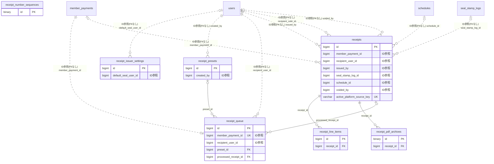

# receipt ドメイン ER 図

> このファイルは自動生成されます。手で編集しないでください。再生成: `cd backend && ./gradlew generateErDiagrams`

- テーブル数: 7
- ビュー数: 0

## ER 図

実線 = 外部キー、点線 = ID参照(FKなし)。図中の `FK` は実外部キーの列だけ（ID参照列は `FK` を付けず "ID参照" と注記）。図にはキー列（PK / FK / 参照推定列 / 単一列 UNIQUE）のみを描く。全列は下の「テーブル定義」を参照。

## 被参照（他ドメインから）

このドメインのテーブルを参照している他ドメインの側（実 FK と ID参照のみ。多態参照と推定不能参照は含まない。同一ドメイン内の参照は上の図を参照）。

なし

## 多態参照（線を引かない）

| テーブル | 種別列 | ID列 |
| --- | --- | --- |
| `receipt_issuer_settings` | `scope_type` | `scope_id` |
| `receipt_number_sequences` | `scope_type` | `scope_id` |
| `receipt_presets` | `scope_type` | `scope_id` |
| `receipt_queue` | `scope_type` | `scope_id` |
| `receipts` | `scope_type` | `scope_id` |

## テーブル定義

### `receipt_issuer_settings`

| 列名 | 型 | NULL | 既定値 | コメント |
| --- | --- | --- | --- | --- |
| `id` | `bigint unsigned` | NO | （なし） auto_increment |  |
| `scope_type` | `varchar(20)` | NO | （なし） | スコープ（TEAM / ORGANIZATION） |
| `scope_id` | `bigint unsigned` | NO | （なし） | スコープ ID |
| `issuer_name` | `text` | NO | （なし） | 発行者名（AES-256-GCM暗号化） |
| `postal_code` | `text` | YES | NULL | 郵便番号（AES-256-GCM暗号化） |
| `address` | `text` | YES | NULL | 住所（AES-256-GCM暗号化） |
| `phone` | `text` | YES | NULL | 電話番号（AES-256-GCM暗号化） |
| `is_qualified_invoicer` | `tinyint(1)` | NO | `0` | 適格請求書発行事業者か |
| `invoice_registration_number` | `varchar(14)` | YES | NULL | 登録番号（T + 13桁） |
| `default_seal_user_id` | `bigint unsigned` | YES | NULL | FK → users。デフォルト押印者 |
| `default_seal_variant` | `varchar(20)` | YES | NULL | デフォルト印鑑バリアント（LAST_NAME / FULL_NAME / FIRST_NAME） |
| `receipt_note_template` | `text` | YES | NULL | 但し書きのテンプレート |
| `logo_storage_key` | `varchar(500)` | YES | NULL | S3 上のロゴ画像キー |
| `custom_footer` | `text` | YES | NULL | PDF カスタムフッターテキスト |
| `next_receipt_number` | `int unsigned` | NO | `1` | 次の領収書番号 |
| `receipt_number_prefix` | `varchar(20)` | YES | NULL | 領収書番号のプレフィックス |
| `fiscal_year_start_month` | `int` | NO | `4` | 会計年度の開始月（1-12） |
| `auto_reset_number` | `tinyint(1)` | NO | `1` | 年度切替時に自動リセットするか |
| `encryption_key_version` | `int unsigned` | NO | `1` | 暗号化キーバージョン |
| `created_at` | `datetime` | NO | `CURRENT_TIMESTAMP` （式） |  |
| `updated_at` | `datetime` | NO | `CURRENT_TIMESTAMP` （式） |  |

### `receipt_line_items`

| 列名 | 型 | NULL | 既定値 | コメント |
| --- | --- | --- | --- | --- |
| `id` | `bigint unsigned` | NO | （なし） auto_increment |  |
| `receipt_id` | `bigint unsigned` | NO | （なし） | FK → receipts |
| `description` | `varchar(200)` | NO | （なし） | 明細の説明 |
| `amount` | `decimal(10,0)` | NO | （なし） | 税込金額 |
| `tax_rate` | `decimal(4,2)` | NO | （なし） | 適用税率（%） |
| `tax_amount` | `decimal(10,0)` | NO | （なし） | 税額 |
| `amount_excl_tax` | `decimal(10,0)` | NO | （なし） | 税抜金額 |
| `sort_order` | `int` | NO | `0` | 表示順（昇順） |
| `created_at` | `datetime` | NO | `CURRENT_TIMESTAMP` （式） |  |
| `updated_at` | `datetime` | NO | `CURRENT_TIMESTAMP` （式） |  |

### `receipt_number_sequences`

| 列名 | 型 | NULL | 既定値 | コメント |
| --- | --- | --- | --- | --- |
| `id` | `binary(16)` | NO | （なし） | PK（UUIDv7） |
| `scope_type` | `varchar(20)` | NO | （なし） | スコープ（PLATFORM / TEAM / ORGANIZATION） |
| `scope_id` | `bigint unsigned` | NO | （なし） | スコープ ID（PLATFORM は 0） |
| `period_key` | `varchar(8)` | NO | （なし） | 期間キー（YYYYMM。将来 YYYY も許容できる長さ） |
| `next_number` | `int unsigned` | NO | `1` | 次に払い出す番号 |
| `created_at` | `datetime` | NO | `CURRENT_TIMESTAMP` （式） |  |
| `updated_at` | `datetime` | NO | `CURRENT_TIMESTAMP` （式） |  |

### `receipt_pdf_archives`

| 列名 | 型 | NULL | 既定値 | コメント |
| --- | --- | --- | --- | --- |
| `id` | `binary(16)` | NO | （なし） | PK（UUIDv7） |
| `receipt_id` | `bigint unsigned` | NO | （なし） | FK → receipts。対象領収書 |
| `archive_kind` | `varchar(20)` | NO | （なし） | 原本の種別（ORIGINAL / VOIDED） |
| `storage_key` | `varchar(500)` | NO | （なし） | オブジェクトストレージ上のキー |
| `content_sha256` | `char(64)` | NO | （なし） | PDF 原本の SHA-256（改ざん検知） |
| `byte_size` | `bigint unsigned` | NO | （なし） | バイト数 |
| `archived_at` | `datetime` | NO | `CURRENT_TIMESTAMP` （式） | 保存日時 |
| `retention_until` | `date` | NO | （なし） | 保存期限（archived_at + 7年） |
| `retention_backend` | `varchar(30)` | NO | （なし） | 実際に効いた不変性の担保手段（S3_OBJECT_LOCK / R2_BUCKET_LOCK / APP_ONLY） |
| `created_at` | `datetime` | NO | `CURRENT_TIMESTAMP` （式） |  |
| `updated_at` | `datetime` | NO | `CURRENT_TIMESTAMP` （式） |  |

### `receipt_presets`

| 列名 | 型 | NULL | 既定値 | コメント |
| --- | --- | --- | --- | --- |
| `id` | `bigint unsigned` | NO | （なし） auto_increment |  |
| `scope_type` | `varchar(20)` | NO | （なし） | スコープ（TEAM / ORGANIZATION） |
| `scope_id` | `bigint unsigned` | NO | （なし） | スコープ ID |
| `name` | `varchar(100)` | NO | （なし） | プリセット名 |
| `description` | `varchar(500)` | NO | （なし） | 但し書き |
| `amount` | `decimal(10,0)` | NO | （なし） | 税込金額 |
| `tax_rate` | `decimal(4,2)` | NO | `10.00` | 適用税率（%） |
| `line_items_json` | `json` | YES | NULL | 複数税率の明細行定義（JSON 配列） |
| `payment_method_label` | `varchar(50)` | YES | NULL | 支払い方法の表示名 |
| `seal_stamp` | `tinyint(1)` | NO | `1` | 電子印鑑を押印するか |
| `created_by` | `bigint unsigned` | NO | （なし） | FK → users。作成した ADMIN |
| `created_at` | `datetime` | NO | `CURRENT_TIMESTAMP` （式） |  |
| `updated_at` | `datetime` | NO | `CURRENT_TIMESTAMP` （式） |  |
| `deleted_at` | `datetime` | YES | NULL | 論理削除日時 |

### `receipt_queue`

| 列名 | 型 | NULL | 既定値 | コメント |
| --- | --- | --- | --- | --- |
| `id` | `bigint unsigned` | NO | （なし） auto_increment |  |
| `scope_type` | `varchar(20)` | NO | （なし） | スコープ（TEAM / ORGANIZATION） |
| `scope_id` | `bigint unsigned` | NO | （なし） | スコープ ID |
| `member_payment_id` | `bigint unsigned` | NO | （なし） | FK → member_payments。決済完了した支払い |
| `recipient_user_id` | `bigint unsigned` | NO | （なし） | FK → users。受領者 |
| `suggested_description` | `varchar(500)` | YES | NULL | 自動生成された但し書き候補 |
| `suggested_amount` | `decimal(10,0)` | NO | （なし） | 支払い額 |
| `preset_id` | `bigint unsigned` | YES | NULL | FK → receipt_presets。マッチしたプリセット |
| `status` | `varchar(20)` | NO | `PENDING` | ステータス（PENDING / APPROVED / SKIPPED） |
| `processed_receipt_id` | `bigint unsigned` | YES | NULL | FK → receipts。承認後に発行された領収書 |
| `created_at` | `datetime` | NO | `CURRENT_TIMESTAMP` （式） |  |
| `updated_at` | `datetime` | NO | `CURRENT_TIMESTAMP` （式） |  |

### `receipts`

| 列名 | 型 | NULL | 既定値 | コメント |
| --- | --- | --- | --- | --- |
| `id` | `bigint unsigned` | NO | （なし） auto_increment |  |
| `scope_type` | `varchar(20)` | NO | （なし） | スコープ（TEAM / ORGANIZATION） |
| `scope_id` | `bigint unsigned` | NO | （なし） | スコープ ID |
| `status` | `varchar(20)` | NO | `ISSUED` | ステータス（DRAFT / ISSUED） |
| `receipt_number` | `varchar(50)` | YES | NULL | 領収書番号（ISSUED 時に採番） |
| `member_payment_id` | `bigint unsigned` | YES | NULL | FK → member_payments |
| `recipient_user_id` | `bigint unsigned` | YES | NULL | FK → users。受領者 |
| `recipient_name` | `text` | NO | （なし） | 受領者名（AES-256-GCM暗号化） |
| `recipient_postal_code` | `text` | YES | NULL | 受領者郵便番号（AES-256-GCM暗号化） |
| `recipient_address` | `text` | YES | NULL | 受領者住所（AES-256-GCM暗号化） |
| `issuer_name` | `text` | NO | （なし） | 発行者名（AES-256-GCM暗号化） |
| `issuer_postal_code` | `text` | YES | NULL | 発行者郵便番号（AES-256-GCM暗号化） |
| `issuer_address` | `text` | YES | NULL | 発行者住所（AES-256-GCM暗号化） |
| `issuer_phone` | `text` | YES | NULL | 発行者電話番号（AES-256-GCM暗号化） |
| `is_qualified_invoice` | `tinyint(1)` | NO | `0` | 適格請求書として発行されたか |
| `invoice_registration_number` | `varchar(14)` | YES | NULL | 発行時点の登録番号（スナップショット） |
| `description` | `varchar(500)` | NO | （なし） | 但し書き |
| `amount` | `decimal(10,0)` | NO | （なし） | 税込金額 |
| `tax_rate` | `decimal(4,2)` | NO | `10.00` | 適用税率（%） |
| `tax_amount` | `decimal(10,0)` | NO | （なし） | 税額 |
| `amount_excl_tax` | `decimal(10,0)` | NO | （なし） | 税抜金額 |
| `payment_method_label` | `varchar(50)` | YES | NULL | 支払い方法の表示名 |
| `payment_date` | `date` | NO | （なし） | 支払日 |
| `issued_at` | `datetime` | NO | `CURRENT_TIMESTAMP` （式） | 発行日時 |
| `issued_by` | `bigint unsigned` | NO | （なし） | FK → users。発行した ADMIN |
| `seal_stamp_log_id` | `bigint unsigned` | YES | NULL | FK → seal_stamp_logs |
| `pdf_storage_key` | `varchar(500)` | YES | NULL | 原本（ORIGINAL）PDF のストレージキー。取得の正は receipt_pdf_archives 側であり本列は冗長キャッシュ。VOIDED のキーは書き込まない |
| `schedule_id` | `bigint unsigned` | YES | NULL | FK → schedules。但し書き自動取得元 |
| `voided_at` | `datetime` | YES | NULL | 無効化日時 |
| `voided_by` | `bigint unsigned` | YES | NULL | FK → users。無効化した ADMIN |
| `voided_reason` | `varchar(500)` | YES | NULL | 無効化理由 |
| `encryption_key_version` | `int unsigned` | NO | `1` | 暗号化キーバージョン |
| `created_at` | `datetime` | NO | `CURRENT_TIMESTAMP` （式） |  |
| `updated_at` | `datetime` | NO | `CURRENT_TIMESTAMP` （式） |  |
| `source_type` | `varchar(30)` | YES | NULL | 元データ種別（MEMBER_PAYMENT/AD_INVOICE/NOTIFICATION_CREDIT_PURCHASE/BILLING_INVOICE/MANUAL） |
| `source_ref` | `varchar(64)` | YES | NULL | 元データIDの文字列表現（FK なし・アプリ層で整合性保証。BIGINT は10進、UUID は小文字36文字） |
| `pdf_status` | `varchar(20)` | NO | `GENERATING` | PDF生成状態（GENERATING/READY/FAILED） |
| `pdf_attempt_count` | `int unsigned` | NO | `0` | PDF生成・保存の試行回数（失敗時に加算） |
| `pdf_failed_at` | `datetime` | YES | NULL | 直近の失敗時刻 |
| `pdf_failure_reason` | `varchar(500)` | YES | NULL | 直近の失敗理由（エラーコード+要約。スタックトレースは入れない） |
| `active_platform_source_key` | `varchar(110)` | YES | NULL | 有効なPLATFORM領収書の重複防止キー。無効化・非PLATFORM・source未設定はNULL |
| `platform_source_present` | `tinyint unsigned` | NO | （なし） | PLATFORM領収書がsourceを持つことを強制する番人。違反行は式がNULLになりNOT NULL違反で拒否される |
