# recruitment ドメイン ER 図

> このファイルは自動生成されます。手で編集しないでください。再生成: `cd backend && ./gradlew generateErDiagrams`

- テーブル数: 17
- ビュー数: 0

## ER 図

実線 = 外部キー、点線 = ID参照(FKなし)。図中の `FK` は実外部キーの列だけ（ID参照列は `FK` を付けず "ID参照" と注記）。図にはキー列（PK / FK / 参照推定列 / 単一列 UNIQUE）のみを描く。全列は下の「テーブル定義」を参照。

```mermaid
erDiagram
    recruitment_cancellation_policies {
        bigint id PK
        bigint created_by "ID参照"
    }
    recruitment_cancellation_policy_tiers {
        bigint id PK
        bigint policy_id FK
    }
    recruitment_cancellation_records {
        bigint id PK
        bigint participant_id FK
        bigint listing_id FK
        bigint user_id "ID参照"
        bigint team_id "ID参照"
        bigint cancelled_by "ID参照"
        bigint applied_tier_id FK
        varchar payment_id UK
    }
    recruitment_categories {
        bigint id PK
        varchar code UK
    }
    recruitment_distribution_targets {
        bigint id PK
        bigint listing_id FK
    }
    recruitment_friend_targets {
        binary id PK
        bigint listing_id FK
        bigint team_id "ID参照"
    }
    recruitment_listing_audience_scopes {
        binary id PK
        bigint listing_id FK
    }
    recruitment_listing_regions {
        binary id PK
        bigint listing_id FK
    }
    recruitment_listings {
        bigint id PK
        bigint category_id FK
        bigint subcategory_id FK
        bigint reservation_line_id "ID参照"
        bigint cancellation_policy_id FK
        bigint created_by "ID参照"
        bigint cancelled_by "ID参照"
        bigint visibility_template_id "ID参照"
        bigint payee_user_id "ID参照"
    }
    recruitment_no_show_records {
        bigint id PK
        bigint participant_id FK
        bigint listing_id FK
        bigint user_id "ID参照"
        bigint recorded_by "ID参照"
    }
    recruitment_participant_history {
        bigint id PK
        bigint participant_id FK
        bigint listing_id FK
        bigint changed_by "ID参照"
    }
    recruitment_participants {
        bigint id PK
        bigint listing_id FK
        bigint user_id "ID参照"
        bigint team_id "ID参照"
        bigint applied_by "ID参照"
        bigint cancelled_by "ID参照"
    }
    recruitment_penalty_settings {
        bigint id PK
    }
    recruitment_reminders {
        bigint id PK
        bigint listing_id FK
        bigint participant_id FK
        bigint notification_id "ID参照"
    }
    recruitment_subcategories {
        bigint id PK
        bigint category_id FK
        bigint parent_subcategory_id FK
        bigint created_by "ID参照"
    }
    recruitment_templates {
        bigint id PK
        bigint default_reservation_line_id "ID参照"
        bigint created_by "ID参照"
    }
    recruitment_user_penalties {
        bigint id PK
        bigint user_id "ID参照"
        bigint triggered_by_setting_id FK
        bigint lifted_by "ID参照"
    }
    notifications
    reservation_lines
    teams
    users
    visibility_templates
    users ||..o{ recruitment_cancellation_policies : "ID参照(FKなし) created_by"
    recruitment_cancellation_policies ||--o{ recruitment_cancellation_policy_tiers : "policy_id"
    recruitment_cancellation_policy_tiers |o--o{ recruitment_cancellation_records : "applied_tier_id"
    recruitment_listings |o--o{ recruitment_cancellation_records : "listing_id"
    recruitment_participants |o--o{ recruitment_cancellation_records : "participant_id"
    teams |o..o{ recruitment_cancellation_records : "ID参照(FKなし) team_id"
    users |o..o{ recruitment_cancellation_records : "ID参照(FKなし) cancelled_by"
    users |o..o{ recruitment_cancellation_records : "ID参照(FKなし) user_id"
    recruitment_listings ||--o{ recruitment_distribution_targets : "listing_id"
    recruitment_listings ||--o{ recruitment_friend_targets : "listing_id"
    teams |o..o{ recruitment_friend_targets : "ID参照(FKなし) team_id"
    recruitment_listings ||--o{ recruitment_listing_audience_scopes : "listing_id"
    recruitment_listings ||--o{ recruitment_listing_regions : "listing_id"
    recruitment_cancellation_policies |o--o{ recruitment_listings : "cancellation_policy_id"
    recruitment_categories ||--o{ recruitment_listings : "category_id"
    recruitment_subcategories |o--o{ recruitment_listings : "subcategory_id"
    reservation_lines |o..o{ recruitment_listings : "ID参照(FKなし) reservation_line_id"
    users |o..o{ recruitment_listings : "ID参照(FKなし) cancelled_by"
    users ||..o{ recruitment_listings : "ID参照(FKなし) created_by"
    users |o..o{ recruitment_listings : "ID参照(FKなし) payee_user_id"
    visibility_templates |o..o{ recruitment_listings : "ID参照(FKなし) visibility_template_id"
    recruitment_listings ||--o{ recruitment_no_show_records : "listing_id"
    recruitment_participants ||--o{ recruitment_no_show_records : "participant_id"
    users |o..o{ recruitment_no_show_records : "ID参照(FKなし) recorded_by"
    users ||..o{ recruitment_no_show_records : "ID参照(FKなし) user_id"
    recruitment_listings ||--o{ recruitment_participant_history : "listing_id"
    recruitment_participants ||--o{ recruitment_participant_history : "participant_id"
    users |o..o{ recruitment_participant_history : "ID参照(FKなし) changed_by"
    recruitment_listings ||--o{ recruitment_participants : "listing_id"
    teams |o..o{ recruitment_participants : "ID参照(FKなし) team_id"
    users |o..o{ recruitment_participants : "ID参照(FKなし) applied_by"
    users |o..o{ recruitment_participants : "ID参照(FKなし) cancelled_by"
    users |o..o{ recruitment_participants : "ID参照(FKなし) user_id"
    notifications |o..o{ recruitment_reminders : "ID参照(FKなし) notification_id"
    recruitment_listings ||--o{ recruitment_reminders : "listing_id"
    recruitment_participants ||--o{ recruitment_reminders : "participant_id"
    recruitment_categories ||--o{ recruitment_subcategories : "category_id"
    recruitment_subcategories |o--o{ recruitment_subcategories : "parent_subcategory_id"
    users ||..o{ recruitment_subcategories : "ID参照(FKなし) created_by"
    reservation_lines |o..o{ recruitment_templates : "ID参照(FKなし) default_reservation_line_id"
    users ||..o{ recruitment_templates : "ID参照(FKなし) created_by"
    recruitment_penalty_settings ||--o{ recruitment_user_penalties : "triggered_by_setting_id"
    users |o..o{ recruitment_user_penalties : "ID参照(FKなし) lifted_by"
    users ||..o{ recruitment_user_penalties : "ID参照(FKなし) user_id"
```

## 被参照（他ドメインから）

このドメインのテーブルを参照している他ドメインの側（実 FK と ID参照のみ。多態参照と推定不能参照は含まない。同一ドメイン内の参照は上の図を参照）。

なし

## 自己参照

mermaid は同一テーブルの自己参照を複数描けず 1 本に畳むため、図に線が欠けることがある。自己参照はこの表を正とする。

| テーブル | 列 | 種別 |
| --- | --- | --- |
| `recruitment_subcategories` | `parent_subcategory_id` | 外部キー |

## 多態参照（線を引かない）

| テーブル | 種別列 | ID列 |
| --- | --- | --- |
| `recruitment_cancellation_policies` | `scope_type` | `scope_id` |
| `recruitment_listing_audience_scopes` | `scope_type` | `scope_id` |
| `recruitment_listings` | `scope_type` | `scope_id` |
| `recruitment_penalty_settings` | `scope_type` | `scope_id` |
| `recruitment_subcategories` | `scope_type` | `scope_id` |
| `recruitment_templates` | `scope_type` | `scope_id` |
| `recruitment_user_penalties` | `scope_type` | `scope_id` |

## 推定不能参照

| テーブル | 列 | 理由 |
| --- | --- | --- |
| `recruitment_cancellation_records` | `payment_id` | 参照先テーブルを特定できない |
| `recruitment_friend_targets` | `folder_id` | 参照先テーブルを特定できない |
| `recruitment_listings` | `template_id` | 参照先テーブルを特定できない |
| `recruitment_templates` | `category_id` | 参照先テーブルを特定できない |
| `recruitment_templates` | `default_cancellation_policy_id` | 参照先テーブルを特定できない |
| `recruitment_templates` | `subcategory_id` | 参照先テーブルを特定できない |

## テーブル定義

### `recruitment_cancellation_policies`

| 列名 | 型 | NULL | 既定値 | コメント |
| --- | --- | --- | --- | --- |
| `id` | `bigint unsigned` | NO | （なし） auto_increment |  |
| `scope_type` | `varchar(20)` | NO | （なし） |  |
| `scope_id` | `bigint unsigned` | NO | （なし） |  |
| `policy_name` | `varchar(100)` | YES | NULL |  |
| `free_until_hours_before` | `int unsigned` | NO | （なし） |  |
| `is_template_policy` | `tinyint(1)` | NO | `0` |  |
| `created_by` | `bigint unsigned` | NO | （なし） |  |
| `created_at` | `datetime` | NO | `CURRENT_TIMESTAMP` （式） |  |
| `updated_at` | `datetime` | NO | `CURRENT_TIMESTAMP` （式） |  |
| `deleted_at` | `datetime` | YES | NULL |  |

### `recruitment_cancellation_policy_tiers`

| 列名 | 型 | NULL | 既定値 | コメント |
| --- | --- | --- | --- | --- |
| `id` | `bigint unsigned` | NO | （なし） auto_increment |  |
| `policy_id` | `bigint unsigned` | NO | （なし） |  |
| `tier_order` | `tinyint unsigned` | NO | （なし） |  |
| `applies_at_or_before_hours` | `int unsigned` | NO | （なし） |  |
| `fee_type` | `varchar(20)` | NO | （なし） |  |
| `fee_value` | `int unsigned` | NO | （なし） |  |
| `created_at` | `datetime` | NO | `CURRENT_TIMESTAMP` （式） |  |
| `updated_at` | `datetime` | NO | `CURRENT_TIMESTAMP` （式） |  |
| `deleted_at` | `datetime` | YES | NULL |  |

### `recruitment_cancellation_records`

| 列名 | 型 | NULL | 既定値 | コメント |
| --- | --- | --- | --- | --- |
| `id` | `bigint unsigned` | NO | （なし） auto_increment |  |
| `participant_id` | `bigint unsigned` | YES | NULL |  |
| `listing_id` | `bigint unsigned` | YES | NULL |  |
| `user_id` | `bigint unsigned` | YES | NULL |  |
| `team_id` | `bigint unsigned` | YES | NULL |  |
| `cancelled_at` | `datetime` | NO | `CURRENT_TIMESTAMP` （式） |  |
| `cancelled_by` | `bigint unsigned` | YES | NULL |  |
| `cancel_source` | `varchar(20)` | NO | （なし） |  |
| `hours_before_start` | `int unsigned` | NO | （なし） |  |
| `applied_tier_id` | `bigint unsigned` | YES | NULL |  |
| `fee_amount` | `int unsigned` | NO | `0` |  |
| `payment_status` | `varchar(20)` | NO | `NOT_REQUIRED` |  |
| `payment_id` | `varchar(100)` | YES | NULL |  |
| `notes` | `varchar(500)` | YES | NULL |  |
| `deleted_at` | `datetime` | YES | NULL |  |
| `payment_retry_count` | `tinyint unsigned` | NO | `0` | 決済リトライ回数（最大3回） |

### `recruitment_categories`

| 列名 | 型 | NULL | 既定値 | コメント |
| --- | --- | --- | --- | --- |
| `id` | `bigint unsigned` | NO | （なし） auto_increment |  |
| `code` | `varchar(50)` | NO | （なし） |  |
| `name_i18n_key` | `varchar(100)` | NO | （なし） |  |
| `icon` | `varchar(50)` | YES | NULL |  |
| `default_participation_type` | `varchar(20)` | NO | `INDIVIDUAL` |  |
| `display_order` | `int unsigned` | NO | `0` |  |
| `is_active` | `tinyint(1)` | NO | `1` |  |
| `created_at` | `datetime` | NO | `CURRENT_TIMESTAMP` （式） |  |
| `updated_at` | `datetime` | NO | `CURRENT_TIMESTAMP` （式） |  |

### `recruitment_distribution_targets`

| 列名 | 型 | NULL | 既定値 | コメント |
| --- | --- | --- | --- | --- |
| `id` | `bigint unsigned` | NO | （なし） auto_increment |  |
| `listing_id` | `bigint unsigned` | NO | （なし） |  |
| `target_type` | `enum('MEMBERS','SUPPORTERS','FOLLOWERS','PUBLIC_FEED')` | NO | （なし） |  |
| `created_at` | `datetime` | NO | `CURRENT_TIMESTAMP` （式） |  |

### `recruitment_friend_targets`

| 列名 | 型 | NULL | 既定値 | コメント |
| --- | --- | --- | --- | --- |
| `id` | `binary(16)` | NO | （なし） | PK（UUIDv7） |
| `listing_id` | `bigint unsigned` | NO | （なし） | FK -&gt; recruitment_listings.id（同一ドメイン CASCADE） |
| `target_kind` | `varchar(20)` | NO | （なし） | 宛先粒度: ALL_FRIENDS / FOLDER / TEAM |
| `folder_id` | `bigint unsigned` | YES | NULL | F01.5 フレンドフォルダID（target_kind=FOLDER のとき必須・FKなし） |
| `team_id` | `bigint unsigned` | YES | NULL | 宛先チームID（target_kind=TEAM のとき必須・FKなし） |
| `created_at` | `datetime(6)` | NO | `CURRENT_TIMESTAMP(6)` （式） |  |

### `recruitment_listing_audience_scopes`

| 列名 | 型 | NULL | 既定値 | コメント |
| --- | --- | --- | --- | --- |
| `id` | `binary(16)` | NO | （なし） | PK UUIDv7 |
| `listing_id` | `bigint unsigned` | NO | （なし） | FK -&gt; recruitment_listings.id (CASCADE) |
| `scope_type` | `varchar(20)` | NO | （なし） | TEAM / ORGANIZATION |
| `scope_id` | `bigint unsigned` | NO | （なし） | 対象 scope ID。クロスドメインのため FK は張らない |
| `created_at` | `datetime(6)` | NO | `CURRENT_TIMESTAMP(6)` （式） |  |

### `recruitment_listing_regions`

| 列名 | 型 | NULL | 既定値 | コメント |
| --- | --- | --- | --- | --- |
| `id` | `binary(16)` | NO | （なし） | PK（UUIDv7） |
| `listing_id` | `bigint unsigned` | NO | （なし） | FK -&gt; recruitment_listings.id（同一ドメイン CASCADE） |
| `prefecture_code` | `char(2)` | NO | （なし） | 都道府県コード（JIS X 0401）。県単位の地域でも必須。prefectures.code 参照（FKなし） |
| `city_code` | `char(5)` | YES | NULL | 市区町村コード（JIS X 0402）。県単位は NULL。cities.code 参照（FKなし） |
| `created_at` | `datetime(6)` | NO | `CURRENT_TIMESTAMP(6)` （式） |  |

### `recruitment_listings`

| 列名 | 型 | NULL | 既定値 | コメント |
| --- | --- | --- | --- | --- |
| `id` | `bigint unsigned` | NO | （なし） auto_increment |  |
| `scope_type` | `varchar(20)` | NO | （なし） |  |
| `scope_id` | `bigint unsigned` | NO | （なし） |  |
| `category_id` | `bigint unsigned` | NO | （なし） |  |
| `subcategory_id` | `bigint unsigned` | YES | NULL |  |
| `template_id` | `bigint unsigned` | YES | NULL |  |
| `title` | `varchar(100)` | NO | （なし） |  |
| `description` | `text` | YES | NULL |  |
| `participation_type` | `varchar(20)` | NO | （なし） |  |
| `start_at` | `datetime` | NO | （なし） |  |
| `end_at` | `datetime` | NO | （なし） |  |
| `application_deadline` | `datetime` | NO | （なし） |  |
| `auto_cancel_at` | `datetime` | NO | （なし） |  |
| `capacity` | `int unsigned` | NO | （なし） |  |
| `min_capacity` | `int unsigned` | NO | （なし） |  |
| `confirmed_count` | `int unsigned` | NO | `0` |  |
| `waitlist_count` | `int unsigned` | NO | `0` |  |
| `waitlist_max` | `int unsigned` | NO | `100` |  |
| `payment_enabled` | `tinyint(1)` | NO | `0` |  |
| `price` | `int unsigned` | YES | NULL |  |
| `visibility` | `varchar(20)` | NO | `SCOPE_ONLY` |  |
| `status` | `varchar(20)` | NO | `DRAFT` |  |
| `location` | `varchar(200)` | YES | NULL |  |
| `prefecture_code` | `char(2)` | YES | NULL | 都道府県コード（JIS X 0401）。prefectures.code 参照（FKなし） |
| `city_code` | `char(5)` | YES | NULL | 市区町村コード（JIS X 0402）。cities.code 参照（FKなし） |
| `reservation_line_id` | `bigint unsigned` | YES | NULL |  |
| `image_url` | `varchar(500)` | YES | NULL |  |
| `cancellation_policy_id` | `bigint unsigned` | YES | NULL |  |
| `created_by` | `bigint unsigned` | NO | （なし） |  |
| `cancelled_at` | `datetime` | YES | NULL |  |
| `cancelled_by` | `bigint unsigned` | YES | NULL |  |
| `cancelled_reason` | `varchar(200)` | YES | NULL |  |
| `participant_count_cache` | `int unsigned` | NO | `0` |  |
| `next_waitlist_position` | `int unsigned` | NO | `1` |  |
| `created_at` | `datetime` | NO | `CURRENT_TIMESTAMP` （式） |  |
| `updated_at` | `datetime` | NO | `CURRENT_TIMESTAMP` （式） |  |
| `deleted_at` | `datetime` | YES | NULL |  |
| `visibility_template_id` | `bigint unsigned` | YES | NULL |  |
| `payee_kind` | `varchar(8)` | YES | NULL | 受領主体 USER/TEAM/ORG（札ごと選択） |
| `payee_user_id` | `bigint unsigned` | YES | NULL | payee_kind=USER の受領者（論理参照） |
| `moderation_hidden_at` | `datetime` | YES | NULL |  |

### `recruitment_no_show_records`

| 列名 | 型 | NULL | 既定値 | コメント |
| --- | --- | --- | --- | --- |
| `id` | `bigint unsigned` | NO | （なし） auto_increment |  |
| `participant_id` | `bigint unsigned` | NO | （なし） | 対象の参加者レコードID |
| `listing_id` | `bigint unsigned` | NO | （なし） | 対象の募集枠ID |
| `user_id` | `bigint unsigned` | NO | （なし） | 対象ユーザーID |
| `reason` | `enum('ADMIN_MARKED','AUTO_DETECTED')` | NO | （なし） | NO_SHOW検出理由 |
| `confirmed` | `tinyint(1)` | NO | `0` | 24h仮マーク期間経過後にTRUE |
| `recorded_at` | `datetime(6)` | NO | `CURRENT_TIMESTAMP(6)` （式） | マーク日時 |
| `recorded_by` | `bigint unsigned` | YES | NULL | マーク実施者ユーザーID（自動検出時NULL） |
| `disputed` | `tinyint(1)` | NO | `0` | 異議申立済みフラグ |
| `dispute_reason` | `text` | YES | NULL |  |
| `dispute_resolution` | `enum('UPHELD','REVOKED')` | YES | NULL | 異議申立結果 |
| `created_at` | `datetime(6)` | NO | `CURRENT_TIMESTAMP(6)` （式） |  |

### `recruitment_participant_history`

| 列名 | 型 | NULL | 既定値 | コメント |
| --- | --- | --- | --- | --- |
| `id` | `bigint unsigned` | NO | （なし） auto_increment |  |
| `participant_id` | `bigint unsigned` | NO | （なし） |  |
| `listing_id` | `bigint unsigned` | NO | （なし） |  |
| `old_status` | `varchar(20)` | YES | NULL |  |
| `new_status` | `varchar(20)` | NO | （なし） |  |
| `changed_by` | `bigint unsigned` | YES | NULL |  |
| `change_reason` | `varchar(20)` | NO | （なし） |  |
| `changed_at` | `datetime` | NO | `CURRENT_TIMESTAMP` （式） |  |

### `recruitment_participants`

| 列名 | 型 | NULL | 既定値 | コメント |
| --- | --- | --- | --- | --- |
| `id` | `bigint unsigned` | NO | （なし） auto_increment |  |
| `listing_id` | `bigint unsigned` | NO | （なし） |  |
| `participant_type` | `varchar(20)` | NO | （なし） |  |
| `user_id` | `bigint unsigned` | YES | NULL |  |
| `team_id` | `bigint unsigned` | YES | NULL |  |
| `applied_by` | `bigint unsigned` | YES | NULL |  |
| `status` | `varchar(20)` | NO | `APPLIED` |  |
| `waitlist_position` | `int unsigned` | YES | NULL |  |
| `note` | `varchar(500)` | YES | NULL |  |
| `applied_at` | `datetime` | NO | `CURRENT_TIMESTAMP` （式） |  |
| `status_changed_at` | `datetime` | NO | `CURRENT_TIMESTAMP` （式） |  |
| `cancelled_by` | `bigint unsigned` | YES | NULL |  |
| `deleted_at` | `datetime` | YES | NULL |  |
| `active_subject_key` | `varchar(100)` | NO | （なし） |  |

### `recruitment_penalty_settings`

| 列名 | 型 | NULL | 既定値 | コメント |
| --- | --- | --- | --- | --- |
| `id` | `bigint unsigned` | NO | （なし） auto_increment |  |
| `scope_type` | `enum('TEAM','ORGANIZATION')` | NO | （なし） |  |
| `scope_id` | `bigint unsigned` | NO | （なし） |  |
| `is_enabled` | `tinyint(1)` | NO | `0` | ペナルティ機能の有効/無効 |
| `threshold_count` | `int` | NO | `3` | N回NO_SHOWでペナルティ発動 |
| `threshold_period_days` | `int` | NO | `180` | 集計期間（日） |
| `penalty_duration_days` | `int` | NO | `30` | ペナルティ有効期間（日） |
| `apply_scope` | `enum('THIS_SCOPE_ONLY','ALL_SCOPES')` | NO | `THIS_SCOPE_ONLY` |  |
| `auto_no_show_detection` | `tinyint(1)` | NO | `0` | 開催後自動NO_SHOW検出 |
| `dispute_allowed_days` | `int` | NO | `30` | 異議申立可能期間（日） |
| `created_at` | `datetime(6)` | NO | `CURRENT_TIMESTAMP(6)` （式） |  |
| `updated_at` | `datetime(6)` | NO | `CURRENT_TIMESTAMP(6)` （式） |  |

### `recruitment_reminders`

| 列名 | 型 | NULL | 既定値 | コメント |
| --- | --- | --- | --- | --- |
| `id` | `bigint unsigned` | NO | （なし） auto_increment |  |
| `listing_id` | `bigint unsigned` | NO | （なし） |  |
| `participant_id` | `bigint unsigned` | NO | （なし） |  |
| `remind_at` | `datetime` | NO | （なし） |  |
| `sent_at` | `datetime` | YES | NULL |  |
| `notification_id` | `bigint unsigned` | YES | NULL |  |
| `created_at` | `datetime` | NO | `CURRENT_TIMESTAMP` （式） |  |

### `recruitment_subcategories`

| 列名 | 型 | NULL | 既定値 | コメント |
| --- | --- | --- | --- | --- |
| `id` | `bigint unsigned` | NO | （なし） auto_increment |  |
| `category_id` | `bigint unsigned` | NO | （なし） |  |
| `parent_subcategory_id` | `bigint unsigned` | YES | NULL |  |
| `scope_type` | `varchar(20)` | NO | （なし） |  |
| `scope_id` | `bigint unsigned` | NO | （なし） |  |
| `name` | `varchar(100)` | NO | （なし） |  |
| `display_order` | `int unsigned` | NO | `0` |  |
| `created_by` | `bigint unsigned` | NO | （なし） |  |
| `created_at` | `datetime` | NO | `CURRENT_TIMESTAMP` （式） |  |
| `updated_at` | `datetime` | NO | `CURRENT_TIMESTAMP` （式） |  |
| `deleted_at` | `datetime` | YES | NULL |  |

### `recruitment_templates`

| 列名 | 型 | NULL | 既定値 | コメント |
| --- | --- | --- | --- | --- |
| `id` | `bigint unsigned` | NO | （なし） auto_increment |  |
| `scope_type` | `enum('TEAM','ORGANIZATION')` | NO | （なし） |  |
| `scope_id` | `bigint unsigned` | NO | （なし） |  |
| `category_id` | `bigint unsigned` | NO | （なし） |  |
| `subcategory_id` | `bigint unsigned` | YES | NULL |  |
| `template_name` | `varchar(100)` | NO | （なし） |  |
| `title` | `varchar(100)` | NO | （なし） |  |
| `description` | `text` | YES | NULL |  |
| `participation_type` | `enum('INDIVIDUAL','TEAM')` | NO | `INDIVIDUAL` |  |
| `default_capacity` | `int unsigned` | NO | `10` |  |
| `default_min_capacity` | `int unsigned` | NO | `1` |  |
| `default_duration_minutes` | `int unsigned` | NO | `90` |  |
| `default_application_deadline_hours` | `int unsigned` | NO | `24` |  |
| `default_auto_cancel_hours` | `int unsigned` | NO | `24` |  |
| `default_payment_enabled` | `tinyint(1)` | NO | `0` |  |
| `default_price` | `int unsigned` | YES | NULL |  |
| `default_visibility` | `enum('PUBLIC','SCOPE_ONLY','SUPPORTERS_ONLY')` | NO | `SCOPE_ONLY` |  |
| `default_location` | `varchar(200)` | YES | NULL |  |
| `default_reservation_line_id` | `bigint unsigned` | YES | NULL |  |
| `default_image_url` | `varchar(500)` | YES | NULL |  |
| `default_cancellation_policy_id` | `bigint unsigned` | YES | NULL |  |
| `created_by` | `bigint unsigned` | NO | （なし） |  |
| `created_at` | `datetime(6)` | NO | `CURRENT_TIMESTAMP(6)` （式） |  |
| `updated_at` | `datetime(6)` | NO | `CURRENT_TIMESTAMP(6)` （式） |  |
| `deleted_at` | `datetime(6)` | YES | NULL |  |

### `recruitment_user_penalties`

| 列名 | 型 | NULL | 既定値 | コメント |
| --- | --- | --- | --- | --- |
| `id` | `bigint unsigned` | NO | （なし） auto_increment |  |
| `user_id` | `bigint unsigned` | NO | （なし） | 対象ユーザーID |
| `scope_type` | `enum('TEAM','ORGANIZATION','GLOBAL')` | NO | （なし） |  |
| `scope_id` | `bigint unsigned` | YES | NULL |  |
| `penalty_type` | `enum('NO_SHOW')` | NO | `NO_SHOW` |  |
| `triggered_by_setting_id` | `bigint unsigned` | NO | （なし） | ペナルティ発動に使用した設定ID |
| `triggered_no_show_count` | `int` | NO | （なし） | 発動時のNO_SHOW件数 |
| `started_at` | `datetime(6)` | NO | （なし） | ペナルティ開始日時 |
| `expires_at` | `datetime(6)` | NO | （なし） | ペナルティ失効予定日時 |
| `lifted_at` | `datetime(6)` | YES | NULL | 実際の解除日時（失効ormanual） |
| `lifted_by` | `bigint unsigned` | YES | NULL | 手動解除実施者ユーザーID |
| `lift_reason` | `enum('AUTO_EXPIRED','ADMIN_MANUAL','DISPUTE_REVOKED')` | YES | NULL |  |
| `created_at` | `datetime(6)` | NO | `CURRENT_TIMESTAMP(6)` （式） |  |
| `active_scope_key` | `bigint unsigned` | YES | NULL |  |
| `active_marker` | `tinyint` | YES | NULL |  |
