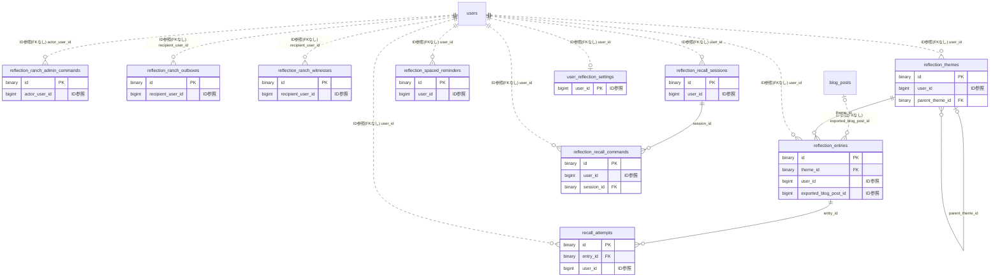

# reflection ドメイン ER 図

> このファイルは自動生成されます。手で編集しないでください。再生成: `cd backend && ./gradlew generateErDiagrams`

- テーブル数: 10
- ビュー数: 0

## ER 図

実線 = 外部キー、点線 = ID参照(FKなし)。図中の `FK` は実外部キーの列だけ（ID参照列は `FK` を付けず "ID参照" と注記）。図にはキー列（PK / FK / 参照推定列 / 単一列 UNIQUE）のみを描く。全列は下の「テーブル定義」を参照。

## 被参照（他ドメインから）

このドメインのテーブルを参照している他ドメインの側（実 FK と ID参照のみ。多態参照と推定不能参照は含まない。同一ドメイン内の参照は上の図を参照）。

なし

## 自己参照

mermaid は同一テーブルの自己参照を複数描けず 1 本に畳むため、図に線が欠けることがある。自己参照はこの表を正とする。

| テーブル | 列 | 種別 |
| --- | --- | --- |
| `reflection_themes` | `parent_theme_id` | 外部キー |

## 推定不能参照

| テーブル | 列 | 理由 |
| --- | --- | --- |
| `reflection_ranch_outboxes` | `canonical_scope_id` | 参照先テーブルを特定できない |
| `reflection_ranch_witnesses` | `canonical_source_id` | 参照先テーブルを特定できない |
| `reflection_ranch_witnesses` | `event_id` | 型が参照先 events.id と不一致（binary ≠ bigint） |
| `reflection_recall_sessions` | `entry_source_id` | 参照先テーブルを特定できない |
| `reflection_spaced_reminders` | `entry_id` | 参照先テーブルを特定できない |
| `reflection_spaced_reminders` | `theme_id` | 参照先テーブルを特定できない |
| `reflection_themes` | `linked_slot_id` | 参照先テーブルを特定できない |

## テーブル定義

### `recall_attempts`

| 列名 | 型 | NULL | 既定値 | コメント |
| --- | --- | --- | --- | --- |
| `id` | `binary(16)` | NO | （なし） |  |
| `entry_id` | `binary(16)` | NO | （なし） |  |
| `user_id` | `bigint unsigned` | NO | （なし） |  |
| `recall_date` | `date` | NO | （なし） |  |
| `recalled_content` | `json` | NO | （なし） |  |
| `self_rating` | `varchar(12)` | NO | （なし） |  |
| `revealed_at` | `datetime` | YES | NULL |  |
| `created_at` | `datetime` | NO | （なし） |  |

### `reflection_entries`

| 列名 | 型 | NULL | 既定値 | コメント |
| --- | --- | --- | --- | --- |
| `id` | `binary(16)` | NO | （なし） |  |
| `theme_id` | `binary(16)` | NO | （なし） |  |
| `user_id` | `bigint unsigned` | NO | （なし） |  |
| `target_date` | `date` | NO | （なし） |  |
| `structured_content` | `json` | NO | （なし） |  |
| `visibility` | `varchar(20)` | NO | `PRIVATE` |  |
| `version` | `bigint` | NO | `0` |  |
| `exported_blog_post_id` | `bigint unsigned` | YES | NULL |  |
| `created_at` | `datetime` | NO | （なし） |  |
| `updated_at` | `datetime` | NO | （なし） |  |
| `deleted_at` | `datetime` | YES | NULL |  |

### `reflection_ranch_admin_commands`

| 列名 | 型 | NULL | 既定値 | コメント |
| --- | --- | --- | --- | --- |
| `id` | `binary(16)` | NO | （なし） |  |
| `actor_user_id` | `bigint unsigned` | NO | （なし） |  |
| `idempotency_key` | `binary(16)` | NO | （なし） |  |
| `command_type` | `varchar(30)` | NO | （なし） |  |
| `body_hash` | `binary(32)` | NO | （なし） |  |
| `result_json` | `json` | NO | （なし） |  |
| `completed_at` | `datetime(6)` | NO | （なし） |  |
| `created_at` | `datetime(6)` | NO | （なし） |  |
| `updated_at` | `datetime(6)` | NO | （なし） |  |

### `reflection_ranch_outboxes`

| 列名 | 型 | NULL | 既定値 | コメント |
| --- | --- | --- | --- | --- |
| `id` | `binary(16)` | NO | （なし） |  |
| `schema_version` | `int` | NO | （なし） |  |
| `event_type` | `varchar(40)` | NO | （なし） |  |
| `scope_type` | `varchar(20)` | NO | （なし） |  |
| `scope_id_type` | `varchar(8)` | YES | NULL |  |
| `canonical_scope_id` | `varbinary(80)` | YES | NULL |  |
| `recipient_user_id` | `bigint unsigned` | NO | （なし） |  |
| `canonical_key` | `varbinary(240)` | NO | （なし） |  |
| `payload_json` | `json` | NO | （なし） |  |
| `occurred_at` | `datetime(6)` | NO | （なし） |  |
| `status` | `varchar(20)` | NO | （なし） |  |
| `terminal_outcome` | `varchar(40)` | YES | NULL |  |
| `attempt_count` | `int` | NO | `0` |  |
| `next_attempt_at` | `datetime(6)` | NO | （なし） |  |
| `lease_token` | `binary(16)` | YES | NULL |  |
| `lease_expires_at` | `datetime(6)` | YES | NULL |  |
| `last_error_code` | `varchar(80)` | YES | NULL |  |
| `acked_at` | `datetime(6)` | YES | NULL |  |
| `created_at` | `datetime(6)` | NO | （なし） |  |
| `updated_at` | `datetime(6)` | NO | （なし） |  |

### `reflection_ranch_witnesses`

| 列名 | 型 | NULL | 既定値 | コメント |
| --- | --- | --- | --- | --- |
| `id` | `binary(16)` | NO | （なし） |  |
| `source_id_type` | `varchar(8)` | NO | （なし） |  |
| `canonical_source_id` | `varbinary(80)` | NO | （なし） |  |
| `recipient_user_id` | `bigint unsigned` | NO | （なし） |  |
| `kind` | `varchar(20)` | NO | （なし） |  |
| `qualifying_at` | `datetime(6)` | YES | NULL |  |
| `event_id` | `binary(16)` | YES | NULL |  |
| `reward_week` | `date` | NO | （なし） |  |
| `created_at` | `datetime(6)` | NO | （なし） |  |
| `updated_at` | `datetime(6)` | NO | （なし） |  |

### `reflection_recall_commands`

| 列名 | 型 | NULL | 既定値 | コメント |
| --- | --- | --- | --- | --- |
| `id` | `binary(16)` | NO | （なし） |  |
| `user_id` | `bigint unsigned` | NO | （なし） |  |
| `idempotency_key` | `binary(16)` | NO | （なし） |  |
| `session_id` | `binary(16)` | NO | （なし） |  |
| `command_type` | `varchar(20)` | NO | （なし） |  |
| `body_hash` | `binary(32)` | NO | （なし） |  |
| `result_json` | `json` | NO | （なし） |  |
| `completed_at` | `datetime(6)` | NO | （なし） |  |
| `created_at` | `datetime(6)` | NO | （なし） |  |
| `updated_at` | `datetime(6)` | NO | （なし） |  |

### `reflection_recall_sessions`

| 列名 | 型 | NULL | 既定値 | コメント |
| --- | --- | --- | --- | --- |
| `id` | `binary(16)` | NO | （なし） |  |
| `user_id` | `bigint unsigned` | NO | （なし） |  |
| `entry_id_type` | `varchar(8)` | NO | （なし） |  |
| `entry_source_id` | `varchar(80)` | NO | （なし） |  |
| `reward_week` | `date` | YES | NULL |  |
| `status` | `varchar(20)` | NO | （なし） |  |
| `prompt_snapshot` | `json` | NO | （なし） |  |
| `original_snapshot` | `json` | NO | （なし） |  |
| `answers_json` | `json` | NO | （なし） |  |
| `self_rating` | `varchar(20)` | YES | NULL |  |
| `started_at` | `datetime(6)` | NO | （なし） |  |
| `completed_at` | `datetime(6)` | YES | NULL |  |
| `cancelled_at` | `datetime(6)` | YES | NULL |  |
| `version` | `bigint` | NO | `0` |  |
| `created_at` | `datetime(6)` | NO | （なし） |  |
| `updated_at` | `datetime(6)` | NO | （なし） |  |

### `reflection_spaced_reminders`

| 列名 | 型 | NULL | 既定値 | コメント |
| --- | --- | --- | --- | --- |
| `id` | `binary(16)` | NO | （なし） |  |
| `entry_id` | `binary(16)` | YES | NULL |  |
| `theme_id` | `binary(16)` | YES | NULL |  |
| `user_id` | `bigint unsigned` | NO | （なし） |  |
| `remind_at` | `datetime` | NO | （なし） |  |
| `interval_days` | `int` | YES | NULL |  |
| `kind` | `varchar(12)` | NO | （なし） |  |
| `status` | `varchar(12)` | NO | `PENDING` |  |
| `sent_at` | `datetime` | YES | NULL |  |
| `created_at` | `datetime` | NO | （なし） |  |

### `reflection_themes`

| 列名 | 型 | NULL | 既定値 | コメント |
| --- | --- | --- | --- | --- |
| `id` | `binary(16)` | NO | （なし） |  |
| `user_id` | `bigint unsigned` | NO | （なし） |  |
| `title` | `varchar(120)` | NO | （なし） |  |
| `description` | `varchar(500)` | YES | NULL |  |
| `source_type` | `varchar(20)` | NO | `FREE` |  |
| `linked_slot_kind` | `varchar(10)` | YES | NULL |  |
| `linked_slot_id` | `bigint unsigned` | YES | NULL |  |
| `linked_subject_name` | `varchar(200)` | YES | NULL |  |
| `linked_course_code` | `varchar(50)` | YES | NULL |  |
| `academic_year` | `smallint` | YES | NULL |  |
| `term_label` | `varchar(50)` | YES | NULL |  |
| `parent_theme_id` | `binary(16)` | YES | NULL |  |
| `exam_date` | `date` | YES | NULL |  |
| `visibility` | `varchar(20)` | NO | `PRIVATE` |  |
| `recall_interval_days` | `varchar(50)` | NO | `1,3,7,14` |  |
| `created_at` | `datetime` | NO | （なし） |  |
| `updated_at` | `datetime` | NO | （なし） |  |
| `deleted_at` | `datetime` | YES | NULL |  |
| `archived_at` | `datetime` | YES | NULL |  |

### `user_reflection_settings`

| 列名 | 型 | NULL | 既定値 | コメント |
| --- | --- | --- | --- | --- |
| `user_id` | `bigint unsigned` | NO | （なし） |  |
| `remind_hour` | `tinyint` | NO | `8` |  |
| `created_at` | `datetime` | NO | （なし） |  |
| `updated_at` | `datetime` | NO | （なし） |  |
