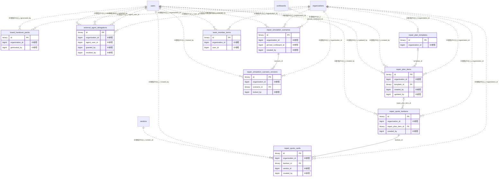

# repairplan ドメイン ER 図

> このファイルは自動生成されます。手で編集しないでください。再生成: `cd backend && ./gradlew generateErDiagrams`

- テーブル数: 9
- ビュー数: 0

## ER 図

実線 = 外部キー、点線 = ID参照(FKなし)。図中の `FK` は実外部キーの列だけ（ID参照列は `FK` を付けず "ID参照" と注記）。図にはキー列（PK / FK / 参照推定列 / 単一列 UNIQUE）のみを描く。全列は下の「テーブル定義」を参照。

## 被参照（他ドメインから）

このドメインのテーブルを参照している他ドメインの側（実 FK と ID参照のみ。多態参照と推定不能参照は含まない。同一ドメイン内の参照は上の図を参照）。

なし

## 多態参照（線を引かない）

| テーブル | 種別列 | ID列 |
| --- | --- | --- |
| `board_handover_packs` | `scope_type` | `scope_id` |
| `external_agent_delegations` | `scope_type` | `scope_id` |
| `repair_plan_items` | `scope_type` | `scope_id` |
| `repair_plan_templates` | `scope_type` | `scope_id` |
| `repair_quote_kanbans` | `scope_type` | `scope_id` |
| `repair_simulation_scenarios` | `scope_type` | `scope_id` |
| `team_member_terms` | `scope_type` | `scope_id` |

## 推定不能参照

| テーブル | 列 | 理由 |
| --- | --- | --- |
| `repair_plan_items` | `linked_work_package_id` | 参照先テーブルを特定できない |
| `repair_quote_kanbans` | `work_package_id` | 参照先テーブルを特定できない |
| `repair_simulation_scenarios` | `published_announcement_id` | 参照先テーブルを特定できない |
| `team_member_terms` | `handover_pack_id` | 参照先テーブルを特定できない |

## テーブル定義

### `board_handover_packs`

| 列名 | 型 | NULL | 既定値 | コメント |
| --- | --- | --- | --- | --- |
| `id` | `binary(16)` | NO | （なし） |  |
| `organization_id` | `bigint unsigned` | NO | （なし） |  |
| `scope_type` | `varchar(20)` | NO | （なし） |  |
| `scope_id` | `bigint unsigned` | NO | （なし） |  |
| `term_year` | `smallint unsigned` | NO | （なし） |  |
| `period_start` | `date` | NO | （なし） |  |
| `period_end` | `date` | NO | （なし） |  |
| `pdf_r2_key` | `varchar(500)` | YES | NULL |  |
| `pdf_size` | `int unsigned` | YES | NULL |  |
| `pdf_sha256` | `char(64)` | YES | NULL |  |
| `pii_level` | `varchar(20)` | NO | `STANDARD` |  |
| `viewer_watermark_template` | `varchar(500)` | YES | NULL |  |
| `status` | `varchar(20)` | NO | `GENERATING` |  |
| `password_separately_sent` | `tinyint(1)` | NO | `0` |  |
| `generated_by` | `bigint unsigned` | NO | （なし） |  |
| `generated_at` | `datetime` | YES | NULL |  |
| `version` | `bigint` | NO | `0` |  |
| `created_at` | `datetime` | NO | `CURRENT_TIMESTAMP` （式） |  |
| `updated_at` | `datetime` | NO | `CURRENT_TIMESTAMP` （式） |  |
| `deleted_at` | `datetime` | YES | NULL |  |

### `external_agent_delegations`

| 列名 | 型 | NULL | 既定値 | コメント |
| --- | --- | --- | --- | --- |
| `id` | `binary(16)` | NO | （なし） |  |
| `organization_id` | `bigint unsigned` | NO | （なし） |  |
| `scope_type` | `varchar(20)` | NO | （なし） |  |
| `scope_id` | `bigint unsigned` | NO | （なし） |  |
| `agent_user_id` | `bigint unsigned` | NO | （なし） |  |
| `agent_company_name` | `varchar(200)` | NO | （なし） |  |
| `delegation_type` | `varchar(40)` | NO | （なし） |  |
| `granted_by` | `bigint unsigned` | NO | （なし） |  |
| `granted_at` | `datetime` | NO | `CURRENT_TIMESTAMP` （式） |  |
| `revoked_by` | `bigint unsigned` | YES | NULL |  |
| `revoked_at` | `datetime` | YES | NULL |  |
| `valid_until` | `datetime` | YES | NULL |  |
| `version` | `bigint` | NO | `0` |  |
| `created_at` | `datetime` | NO | `CURRENT_TIMESTAMP` （式） |  |
| `updated_at` | `datetime` | NO | `CURRENT_TIMESTAMP` （式） |  |
| `deleted_at` | `datetime` | YES | NULL |  |

### `repair_plan_items`

| 列名 | 型 | NULL | 既定値 | コメント |
| --- | --- | --- | --- | --- |
| `id` | `binary(16)` | NO | （なし） |  |
| `organization_id` | `bigint unsigned` | NO | （なし） |  |
| `scope_type` | `varchar(20)` | NO | （なし） |  |
| `scope_id` | `bigint unsigned` | NO | （なし） |  |
| `template_id` | `binary(16)` | YES | NULL |  |
| `category` | `varchar(60)` | NO | （なし） |  |
| `title` | `varchar(200)` | NO | （なし） |  |
| `description` | `text` | YES | NULL |  |
| `planned_year` | `smallint unsigned` | NO | （なし） |  |
| `planned_month` | `tinyint unsigned` | YES | NULL |  |
| `estimated_amount` | `bigint unsigned` | NO | （なし） |  |
| `cpi_inflation_basis_year` | `smallint unsigned` | NO | （なし） |  |
| `status` | `varchar(20)` | NO | `PLANNED` |  |
| `linked_work_package_id` | `bigint unsigned` | YES | NULL |  |
| `tags` | `json` | YES | NULL |  |
| `minutes_note` | `tinytext` | YES | NULL | 議事録メモ（Phase 3 地層タイムライン用） |
| `created_by` | `bigint unsigned` | NO | （なし） |  |
| `updated_by` | `bigint unsigned` | YES | NULL |  |
| `version` | `bigint` | NO | `0` |  |
| `created_at` | `datetime` | NO | `CURRENT_TIMESTAMP` （式） |  |
| `updated_at` | `datetime` | NO | `CURRENT_TIMESTAMP` （式） |  |
| `deleted_at` | `datetime` | YES | NULL |  |

### `repair_plan_templates`

| 列名 | 型 | NULL | 既定値 | コメント |
| --- | --- | --- | --- | --- |
| `id` | `binary(16)` | NO | （なし） |  |
| `organization_id` | `bigint unsigned` | YES | NULL |  |
| `scope_type` | `varchar(20)` | NO | （なし） |  |
| `scope_id` | `bigint unsigned` | YES | NULL |  |
| `category` | `varchar(60)` | NO | （なし） |  |
| `cycle_years` | `smallint unsigned` | NO | （なし） |  |
| `unit_cost_per_dwelling` | `int unsigned` | NO | （なし） |  |
| `source_reference` | `varchar(500)` | YES | NULL |  |
| `version` | `bigint` | NO | `0` |  |
| `created_at` | `datetime` | NO | `CURRENT_TIMESTAMP` （式） |  |
| `updated_at` | `datetime` | NO | `CURRENT_TIMESTAMP` （式） |  |
| `deleted_at` | `datetime` | YES | NULL |  |

### `repair_quote_cards`

| 列名 | 型 | NULL | 既定値 | コメント |
| --- | --- | --- | --- | --- |
| `id` | `binary(16)` | NO | （なし） |  |
| `organization_id` | `bigint unsigned` | NO | （なし） |  |
| `kanban_id` | `binary(16)` | NO | （なし） |  |
| `vendor_id` | `bigint unsigned` | NO | （なし） |  |
| `vendor_name_snapshot` | `varchar(150)` | NO | （なし） |  |
| `stage` | `varchar(20)` | NO | `REQUESTED` |  |
| `amount` | `bigint unsigned` | YES | NULL |  |
| `breakdown_json` | `json` | YES | NULL |  |
| `bid_token_hash` | `char(64)` | YES | NULL |  |
| `is_visible_after` | `datetime` | YES | NULL |  |
| `compliance_check_status` | `varchar(20)` | NO | `UNCHECKED` |  |
| `compliance_checked_at` | `datetime` | YES | NULL |  |
| `display_order` | `int` | NO | `0` |  |
| `created_by` | `bigint unsigned` | NO | （なし） |  |
| `version` | `bigint` | NO | `0` |  |
| `created_at` | `datetime` | NO | `CURRENT_TIMESTAMP` （式） |  |
| `updated_at` | `datetime` | NO | `CURRENT_TIMESTAMP` （式） |  |
| `deleted_at` | `datetime` | YES | NULL |  |

### `repair_quote_kanbans`

| 列名 | 型 | NULL | 既定値 | コメント |
| --- | --- | --- | --- | --- |
| `id` | `binary(16)` | NO | （なし） |  |
| `organization_id` | `bigint unsigned` | NO | （なし） |  |
| `scope_type` | `varchar(20)` | NO | （なし） |  |
| `scope_id` | `bigint unsigned` | NO | （なし） |  |
| `work_package_id` | `bigint unsigned` | NO | （なし） |  |
| `repair_plan_item_id` | `binary(16)` | YES | NULL |  |
| `title` | `varchar(200)` | NO | （なし） |  |
| `bid_deadline_at` | `datetime` | YES | NULL |  |
| `visibility_to_member` | `varchar(20)` | NO | `ANONYMIZED` |  |
| `status` | `varchar(20)` | NO | `OPEN` |  |
| `created_by` | `bigint unsigned` | NO | （なし） |  |
| `version` | `bigint` | NO | `0` |  |
| `created_at` | `datetime` | NO | `CURRENT_TIMESTAMP` （式） |  |
| `updated_at` | `datetime` | NO | `CURRENT_TIMESTAMP` （式） |  |
| `deleted_at` | `datetime` | YES | NULL |  |

### `repair_simulation_scenario_versions`

| 列名 | 型 | NULL | 既定値 | コメント |
| --- | --- | --- | --- | --- |
| `id` | `binary(16)` | NO | （なし） |  |
| `organization_id` | `bigint unsigned` | NO | （なし） |  |
| `scenario_id` | `binary(16)` | NO | （なし） |  |
| `version_no` | `int unsigned` | NO | （なし） |  |
| `params_snapshot` | `json` | NO | （なし） |  |
| `computed_summary_snapshot` | `json` | NO | （なし） |  |
| `engine_version` | `varchar(20)` | NO | （なし） |  |
| `content_sha256` | `char(64)` | NO | （なし） |  |
| `proposed_resolution_no` | `varchar(100)` | YES | NULL |  |
| `locked_by` | `bigint unsigned` | NO | （なし） |  |
| `locked_at` | `datetime` | NO | `CURRENT_TIMESTAMP` （式） |  |

### `repair_simulation_scenarios`

| 列名 | 型 | NULL | 既定値 | コメント |
| --- | --- | --- | --- | --- |
| `id` | `binary(16)` | NO | （なし） |  |
| `organization_id` | `bigint unsigned` | NO | （なし） |  |
| `scope_type` | `varchar(20)` | NO | （なし） |  |
| `scope_id` | `bigint unsigned` | NO | （なし） |  |
| `name` | `varchar(200)` | YES | NULL |  |
| `description` | `text` | YES | NULL |  |
| `params_json` | `json` | NO | （なし） |  |
| `computed_summary_json` | `json` | NO | （なし） |  |
| `engine_version` | `varchar(20)` | NO | （なし） |  |
| `content_sha256` | `char(64)` | NO | （なし） |  |
| `baseline_at` | `datetime` | NO | （なし） |  |
| `locked_at` | `datetime` | YES | NULL |  |
| `published_announcement_id` | `bigint unsigned` | YES | NULL |  |
| `pinned_corkboard_id` | `bigint unsigned` | YES | NULL |  |
| `created_by` | `bigint unsigned` | NO | （なし） |  |
| `version` | `bigint` | NO | `0` |  |
| `created_at` | `datetime` | NO | `CURRENT_TIMESTAMP` （式） |  |
| `updated_at` | `datetime` | NO | `CURRENT_TIMESTAMP` （式） |  |
| `deleted_at` | `datetime` | YES | NULL |  |

### `team_member_terms`

| 列名 | 型 | NULL | 既定値 | コメント |
| --- | --- | --- | --- | --- |
| `id` | `binary(16)` | NO | （なし） |  |
| `organization_id` | `bigint unsigned` | NO | （なし） |  |
| `scope_type` | `varchar(20)` | NO | （なし） |  |
| `scope_id` | `bigint unsigned` | NO | （なし） |  |
| `user_id` | `bigint unsigned` | NO | （なし） |  |
| `role_label` | `varchar(60)` | NO | （なし） |  |
| `term_start` | `date` | NO | （なし） |  |
| `term_end` | `date` | NO | （なし） |  |
| `handover_pack_id` | `binary(16)` | YES | NULL |  |
| `is_active` | `tinyint(1)` | NO | `1` |  |
| `created_at` | `datetime` | NO | `CURRENT_TIMESTAMP` （式） |  |
| `updated_at` | `datetime` | NO | `CURRENT_TIMESTAMP` （式） |  |
