# reservation ドメイン ER 図

> このファイルは自動生成されます。手で編集しないでください。再生成: `cd backend && ./gradlew generateErDiagrams`

- テーブル数: 17
- ビュー数: 0

## ER 図

実線 = 外部キー、点線 = ID参照(FKなし)。図中の `FK` は実外部キーの列だけ（ID参照列は `FK` を付けず "ID参照" と注記）。図にはキー列（PK / FK / 参照推定列 / 単一列 UNIQUE）のみを描く。全列は下の「テーブル定義」を参照。

```mermaid
erDiagram
    emergency_closure_confirmations {
        bigint id PK
        bigint emergency_closure_id FK
        bigint user_id "ID参照"
        bigint reservation_id "ID参照"
    }
    emergency_closures {
        bigint id PK
        bigint team_id "ID参照"
        bigint created_by "ID参照"
    }
    reservation_blocked_times {
        bigint id PK
        bigint team_id "ID参照"
        bigint created_by "ID参照"
    }
    reservation_business_hours {
        bigint id PK
        bigint team_id "ID参照"
    }
    reservation_lines {
        bigint id PK
        bigint team_id "ID参照"
        bigint default_staff_user_id "ID参照"
    }
    reservation_menu_lines {
        binary menu_id PK, FK
        bigint line_id PK, FK
    }
    reservation_menus {
        binary id PK
        bigint team_id "ID参照"
        bigint created_by "ID参照"
    }
    reservation_notification_recipients {
        binary id PK
        bigint team_id "ID参照"
        bigint created_by "ID参照"
    }
    reservation_pending_expire_scan_state {
        binary id PK
        tinyint singleton_key UK
    }
    reservation_policies {
        binary id PK
        bigint team_id UK "ID参照"
    }
    reservation_recurring_blocked_times {
        binary id PK
        bigint team_id "ID参照"
        bigint line_id FK
        bigint created_by "ID参照"
    }
    reservation_reminders {
        bigint id PK
        bigint reservation_id FK
    }
    reservation_slot_templates {
        binary id PK
        bigint team_id "ID参照"
        bigint line_id FK
        bigint staff_user_id "ID参照"
        bigint created_by "ID参照"
    }
    reservation_slots {
        bigint id PK
        bigint team_id "ID参照"
        bigint staff_user_id "ID参照"
        bigint line_id FK
        binary template_id FK
        bigint created_by "ID参照"
    }
    reservation_team_settings {
        binary id PK
        bigint team_id UK "ID参照"
    }
    reservation_waitlist_entries {
        binary id PK
        bigint team_id "ID参照"
        bigint slot_id FK
        bigint user_id "ID参照"
    }
    reservations {
        bigint id PK
        bigint reservation_slot_id FK
        bigint line_id FK
        bigint team_id "ID参照"
        bigint user_id "ID参照"
        binary menu_id FK
    }
    teams
    users
    emergency_closures ||--o{ emergency_closure_confirmations : "emergency_closure_id"
    reservations ||..o{ emergency_closure_confirmations : "ID参照(FKなし) reservation_id"
    users ||..o{ emergency_closure_confirmations : "ID参照(FKなし) user_id"
    teams ||..o{ emergency_closures : "ID参照(FKなし) team_id"
    users ||..o{ emergency_closures : "ID参照(FKなし) created_by"
    teams ||..o{ reservation_blocked_times : "ID参照(FKなし) team_id"
    users |o..o{ reservation_blocked_times : "ID参照(FKなし) created_by"
    teams ||..o{ reservation_business_hours : "ID参照(FKなし) team_id"
    teams ||..o{ reservation_lines : "ID参照(FKなし) team_id"
    users |o..o{ reservation_lines : "ID参照(FKなし) default_staff_user_id"
    reservation_lines ||--o{ reservation_menu_lines : "line_id"
    reservation_menus ||--o{ reservation_menu_lines : "menu_id"
    teams ||..o{ reservation_menus : "ID参照(FKなし) team_id"
    users |o..o{ reservation_menus : "ID参照(FKなし) created_by"
    teams ||..o{ reservation_notification_recipients : "ID参照(FKなし) team_id"
    users |o..o{ reservation_notification_recipients : "ID参照(FKなし) created_by"
    teams ||..o| reservation_policies : "ID参照(FKなし) team_id"
    reservation_lines |o--o{ reservation_recurring_blocked_times : "line_id"
    teams ||..o{ reservation_recurring_blocked_times : "ID参照(FKなし) team_id"
    users |o..o{ reservation_recurring_blocked_times : "ID参照(FKなし) created_by"
    reservations ||--o{ reservation_reminders : "reservation_id"
    reservation_lines |o--o{ reservation_slot_templates : "line_id"
    teams ||..o{ reservation_slot_templates : "ID参照(FKなし) team_id"
    users |o..o{ reservation_slot_templates : "ID参照(FKなし) created_by"
    users |o..o{ reservation_slot_templates : "ID参照(FKなし) staff_user_id"
    reservation_lines |o--o{ reservation_slots : "line_id"
    reservation_slot_templates |o--o{ reservation_slots : "template_id"
    teams ||..o{ reservation_slots : "ID参照(FKなし) team_id"
    users |o..o{ reservation_slots : "ID参照(FKなし) created_by"
    users |o..o{ reservation_slots : "ID参照(FKなし) staff_user_id"
    teams ||..o| reservation_team_settings : "ID参照(FKなし) team_id"
    reservation_slots ||--o{ reservation_waitlist_entries : "slot_id"
    teams ||..o{ reservation_waitlist_entries : "ID参照(FKなし) team_id"
    users ||..o{ reservation_waitlist_entries : "ID参照(FKなし) user_id"
    reservation_lines ||--o{ reservations : "line_id"
    reservation_menus |o--o{ reservations : "menu_id"
    reservation_slots ||--o{ reservations : "reservation_slot_id"
    teams ||..o{ reservations : "ID参照(FKなし) team_id"
    users ||..o{ reservations : "ID参照(FKなし) user_id"
```

## 被参照（他ドメインから）

このドメインのテーブルを参照している他ドメインの側（実 FK と ID参照のみ。多態参照と推定不能参照は含まない。同一ドメイン内の参照は上の図を参照）。

| 参照元ドメイン | 参照元テーブル | 列 | 種別 | 参照先テーブル |
| --- | --- | --- | --- | --- |
| [membership](membership.md) | `member_card_checkins` | `reservation_id` | ID参照 | `reservations` |
| [recruitment](recruitment.md) | `recruitment_listings` | `reservation_line_id` | ID参照 | `reservation_lines` |
| [recruitment](recruitment.md) | `recruitment_templates` | `default_reservation_line_id` | ID参照 | `reservation_lines` |
| [ticket](ticket.md) | `ticket_consumptions` | `reservation_id` | ID参照 | `reservations` |

## 多態参照（線を引かない）

| テーブル | 種別列 | ID列 |
| --- | --- | --- |
| `reservation_blocked_times` | `resource_type` | `resource_id` |

## 推定不能参照

| テーブル | 列 | 理由 |
| --- | --- | --- |
| `reservation_pending_expire_scan_state` | `last_inspected_id` | 参照先テーブルを特定できない |
| `reservations` | `group_id` | 参照先テーブルを特定できない |
| `reservations` | `recurring_series_id` | 参照先テーブルを特定できない |

## テーブル定義

### `emergency_closure_confirmations`

| 列名 | 型 | NULL | 既定値 | コメント |
| --- | --- | --- | --- | --- |
| `id` | `bigint unsigned` | NO | （なし） auto_increment |  |
| `emergency_closure_id` | `bigint unsigned` | NO | （なし） |  |
| `user_id` | `bigint unsigned` | NO | （なし） |  |
| `reservation_id` | `bigint unsigned` | NO | （なし） |  |
| `appointment_at` | `datetime` | NO | （なし） |  |
| `confirmed_at` | `datetime` | YES | NULL |  |
| `reminder_sent_at` | `datetime` | YES | NULL |  |
| `patient_reminder_sent_at` | `datetime` | YES | NULL |  |
| `created_at` | `datetime` | NO | `CURRENT_TIMESTAMP` （式） |  |
| `updated_at` | `datetime` | NO | `CURRENT_TIMESTAMP` （式） |  |

### `emergency_closures`

| 列名 | 型 | NULL | 既定値 | コメント |
| --- | --- | --- | --- | --- |
| `id` | `bigint unsigned` | NO | （なし） auto_increment |  |
| `team_id` | `bigint unsigned` | NO | （なし） |  |
| `start_date` | `date` | NO | （なし） |  |
| `end_date` | `date` | NO | （なし） |  |
| `start_time` | `time` | YES | NULL | 部分時間帯休業の開始時刻。NULLなら終日休業 |
| `end_time` | `time` | YES | NULL | 部分時間帯休業の終了時刻。NULLなら終日休業 |
| `reason` | `varchar(200)` | NO | （なし） |  |
| `subject` | `varchar(200)` | NO | （なし） |  |
| `message_body` | `text` | NO | （なし） |  |
| `sent_count` | `int` | NO | `0` |  |
| `cancel_reservations` | `tinyint(1)` | NO | `0` |  |
| `created_by` | `bigint unsigned` | NO | （なし） |  |
| `created_at` | `datetime` | NO | `CURRENT_TIMESTAMP` （式） |  |
| `updated_at` | `datetime` | NO | `CURRENT_TIMESTAMP` （式） |  |
| `idempotency_key` | `char(36)` | YES | NULL | 送信の冪等キー（Idempotency-Keyヘッダ・UUID小文字）。ヘッダ無しの送信はNULL |
| `request_hash` | `char(64)` | YES | NULL | 正規化した要求内容のSHA-256（16進）。同一キーで内容が異なる再送の判別に使う |

### `reservation_blocked_times`

| 列名 | 型 | NULL | 既定値 | コメント |
| --- | --- | --- | --- | --- |
| `id` | `bigint unsigned` | NO | （なし） auto_increment |  |
| `team_id` | `bigint unsigned` | NO | （なし） |  |
| `blocked_date` | `date` | NO | （なし） |  |
| `start_time` | `time` | YES | NULL |  |
| `end_time` | `time` | YES | NULL |  |
| `reason` | `varchar(200)` | YES | NULL |  |
| `resource_type` | `varchar(20)` | NO | `TEAM` |  |
| `resource_id` | `bigint unsigned` | YES | NULL |  |
| `created_by` | `bigint unsigned` | YES | NULL |  |
| `created_at` | `datetime` | NO | `CURRENT_TIMESTAMP` （式） |  |
| `updated_at` | `datetime` | NO | `CURRENT_TIMESTAMP` （式） |  |
| `ends_next_day` | `tinyint(1)` | NO | `0` |  |

### `reservation_business_hours`

| 列名 | 型 | NULL | 既定値 | コメント |
| --- | --- | --- | --- | --- |
| `id` | `bigint unsigned` | NO | （なし） auto_increment |  |
| `team_id` | `bigint unsigned` | NO | （なし） |  |
| `day_of_week` | `varchar(3)` | NO | （なし） |  |
| `is_open` | `tinyint(1)` | NO | `1` |  |
| `open_time` | `time` | YES | NULL |  |
| `close_time` | `time` | YES | NULL |  |
| `created_at` | `datetime` | NO | `CURRENT_TIMESTAMP` （式） |  |
| `updated_at` | `datetime` | NO | `CURRENT_TIMESTAMP` （式） |  |
| `ends_next_day` | `tinyint(1)` | NO | `0` |  |

### `reservation_lines`

| 列名 | 型 | NULL | 既定値 | コメント |
| --- | --- | --- | --- | --- |
| `id` | `bigint unsigned` | NO | （なし） auto_increment |  |
| `team_id` | `bigint unsigned` | NO | （なし） |  |
| `name` | `varchar(50)` | NO | （なし） |  |
| `description` | `varchar(200)` | YES | NULL |  |
| `display_order` | `int` | NO | `1` |  |
| `is_active` | `tinyint(1)` | NO | `1` |  |
| `default_staff_user_id` | `bigint unsigned` | YES | NULL |  |
| `created_at` | `datetime` | NO | `CURRENT_TIMESTAMP` （式） |  |
| `updated_at` | `datetime` | NO | `CURRENT_TIMESTAMP` （式） |  |
| `deleted_at` | `datetime` | YES | NULL |  |

### `reservation_menu_lines`

| 列名 | 型 | NULL | 既定値 | コメント |
| --- | --- | --- | --- | --- |
| `menu_id` | `binary(16)` | NO | （なし） |  |
| `line_id` | `bigint unsigned` | NO | （なし） |  |
| `created_at` | `datetime(6)` | NO | （なし） |  |

### `reservation_menus`

| 列名 | 型 | NULL | 既定値 | コメント |
| --- | --- | --- | --- | --- |
| `id` | `binary(16)` | NO | （なし） |  |
| `team_id` | `bigint unsigned` | NO | （なし） |  |
| `name` | `varchar(100)` | NO | （なし） |  |
| `duration_minutes` | `int` | NO | （なし） |  |
| `price` | `decimal(10,2)` | YES | NULL |  |
| `description` | `varchar(500)` | YES | NULL |  |
| `display_order` | `int` | NO | `1` |  |
| `is_active` | `tinyint(1)` | NO | `1` |  |
| `created_by` | `bigint unsigned` | YES | NULL |  |
| `created_at` | `datetime(6)` | NO | （なし） |  |
| `updated_at` | `datetime(6)` | NO | （なし） |  |
| `deleted_at` | `datetime(6)` | YES | NULL |  |

### `reservation_notification_recipients`

| 列名 | 型 | NULL | 既定値 | コメント |
| --- | --- | --- | --- | --- |
| `id` | `binary(16)` | NO | （なし） |  |
| `team_id` | `bigint unsigned` | NO | （なし） |  |
| `email` | `varchar(255)` | NO | （なし） |  |
| `label` | `varchar(100)` | YES | NULL |  |
| `is_enabled` | `tinyint(1)` | NO | `1` |  |
| `created_by` | `bigint` | YES | NULL |  |
| `created_at` | `datetime(6)` | NO | （なし） |  |
| `updated_at` | `datetime(6)` | NO | （なし） |  |

### `reservation_pending_expire_scan_state`

| 列名 | 型 | NULL | 既定値 | コメント |
| --- | --- | --- | --- | --- |
| `id` | `binary(16)` | NO | （なし） |  |
| `singleton_key` | `tinyint` | NO | （なし） |  |
| `cycle_high_water` | `bigint unsigned` | NO | （なし） |  |
| `last_inspected_id` | `bigint unsigned` | NO | （なし） |  |
| `run_epoch` | `bigint` | NO | （なし） |  |
| `retry_primary_ids` | `json` | NO | （なし） |  |
| `updated_at` | `datetime(6)` | NO | （なし） |  |

### `reservation_policies`

| 列名 | 型 | NULL | 既定値 | コメント |
| --- | --- | --- | --- | --- |
| `id` | `binary(16)` | NO | （なし） |  |
| `team_id` | `bigint unsigned` | NO | （なし） |  |
| `approval_mode` | `varchar(10)` | NO | `AUTO` |  |
| `cancel_deadline_hours` | `int` | NO | `24` |  |
| `remind_before_hours` | `varchar(64)` | NO | `24,1` |  |
| `pending_expire_hours` | `int` | YES | `24` | 仮押さえ(PENDING)の自動失効までの時間数。NULL=自動失効しない。既定24時間（F03.4.5 §6.3） |
| `created_at` | `datetime(6)` | NO | （なし） |  |
| `updated_at` | `datetime(6)` | NO | （なし） |  |

### `reservation_recurring_blocked_times`

| 列名 | 型 | NULL | 既定値 | コメント |
| --- | --- | --- | --- | --- |
| `id` | `binary(16)` | NO | （なし） |  |
| `team_id` | `bigint unsigned` | NO | （なし） |  |
| `line_id` | `bigint unsigned` | YES | NULL |  |
| `day_of_week` | `varchar(3)` | NO | （なし） |  |
| `start_time` | `time` | NO | （なし） |  |
| `end_time` | `time` | NO | （なし） |  |
| `reason` | `varchar(100)` | NO | （なし） |  |
| `is_public` | `tinyint(1)` | NO | `0` |  |
| `is_active` | `tinyint(1)` | NO | `1` |  |
| `created_by` | `bigint unsigned` | YES | NULL |  |
| `created_at` | `datetime(6)` | NO | （なし） |  |
| `updated_at` | `datetime(6)` | NO | （なし） |  |
| `ends_next_day` | `tinyint(1)` | NO | `0` |  |

### `reservation_reminders`

| 列名 | 型 | NULL | 既定値 | コメント |
| --- | --- | --- | --- | --- |
| `id` | `bigint unsigned` | NO | （なし） auto_increment |  |
| `reservation_id` | `bigint unsigned` | NO | （なし） |  |
| `remind_at` | `datetime` | NO | （なし） |  |
| `status` | `varchar(20)` | NO | `PENDING` |  |
| `sent_at` | `datetime` | YES | NULL |  |
| `created_at` | `datetime` | NO | `CURRENT_TIMESTAMP` （式） |  |

### `reservation_slot_templates`

| 列名 | 型 | NULL | 既定値 | コメント |
| --- | --- | --- | --- | --- |
| `id` | `binary(16)` | NO | （なし） |  |
| `team_id` | `bigint unsigned` | NO | （なし） |  |
| `name` | `varchar(100)` | YES | NULL |  |
| `line_id` | `bigint unsigned` | YES | NULL |  |
| `day_of_week` | `varchar(3)` | NO | （なし） |  |
| `start_time` | `time` | NO | （なし） |  |
| `end_time` | `time` | NO | （なし） |  |
| `capacity` | `int` | NO | `1` |  |
| `staff_user_id` | `bigint unsigned` | YES | NULL |  |
| `title` | `varchar(200)` | YES | NULL |  |
| `price` | `decimal(10,2)` | YES | NULL |  |
| `approval_mode` | `varchar(10)` | YES | NULL |  |
| `is_active` | `tinyint(1)` | NO | `1` |  |
| `created_by` | `bigint unsigned` | YES | NULL |  |
| `created_at` | `datetime(6)` | NO | （なし） |  |
| `updated_at` | `datetime(6)` | NO | （なし） |  |
| `ends_next_day` | `tinyint(1)` | NO | `0` |  |

### `reservation_slots`

| 列名 | 型 | NULL | 既定値 | コメント |
| --- | --- | --- | --- | --- |
| `id` | `bigint unsigned` | NO | （なし） auto_increment |  |
| `team_id` | `bigint unsigned` | NO | （なし） |  |
| `staff_user_id` | `bigint unsigned` | YES | NULL |  |
| `line_id` | `bigint unsigned` | YES | NULL |  |
| `template_id` | `binary(16)` | YES | NULL |  |
| `title` | `varchar(200)` | YES | NULL |  |
| `slot_date` | `date` | NO | （なし） |  |
| `start_time` | `time` | NO | （なし） |  |
| `end_time` | `time` | NO | （なし） |  |
| `booked_count` | `int` | NO | `0` |  |
| `capacity` | `int` | NO | `1` |  |
| `slot_status` | `varchar(20)` | NO | `AVAILABLE` |  |
| `approval_mode` | `enum('AUTO','MANUAL')` | YES | NULL |  |
| `price` | `decimal(10,2)` | YES | NULL |  |
| `closed_reason` | `varchar(20)` | YES | NULL |  |
| `note` | `text` | YES | NULL |  |
| `created_by` | `bigint unsigned` | YES | NULL |  |
| `created_at` | `datetime` | NO | `CURRENT_TIMESTAMP` （式） |  |
| `updated_at` | `datetime` | NO | `CURRENT_TIMESTAMP` （式） |  |
| `deleted_at` | `datetime` | YES | NULL |  |
| `end_date` | `date` | NO | （なし） |  |

### `reservation_team_settings`

| 列名 | 型 | NULL | 既定値 | コメント |
| --- | --- | --- | --- | --- |
| `id` | `binary(16)` | NO | （なし） |  |
| `team_id` | `bigint unsigned` | NO | （なし） |  |
| `allow_public_reservation` | `tinyint(1)` | NO | `0` |  |
| `resource_name_type` | `varchar(10)` | NO | `DEFAULT` |  |
| `resource_name_custom` | `varchar(30)` | YES | NULL |  |
| `created_at` | `datetime(6)` | NO | （なし） |  |
| `updated_at` | `datetime(6)` | NO | （なし） |  |

### `reservation_waitlist_entries`

| 列名 | 型 | NULL | 既定値 | コメント |
| --- | --- | --- | --- | --- |
| `id` | `binary(16)` | NO | （なし） |  |
| `team_id` | `bigint unsigned` | NO | （なし） |  |
| `slot_id` | `bigint unsigned` | NO | （なし） |  |
| `user_id` | `bigint unsigned` | NO | （なし） |  |
| `status` | `varchar(20)` | NO | `WAITING` |  |
| `notified_at` | `datetime(6)` | YES | NULL |  |
| `created_at` | `datetime(6)` | NO | （なし） |  |
| `updated_at` | `datetime(6)` | NO | （なし） |  |

### `reservations`

| 列名 | 型 | NULL | 既定値 | コメント |
| --- | --- | --- | --- | --- |
| `id` | `bigint unsigned` | NO | （なし） auto_increment |  |
| `reservation_slot_id` | `bigint unsigned` | NO | （なし） |  |
| `line_id` | `bigint unsigned` | NO | （なし） |  |
| `team_id` | `bigint unsigned` | NO | （なし） |  |
| `user_id` | `bigint unsigned` | NO | （なし） |  |
| `group_id` | `binary(16)` | YES | NULL |  |
| `menu_id` | `binary(16)` | YES | NULL |  |
| `recurring_series_id` | `binary(16)` | YES | NULL |  |
| `is_group_primary` | `tinyint(1)` | NO | `1` |  |
| `status` | `varchar(20)` | NO | `PENDING` |  |
| `booked_at` | `datetime` | NO | `CURRENT_TIMESTAMP` （式） |  |
| `confirmed_at` | `datetime` | YES | NULL |  |
| `cancelled_at` | `datetime` | YES | NULL |  |
| `cancel_reason` | `varchar(500)` | YES | NULL |  |
| `cancelled_by` | `varchar(10)` | YES | NULL |  |
| `completed_at` | `datetime` | YES | NULL |  |
| `user_note` | `varchar(500)` | YES | NULL |  |
| `admin_note` | `varchar(500)` | YES | NULL |  |
| `created_at` | `datetime` | NO | `CURRENT_TIMESTAMP` （式） |  |
| `updated_at` | `datetime` | NO | `CURRENT_TIMESTAMP` （式） |  |
| `deleted_at` | `datetime` | YES | NULL |  |
