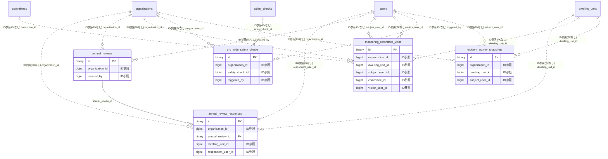

# residencestatus ドメイン ER 図

> このファイルは自動生成されます。手で編集しないでください。再生成: `cd backend && ./gradlew generateErDiagrams`

- テーブル数: 5
- ビュー数: 0

## ER 図

実線 = 外部キー、点線 = ID参照(FKなし)。図中の `FK` は実外部キーの列だけ（ID参照列は `FK` を付けず "ID参照" と注記）。図にはキー列（PK / FK / 参照推定列 / 単一列 UNIQUE）のみを描く。全列は下の「テーブル定義」を参照。

## 被参照（他ドメインから）

このドメインのテーブルを参照している他ドメインの側（実 FK と ID参照のみ。多態参照と推定不能参照は含まない。同一ドメイン内の参照は上の図を参照）。

なし

## 推定不能参照

| テーブル | 列 | 理由 |
| --- | --- | --- |
| `annual_review_responses` | `resident_registry_id` | 参照先テーブルを特定できない |
| `monitoring_committee_visits` | `consent_covenant_id` | 参照先テーブルを特定できない |
| `monitoring_committee_visits` | `resident_registry_id` | 参照先テーブルを特定できない |
| `resident_activity_snapshots` | `resident_registry_id` | 参照先テーブルを特定できない |

## テーブル定義

### `annual_review_responses`

| 列名 | 型 | NULL | 既定値 | コメント |
| --- | --- | --- | --- | --- |
| `id` | `binary(16)` | NO | （なし） |  |
| `organization_id` | `bigint unsigned` | NO | （なし） |  |
| `annual_review_id` | `binary(16)` | NO | （なし） |  |
| `dwelling_unit_id` | `bigint unsigned` | NO | （なし） |  |
| `resident_registry_id` | `bigint unsigned` | NO | （なし） |  |
| `respondent_user_id` | `bigint unsigned` | NO | （なし） |  |
| `residence_state` | `varchar(30)` | NO | `UNRESPONDED` |  |
| `contact_phone_verified` | `tinyint(1)` | NO | `0` |  |
| `contact_email_verified` | `tinyint(1)` | NO | `0` |  |
| `emergency_contact_verified` | `tinyint(1)` | NO | `0` |  |
| `responded_at` | `datetime(6)` | YES | NULL |  |
| `note` | `text` | YES | NULL |  |
| `created_at` | `datetime(6)` | NO | `CURRENT_TIMESTAMP(6)` （式） |  |
| `updated_at` | `datetime(6)` | NO | `CURRENT_TIMESTAMP(6)` （式） |  |
| `deleted_at` | `datetime(6)` | YES | NULL |  |

### `annual_reviews`

| 列名 | 型 | NULL | 既定値 | コメント |
| --- | --- | --- | --- | --- |
| `id` | `binary(16)` | NO | （なし） |  |
| `organization_id` | `bigint unsigned` | NO | （なし） |  |
| `review_year` | `smallint unsigned` | NO | （なし） |  |
| `started_at` | `datetime(6)` | NO | （なし） |  |
| `deadline_at` | `datetime(6)` | NO | （なし） |  |
| `closed_at` | `datetime(6)` | YES | NULL |  |
| `target_count` | `int unsigned` | NO | `0` |  |
| `response_count` | `int unsigned` | NO | `0` |  |
| `created_by` | `bigint unsigned` | YES | NULL |  |
| `created_at` | `datetime(6)` | NO | `CURRENT_TIMESTAMP(6)` （式） |  |
| `updated_at` | `datetime(6)` | NO | `CURRENT_TIMESTAMP(6)` （式） |  |
| `deleted_at` | `datetime(6)` | YES | NULL |  |

### `monitoring_committee_visits`

| 列名 | 型 | NULL | 既定値 | コメント |
| --- | --- | --- | --- | --- |
| `id` | `binary(16)` | NO | （なし） |  |
| `organization_id` | `bigint unsigned` | NO | （なし） |  |
| `dwelling_unit_id` | `bigint unsigned` | NO | （なし） |  |
| `resident_registry_id` | `bigint unsigned` | NO | （なし） |  |
| `subject_user_id` | `bigint unsigned` | NO | （なし） |  |
| `committee_id` | `bigint unsigned` | NO | （なし） |  |
| `visitor_user_id` | `bigint unsigned` | NO | （なし） |  |
| `visited_at` | `datetime(6)` | NO | （なし） |  |
| `contact_result` | `varchar(20)` | NO | （なし） |  |
| `consideration_memo_encrypted` | `text` | YES | NULL |  |
| `next_visit_recommended_at` | `date` | YES | NULL |  |
| `consent_covenant_id` | `binary(16)` | YES | NULL |  |
| `created_at` | `datetime(6)` | NO | `CURRENT_TIMESTAMP(6)` （式） |  |
| `updated_at` | `datetime(6)` | NO | `CURRENT_TIMESTAMP(6)` （式） |  |
| `deleted_at` | `datetime(6)` | YES | NULL |  |

### `org_wide_safety_checks`

| 列名 | 型 | NULL | 既定値 | コメント |
| --- | --- | --- | --- | --- |
| `id` | `binary(16)` | NO | （なし） |  |
| `organization_id` | `bigint unsigned` | NO | （なし） |  |
| `safety_check_id` | `bigint unsigned` | NO | （なし） |  |
| `triggered_by` | `bigint unsigned` | NO | （なし） |  |
| `triggered_at` | `datetime(6)` | NO | （なし） |  |
| `trigger_reason` | `varchar(200)` | YES | NULL |  |
| `closed_at` | `datetime(6)` | YES | NULL |  |
| `created_at` | `datetime(6)` | NO | `CURRENT_TIMESTAMP(6)` （式） |  |
| `updated_at` | `datetime(6)` | NO | `CURRENT_TIMESTAMP(6)` （式） |  |
| `deleted_at` | `datetime(6)` | YES | NULL |  |

### `resident_activity_snapshots`

| 列名 | 型 | NULL | 既定値 | コメント |
| --- | --- | --- | --- | --- |
| `id` | `binary(16)` | NO | （なし） |  |
| `organization_id` | `bigint unsigned` | NO | （なし） |  |
| `dwelling_unit_id` | `bigint unsigned` | NO | （なし） |  |
| `resident_registry_id` | `bigint unsigned` | NO | （なし） |  |
| `subject_user_id` | `bigint unsigned` | NO | （なし） |  |
| `snapshot_date` | `date` | NO | （なし） |  |
| `activity_score_total` | `smallint unsigned` | NO | `0` |  |
| `activity_breakdown_json` | `json` | YES | NULL |  |
| `created_at` | `datetime(6)` | NO | `CURRENT_TIMESTAMP(6)` （式） |  |
| `updated_at` | `datetime(6)` | NO | `CURRENT_TIMESTAMP(6)` （式） |  |
| `deleted_at` | `datetime(6)` | YES | NULL |  |
