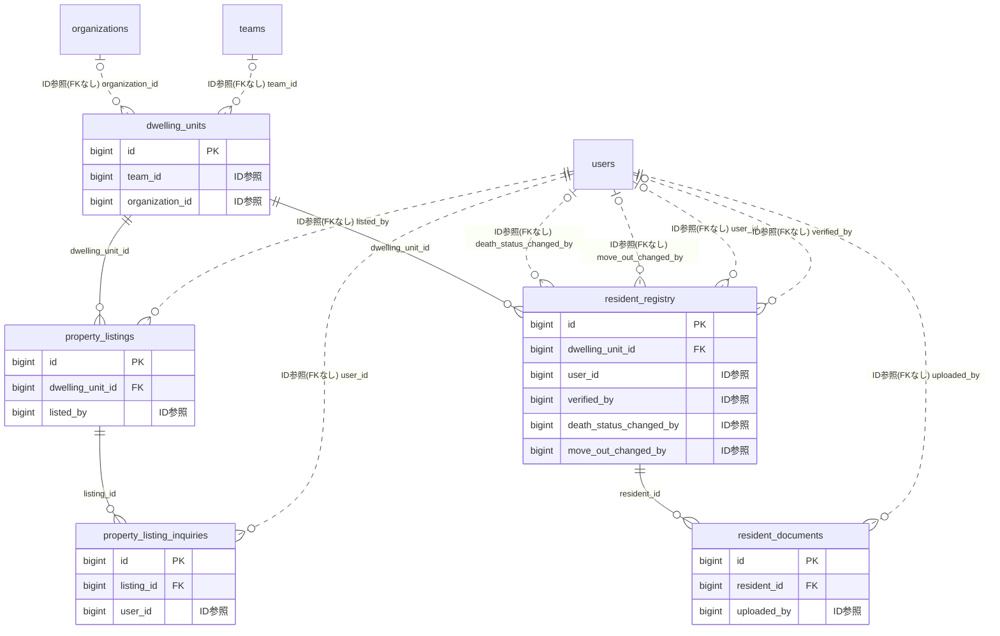

# resident ドメイン ER 図

> このファイルは自動生成されます。手で編集しないでください。再生成: `cd backend && ./gradlew generateErDiagrams`

- テーブル数: 5
- ビュー数: 0

## ER 図

実線 = 外部キー、点線 = ID参照(FKなし)。図中の `FK` は実外部キーの列だけ（ID参照列は `FK` を付けず "ID参照" と注記）。図にはキー列（PK / FK / 参照推定列 / 単一列 UNIQUE）のみを描く。全列は下の「テーブル定義」を参照。

## 被参照（他ドメインから）

このドメインのテーブルを参照している他ドメインの側（実 FK と ID参照のみ。多態参照と推定不能参照は含まない。同一ドメイン内の参照は上の図を参照）。

| 参照元ドメイン | 参照元テーブル | 列 | 種別 | 参照先テーブル |
| --- | --- | --- | --- | --- |
| [disclosure](disclosure.md) | `disclosure_exports` | `target_dwelling_unit_id` | ID参照 | `dwelling_units` |
| [disclosure](disclosure.md) | `disclosure_form_drafts` | `target_dwelling_unit_id` | ID参照 | `dwelling_units` |
| [property](property.md) | `property_work_packages` | `dwelling_unit_id` | ID参照 | `dwelling_units` |
| [residencestatus](residencestatus.md) | `annual_review_responses` | `dwelling_unit_id` | ID参照 | `dwelling_units` |
| [residencestatus](residencestatus.md) | `monitoring_committee_visits` | `dwelling_unit_id` | ID参照 | `dwelling_units` |
| [residencestatus](residencestatus.md) | `resident_activity_snapshots` | `dwelling_unit_id` | ID参照 | `dwelling_units` |
| [succession](succession.md) | `delinquency_escalations` | `dwelling_unit_id` | ID参照 | `dwelling_units` |
| [succession](succession.md) | `legal_filings` | `dwelling_unit_id` | ID参照 | `dwelling_units` |
| [succession](succession.md) | `succession_covenants` | `dwelling_unit_id` | ID参照 | `dwelling_units` |
| [succession](succession.md) | `succession_pre_registrations` | `dwelling_unit_id` | ID参照 | `dwelling_units` |
| [succession](succession.md) | `unseal_requests` | `dwelling_unit_id` | ID参照 | `dwelling_units` |

## テーブル定義

### `dwelling_units`

| 列名 | 型 | NULL | 既定値 | コメント |
| --- | --- | --- | --- | --- |
| `id` | `bigint unsigned` | NO | （なし） auto_increment |  |
| `scope_type` | `varchar(20)` | NO | （なし） |  |
| `team_id` | `bigint unsigned` | YES | NULL |  |
| `organization_id` | `bigint unsigned` | YES | NULL |  |
| `unit_number` | `varchar(50)` | NO | （なし） |  |
| `floor` | `smallint` | YES | NULL |  |
| `area_sqm` | `decimal(8,2)` | YES | NULL |  |
| `layout` | `varchar(20)` | YES | NULL |  |
| `unit_type` | `varchar(20)` | NO | `STANDARD` |  |
| `notes` | `text` | YES | NULL |  |
| `resident_count` | `smallint` | NO | `0` |  |
| `created_at` | `datetime` | NO | `CURRENT_TIMESTAMP` （式） |  |
| `updated_at` | `datetime` | NO | `CURRENT_TIMESTAMP` （式） |  |
| `deleted_at` | `datetime` | YES | NULL |  |

### `property_listing_inquiries`

| 列名 | 型 | NULL | 既定値 | コメント |
| --- | --- | --- | --- | --- |
| `id` | `bigint unsigned` | NO | （なし） auto_increment |  |
| `listing_id` | `bigint unsigned` | NO | （なし） |  |
| `user_id` | `bigint unsigned` | NO | （なし） |  |
| `message` | `text` | YES | NULL |  |
| `created_at` | `datetime` | NO | `CURRENT_TIMESTAMP` （式） |  |

### `property_listings`

| 列名 | 型 | NULL | 既定値 | コメント |
| --- | --- | --- | --- | --- |
| `id` | `bigint unsigned` | NO | （なし） auto_increment |  |
| `dwelling_unit_id` | `bigint unsigned` | NO | （なし） |  |
| `listed_by` | `bigint unsigned` | NO | （なし） |  |
| `listing_type` | `varchar(10)` | NO | （なし） |  |
| `title` | `varchar(200)` | NO | （なし） |  |
| `description` | `text` | YES | NULL |  |
| `asking_price` | `decimal(12,0)` | YES | NULL |  |
| `monthly_rent` | `decimal(10,0)` | YES | NULL |  |
| `status` | `varchar(20)` | NO | `ACTIVE` |  |
| `expires_at` | `datetime` | YES | NULL |  |
| `image_urls` | `json` | YES | NULL |  |
| `created_at` | `datetime` | NO | `CURRENT_TIMESTAMP` （式） |  |
| `updated_at` | `datetime` | NO | `CURRENT_TIMESTAMP` （式） |  |
| `deleted_at` | `datetime` | YES | NULL |  |

### `resident_documents`

| 列名 | 型 | NULL | 既定値 | コメント |
| --- | --- | --- | --- | --- |
| `id` | `bigint unsigned` | NO | （なし） auto_increment |  |
| `resident_id` | `bigint unsigned` | NO | （なし） |  |
| `document_type` | `varchar(30)` | NO | （なし） |  |
| `file_name` | `varchar(255)` | NO | （なし） |  |
| `s3_key` | `varchar(500)` | NO | （なし） |  |
| `file_size` | `int` | NO | （なし） |  |
| `content_type` | `varchar(100)` | NO | （なし） |  |
| `uploaded_by` | `bigint unsigned` | NO | （なし） |  |
| `created_at` | `datetime` | NO | `CURRENT_TIMESTAMP` （式） |  |

### `resident_registry`

| 列名 | 型 | NULL | 既定値 | コメント |
| --- | --- | --- | --- | --- |
| `id` | `bigint unsigned` | NO | （なし） auto_increment |  |
| `dwelling_unit_id` | `bigint unsigned` | NO | （なし） |  |
| `user_id` | `bigint unsigned` | YES | NULL |  |
| `resident_type` | `varchar(20)` | NO | （なし） |  |
| `last_name` | `text` | NO | （なし） | 姓（AES-256-GCM暗号化） |
| `first_name` | `text` | NO | （なし） | 名（AES-256-GCM暗号化） |
| `last_name_kana` | `text` | YES | NULL | 姓カナ（AES-256-GCM暗号化） |
| `first_name_kana` | `text` | YES | NULL | 名カナ（AES-256-GCM暗号化） |
| `phone` | `text` | YES | NULL | 電話番号（AES-256-GCM暗号化） |
| `email` | `text` | YES | NULL | メール（AES-256-GCM暗号化） |
| `emergency_contact` | `text` | YES | NULL | 緊急連絡先（AES-256-GCM暗号化） |
| `last_name_hash` | `char(64)` | YES | NULL | 姓のHMACハッシュ（検索用） |
| `first_name_hash` | `char(64)` | YES | NULL | 名のHMACハッシュ（検索用） |
| `encryption_key_version` | `int unsigned` | NO | `1` | 暗号化キーバージョン |
| `move_in_date` | `date` | NO | （なし） |  |
| `move_out_date` | `date` | YES | NULL |  |
| `ownership_ratio` | `decimal(5,4)` | YES | NULL |  |
| `is_primary` | `tinyint(1)` | NO | `0` |  |
| `is_verified` | `tinyint(1)` | NO | `0` |  |
| `verified_by` | `bigint unsigned` | YES | NULL |  |
| `verified_at` | `datetime` | YES | NULL |  |
| `notes` | `text` | YES | NULL |  |
| `created_at` | `datetime` | NO | `CURRENT_TIMESTAMP` （式） |  |
| `updated_at` | `datetime` | NO | `CURRENT_TIMESTAMP` （式） |  |
| `deleted_at` | `datetime` | YES | NULL |  |
| `death_status` | `varchar(30)` | NO | `ALIVE` | 死亡状態: ALIVE / SUSPECTED / CONFIRMED / CANCELLED_FALSE_ALARM |
| `death_status_changed_at` | `datetime(6)` | YES | NULL | 死亡状態の最終変更日時 |
| `death_status_changed_by` | `bigint unsigned` | YES | NULL | 死亡状態を変更した user_id（弱参照・FKなし） |
| `presumed_death_score` | `smallint unsigned` | YES | NULL | 居住実態推定スコア 0〜100（F09.16 が更新・本人非開示） |
| `activity_last_seen_at` | `datetime(6)` | YES | NULL | 直近アクティビティ日時のキャッシュ（F09.16 ActivitySnapshotAggregator が更新） |
| `occupancy_status` | `varchar(30)` | NO | `UNKNOWN` | 居住実態区分: OWNER_OCCUPIED / RENTED_OUT / VACANT / SECONDARY_HOME / UNKNOWN |
| `last_annual_review_at` | `datetime(6)` | YES | NULL | 直近の年次居住実態更新日時（annual_review_responses から派生キャッシュ） |
| `annual_review_due_at` | `date` | YES | NULL | 次回年次居住実態更新の期限日 |
| `is_secondary_home` | `tinyint(1)` | NO | `0` | セカンドハウス・別荘扱いフラグ（通常の見守り対象から除外） |
| `age_estimated` | `tinyint unsigned` | YES | NULL | 推定年齢（0〜200、自己申告ベース・本人開示） |
| `move_out_changed_by` | `bigint unsigned` | YES | NULL |  |
| `move_out_changed_at` | `datetime(3)` | YES | NULL |  |
