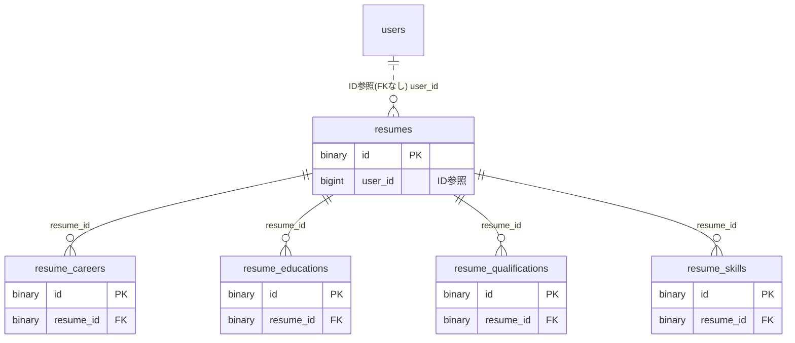

# resume ドメイン ER 図

> このファイルは自動生成されます。手で編集しないでください。再生成: `cd backend && ./gradlew generateErDiagrams`

- テーブル数: 5
- ビュー数: 0

## ER 図

実線 = 外部キー、点線 = ID参照(FKなし)。図中の `FK` は実外部キーの列だけ（ID参照列は `FK` を付けず "ID参照" と注記）。図にはキー列（PK / FK / 参照推定列 / 単一列 UNIQUE）のみを描く。全列は下の「テーブル定義」を参照。

## 被参照（他ドメインから）

このドメインのテーブルを参照している他ドメインの側（実 FK と ID参照のみ。多態参照と推定不能参照は含まない。同一ドメイン内の参照は上の図を参照）。

なし

## テーブル定義

### `resume_careers`

| 列名 | 型 | NULL | 既定値 | コメント |
| --- | --- | --- | --- | --- |
| `id` | `binary(16)` | NO | （なし） |  |
| `resume_id` | `binary(16)` | NO | （なし） |  |
| `entry_year` | `smallint` | NO | （なし） |  |
| `entry_month` | `tinyint` | YES | NULL |  |
| `end_year` | `smallint` | YES | NULL |  |
| `end_month` | `tinyint` | YES | NULL |  |
| `is_current` | `tinyint(1)` | NO | `0` |  |
| `company_name` | `varchar(255)` | NO | （なし） |  |
| `department` | `varchar(255)` | YES | NULL |  |
| `employment_type` | `varchar(50)` | YES | NULL |  |
| `business_summary` | `varchar(500)` | YES | NULL |  |
| `job_description` | `text` | YES | NULL |  |
| `achievements` | `text` | YES | NULL |  |
| `include_in_rirekisho` | `tinyint(1)` | NO | `1` |  |
| `include_in_shokumukeireki` | `tinyint(1)` | NO | `1` |  |
| `display_order` | `int` | NO | `0` |  |
| `created_at` | `datetime` | NO | `CURRENT_TIMESTAMP` （式） |  |
| `updated_at` | `datetime` | NO | `CURRENT_TIMESTAMP` （式） |  |
| `deleted_at` | `datetime` | YES | NULL |  |

### `resume_educations`

| 列名 | 型 | NULL | 既定値 | コメント |
| --- | --- | --- | --- | --- |
| `id` | `binary(16)` | NO | （なし） |  |
| `resume_id` | `binary(16)` | NO | （なし） |  |
| `entry_year` | `smallint` | NO | （なし） |  |
| `entry_month` | `tinyint` | YES | NULL |  |
| `description` | `varchar(255)` | NO | （なし） |  |
| `display_order` | `int` | NO | `0` |  |
| `created_at` | `datetime` | NO | `CURRENT_TIMESTAMP` （式） |  |
| `updated_at` | `datetime` | NO | `CURRENT_TIMESTAMP` （式） |  |
| `deleted_at` | `datetime` | YES | NULL |  |

### `resume_qualifications`

| 列名 | 型 | NULL | 既定値 | コメント |
| --- | --- | --- | --- | --- |
| `id` | `binary(16)` | NO | （なし） |  |
| `resume_id` | `binary(16)` | NO | （なし） |  |
| `acquired_year` | `smallint` | NO | （なし） |  |
| `acquired_month` | `tinyint` | YES | NULL |  |
| `name` | `varchar(255)` | NO | （なし） |  |
| `note` | `varchar(255)` | YES | NULL |  |
| `display_order` | `int` | NO | `0` |  |
| `created_at` | `datetime` | NO | `CURRENT_TIMESTAMP` （式） |  |
| `updated_at` | `datetime` | NO | `CURRENT_TIMESTAMP` （式） |  |
| `deleted_at` | `datetime` | YES | NULL |  |

### `resume_skills`

| 列名 | 型 | NULL | 既定値 | コメント |
| --- | --- | --- | --- | --- |
| `id` | `binary(16)` | NO | （なし） |  |
| `resume_id` | `binary(16)` | NO | （なし） |  |
| `skill_name` | `varchar(100)` | NO | （なし） |  |
| `level` | `enum('BEGINNER','INTERMEDIATE','ADVANCED','EXPERT')` | YES | NULL |  |
| `description` | `varchar(500)` | YES | NULL |  |
| `display_order` | `int` | NO | `0` |  |
| `created_at` | `datetime` | NO | `CURRENT_TIMESTAMP` （式） |  |
| `updated_at` | `datetime` | NO | `CURRENT_TIMESTAMP` （式） |  |
| `deleted_at` | `datetime` | YES | NULL |  |

### `resumes`

| 列名 | 型 | NULL | 既定値 | コメント |
| --- | --- | --- | --- | --- |
| `id` | `binary(16)` | NO | （なし） |  |
| `user_id` | `bigint unsigned` | NO | （なし） |  |
| `title` | `varchar(100)` | NO | （なし） |  |
| `photo_key` | `varchar(500)` | YES | NULL |  |
| `era_format` | `enum('WESTERN','JAPANESE')` | NO | `WESTERN` |  |
| `current_address` | `text` | YES | NULL |  |
| `current_address_kana` | `text` | YES | NULL |  |
| `contact_address` | `text` | YES | NULL |  |
| `contact_address_kana` | `text` | YES | NULL |  |
| `contact_phone` | `text` | YES | NULL |  |
| `contact_email` | `text` | YES | NULL |  |
| `motivation` | `text` | YES | NULL |  |
| `self_pr` | `text` | YES | NULL |  |
| `personal_request` | `text` | YES | NULL |  |
| `commute_minutes` | `smallint` | YES | NULL |  |
| `dependents_count` | `smallint` | YES | NULL |  |
| `has_spouse` | `tinyint(1)` | YES | NULL |  |
| `spouse_support` | `tinyint(1)` | YES | NULL |  |
| `career_summary` | `text` | YES | NULL |  |
| `skills_summary` | `text` | YES | NULL |  |
| `version` | `bigint` | NO | `0` |  |
| `created_at` | `datetime` | NO | `CURRENT_TIMESTAMP` （式） |  |
| `updated_at` | `datetime` | NO | `CURRENT_TIMESTAMP` （式） |  |
| `deleted_at` | `datetime` | YES | NULL |  |
