# role ドメイン ER 図

> このファイルは自動生成されます。手で編集しないでください。再生成: `cd backend && ./gradlew generateErDiagrams`

- テーブル数: 13
- ビュー数: 0

## ER 図

実線 = 外部キー、点線 = ID参照(FKなし)。図中の `FK` は実外部キーの列だけ（ID参照列は `FK` を付けず "ID参照" と注記）。図にはキー列（PK / FK / 参照推定列 / 単一列 UNIQUE）のみを描く。全列は下の「テーブル定義」を参照。

```mermaid
erDiagram
    archived_membership_grants {
        binary id PK
        bigint membership_id "ID参照"
        bigint granted_by "ID参照"
    }
    invite_token_claims {
        binary id PK
        bigint token_id FK
        bigint user_id "ID参照"
    }
    invite_tokens {
        bigint id PK
        varchar token_hash UK "SHA-256 hex64"
        bigint team_id "ID参照"
        bigint organization_id "ID参照"
        bigint role_id FK
        bigint created_by "ID参照"
        bigint target_user_id "ID参照"
    }
    ownership_transfer_offers {
        binary id PK
        bigint team_id "ID参照"
        bigint organization_id "ID参照"
        bigint issued_by "ID参照"
        bigint target_user_id "ID参照"
    }
    permission_group_permissions {
        bigint id PK
        bigint group_id FK
        bigint permission_id FK
    }
    permission_groups {
        bigint id PK
        bigint team_id "ID参照"
        bigint organization_id "ID参照"
        bigint created_by "ID参照"
    }
    permissions {
        bigint id PK
        varchar name UK
    }
    role_permission_cache_generations {
        binary id PK
    }
    role_permissions {
        bigint id PK
        bigint role_id FK
        bigint permission_id FK
    }
    roles {
        bigint id PK
        varchar name UK
    }
    team_role_permissions {
        binary id PK
        bigint role_id FK
        bigint permission_id FK
    }
    user_permission_groups {
        bigint id PK
        bigint user_id "ID参照"
        bigint group_id FK
        bigint assigned_by "ID参照"
    }
    user_roles {
        bigint id PK
        bigint user_id "ID参照"
        bigint role_id FK
        bigint team_id "ID参照"
        bigint organization_id "ID参照"
        bigint granted_by "ID参照"
    }
    memberships
    organizations
    teams
    users
    memberships ||..o{ archived_membership_grants : "ID参照(FKなし) membership_id"
    users |o..o{ archived_membership_grants : "ID参照(FKなし) granted_by"
    invite_tokens ||--o{ invite_token_claims : "token_id"
    users ||..o{ invite_token_claims : "ID参照(FKなし) user_id"
    organizations |o..o{ invite_tokens : "ID参照(FKなし) organization_id"
    roles ||--o{ invite_tokens : "role_id"
    teams |o..o{ invite_tokens : "ID参照(FKなし) team_id"
    users |o..o{ invite_tokens : "ID参照(FKなし) created_by"
    users |o..o{ invite_tokens : "ID参照(FKなし) target_user_id"
    organizations |o..o{ ownership_transfer_offers : "ID参照(FKなし) organization_id"
    teams |o..o{ ownership_transfer_offers : "ID参照(FKなし) team_id"
    users ||..o{ ownership_transfer_offers : "ID参照(FKなし) issued_by"
    users ||..o{ ownership_transfer_offers : "ID参照(FKなし) target_user_id"
    permission_groups ||--o{ permission_group_permissions : "group_id"
    permissions ||--o{ permission_group_permissions : "permission_id"
    organizations |o..o{ permission_groups : "ID参照(FKなし) organization_id"
    teams |o..o{ permission_groups : "ID参照(FKなし) team_id"
    users |o..o{ permission_groups : "ID参照(FKなし) created_by"
    permissions ||--o{ role_permissions : "permission_id"
    roles ||--o{ role_permissions : "role_id"
    permissions ||--o{ team_role_permissions : "permission_id"
    roles ||--o{ team_role_permissions : "role_id"
    permission_groups ||--o{ user_permission_groups : "group_id"
    users |o..o{ user_permission_groups : "ID参照(FKなし) assigned_by"
    users ||..o{ user_permission_groups : "ID参照(FKなし) user_id"
    organizations |o..o{ user_roles : "ID参照(FKなし) organization_id"
    roles ||--o{ user_roles : "role_id"
    teams |o..o{ user_roles : "ID参照(FKなし) team_id"
    users |o..o{ user_roles : "ID参照(FKなし) granted_by"
    users ||..o{ user_roles : "ID参照(FKなし) user_id"
```

## 被参照（他ドメインから）

このドメインのテーブルを参照している他ドメインの側（実 FK と ID参照のみ。多態参照と推定不能参照は含まない。同一ドメイン内の参照は上の図を参照）。

| 参照元ドメイン | 参照元テーブル | 列 | 種別 | 参照先テーブル |
| --- | --- | --- | --- | --- |
| [chat](chat.md) | `chat_messages` | `invite_token_id` | ID参照 | `invite_tokens` |
| [event](event.md) | `event_registrations` | `invite_token_id` | ID参照 | `invite_tokens` |

## 多態参照（線を引かない）

| テーブル | 種別列 | ID列 |
| --- | --- | --- |
| `role_permission_cache_generations` | `scope_type` | `scope_id` |
| `team_role_permissions` | `scope_type` | `scope_id` |

## 推定不能参照

| テーブル | 列 | 理由 |
| --- | --- | --- |
| `archived_membership_grants` | `grant_ref_id` | 参照先テーブルを特定できない |

## テーブル定義

### `archived_membership_grants`

| 列名 | 型 | NULL | 既定値 | コメント |
| --- | --- | --- | --- | --- |
| `id` | `binary(16)` | NO | （なし） |  |
| `membership_id` | `bigint unsigned` | NO | （なし） |  |
| `archive_generation` | `int` | NO | （なし） |  |
| `grant_type` | `varchar(20)` | NO | （なし） |  |
| `grant_ref_id` | `bigint unsigned` | NO | （なし） |  |
| `granted_by` | `bigint unsigned` | YES | NULL |  |
| `revoked_at` | `datetime(3)` | NO | （なし） |  |
| `restored_at` | `datetime(3)` | YES | NULL |  |
| `created_at` | `datetime(3)` | NO | （なし） |  |
| `updated_at` | `datetime(3)` | NO | （なし） |  |

### `invite_token_claims`

| 列名 | 型 | NULL | 既定値 | コメント |
| --- | --- | --- | --- | --- |
| `id` | `binary(16)` | NO | （なし） |  |
| `token_id` | `bigint unsigned` | NO | （なし） |  |
| `user_id` | `bigint unsigned` | NO | （なし） |  |
| `status` | `varchar(16)` | NO | （なし） |  |
| `created_at` | `datetime(6)` | NO | （なし） |  |
| `updated_at` | `datetime(6)` | NO | （なし） |  |

### `invite_tokens`

| 列名 | 型 | NULL | 既定値 | コメント |
| --- | --- | --- | --- | --- |
| `id` | `bigint unsigned` | NO | （なし） auto_increment |  |
| `token_hash` | `varchar(64)` | NO | （なし） | 招待トークンのSHA-256ハッシュ(hex)。平文は保存しない |
| `team_id` | `bigint unsigned` | YES | NULL |  |
| `organization_id` | `bigint unsigned` | YES | NULL |  |
| `role_id` | `bigint unsigned` | NO | （なし） |  |
| `expires_at` | `datetime` | YES | NULL |  |
| `max_uses` | `int` | YES | NULL |  |
| `used_count` | `int` | NO | `0` |  |
| `revoked_at` | `datetime` | YES | NULL |  |
| `created_by` | `bigint unsigned` | YES | NULL |  |
| `created_at` | `datetime` | NO | （なし） |  |
| `target_user_id` | `bigint unsigned` | YES | NULL | 承諾型招待の宛先ユーザー（users.id）。NULL=共有リンク型 / 非NULL=宛先付き承諾型（クロスドメイン・FK 張らない） |
| `scope_closure_generation` | `bigint` | NO | `0` | 招待先自身の発行時閉鎖世代。解除しても旧招待を復元しない |

### `ownership_transfer_offers`

| 列名 | 型 | NULL | 既定値 | コメント |
| --- | --- | --- | --- | --- |
| `id` | `binary(16)` | NO | （なし） | UUIDv7 PK（原則6） |
| `team_id` | `bigint unsigned` | YES | NULL | 委譲対象がチームの場合（FK 張らない・原則1） |
| `organization_id` | `bigint unsigned` | YES | NULL | 委譲対象が組織の場合（FK 張らない・原則1） |
| `issued_by` | `bigint unsigned` | NO | （なし） | 発行者（現 ADMIN）の user ID（FK 張らない） |
| `target_user_id` | `bigint unsigned` | NO | （なし） | 指名相手（承諾できる唯一のユーザー）の user ID（FK 張らない） |
| `status` | `varchar(20)` | NO | `PENDING` | PENDING/ACCEPTED/DECLINED/EXPIRED/CANCELLED |
| `expires_at` | `datetime` | NO | （なし） | 有効期限（発行から7日を既定） |
| `accepted_at` | `datetime` | YES | NULL | 承諾日時（ACCEPTED 時のみ） |
| `resolved_at` | `datetime` | YES | NULL | 辞退/取消/期限確定の処理日時 |
| `created_at` | `datetime` | NO | `CURRENT_TIMESTAMP` （式） |  |
| `updated_at` | `datetime` | NO | `CURRENT_TIMESTAMP` （式） |  |

### `permission_group_permissions`

| 列名 | 型 | NULL | 既定値 | コメント |
| --- | --- | --- | --- | --- |
| `id` | `bigint unsigned` | NO | （なし） auto_increment |  |
| `group_id` | `bigint unsigned` | NO | （なし） |  |
| `permission_id` | `bigint unsigned` | NO | （なし） |  |
| `created_at` | `datetime` | NO | （なし） |  |

### `permission_groups`

| 列名 | 型 | NULL | 既定値 | コメント |
| --- | --- | --- | --- | --- |
| `id` | `bigint unsigned` | NO | （なし） auto_increment |  |
| `team_id` | `bigint unsigned` | YES | NULL |  |
| `organization_id` | `bigint unsigned` | YES | NULL |  |
| `target_role` | `varchar(30)` | NO | （なし） |  |
| `name` | `varchar(100)` | NO | （なし） |  |
| `created_by` | `bigint unsigned` | YES | NULL |  |
| `deleted_at` | `datetime` | YES | NULL |  |
| `created_at` | `datetime` | NO | （なし） |  |
| `updated_at` | `datetime` | NO | （なし） |  |

### `permissions`

| 列名 | 型 | NULL | 既定値 | コメント |
| --- | --- | --- | --- | --- |
| `id` | `bigint unsigned` | NO | （なし） auto_increment |  |
| `name` | `varchar(50)` | NO | （なし） |  |
| `display_name` | `varchar(100)` | NO | （なし） |  |
| `scope` | `varchar(20)` | NO | （なし） |  |
| `created_at` | `datetime` | NO | （なし） |  |
| `updated_at` | `datetime` | NO | （なし） |  |

### `role_permission_cache_generations`

| 列名 | 型 | NULL | 既定値 | コメント |
| --- | --- | --- | --- | --- |
| `id` | `binary(16)` | NO | （なし） |  |
| `scope_type` | `varchar(20)` | NO | （なし） |  |
| `scope_id` | `bigint unsigned` | NO | （なし） |  |
| `generation` | `bigint` | NO | （なし） |  |
| `updated_at` | `datetime(3)` | NO | （なし） |  |

### `role_permissions`

| 列名 | 型 | NULL | 既定値 | コメント |
| --- | --- | --- | --- | --- |
| `id` | `bigint unsigned` | NO | （なし） auto_increment |  |
| `role_id` | `bigint unsigned` | NO | （なし） |  |
| `permission_id` | `bigint unsigned` | NO | （なし） |  |
| `is_default` | `tinyint(1)` | NO | `0` |  |
| `created_at` | `datetime` | NO | （なし） |  |

### `roles`

| 列名 | 型 | NULL | 既定値 | コメント |
| --- | --- | --- | --- | --- |
| `id` | `bigint unsigned` | NO | （なし） auto_increment |  |
| `name` | `varchar(30)` | NO | （なし） |  |
| `display_name` | `varchar(50)` | NO | （なし） |  |
| `priority` | `int` | NO | （なし） |  |
| `is_system` | `tinyint(1)` | NO | `0` |  |
| `created_at` | `datetime` | NO | （なし） |  |
| `updated_at` | `datetime` | NO | （なし） |  |

### `team_role_permissions`

| 列名 | 型 | NULL | 既定値 | コメント |
| --- | --- | --- | --- | --- |
| `id` | `binary(16)` | NO | （なし） |  |
| `scope_type` | `varchar(20)` | NO | （なし） |  |
| `scope_id` | `bigint unsigned` | NO | （なし） |  |
| `role_id` | `bigint unsigned` | NO | （なし） |  |
| `permission_id` | `bigint unsigned` | NO | （なし） |  |
| `is_enabled` | `tinyint(1)` | NO | （なし） |  |
| `created_at` | `datetime(3)` | NO | （なし） |  |
| `updated_at` | `datetime(3)` | NO | （なし） |  |

### `user_permission_groups`

| 列名 | 型 | NULL | 既定値 | コメント |
| --- | --- | --- | --- | --- |
| `id` | `bigint unsigned` | NO | （なし） auto_increment |  |
| `user_id` | `bigint unsigned` | NO | （なし） |  |
| `group_id` | `bigint unsigned` | NO | （なし） |  |
| `assigned_by` | `bigint unsigned` | YES | NULL |  |
| `created_at` | `datetime` | NO | （なし） |  |

### `user_roles`

| 列名 | 型 | NULL | 既定値 | コメント |
| --- | --- | --- | --- | --- |
| `id` | `bigint unsigned` | NO | （なし） auto_increment |  |
| `user_id` | `bigint unsigned` | NO | （なし） |  |
| `role_id` | `bigint unsigned` | NO | （なし） |  |
| `team_id` | `bigint unsigned` | YES | NULL |  |
| `organization_id` | `bigint unsigned` | YES | NULL |  |
| `scope_key` | `varchar(100)` | YES | NULL |  |
| `granted_by` | `bigint unsigned` | YES | NULL |  |
| `created_at` | `datetime` | NO | （なし） |  |
| `updated_at` | `datetime` | NO | （なし） |  |
