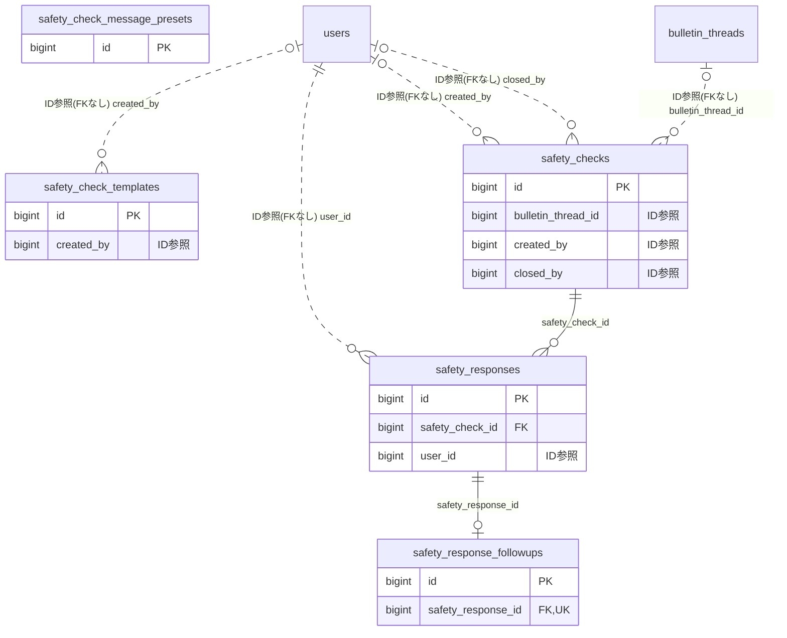

# safetycheck ドメイン ER 図

> このファイルは自動生成されます。手で編集しないでください。再生成: `cd backend && ./gradlew generateErDiagrams`

- テーブル数: 5
- ビュー数: 0

## ER 図

実線 = 外部キー、点線 = ID参照(FKなし)。図中の `FK` は実外部キーの列だけ（ID参照列は `FK` を付けず "ID参照" と注記）。図にはキー列（PK / FK / 参照推定列 / 単一列 UNIQUE）のみを描く。全列は下の「テーブル定義」を参照。

## 被参照（他ドメインから）

このドメインのテーブルを参照している他ドメインの側（実 FK と ID参照のみ。多態参照と推定不能参照は含まない。同一ドメイン内の参照は上の図を参照）。

| 参照元ドメイン | 参照元テーブル | 列 | 種別 | 参照先テーブル |
| --- | --- | --- | --- | --- |
| [residencestatus](residencestatus.md) | `org_wide_safety_checks` | `safety_check_id` | ID参照 | `safety_checks` |

## 多態参照（線を引かない）

| テーブル | 種別列 | ID列 |
| --- | --- | --- |
| `safety_check_templates` | `scope_type` | `scope_id` |
| `safety_checks` | `scope_type` | `scope_id` |

## テーブル定義

### `safety_check_message_presets`

| 列名 | 型 | NULL | 既定値 | コメント |
| --- | --- | --- | --- | --- |
| `id` | `bigint unsigned` | NO | （なし） auto_increment |  |
| `body` | `varchar(200)` | NO | （なし） |  |
| `sort_order` | `int` | NO | `0` |  |
| `is_active` | `tinyint(1)` | NO | `1` |  |
| `created_at` | `datetime` | NO | `CURRENT_TIMESTAMP` （式） |  |
| `updated_at` | `datetime` | NO | `CURRENT_TIMESTAMP` （式） |  |

### `safety_check_templates`

| 列名 | 型 | NULL | 既定値 | コメント |
| --- | --- | --- | --- | --- |
| `id` | `bigint unsigned` | NO | （なし） auto_increment |  |
| `scope_type` | `varchar(20)` | YES | NULL |  |
| `scope_id` | `bigint unsigned` | YES | NULL |  |
| `template_name` | `varchar(100)` | YES | NULL |  |
| `title` | `varchar(200)` | YES | NULL |  |
| `message` | `varchar(1000)` | YES | NULL |  |
| `reminder_interval_minutes` | `int` | YES | NULL |  |
| `is_system_default` | `tinyint(1)` | NO | `0` |  |
| `sort_order` | `int` | NO | `0` |  |
| `created_by` | `bigint unsigned` | YES | NULL |  |
| `created_at` | `datetime` | NO | `CURRENT_TIMESTAMP` （式） |  |
| `updated_at` | `datetime` | NO | `CURRENT_TIMESTAMP` （式） |  |

### `safety_checks`

| 列名 | 型 | NULL | 既定値 | コメント |
| --- | --- | --- | --- | --- |
| `id` | `bigint unsigned` | NO | （なし） auto_increment |  |
| `scope_type` | `varchar(20)` | NO | （なし） |  |
| `scope_id` | `bigint unsigned` | NO | （なし） |  |
| `title` | `varchar(200)` | YES | NULL |  |
| `message` | `varchar(1000)` | YES | NULL |  |
| `is_drill` | `tinyint(1)` | NO | `0` |  |
| `status` | `varchar(20)` | NO | `ACTIVE` |  |
| `source_type` | `varchar(20)` | YES | NULL |  |
| `reminder_interval_minutes` | `int` | YES | NULL |  |
| `last_reminder_at` | `datetime` | YES | NULL |  |
| `total_target_count` | `int` | NO | `0` |  |
| `admin_24h_notified` | `tinyint(1)` | NO | `0` |  |
| `bulletin_thread_id` | `bigint unsigned` | YES | NULL |  |
| `created_by` | `bigint unsigned` | YES | NULL |  |
| `closed_at` | `datetime` | YES | NULL |  |
| `closed_by` | `bigint unsigned` | YES | NULL |  |
| `created_at` | `datetime` | NO | `CURRENT_TIMESTAMP` （式） |  |
| `updated_at` | `datetime` | NO | `CURRENT_TIMESTAMP` （式） |  |

### `safety_response_followups`

| 列名 | 型 | NULL | 既定値 | コメント |
| --- | --- | --- | --- | --- |
| `id` | `bigint unsigned` | NO | （なし） auto_increment |  |
| `safety_response_id` | `bigint unsigned` | NO | （なし） |  |
| `followup_status` | `varchar(20)` | NO | `PENDING` |  |
| `assigned_to` | `bigint unsigned` | YES | NULL |  |
| `note` | `varchar(500)` | YES | NULL |  |
| `created_at` | `datetime` | NO | `CURRENT_TIMESTAMP` （式） |  |
| `updated_at` | `datetime` | NO | `CURRENT_TIMESTAMP` （式） |  |

### `safety_responses`

| 列名 | 型 | NULL | 既定値 | コメント |
| --- | --- | --- | --- | --- |
| `id` | `bigint unsigned` | NO | （なし） auto_increment |  |
| `safety_check_id` | `bigint unsigned` | NO | （なし） |  |
| `user_id` | `bigint unsigned` | NO | （なし） |  |
| `status` | `varchar(20)` | NO | （なし） |  |
| `message` | `varchar(200)` | YES | NULL |  |
| `message_source` | `varchar(10)` | YES | NULL |  |
| `gps_shared` | `tinyint(1)` | NO | `0` |  |
| `gps_latitude` | `decimal(10,7)` | YES | NULL |  |
| `gps_longitude` | `decimal(10,7)` | YES | NULL |  |
| `responded_at` | `datetime` | NO | `CURRENT_TIMESTAMP` （式） |  |
| `created_at` | `datetime` | NO | `CURRENT_TIMESTAMP` （式） |  |
| `updated_at` | `datetime` | NO | `CURRENT_TIMESTAMP` （式） |  |
