# schedule ドメイン ER 図

> このファイルは自動生成されます。手で編集しないでください。再生成: `cd backend && ./gradlew generateErDiagrams`

- テーブル数: 24
- ビュー数: 0

## ER 図

実線 = 外部キー、点線 = ID参照(FKなし)。図中の `FK` は実外部キーの列だけ（ID参照列は `FK` を付けず "ID参照" と注記）。図にはキー列（PK / FK / 参照推定列 / 単一列 UNIQUE）のみを描く。全列は下の「テーブル定義」を参照。

```mermaid
erDiagram
    event_survey_responses {
        bigint id PK
        bigint event_survey_id FK
        bigint user_id "ID参照"
    }
    event_surveys {
        bigint id PK
        bigint schedule_id FK
    }
    google_calendar_webhook_channels {
        binary id PK
        bigint user_id UK "ID参照"
        varchar channel_id UK
    }
    personal_schedule_reminders {
        bigint id PK
        bigint schedule_id FK
    }
    schedule_annual_copy_logs {
        bigint id PK
        bigint team_id "ID参照"
        bigint organization_id "ID参照"
        bigint executed_by "ID参照"
    }
    schedule_attendance_reminders {
        bigint id PK
        bigint schedule_id FK
    }
    schedule_attendances {
        bigint id PK
        bigint schedule_id FK
        bigint user_id "ID参照"
        bigint proxy_input_record_id "ID参照"
        bigint ranch_first_self_user_id "ID参照"
    }
    schedule_comments {
        binary id PK
        bigint schedule_id FK
        bigint user_id "ID参照"
        binary parent_id FK
    }
    schedule_cross_refs {
        bigint id PK
        bigint source_schedule_id FK
        bigint target_schedule_id FK
        bigint invited_by "ID参照"
    }
    schedule_delegations {
        binary id PK
        bigint schedule_id FK
        bigint organization_id "ID参照"
        bigint team_id "ID参照"
    }
    schedule_event_categories {
        bigint id PK
        bigint team_id "ID参照"
        bigint organization_id "ID参照"
    }
    schedule_keeps {
        binary id PK
        bigint team_id "ID参照"
        bigint organization_id "ID参照"
        bigint user_id "ID参照"
        bigint converted_schedule_id "ID参照"
        bigint created_by "ID参照"
    }
    schedule_media_uploads {
        binary id PK
        bigint schedule_id FK
        varchar r2_key UK
    }
    schedule_ranch_admin_commands {
        binary id PK
        bigint actor_user_id "ID参照"
    }
    schedule_ranch_outboxes {
        binary id PK
        bigint recipient_user_id "ID参照"
    }
    schedule_ranch_witnesses {
        binary id PK
        bigint recipient_user_id "ID参照"
        bigint schedule_id "ID参照"
    }
    schedule_scheduled_tasks {
        binary id PK
        bigint schedule_id "ID参照"
        bigint organization_id "ID参照"
        bigint created_by "ID参照"
    }
    schedule_targets {
        binary id PK
        bigint schedule_id FK
        bigint user_id "ID参照"
    }
    schedules {
        bigint id PK
        bigint team_id "ID参照"
        bigint organization_id "ID参照"
        bigint user_id "ID参照"
        bigint committee_id "ID参照"
        bigint venue_id "ID参照"
        bigint event_category_id FK
        bigint source_schedule_id "ID参照"
        bigint parent_schedule_id FK
        bigint linked_todo_id UK "ID参照"
        bigint created_by "ID参照"
        char external_ref_hash UK
        bigint visibility_template_id "ID参照"
    }
    user_calendar_layer_settings {
        binary id PK
        bigint user_id "ID参照"
    }
    user_calendar_sync_settings {
        bigint id PK
        bigint user_id "ID参照"
    }
    user_google_calendar_connections {
        bigint id PK
        bigint user_id UK "ID参照"
    }
    user_ical_tokens {
        bigint id PK
        bigint user_id UK "ID参照"
        varchar token UK
    }
    user_schedule_google_events {
        bigint id PK
        bigint user_id "ID参照"
        bigint schedule_id FK
    }
    committees
    organizations
    proxy_input_records
    teams
    todos
    users
    venues
    visibility_templates
    event_surveys ||--o{ event_survey_responses : "event_survey_id"
    users ||..o{ event_survey_responses : "ID参照(FKなし) user_id"
    schedules ||--o{ event_surveys : "schedule_id"
    users ||..o| google_calendar_webhook_channels : "ID参照(FKなし) user_id"
    schedules ||--o{ personal_schedule_reminders : "schedule_id"
    organizations |o..o{ schedule_annual_copy_logs : "ID参照(FKなし) organization_id"
    teams |o..o{ schedule_annual_copy_logs : "ID参照(FKなし) team_id"
    users |o..o{ schedule_annual_copy_logs : "ID参照(FKなし) executed_by"
    schedules ||--o{ schedule_attendance_reminders : "schedule_id"
    proxy_input_records |o..o{ schedule_attendances : "ID参照(FKなし) proxy_input_record_id"
    schedules ||--o{ schedule_attendances : "schedule_id"
    users |o..o{ schedule_attendances : "ID参照(FKなし) ranch_first_self_user_id"
    users ||..o{ schedule_attendances : "ID参照(FKなし) user_id"
    schedule_comments |o--o{ schedule_comments : "parent_id"
    schedules ||--o{ schedule_comments : "schedule_id"
    users |o..o{ schedule_comments : "ID参照(FKなし) user_id"
    schedules ||--o{ schedule_cross_refs : "source_schedule_id"
    schedules |o--o{ schedule_cross_refs : "target_schedule_id"
    users |o..o{ schedule_cross_refs : "ID参照(FKなし) invited_by"
    organizations |o..o{ schedule_delegations : "ID参照(FKなし) organization_id"
    schedules ||--o{ schedule_delegations : "schedule_id"
    teams |o..o{ schedule_delegations : "ID参照(FKなし) team_id"
    organizations |o..o{ schedule_event_categories : "ID参照(FKなし) organization_id"
    teams |o..o{ schedule_event_categories : "ID参照(FKなし) team_id"
    organizations |o..o{ schedule_keeps : "ID参照(FKなし) organization_id"
    schedules |o..o{ schedule_keeps : "ID参照(FKなし) converted_schedule_id"
    teams |o..o{ schedule_keeps : "ID参照(FKなし) team_id"
    users |o..o{ schedule_keeps : "ID参照(FKなし) created_by"
    users |o..o{ schedule_keeps : "ID参照(FKなし) user_id"
    schedules |o--o{ schedule_media_uploads : "schedule_id"
    users ||..o{ schedule_ranch_admin_commands : "ID参照(FKなし) actor_user_id"
    users ||..o{ schedule_ranch_outboxes : "ID参照(FKなし) recipient_user_id"
    schedules ||..o{ schedule_ranch_witnesses : "ID参照(FKなし) schedule_id"
    users ||..o{ schedule_ranch_witnesses : "ID参照(FKなし) recipient_user_id"
    organizations ||..o{ schedule_scheduled_tasks : "ID参照(FKなし) organization_id"
    schedules ||..o{ schedule_scheduled_tasks : "ID参照(FKなし) schedule_id"
    users |o..o{ schedule_scheduled_tasks : "ID参照(FKなし) created_by"
    schedules ||--o{ schedule_targets : "schedule_id"
    users ||..o{ schedule_targets : "ID参照(FKなし) user_id"
    committees |o..o{ schedules : "ID参照(FKなし) committee_id"
    organizations |o..o{ schedules : "ID参照(FKなし) organization_id"
    schedule_event_categories |o--o{ schedules : "event_category_id"
    schedules |o..o{ schedules : "ID参照(FKなし) source_schedule_id"
    schedules |o--o{ schedules : "parent_schedule_id"
    teams |o..o{ schedules : "ID参照(FKなし) team_id"
    todos |o..o| schedules : "ID参照(FKなし) linked_todo_id"
    users |o..o{ schedules : "ID参照(FKなし) created_by"
    users |o..o{ schedules : "ID参照(FKなし) user_id"
    venues |o..o{ schedules : "ID参照(FKなし) venue_id"
    visibility_templates |o..o{ schedules : "ID参照(FKなし) visibility_template_id"
    users ||..o{ user_calendar_layer_settings : "ID参照(FKなし) user_id"
    users ||..o{ user_calendar_sync_settings : "ID参照(FKなし) user_id"
    users ||..o| user_google_calendar_connections : "ID参照(FKなし) user_id"
    users ||..o| user_ical_tokens : "ID参照(FKなし) user_id"
    schedules ||--o{ user_schedule_google_events : "schedule_id"
    users ||..o{ user_schedule_google_events : "ID参照(FKなし) user_id"
```

## 被参照（他ドメインから）

このドメインのテーブルを参照している他ドメインの側（実 FK と ID参照のみ。多態参照と推定不能参照は含まない。同一ドメイン内の参照は上の図を参照）。

| 参照元ドメイン | 参照元テーブル | 列 | 種別 | 参照先テーブル |
| --- | --- | --- | --- | --- |
| [activity](activity.md) | `activity_results` | `schedule_id` | ID参照 | `schedules` |
| [event](event.md) | `events` | `schedule_id` | ID参照 | `schedules` |
| [match](match.md) | `matches` | `schedule_id` | ID参照 | `schedules` |
| [performance](performance.md) | `performance_records` | `schedule_id` | ID参照 | `schedules` |
| [receipt](receipt.md) | `receipts` | `schedule_id` | ID参照 | `schedules` |
| [todo](todo.md) | `todos` | `linked_schedule_id` | ID参照 | `schedules` |
| [tournament](tournament.md) | `tournament_matches` | `schedule_id` | ID参照 | `schedules` |

## 自己参照

mermaid は同一テーブルの自己参照を複数描けず 1 本に畳むため、図に線が欠けることがある。自己参照はこの表を正とする。

| テーブル | 列 | 種別 |
| --- | --- | --- |
| `schedule_comments` | `parent_id` | 外部キー |
| `schedules` | `parent_schedule_id` | 外部キー |
| `schedules` | `source_schedule_id` | ID参照 |

## 多態参照（線を引かない）

| テーブル | 種別列 | ID列 |
| --- | --- | --- |
| `schedule_cross_refs` | `target_type` | `target_id` |
| `schedule_scheduled_tasks` | `scope_type` | `scope_id` |
| `user_calendar_layer_settings` | `scope_type` | `scope_id` |
| `user_calendar_sync_settings` | `scope_type` | `scope_id` |

## 推定不能参照

| テーブル | 列 | 理由 |
| --- | --- | --- |
| `google_calendar_webhook_channels` | `channel_id` | 参照先テーブルを特定できない |
| `google_calendar_webhook_channels` | `resource_id` | 参照先テーブルを特定できない |
| `schedule_comments` | `root_id` | 参照先テーブルを特定できない |
| `schedule_delegations` | `delegate_id` | 参照先テーブルを特定できない |
| `schedule_delegations` | `delegator_id` | 参照先テーブルを特定できない |
| `schedule_media_uploads` | `uploader_id` | 参照先テーブルを特定できない |
| `schedule_ranch_outboxes` | `canonical_scope_id` | 参照先テーブルを特定できない |
| `schedule_ranch_witnesses` | `canonical_source_id` | 参照先テーブルを特定できない |
| `schedule_ranch_witnesses` | `event_id` | 型が参照先 events.id と不一致（binary ≠ bigint） |
| `schedule_scheduled_tasks` | `materialized_entity_id` | 参照先テーブルを特定できない |
| `schedules` | `google_calendar_event_id` | 型が参照先 events.id と不一致（varchar ≠ bigint） |
| `user_google_calendar_connections` | `google_calendar_id` | 参照先テーブルを特定できない |
| `user_schedule_google_events` | `google_event_id` | 型が参照先 events.id と不一致（varchar ≠ bigint） |

## テーブル定義

### `event_survey_responses`

| 列名 | 型 | NULL | 既定値 | コメント |
| --- | --- | --- | --- | --- |
| `id` | `bigint unsigned` | NO | （なし） auto_increment |  |
| `event_survey_id` | `bigint unsigned` | NO | （なし） |  |
| `user_id` | `bigint unsigned` | NO | （なし） |  |
| `answer_text` | `text` | YES | NULL |  |
| `answer_options` | `json` | YES | NULL |  |
| `created_at` | `datetime` | NO | `CURRENT_TIMESTAMP` （式） |  |
| `updated_at` | `datetime` | NO | `CURRENT_TIMESTAMP` （式） |  |

### `event_surveys`

| 列名 | 型 | NULL | 既定値 | コメント |
| --- | --- | --- | --- | --- |
| `id` | `bigint unsigned` | NO | （なし） auto_increment |  |
| `schedule_id` | `bigint unsigned` | NO | （なし） |  |
| `question` | `varchar(500)` | NO | （なし） |  |
| `question_type` | `varchar(20)` | NO | `BOOLEAN` |  |
| `options` | `json` | YES | NULL |  |
| `is_required` | `tinyint(1)` | NO | `1` |  |
| `sort_order` | `tinyint unsigned` | NO | `0` |  |
| `created_at` | `datetime` | NO | `CURRENT_TIMESTAMP` （式） |  |

### `google_calendar_webhook_channels`

| 列名 | 型 | NULL | 既定値 | コメント |
| --- | --- | --- | --- | --- |
| `id` | `binary(16)` | NO | （なし） |  |
| `user_id` | `bigint unsigned` | NO | （なし） |  |
| `channel_id` | `varchar(255)` | NO | （なし） |  |
| `resource_id` | `varchar(255)` | NO | （なし） |  |
| `channel_token` | `varchar(64)` | NO | （なし） |  |
| `expires_at` | `datetime(3)` | NO | （なし） |  |
| `last_received_at` | `datetime(3)` | YES | NULL |  |
| `created_at` | `datetime(3)` | NO | `CURRENT_TIMESTAMP(3)` （式） |  |
| `updated_at` | `datetime(3)` | NO | `CURRENT_TIMESTAMP(3)` （式） |  |

### `personal_schedule_reminders`

| 列名 | 型 | NULL | 既定値 | コメント |
| --- | --- | --- | --- | --- |
| `id` | `bigint unsigned` | NO | （なし） auto_increment |  |
| `schedule_id` | `bigint unsigned` | NO | （なし） |  |
| `remind_before_minutes` | `int unsigned` | YES | NULL | 相対指定：開始N分前（RELATIVE時に使用。ABSOLUTE時は未使用のため NULL 可） |
| `notified` | `tinyint(1)` | NO | `0` |  |
| `created_at` | `datetime` | NO | `CURRENT_TIMESTAMP` （式） |  |
| `remind_at` | `datetime` | YES | NULL | 絶対日時（ABSOLUTE時に使用） |
| `reminder_kind` | `varchar(10)` | NO | `RELATIVE` | RELATIVE / ABSOLUTE |

### `schedule_annual_copy_logs`

| 列名 | 型 | NULL | 既定値 | コメント |
| --- | --- | --- | --- | --- |
| `id` | `bigint unsigned` | NO | （なし） auto_increment |  |
| `team_id` | `bigint unsigned` | YES | NULL |  |
| `organization_id` | `bigint unsigned` | YES | NULL |  |
| `source_academic_year` | `smallint` | NO | （なし） | コピー元年度（例: 2025） |
| `target_academic_year` | `smallint` | NO | （なし） | コピー先年度（例: 2026） |
| `total_copied` | `int unsigned` | NO | `0` | コピーされた行事数 |
| `total_skipped` | `int unsigned` | NO | `0` | スキップされた行事数 |
| `date_shift_mode` | `varchar(20)` | NO | `SAME_WEEKDAY` | EXACT_DAYS / SAME_WEEKDAY |
| `executed_by` | `bigint unsigned` | YES | NULL |  |
| `created_at` | `datetime` | NO | `CURRENT_TIMESTAMP` （式） |  |
| `updated_at` | `datetime` | NO | `CURRENT_TIMESTAMP` （式） |  |

### `schedule_attendance_reminders`

| 列名 | 型 | NULL | 既定値 | コメント |
| --- | --- | --- | --- | --- |
| `id` | `bigint unsigned` | NO | （なし） auto_increment |  |
| `schedule_id` | `bigint unsigned` | NO | （なし） |  |
| `remind_at` | `datetime` | YES | NULL | 絶対日時（ABSOLUTE時に使用。RELATIVE時は未確定のため NULL 可） |
| `is_sent` | `tinyint(1)` | NO | `0` |  |
| `sent_at` | `datetime` | YES | NULL |  |
| `created_at` | `datetime` | NO | `CURRENT_TIMESTAMP` （式） |  |
| `remind_before_minutes` | `int` | YES | NULL | 相対指定：開始N分前（RELATIVE時に使用） |
| `reminder_kind` | `varchar(10)` | NO | `ABSOLUTE` | RELATIVE / ABSOLUTE |

### `schedule_attendances`

| 列名 | 型 | NULL | 既定値 | コメント |
| --- | --- | --- | --- | --- |
| `id` | `bigint unsigned` | NO | （なし） auto_increment |  |
| `schedule_id` | `bigint unsigned` | NO | （なし） |  |
| `user_id` | `bigint unsigned` | NO | （なし） |  |
| `status` | `varchar(20)` | NO | `UNDECIDED` |  |
| `comment` | `varchar(500)` | YES | NULL |  |
| `responded_at` | `datetime` | YES | NULL |  |
| `created_at` | `datetime` | NO | `CURRENT_TIMESTAMP` （式） |  |
| `updated_at` | `datetime` | NO | `CURRENT_TIMESTAMP` （式） |  |
| `is_proxy_input` | `tinyint(1)` | NO | `0` | 代理入力フラグ（0=本人入力, 1=代理入力）（F14.1） |
| `proxy_input_record_id` | `bigint unsigned` | YES | NULL | 代理入力ログID FK→proxy_input_records.id（F14.1） |
| `is_ranch_response_history_known` | `tinyint(1)` | NO | `0` |  |
| `is_ranch_self_response_observed` | `tinyint(1)` | NO | `0` |  |
| `ranch_first_self_at` | `datetime(6)` | YES | NULL |  |
| `ranch_first_self_user_id` | `bigint unsigned` | YES | NULL |  |

### `schedule_comments`

| 列名 | 型 | NULL | 既定値 | コメント |
| --- | --- | --- | --- | --- |
| `id` | `binary(16)` | NO | （なし） | UUIDv7 主キー（UuidV7Entity・原則6） |
| `schedule_id` | `bigint unsigned` | NO | （なし） | FK → schedules（同一ドメイン・CASCADE）。参照先に合わせBIGINT |
| `user_id` | `bigint unsigned` | YES | NULL | 投稿者。FKは張らない（原則1）。退会匿名化でNULL化されうる |
| `parent_id` | `binary(16)` | YES | NULL | 返信先コメントID（NULL=トップレベル）。自表参照のためUUID |
| `root_id` | `binary(16)` | YES | NULL | スレッド根のID（トップレベルはNULL）。自表参照のためUUID |
| `depth` | `int` | NO | `0` | 0=トップレベル / 1=返信（当面の上限） |
| `body` | `text` | NO | （なし） | 本文（アプリ層で1〜2000文字を検証） |
| `is_edited` | `tinyint(1)` | NO | `0` |  |
| `reply_count` | `int` | NO | `0` | 返信数（トップレベル行のみ意味を持つ。生存返信数） |
| `created_at` | `datetime` | NO | `CURRENT_TIMESTAMP` （式） |  |
| `updated_at` | `datetime` | NO | `CURRENT_TIMESTAMP` （式） |  |
| `deleted_at` | `datetime` | YES | NULL |  |

### `schedule_cross_refs`

| 列名 | 型 | NULL | 既定値 | コメント |
| --- | --- | --- | --- | --- |
| `id` | `bigint unsigned` | NO | （なし） auto_increment |  |
| `source_schedule_id` | `bigint unsigned` | NO | （なし） |  |
| `target_type` | `varchar(20)` | NO | （なし） |  |
| `target_id` | `bigint unsigned` | NO | （なし） |  |
| `target_schedule_id` | `bigint unsigned` | YES | NULL |  |
| `invited_by` | `bigint unsigned` | YES | NULL |  |
| `status` | `varchar(30)` | NO | `PENDING` |  |
| `message` | `varchar(500)` | YES | NULL |  |
| `created_at` | `datetime` | NO | `CURRENT_TIMESTAMP` （式） |  |
| `responded_at` | `datetime` | YES | NULL |  |

### `schedule_delegations`

| 列名 | 型 | NULL | 既定値 | コメント |
| --- | --- | --- | --- | --- |
| `id` | `binary(16)` | NO | （なし） | UUIDv7 主キー |
| `schedule_id` | `bigint unsigned` | NO | （なし） | FK → schedules.id |
| `delegator_id` | `bigint unsigned` | NO | （なし） | 委任者 user_id（クロスドメイン、FK なし） |
| `delegate_id` | `bigint unsigned` | NO | （なし） | 代理人 user_id（クロスドメイン、FK なし） |
| `organization_id` | `bigint unsigned` | YES | NULL | 親スケジュールから非正規化（組織スコープ時。team_id と XOR） |
| `team_id` | `bigint unsigned` | YES | NULL | 親スケジュールから非正規化（チームスコープ時。organization_id と XOR） |
| `status` | `varchar(20)` | NO | `PENDING` | PENDING / ACCEPTED / REJECTED / CANCELLED |
| `reason` | `varchar(500)` | YES | NULL | 委任理由（任意） |
| `reviewed_at` | `datetime` | YES | NULL | 承認/拒否/取消日時 |
| `created_at` | `datetime` | NO | （なし） |  |
| `updated_at` | `datetime` | NO | （なし） |  |
| `deleted_at` | `datetime` | YES | NULL | AbstractTenantAwareRepository 互換用（運用上は常に NULL。ライフサイクルは status で表現） |
| `active_delegator_marker` | `bigint unsigned` | YES | NULL | アクティブ委任の一意性を DB 強制するための生成カラム |

### `schedule_event_categories`

| 列名 | 型 | NULL | 既定値 | コメント |
| --- | --- | --- | --- | --- |
| `id` | `bigint unsigned` | NO | （なし） auto_increment |  |
| `team_id` | `bigint unsigned` | YES | NULL | チーム固有カテゴリ（NULL=組織レベル） |
| `organization_id` | `bigint unsigned` | YES | NULL | 組織レベルカテゴリ（NULL=チーム固有） |
| `name` | `varchar(100)` | NO | （なし） | カテゴリ名（例: 式典, テスト・試験） |
| `color` | `varchar(7)` | NO | `#3B82F6` | 表示色（HEXカラーコード） |
| `icon` | `varchar(50)` | YES | NULL | アイコン識別子（フロントエンド用） |
| `is_day_off_category` | `tinyint(1)` | NO | `0` | 休業日系カテゴリフラグ（TRUE=時間割DAY_OFF自動連携） |
| `sort_order` | `tinyint unsigned` | NO | `0` | 表示順 |
| `created_at` | `datetime` | NO | `CURRENT_TIMESTAMP` （式） |  |
| `updated_at` | `datetime` | NO | `CURRENT_TIMESTAMP` （式） |  |

### `schedule_keeps`

| 列名 | 型 | NULL | 既定値 | コメント |
| --- | --- | --- | --- | --- |
| `id` | `binary(16)` | NO | （なし） | UUIDv7 主キー |
| `team_id` | `bigint unsigned` | YES | NULL |  |
| `organization_id` | `bigint unsigned` | YES | NULL |  |
| `user_id` | `bigint unsigned` | YES | NULL |  |
| `title` | `varchar(200)` | NO | （なし） |  |
| `memo` | `text` | YES | NULL |  |
| `candidate_dates` | `json` | YES | NULL |  |
| `status` | `varchar(20)` | NO | `KEPT` |  |
| `converted_schedule_id` | `bigint unsigned` | YES | NULL |  |
| `sort_order` | `int unsigned` | NO | `0` |  |
| `created_by` | `bigint unsigned` | YES | NULL |  |
| `created_at` | `datetime` | NO | `CURRENT_TIMESTAMP` （式） |  |
| `updated_at` | `datetime` | NO | `CURRENT_TIMESTAMP` （式） |  |
| `deleted_at` | `datetime` | YES | NULL |  |

### `schedule_media_uploads`

| 列名 | 型 | NULL | 既定値 | コメント |
| --- | --- | --- | --- | --- |
| `id` | `binary(16)` | NO | （なし） |  |
| `schedule_id` | `bigint unsigned` | YES | NULL |  |
| `uploader_id` | `bigint unsigned` | YES | NULL |  |
| `media_type` | `varchar(10)` | NO | `IMAGE` |  |
| `r2_key` | `varchar(500)` | NO | （なし） |  |
| `thumbnail_r2_key` | `varchar(500)` | YES | NULL |  |
| `file_name` | `varchar(255)` | NO | （なし） |  |
| `file_size` | `bigint` | NO | （なし） |  |
| `content_type` | `varchar(50)` | NO | （なし） |  |
| `duration_seconds` | `int` | YES | NULL |  |
| `caption` | `varchar(500)` | YES | NULL |  |
| `taken_at` | `datetime` | YES | NULL |  |
| `is_cover` | `tinyint(1)` | NO | `0` |  |
| `is_expense_receipt` | `tinyint(1)` | NO | `0` |  |
| `processing_status` | `varchar(20)` | NO | `READY` |  |
| `created_at` | `datetime` | NO | `CURRENT_TIMESTAMP` （式） |  |

### `schedule_ranch_admin_commands`

| 列名 | 型 | NULL | 既定値 | コメント |
| --- | --- | --- | --- | --- |
| `id` | `binary(16)` | NO | （なし） |  |
| `actor_user_id` | `bigint unsigned` | NO | （なし） |  |
| `idempotency_key` | `binary(16)` | NO | （なし） |  |
| `command_type` | `varchar(30)` | NO | （なし） |  |
| `body_hash` | `binary(32)` | NO | （なし） |  |
| `result_json` | `json` | NO | （なし） |  |
| `completed_at` | `datetime(6)` | NO | （なし） |  |
| `created_at` | `datetime(6)` | NO | （なし） |  |
| `updated_at` | `datetime(6)` | NO | （なし） |  |

### `schedule_ranch_outboxes`

| 列名 | 型 | NULL | 既定値 | コメント |
| --- | --- | --- | --- | --- |
| `id` | `binary(16)` | NO | （なし） |  |
| `schema_version` | `int` | NO | （なし） |  |
| `event_type` | `varchar(40)` | NO | （なし） |  |
| `scope_type` | `varchar(20)` | NO | （なし） |  |
| `scope_id_type` | `varchar(8)` | YES | NULL |  |
| `canonical_scope_id` | `varbinary(80)` | YES | NULL |  |
| `recipient_user_id` | `bigint unsigned` | NO | （なし） |  |
| `canonical_key` | `varbinary(240)` | NO | （なし） |  |
| `payload_json` | `json` | NO | （なし） |  |
| `occurred_at` | `datetime(6)` | NO | （なし） |  |
| `status` | `varchar(20)` | NO | （なし） |  |
| `terminal_outcome` | `varchar(40)` | YES | NULL |  |
| `attempt_count` | `int` | NO | `0` |  |
| `next_attempt_at` | `datetime(6)` | NO | （なし） |  |
| `lease_token` | `binary(16)` | YES | NULL |  |
| `lease_expires_at` | `datetime(6)` | YES | NULL |  |
| `last_error_code` | `varchar(80)` | YES | NULL |  |
| `acked_at` | `datetime(6)` | YES | NULL |  |
| `created_at` | `datetime(6)` | NO | （なし） |  |
| `updated_at` | `datetime(6)` | NO | （なし） |  |

### `schedule_ranch_witnesses`

| 列名 | 型 | NULL | 既定値 | コメント |
| --- | --- | --- | --- | --- |
| `id` | `binary(16)` | NO | （なし） |  |
| `source_id_type` | `varchar(8)` | NO | （なし） |  |
| `canonical_source_id` | `varbinary(80)` | NO | （なし） |  |
| `recipient_user_id` | `bigint unsigned` | NO | （なし） |  |
| `schedule_id` | `bigint unsigned` | NO | （なし） |  |
| `kind` | `varchar(20)` | NO | （なし） |  |
| `qualifying_at` | `datetime(6)` | YES | NULL |  |
| `event_id` | `binary(16)` | YES | NULL |  |
| `created_at` | `datetime(6)` | NO | （なし） |  |
| `updated_at` | `datetime(6)` | NO | （なし） |  |

### `schedule_scheduled_tasks`

| 列名 | 型 | NULL | 既定値 | コメント |
| --- | --- | --- | --- | --- |
| `id` | `binary(16)` | NO | （なし） | UUIDv7 主キー（原則6） |
| `schedule_id` | `bigint unsigned` | NO | （なし） | 親予定 schedules.id（FK制約なし・論理参照） |
| `organization_id` | `bigint unsigned` | NO | （なし） | テナントキー。team予定なら所属組織のid（原則7） |
| `scope_type` | `varchar(20)` | NO | （なし） | TEAM / ORGANIZATION |
| `scope_id` | `bigint unsigned` | NO | （なし） | スコープ実体ID（team_id または organization_id） |
| `task_type` | `varchar(20)` | NO | （なし） | SURVEY / ATTENDANCE |
| `scheduled_at` | `datetime` | NO | （なし） | この時刻に materialize する |
| `status` | `varchar(20)` | NO | `PENDING` | PENDING/CREATED/CANCELLED/FAILED |
| `payload_json` | `json` | NO | （なし） | アンケート定義/出欠設定のスナップショット |
| `materialized_entity_id` | `bigint unsigned` | YES | NULL | 生成後の実体id（event_survey / schedule_attendance 等） |
| `attempt_count` | `int` | NO | `0` | materialize 試行回数 |
| `last_error` | `varchar(1000)` | YES | NULL | 最終失敗理由 |
| `created_by` | `bigint` | YES | NULL | 作成者 users.id（FK制約なし） |
| `created_at` | `datetime` | NO | （なし） | 作成日時 |
| `updated_at` | `datetime` | NO | （なし） | 更新日時 |
| `deleted_at` | `datetime` | YES | NULL | 論理削除日時 |

### `schedule_targets`

| 列名 | 型 | NULL | 既定値 | コメント |
| --- | --- | --- | --- | --- |
| `id` | `binary(16)` | NO | （なし） | UUIDv7 |
| `schedule_id` | `bigint unsigned` | NO | （なし） |  |
| `user_id` | `bigint unsigned` | NO | （なし） | users への論理参照。FK禁止 |

### `schedules`

| 列名 | 型 | NULL | 既定値 | コメント |
| --- | --- | --- | --- | --- |
| `id` | `bigint unsigned` | NO | （なし） auto_increment |  |
| `team_id` | `bigint unsigned` | YES | NULL |  |
| `organization_id` | `bigint unsigned` | YES | NULL |  |
| `user_id` | `bigint unsigned` | YES | NULL |  |
| `committee_id` | `bigint unsigned` | YES | NULL | FK → committees（ON DELETE CASCADE）委員会スコープ時にセット |
| `title` | `varchar(200)` | NO | （なし） |  |
| `description` | `text` | YES | NULL |  |
| `location` | `varchar(300)` | YES | NULL |  |
| `venue_id` | `bigint unsigned` | YES | NULL | 施設マスタID（NULLの場合はlocationテキストを使用） |
| `start_at` | `datetime` | NO | （なし） |  |
| `end_at` | `datetime` | YES | NULL |  |
| `all_day` | `tinyint(1)` | NO | `0` |  |
| `event_type` | `varchar(20)` | NO | `OTHER` |  |
| `visibility` | `varchar(20)` | NO | `MEMBERS_ONLY` |  |
| `min_view_role` | `varchar(20)` | NO | `MEMBER_PLUS` |  |
| `min_response_role` | `varchar(20)` | NO | `MEMBER_PLUS` |  |
| `status` | `varchar(20)` | NO | `SCHEDULED` |  |
| `attendance_required` | `tinyint(1)` | NO | `0` |  |
| `include_supporters` | `tinyint(1)` | NO | `0` | 出欠確認の配信母集団にサポーター（応援者）を含めるか |
| `team_breakdown_enabled` | `tinyint(1)` | NO | `0` | 出欠確認の集計をチーム別内訳（by_team）でも収集・表示するか |
| `attendance_status` | `varchar(20)` | NO | `READY` |  |
| `attendance_deadline` | `datetime` | YES | NULL |  |
| `comment_option` | `varchar(20)` | NO | `OPTIONAL` |  |
| `event_category_id` | `bigint unsigned` | YES | NULL | 行事カテゴリ（NULL=カテゴリ未設定） |
| `source_schedule_id` | `bigint unsigned` | YES | NULL | 前年度トレースのコピー元スケジュールID（ソフト参照・FK制約なし） |
| `academic_year` | `smallint` | YES | NULL | 年度（例: 2026）。年度ビュー用 |
| `parent_schedule_id` | `bigint unsigned` | YES | NULL |  |
| `recurrence_rule` | `json` | YES | NULL |  |
| `linked_todo_id` | `bigint unsigned` | YES | NULL | 連携TODOのID（スケジュールとTODOを1:1で紐付け） |
| `is_exception` | `tinyint(1)` | NO | `0` |  |
| `color` | `varchar(7)` | YES | NULL |  |
| `google_calendar_event_id` | `varchar(255)` | YES | NULL |  |
| `created_by` | `bigint unsigned` | YES | NULL |  |
| `created_at` | `datetime` | NO | `CURRENT_TIMESTAMP` （式） |  |
| `updated_at` | `datetime` | NO | `CURRENT_TIMESTAMP` （式） |  |
| `deleted_at` | `datetime` | YES | NULL |  |
| `external_ref` | `text` | YES | NULL | F03.15 等の外部参照 JSON。idempotency 用 |
| `external_ref_hash` | `char(32)` | YES | NULL | external_ref の MD5 ハッシュ。UNIQUE INDEX 用 |
| `visibility_template_id` | `bigint unsigned` | YES | NULL |  |
| `allow_proxy_attendance` | `tinyint(1)` | NO | `0` | 代理出席を許可するか |
| `is_proxy_auto_accept` | `tinyint(1)` | NO | `0` | 代理人の承認不要（TRUE = 指定時に即 ACCEPTED） |
| `source` | `enum('MANNSCHAFT','GOOGLE_IMPORT')` | NO | `MANNSCHAFT` |  |
| `comments_enabled` | `tinyint(1)` | NO | `1` | 予定コメントスレッドの開閉（FALSE = 新規投稿・返信・編集を拒否。既存コメントの閲覧は可） |
| `target_mode` | `varchar(20)` | NO | `ALL_MEMBERS` | ALL_MEMBERS または SELECTED_MEMBERS |

### `user_calendar_layer_settings`

| 列名 | 型 | NULL | 既定値 | コメント |
| --- | --- | --- | --- | --- |
| `id` | `binary(16)` | NO | （なし） | UUIDv7 主キー |
| `user_id` | `bigint unsigned` | NO | （なし） | 設定の所有者（論理参照・FK なし。本人以外は読み書き不可） |
| `scope_type` | `varchar(20)` | NO | （なし） | レイヤー種別（PERSONAL / TEAM / ORGANIZATION） |
| `scope_id` | `bigint unsigned` | NO | `0` | レイヤー対象ID（TEAM=teams.id / ORGANIZATION=organizations.id / PERSONAL=0 センチネル。論理参照・FK なし） |
| `color` | `char(7)` | YES | NULL | ユーザー指定色（#RRGGBB 大文字。NULL=自動色にフォールバック） |
| `hidden` | `tinyint(1)` | NO | `0` | 既定で非表示にするか（フィルタの初期状態。true でもレイヤー一覧には必ず出る＝P3） |
| `created_at` | `datetime(3)` | NO | `CURRENT_TIMESTAMP(3)` （式） |  |
| `updated_at` | `datetime(3)` | NO | `CURRENT_TIMESTAMP(3)` （式） |  |

### `user_calendar_sync_settings`

| 列名 | 型 | NULL | 既定値 | コメント |
| --- | --- | --- | --- | --- |
| `id` | `bigint unsigned` | NO | （なし） auto_increment |  |
| `user_id` | `bigint unsigned` | NO | （なし） |  |
| `scope_type` | `varchar(20)` | NO | （なし） |  |
| `scope_id` | `bigint unsigned` | NO | （なし） |  |
| `is_enabled` | `tinyint(1)` | NO | `1` |  |
| `created_at` | `datetime` | NO | `CURRENT_TIMESTAMP` （式） |  |
| `updated_at` | `datetime` | NO | `CURRENT_TIMESTAMP` （式） |  |

### `user_google_calendar_connections`

| 列名 | 型 | NULL | 既定値 | コメント |
| --- | --- | --- | --- | --- |
| `id` | `bigint unsigned` | NO | （なし） auto_increment |  |
| `user_id` | `bigint unsigned` | NO | （なし） |  |
| `google_account_email` | `varchar(255)` | NO | （なし） |  |
| `google_calendar_id` | `varchar(255)` | NO | `primary` |  |
| `access_token` | `text` | NO | （なし） |  |
| `refresh_token` | `text` | NO | （なし） |  |
| `token_expires_at` | `datetime` | NO | （なし） |  |
| `is_active` | `tinyint(1)` | NO | `1` |  |
| `personal_sync_enabled` | `tinyint(1)` | NO | `0` |  |
| `last_sync_error_type` | `varchar(30)` | YES | NULL |  |
| `last_sync_error_message` | `text` | YES | NULL |  |
| `last_sync_error_at` | `datetime` | YES | NULL |  |
| `encryption_key_version` | `int unsigned` | NO | `1` |  |
| `created_at` | `datetime` | NO | `CURRENT_TIMESTAMP` （式） |  |
| `updated_at` | `datetime` | NO | `CURRENT_TIMESTAMP` （式） |  |

### `user_ical_tokens`

| 列名 | 型 | NULL | 既定値 | コメント |
| --- | --- | --- | --- | --- |
| `id` | `bigint unsigned` | NO | （なし） auto_increment |  |
| `user_id` | `bigint unsigned` | NO | （なし） |  |
| `token` | `varchar(64)` | NO | （なし） |  |
| `is_active` | `tinyint(1)` | NO | `1` |  |
| `last_polled_at` | `datetime` | YES | NULL |  |
| `created_at` | `datetime` | NO | `CURRENT_TIMESTAMP` （式） |  |
| `updated_at` | `datetime` | NO | `CURRENT_TIMESTAMP` （式） |  |

### `user_schedule_google_events`

| 列名 | 型 | NULL | 既定値 | コメント |
| --- | --- | --- | --- | --- |
| `id` | `bigint unsigned` | NO | （なし） auto_increment |  |
| `user_id` | `bigint unsigned` | NO | （なし） |  |
| `schedule_id` | `bigint unsigned` | NO | （なし） |  |
| `google_event_id` | `varchar(255)` | NO | （なし） |  |
| `last_synced_at` | `datetime` | NO | （なし） |  |
| `sync_direction` | `enum('PUSH_ONLY','BIDIRECTIONAL')` | NO | `PUSH_ONLY` |  |
| `google_etag` | `varchar(255)` | YES | NULL |  |
