# school ドメイン ER 図

> このファイルは自動生成されます。手で編集しないでください。再生成: `cd backend && ./gradlew generateErDiagrams`

- テーブル数: 10
- ビュー数: 0

## ER 図

実線 = 外部キー、点線 = ID参照(FKなし)。図中の `FK` は実外部キーの列だけ（ID参照列は `FK` を付けず "ID参照" と注記）。図にはキー列（PK / FK / 参照推定列 / 単一列 UNIQUE）のみを描く。全列は下の「テーブル定義」を参照。

```mermaid
erDiagram
    attendance_disclosure_records {
        bigint id PK
        bigint evaluation_id FK
        bigint student_user_id "ID参照"
        bigint decided_by "ID参照"
        bigint notification_id "ID参照"
    }
    attendance_location_changes {
        bigint id PK
        bigint team_id "ID参照"
        bigint student_user_id "ID参照"
        bigint recorded_by "ID参照"
    }
    attendance_requirement_evaluations {
        bigint id PK
        bigint requirement_rule_id FK
        bigint student_user_id "ID参照"
        bigint summary_id FK
        bigint resolver_user_id "ID参照"
    }
    attendance_requirement_rules {
        bigint id PK
        bigint organization_id "ID参照"
        bigint team_id "ID参照"
    }
    attendance_transition_alerts {
        bigint id PK
        bigint team_id "ID参照"
        bigint student_user_id "ID参照"
        bigint resolved_by "ID参照"
    }
    class_homerooms {
        bigint id PK
        bigint team_id "ID参照"
        bigint homeroom_teacher_user_id "ID参照"
        bigint created_by "ID参照"
    }
    daily_attendance_records {
        bigint id PK
        bigint team_id "ID参照"
        bigint student_user_id "ID参照"
        bigint family_notice_id FK
        bigint recorded_by "ID参照"
    }
    family_attendance_notices {
        bigint id PK
        bigint team_id "ID参照"
        bigint student_user_id "ID参照"
        bigint submitter_user_id "ID参照"
        bigint acknowledged_by "ID参照"
    }
    period_attendance_records {
        bigint id PK
        bigint team_id "ID参照"
        bigint student_user_id "ID参照"
        bigint timetable_slot_id "ID参照"
        bigint timetable_change_id "ID参照"
        bigint teacher_user_id "ID参照"
        bigint recorded_by "ID参照"
    }
    student_attendance_summaries {
        bigint id PK
        bigint team_id "ID参照"
        bigint student_user_id "ID参照"
    }
    notifications
    organizations
    teams
    timetable_changes
    timetable_slots
    users
    attendance_requirement_evaluations ||--o{ attendance_disclosure_records : "evaluation_id"
    notifications |o..o{ attendance_disclosure_records : "ID参照(FKなし) notification_id"
    users ||..o{ attendance_disclosure_records : "ID参照(FKなし) decided_by"
    users ||..o{ attendance_disclosure_records : "ID参照(FKなし) student_user_id"
    teams ||..o{ attendance_location_changes : "ID参照(FKなし) team_id"
    users ||..o{ attendance_location_changes : "ID参照(FKなし) recorded_by"
    users ||..o{ attendance_location_changes : "ID参照(FKなし) student_user_id"
    attendance_requirement_rules ||--o{ attendance_requirement_evaluations : "requirement_rule_id"
    student_attendance_summaries ||--o{ attendance_requirement_evaluations : "summary_id"
    users |o..o{ attendance_requirement_evaluations : "ID参照(FKなし) resolver_user_id"
    users ||..o{ attendance_requirement_evaluations : "ID参照(FKなし) student_user_id"
    organizations |o..o{ attendance_requirement_rules : "ID参照(FKなし) organization_id"
    teams |o..o{ attendance_requirement_rules : "ID参照(FKなし) team_id"
    teams ||..o{ attendance_transition_alerts : "ID参照(FKなし) team_id"
    users |o..o{ attendance_transition_alerts : "ID参照(FKなし) resolved_by"
    users ||..o{ attendance_transition_alerts : "ID参照(FKなし) student_user_id"
    teams ||..o{ class_homerooms : "ID参照(FKなし) team_id"
    users ||..o{ class_homerooms : "ID参照(FKなし) created_by"
    users ||..o{ class_homerooms : "ID参照(FKなし) homeroom_teacher_user_id"
    family_attendance_notices |o--o{ daily_attendance_records : "family_notice_id"
    teams ||..o{ daily_attendance_records : "ID参照(FKなし) team_id"
    users ||..o{ daily_attendance_records : "ID参照(FKなし) recorded_by"
    users ||..o{ daily_attendance_records : "ID参照(FKなし) student_user_id"
    teams ||..o{ family_attendance_notices : "ID参照(FKなし) team_id"
    users |o..o{ family_attendance_notices : "ID参照(FKなし) acknowledged_by"
    users ||..o{ family_attendance_notices : "ID参照(FKなし) student_user_id"
    users ||..o{ family_attendance_notices : "ID参照(FKなし) submitter_user_id"
    teams ||..o{ period_attendance_records : "ID参照(FKなし) team_id"
    timetable_changes |o..o{ period_attendance_records : "ID参照(FKなし) timetable_change_id"
    timetable_slots |o..o{ period_attendance_records : "ID参照(FKなし) timetable_slot_id"
    users ||..o{ period_attendance_records : "ID参照(FKなし) recorded_by"
    users ||..o{ period_attendance_records : "ID参照(FKなし) student_user_id"
    users |o..o{ period_attendance_records : "ID参照(FKなし) teacher_user_id"
    teams ||..o{ student_attendance_summaries : "ID参照(FKなし) team_id"
    users ||..o{ student_attendance_summaries : "ID参照(FKなし) student_user_id"
```

## 被参照（他ドメインから）

このドメインのテーブルを参照している他ドメインの側（実 FK と ID参照のみ。多態参照と推定不能参照は含まない。同一ドメイン内の参照は上の図を参照）。

なし

## 推定不能参照

| テーブル | 列 | 理由 |
| --- | --- | --- |
| `attendance_requirement_rules` | `term_id` | 参照先テーブルを特定できない |
| `student_attendance_summaries` | `term_id` | 参照先テーブルを特定できない |

## テーブル定義

### `attendance_disclosure_records`

| 列名 | 型 | NULL | 既定値 | コメント |
| --- | --- | --- | --- | --- |
| `id` | `bigint unsigned` | NO | （なし） auto_increment |  |
| `evaluation_id` | `bigint unsigned` | NO | （なし） | 対象評価ID |
| `student_user_id` | `bigint unsigned` | NO | （なし） | 対象生徒のユーザーID |
| `decision` | `enum('DISCLOSED','WITHHELD')` | NO | （なし） | 開示判断（開示/非開示） |
| `mode` | `enum('WITH_NUMBERS','WITHOUT_NUMBERS','MEETING_REQUEST_ONLY')` | YES | NULL | 開示モード（DISCLOSED時のみ） |
| `recipients` | `enum('STUDENT_ONLY','GUARDIAN_ONLY','BOTH')` | YES | NULL | 通知先（DISCLOSED時のみ） |
| `message` | `longtext` | YES | NULL | 担任メッセージ（AES-256-GCM暗号化） |
| `withhold_reason` | `longtext` | YES | NULL | 非開示理由（AES-256-GCM暗号化・WITHHELD時のみ） |
| `decided_by` | `bigint unsigned` | NO | （なし） | 判断者のユーザーID（担任等） |
| `decided_at` | `datetime` | NO | `CURRENT_TIMESTAMP` （式） | 判断日時 |
| `notification_id` | `bigint unsigned` | YES | NULL | 通知配信レコードID（DISCLOSED時のみ・将来拡張） |

### `attendance_location_changes`

| 列名 | 型 | NULL | 既定値 | コメント |
| --- | --- | --- | --- | --- |
| `id` | `bigint` | NO | （なし） auto_increment |  |
| `team_id` | `bigint unsigned` | NO | （なし） |  |
| `student_user_id` | `bigint unsigned` | NO | （なし） |  |
| `attendance_date` | `date` | NO | （なし） |  |
| `from_location` | `enum('CLASSROOM','SICK_BAY','SEPARATE_ROOM','LIBRARY','ONLINE','HOME_LEARNING','OUT_OF_SCHOOL','NOT_APPLICABLE')` | NO | （なし） |  |
| `to_location` | `enum('CLASSROOM','SICK_BAY','SEPARATE_ROOM','LIBRARY','ONLINE','HOME_LEARNING','OUT_OF_SCHOOL','NOT_APPLICABLE')` | NO | （なし） |  |
| `changed_at_period` | `tinyint` | YES | NULL |  |
| `changed_at_time` | `time` | YES | NULL |  |
| `reason` | `enum('FELT_SICK','INJURY','MENTAL_HEALTH','SCHEDULED','RECOVERED','RETURNED_TO_CLASS','OTHER')` | NO | （なし） |  |
| `note` | `varchar(500)` | YES | NULL |  |
| `recorded_by` | `bigint` | NO | （なし） |  |
| `recorded_at` | `datetime` | NO | （なし） |  |
| `created_at` | `datetime` | NO | `CURRENT_TIMESTAMP` （式） |  |
| `updated_at` | `datetime` | NO | `CURRENT_TIMESTAMP` （式） |  |

### `attendance_requirement_evaluations`

| 列名 | 型 | NULL | 既定値 | コメント |
| --- | --- | --- | --- | --- |
| `id` | `bigint unsigned` | NO | （なし） auto_increment |  |
| `requirement_rule_id` | `bigint unsigned` | NO | （なし） | FK→attendance_requirement_rules.id |
| `student_user_id` | `bigint unsigned` | NO | （なし） | 評価対象生徒 FK→users.id |
| `summary_id` | `bigint unsigned` | NO | （なし） | FK→student_attendance_summaries.id |
| `status` | `varchar(16)` | NO | （なし） | OK \| WARNING \| RISK \| VIOLATION |
| `current_attendance_rate` | `decimal(5,2)` | NO | `0.00` | 評価時点の出席率（%） |
| `remaining_allowed_absences` | `int` | NO | `0` | あと何日休めるか（0以下=違反） |
| `evaluated_at` | `datetime` | NO | （なし） | 評価実施日時 |
| `notified_user_ids` | `json` | YES | NULL | 通知済みユーザーIDのJSONアレイ |
| `resolved_at` | `datetime` | YES | NULL | 違反解消日時 |
| `resolution_note` | `varchar(512)` | YES | NULL | 解消理由 |
| `resolver_user_id` | `bigint unsigned` | YES | NULL | 解消した教員ID FK→users.id |
| `created_at` | `datetime` | NO | `CURRENT_TIMESTAMP` （式） |  |
| `updated_at` | `datetime` | NO | `CURRENT_TIMESTAMP` （式） |  |
| `deleted_at` | `datetime` | YES | NULL |  |

### `attendance_requirement_rules`

| 列名 | 型 | NULL | 既定値 | コメント |
| --- | --- | --- | --- | --- |
| `id` | `bigint unsigned` | NO | （なし） auto_increment |  |
| `organization_id` | `bigint unsigned` | YES | NULL | 組織スコープ（team_id と排他） |
| `team_id` | `bigint unsigned` | YES | NULL | チームスコープ（organization_id と排他） |
| `term_id` | `bigint unsigned` | YES | NULL | NULLなら年度通算 |
| `academic_year` | `smallint` | NO | （なし） | 学年度（例: 2025） |
| `category` | `varchar(30)` | NO | （なし） | GRADE_PROMOTION/GRADUATION/SUBJECT_CREDIT/PERFECT_ATTENDANCE/CUSTOM |
| `name` | `varchar(100)` | NO | （なし） | 規程名（例: 3年進級要件） |
| `description` | `text` | YES | NULL |  |
| `min_attendance_rate` | `decimal(5,2)` | YES | NULL | 最小出席率（%） |
| `max_absence_days` | `smallint` | YES | NULL | 最大欠席日数 |
| `max_absence_rate` | `decimal(5,2)` | YES | NULL | 最大欠席率（%） |
| `count_sick_bay_as_present` | `tinyint(1)` | NO | `1` | 保健室登校を出席扱い |
| `count_separate_room_as_present` | `tinyint(1)` | NO | `1` | 別室登校を出席扱い |
| `count_library_as_present` | `tinyint(1)` | NO | `1` | 図書室登校を出席扱い |
| `count_online_as_present` | `tinyint(1)` | NO | `1` | オンライン登校を出席扱い |
| `count_home_learning_as_official_absence` | `tinyint(1)` | NO | `0` | 家庭学習を公欠扱い |
| `count_late_as_absence_threshold` | `tinyint` | NO | `0` | 遅刻N回で欠席1日換算（0=換算なし） |
| `warning_threshold_rate` | `decimal(5,2)` | YES | NULL | 警告発火しきい値（%） |
| `effective_from` | `date` | NO | （なし） |  |
| `effective_until` | `date` | YES | NULL | NULLなら無期限 |
| `created_at` | `datetime` | NO | `CURRENT_TIMESTAMP` （式） |  |
| `updated_at` | `datetime` | NO | `CURRENT_TIMESTAMP` （式） |  |
| `notify_violation_to_guardian_automatically` | `tinyint(1)` | NO | `0` | VIOLATION確定時に自動で保護者通知するか（デフォルト false） |

### `attendance_transition_alerts`

| 列名 | 型 | NULL | 既定値 | コメント |
| --- | --- | --- | --- | --- |
| `id` | `bigint unsigned` | NO | （なし） auto_increment |  |
| `team_id` | `bigint unsigned` | NO | （なし） |  |
| `student_user_id` | `bigint unsigned` | NO | （なし） |  |
| `attendance_date` | `date` | NO | （なし） |  |
| `previous_period_number` | `tinyint unsigned` | NO | （なし） | 直前時限（出席だった） |
| `current_period_number` | `tinyint unsigned` | NO | （なし） | 現在時限（欠席になった） |
| `previous_period_status` | `enum('ATTENDING','PARTIAL','ABSENT','UNDECIDED')` | NO | （なし） | 直前のステータス |
| `current_period_status` | `enum('ATTENDING','PARTIAL','ABSENT','UNDECIDED')` | NO | （なし） | 現在のステータス |
| `alert_level` | `enum('NORMAL','URGENT')` | NO | `NORMAL` | URGENT=明らかな失踪リスク（2時限連続欠席等） |
| `notified_users` | `json` | NO | （なし） | 通知済みユーザーID配列 [担任, 副担任, 保護者] |
| `resolved_at` | `datetime` | YES | NULL | 解決確認日時 |
| `resolved_by` | `bigint unsigned` | YES | NULL | 解決確認者 |
| `resolution_note` | `varchar(500)` | YES | NULL | 解決理由 |
| `created_at` | `datetime` | NO | `CURRENT_TIMESTAMP` （式） |  |
| `updated_at` | `datetime` | NO | `CURRENT_TIMESTAMP` （式） |  |

### `class_homerooms`

| 列名 | 型 | NULL | 既定値 | コメント |
| --- | --- | --- | --- | --- |
| `id` | `bigint unsigned` | NO | （なし） auto_increment |  |
| `team_id` | `bigint unsigned` | NO | （なし） | FK → teams.id（クラスチーム） |
| `homeroom_teacher_user_id` | `bigint unsigned` | NO | （なし） | FK → users.id（学級担任） |
| `assistant_teacher_user_ids` | `json` | YES | NULL | 副担任配列 [123, 456]（最大3名） |
| `academic_year` | `smallint unsigned` | NO | （なし） | 年度 |
| `effective_from` | `date` | NO | （なし） | 有効開始日 |
| `effective_until` | `date` | YES | NULL | 有効終了日（NULL=現役） |
| `created_by` | `bigint unsigned` | NO | （なし） | FK → users.id |
| `created_at` | `datetime` | NO | `CURRENT_TIMESTAMP` （式） |  |
| `updated_at` | `datetime` | NO | `CURRENT_TIMESTAMP` （式） |  |

### `daily_attendance_records`

| 列名 | 型 | NULL | 既定値 | コメント |
| --- | --- | --- | --- | --- |
| `id` | `bigint unsigned` | NO | （なし） auto_increment |  |
| `team_id` | `bigint unsigned` | NO | （なし） | クラスチーム |
| `student_user_id` | `bigint unsigned` | NO | （なし） | 生徒 |
| `attendance_date` | `date` | NO | （なし） | 対象日 |
| `status` | `enum('ATTENDING','PARTIAL','ABSENT','UNDECIDED')` | NO | `UNDECIDED` |  |
| `attendance_location` | `enum('CLASSROOM','SICK_BAY','SEPARATE_ROOM','LIBRARY','ONLINE','HOME_LEARNING','OUT_OF_SCHOOL','NOT_APPLICABLE')` | NO | `CLASSROOM` |  |
| `absence_reason` | `enum('SICK','INJURY','FAMILY_REASON','BEREAVEMENT','INFECTIOUS_DISEASE','MENTAL_HEALTH','OFFICIAL_BUSINESS','OTHER')` | YES | NULL | status=ABSENT/PARTIAL 時 |
| `arrival_time` | `time` | YES | NULL | 実際の登校時刻（PARTIAL=遅刻の場合に記録） |
| `leave_time` | `time` | YES | NULL | 早退時刻（PARTIAL=早退の場合に記録） |
| `comment` | `varchar(500)` | YES | NULL | 担任コメント |
| `family_notice_id` | `bigint unsigned` | YES | NULL | FK → family_attendance_notices.id（保護者連絡の参照） |
| `recorded_by` | `bigint unsigned` | NO | （なし） | 記録者（担任 user_id） |
| `recorded_at` | `datetime` | NO | `CURRENT_TIMESTAMP` （式） |  |
| `created_at` | `datetime` | NO | `CURRENT_TIMESTAMP` （式） |  |
| `updated_at` | `datetime` | NO | `CURRENT_TIMESTAMP` （式） |  |
| `location_changed_during_day` | `tinyint(1)` | NO | `0` |  |

### `family_attendance_notices`

| 列名 | 型 | NULL | 既定値 | コメント |
| --- | --- | --- | --- | --- |
| `id` | `bigint unsigned` | NO | （なし） auto_increment |  |
| `team_id` | `bigint unsigned` | NO | （なし） | クラスチーム |
| `student_user_id` | `bigint unsigned` | NO | （なし） | 生徒 |
| `submitter_user_id` | `bigint unsigned` | NO | （なし） | 連絡送信者（保護者 users.id） |
| `attendance_date` | `date` | NO | （なし） | 対象日 |
| `notice_type` | `enum('ABSENCE','LATE','EARLY_LEAVE','OTHER')` | NO | （なし） | 連絡種別 |
| `reason` | `enum('SICK','INJURY','FAMILY_REASON','BEREAVEMENT','INFECTIOUS_DISEASE','MENTAL_HEALTH','OFFICIAL_BUSINESS','OTHER')` | YES | NULL | 欠席理由 |
| `reason_detail` | `varchar(1000)` | YES | NULL | 詳細（健康情報配慮） |
| `expected_arrival_time` | `time` | YES | NULL | 遅刻時の到着予定 |
| `expected_leave_time` | `time` | YES | NULL | 早退時の早退予定 |
| `attached_file_keys` | `json` | YES | NULL | 診断書等の添付ファイルキー配列 |
| `acknowledged_by` | `bigint unsigned` | YES | NULL | 担任が確認した user_id |
| `acknowledged_at` | `datetime` | YES | NULL | 確認日時 |
| `applied_to_record` | `tinyint(1)` | NO | `0` | 出欠レコードに反映済みか |
| `created_at` | `datetime` | NO | `CURRENT_TIMESTAMP` （式） |  |
| `updated_at` | `datetime` | NO | `CURRENT_TIMESTAMP` （式） |  |

### `period_attendance_records`

| 列名 | 型 | NULL | 既定値 | コメント |
| --- | --- | --- | --- | --- |
| `id` | `bigint unsigned` | NO | （なし） auto_increment |  |
| `team_id` | `bigint unsigned` | NO | （なし） |  |
| `student_user_id` | `bigint unsigned` | NO | （なし） |  |
| `attendance_date` | `date` | NO | （なし） |  |
| `period_number` | `tinyint unsigned` | NO | （なし） | 時限番号（1〜15） |
| `timetable_slot_id` | `bigint unsigned` | YES | NULL | FK → timetable_slots.id（基本コマ） |
| `timetable_change_id` | `bigint unsigned` | YES | NULL | FK → timetable_changes.id（臨時変更時） |
| `subject_name` | `varchar(100)` | NO | （なし） | スナップショット（変更後も履歴維持） |
| `teacher_name` | `varchar(100)` | YES | NULL | スナップショット |
| `teacher_user_id` | `bigint unsigned` | YES | NULL | FK → users.id（教科担任） |
| `status` | `enum('ATTENDING','PARTIAL','ABSENT','UNDECIDED')` | NO | `UNDECIDED` |  |
| `attendance_location` | `enum('CLASSROOM','SICK_BAY','SEPARATE_ROOM','LIBRARY','ONLINE','HOME_LEARNING','OUT_OF_SCHOOL','NOT_APPLICABLE')` | NO | `CLASSROOM` |  |
| `late_minutes` | `int` | YES | NULL | 遅刻分数（PARTIAL 時） |
| `comment` | `varchar(500)` | YES | NULL | 教科担任コメント |
| `recorded_by` | `bigint unsigned` | NO | （なし） | 記録者（教科担任 user_id） |
| `recorded_at` | `datetime` | NO | `CURRENT_TIMESTAMP` （式） |  |
| `created_at` | `datetime` | NO | `CURRENT_TIMESTAMP` （式） |  |
| `updated_at` | `datetime` | NO | `CURRENT_TIMESTAMP` （式） |  |
| `transition_alert_sent_at` | `datetime` | YES | NULL | 「前にいたのに今いない」検知通知送信日時 |

### `student_attendance_summaries`

| 列名 | 型 | NULL | 既定値 | コメント |
| --- | --- | --- | --- | --- |
| `id` | `bigint unsigned` | NO | （なし） auto_increment |  |
| `team_id` | `bigint unsigned` | NO | （なし） | チームID |
| `student_user_id` | `bigint unsigned` | NO | （なし） | 生徒ユーザーID |
| `term_id` | `bigint unsigned` | YES | NULL | NULLなら年度通算 |
| `academic_year` | `smallint` | NO | （なし） | 学年度（例: 2025） |
| `period_from` | `date` | NO | （なし） | 集計期間開始（転入生対応） |
| `period_to` | `date` | NO | （なし） | 集計期間終了 |
| `total_school_days` | `smallint` | NO | `0` | 授業日数 |
| `present_days` | `smallint` | NO | `0` | 出席日数 |
| `absent_days` | `smallint` | NO | `0` | 欠席日数 |
| `late_count` | `smallint` | NO | `0` | 遅刻回数 |
| `early_leave_count` | `smallint` | NO | `0` | 早退回数 |
| `official_absence_days` | `smallint` | NO | `0` | 公欠日数 |
| `school_activity_days` | `smallint` | NO | `0` | 学校行事日数 |
| `sick_bay_days` | `smallint` | NO | `0` | 保健室登校日数 |
| `separate_room_days` | `smallint` | NO | `0` | 別室登校日数 |
| `online_days` | `smallint` | NO | `0` | オンライン登校日数 |
| `home_learning_days` | `smallint` | NO | `0` | 家庭学習日数 |
| `attendance_rate` | `decimal(5,2)` | NO | `0.00` | 出席率（%） |
| `total_periods` | `smallint` | NO | `0` | 総時限数 |
| `present_periods` | `smallint` | NO | `0` | 出席時限数 |
| `period_attendance_rate` | `decimal(5,2)` | NO | `0.00` | 時限別出席率（%） |
| `subject_breakdown` | `json` | YES | NULL | 教科別出席 {math:{present:40,absent:2,rate:95.2},...} |
| `last_recalculated_at` | `datetime` | NO | `CURRENT_TIMESTAMP` （式） | 最終再集計日時 |
| `created_at` | `datetime` | NO | `CURRENT_TIMESTAMP` （式） |  |
| `updated_at` | `datetime` | NO | `CURRENT_TIMESTAMP` （式） |  |
