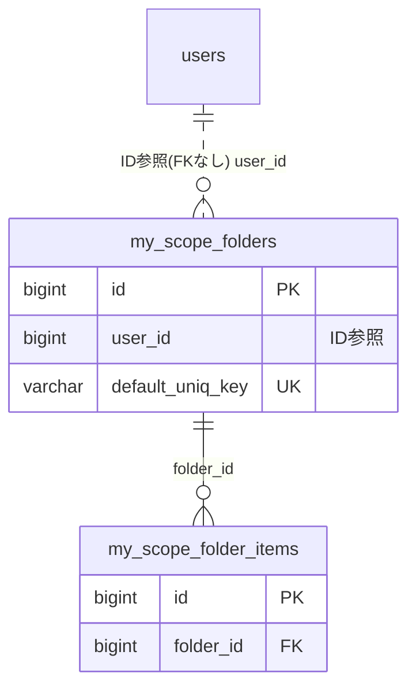

# scopefolder ドメイン ER 図

> このファイルは自動生成されます。手で編集しないでください。再生成: `cd backend && ./gradlew generateErDiagrams`

- テーブル数: 2
- ビュー数: 0

## ER 図

実線 = 外部キー、点線 = ID参照(FKなし)。図中の `FK` は実外部キーの列だけ（ID参照列は `FK` を付けず "ID参照" と注記）。図にはキー列（PK / FK / 参照推定列 / 単一列 UNIQUE）のみを描く。全列は下の「テーブル定義」を参照。

## 被参照（他ドメインから）

このドメインのテーブルを参照している他ドメインの側（実 FK と ID参照のみ。多態参照と推定不能参照は含まない。同一ドメイン内の参照は上の図を参照）。

なし

## 推定不能参照

| テーブル | 列 | 理由 |
| --- | --- | --- |
| `my_scope_folder_items` | `scope_id` | 参照先テーブルを特定できない |

## テーブル定義

### `my_scope_folder_items`

| 列名 | 型 | NULL | 既定値 | コメント |
| --- | --- | --- | --- | --- |
| `id` | `bigint unsigned` | NO | （なし） auto_increment |  |
| `folder_id` | `bigint unsigned` | NO | （なし） |  |
| `scope_id` | `bigint unsigned` | NO | （なし） | team_id or organization_id |
| `sort_order` | `int` | NO | `0` |  |
| `created_at` | `datetime(6)` | NO | `CURRENT_TIMESTAMP(6)` （式） |  |
| `assigned_via` | `varchar(20)` | NO | `MANUAL` | アイテム割当経路。INVITE / MANUAL / MIGRATION / DEFAULT |

### `my_scope_folders`

| 列名 | 型 | NULL | 既定値 | コメント |
| --- | --- | --- | --- | --- |
| `id` | `bigint unsigned` | NO | （なし） auto_increment |  |
| `user_id` | `bigint unsigned` | NO | （なし） |  |
| `scope_type` | `varchar(20)` | NO | （なし） | TEAM or ORGANIZATION |
| `name` | `varchar(100)` | NO | （なし） |  |
| `color` | `varchar(7)` | YES | NULL | HEX color (#RRGGBB) |
| `sort_order` | `int` | NO | `0` |  |
| `created_at` | `datetime(6)` | NO | `CURRENT_TIMESTAMP(6)` （式） |  |
| `updated_at` | `datetime(6)` | NO | `CURRENT_TIMESTAMP(6)` （式） |  |
| `deleted_at` | `datetime(6)` | YES | NULL |  |
| `is_default` | `tinyint(1)` | NO | `0` | 未分類フォルダフラグ。user_id × scope_type ごとに 1 行のみ |
| `icon` | `varchar(40)` | YES | NULL | PrimeIcons の pi-icon 名（例: pi-briefcase） |
| `default_uniq_key` | `varchar(80)` | YES | NULL |  |
