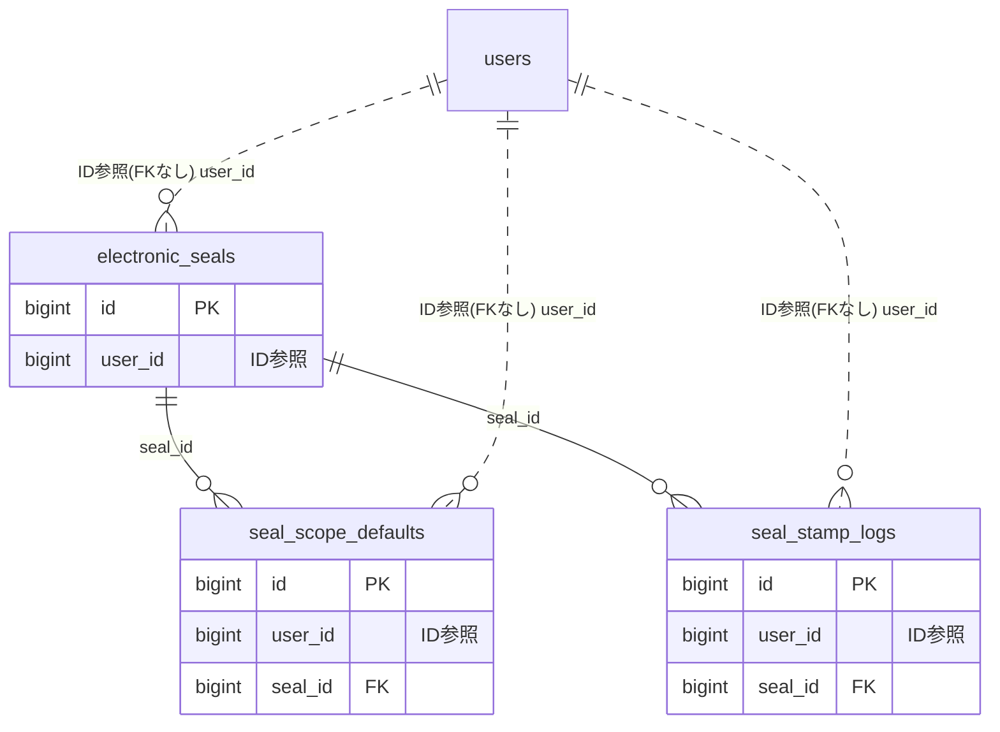

# seal ドメイン ER 図

> このファイルは自動生成されます。手で編集しないでください。再生成: `cd backend && ./gradlew generateErDiagrams`

- テーブル数: 3
- ビュー数: 0

## ER 図

実線 = 外部キー、点線 = ID参照(FKなし)。図中の `FK` は実外部キーの列だけ（ID参照列は `FK` を付けず "ID参照" と注記）。図にはキー列（PK / FK / 参照推定列 / 単一列 UNIQUE）のみを描く。全列は下の「テーブル定義」を参照。

## 被参照（他ドメインから）

このドメインのテーブルを参照している他ドメインの側（実 FK と ID参照のみ。多態参照と推定不能参照は含まない。同一ドメイン内の参照は上の図を参照）。

| 参照元ドメイン | 参照元テーブル | 列 | 種別 | 参照先テーブル |
| --- | --- | --- | --- | --- |
| [chart](chart.md) | `chart_intake_forms` | `electronic_seal_id` | ID参照 | `electronic_seals` |
| [proxyvote](proxyvote.md) | `proxy_delegations` | `electronic_seal_id` | ID参照 | `electronic_seals` |
| [receipt](receipt.md) | `receipts` | `seal_stamp_log_id` | ID参照 | `seal_stamp_logs` |

## 多態参照（線を引かない）

| テーブル | 種別列 | ID列 |
| --- | --- | --- |
| `seal_scope_defaults` | `scope_type` | `scope_id` |
| `seal_stamp_logs` | `target_type` | `target_id` |

## テーブル定義

### `electronic_seals`

| 列名 | 型 | NULL | 既定値 | コメント |
| --- | --- | --- | --- | --- |
| `id` | `bigint unsigned` | NO | （なし） auto_increment |  |
| `user_id` | `bigint unsigned` | NO | （なし） |  |
| `variant` | `varchar(20)` | NO | （なし） |  |
| `display_text` | `varchar(20)` | NO | （なし） |  |
| `svg_data` | `text` | NO | （なし） |  |
| `seal_hash` | `char(64)` | NO | （なし） |  |
| `generation_version` | `int` | NO | `1` |  |
| `created_at` | `datetime` | NO | `CURRENT_TIMESTAMP` （式） |  |
| `updated_at` | `datetime` | NO | `CURRENT_TIMESTAMP` （式） |  |
| `deleted_at` | `datetime` | YES | NULL |  |

### `seal_scope_defaults`

| 列名 | 型 | NULL | 既定値 | コメント |
| --- | --- | --- | --- | --- |
| `id` | `bigint unsigned` | NO | （なし） auto_increment |  |
| `user_id` | `bigint unsigned` | NO | （なし） |  |
| `scope_type` | `varchar(20)` | NO | `DEFAULT` |  |
| `scope_id` | `bigint unsigned` | YES | NULL |  |
| `seal_id` | `bigint unsigned` | NO | （なし） |  |
| `created_at` | `datetime` | NO | `CURRENT_TIMESTAMP` （式） |  |
| `updated_at` | `datetime` | NO | `CURRENT_TIMESTAMP` （式） |  |

### `seal_stamp_logs`

| 列名 | 型 | NULL | 既定値 | コメント |
| --- | --- | --- | --- | --- |
| `id` | `bigint unsigned` | NO | （なし） auto_increment |  |
| `user_id` | `bigint unsigned` | NO | （なし） |  |
| `seal_id` | `bigint unsigned` | NO | （なし） |  |
| `seal_hash_at_stamp` | `char(64)` | NO | （なし） |  |
| `target_type` | `varchar(30)` | NO | （なし） |  |
| `target_id` | `bigint unsigned` | NO | （なし） |  |
| `stamp_document_hash` | `char(64)` | YES | NULL |  |
| `is_revoked` | `tinyint(1)` | NO | `0` |  |
| `revoked_at` | `datetime` | YES | NULL |  |
| `stamped_at` | `datetime` | NO | `CURRENT_TIMESTAMP` （式） |  |
| `created_at` | `datetime` | NO | `CURRENT_TIMESTAMP` （式） |  |
