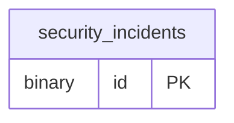

# securityincident ドメイン ER 図

> このファイルは自動生成されます。手で編集しないでください。再生成: `cd backend && ./gradlew generateErDiagrams`

- テーブル数: 1
- ビュー数: 0

## ER 図

実線 = 外部キー、点線 = ID参照(FKなし)。図にはキー列（PK / FK / 参照推定列 / 単一列 UNIQUE）のみを描く。全列は下の「テーブル定義」を参照。

## テーブル定義

### `security_incidents`

| 列名 | 型 | NULL | 既定値 | コメント |
| --- | --- | --- | --- | --- |
| `id` | `binary(16)` | NO | （なし） | UUIDv7 |
| `incident_type` | `varchar(50)` | NO | （なし） |  |
| `severity` | `varchar(20)` | NO | （なし） |  |
| `detected_at` | `datetime(6)` | NO | （なし） |  |
| `records_affected` | `int` | YES | NULL |  |
| `description` | `text` | YES | NULL |  |
| `status` | `varchar(20)` | NO | `OPEN` |  |
| `notified_dpa_at` | `datetime(6)` | YES | NULL |  |
| `resolved_at` | `datetime(6)` | YES | NULL |  |
| `created_at` | `datetime(6)` | NO | （なし） |  |
| `updated_at` | `datetime(6)` | NO | （なし） |  |
