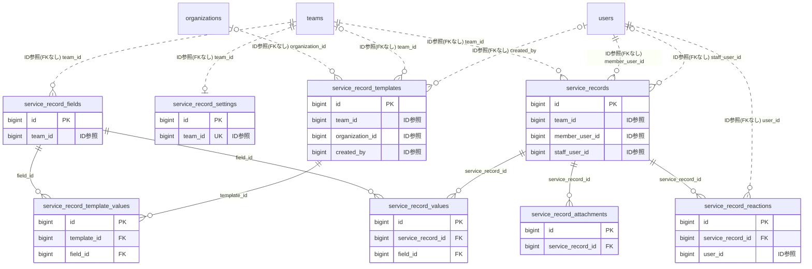

# service ドメイン ER 図

> このファイルは自動生成されます。手で編集しないでください。再生成: `cd backend && ./gradlew generateErDiagrams`

- テーブル数: 8
- ビュー数: 0

## ER 図

実線 = 外部キー、点線 = ID参照(FKなし)。図中の `FK` は実外部キーの列だけ（ID参照列は `FK` を付けず "ID参照" と注記）。図にはキー列（PK / FK / 参照推定列 / 単一列 UNIQUE）のみを描く。全列は下の「テーブル定義」を参照。

## 被参照（他ドメインから）

このドメインのテーブルを参照している他ドメインの側（実 FK と ID参照のみ。多態参照と推定不能参照は含まない。同一ドメイン内の参照は上の図を参照）。

| 参照元ドメイン | 参照元テーブル | 列 | 種別 | 参照先テーブル |
| --- | --- | --- | --- | --- |
| [membership](membership.md) | `member_card_checkins` | `service_record_id` | ID参照 | `service_records` |
| [ticket](ticket.md) | `ticket_consumptions` | `service_record_id` | ID参照 | `service_records` |

## テーブル定義

### `service_record_attachments`

| 列名 | 型 | NULL | 既定値 | コメント |
| --- | --- | --- | --- | --- |
| `id` | `bigint unsigned` | NO | （なし） auto_increment |  |
| `service_record_id` | `bigint unsigned` | NO | （なし） |  |
| `file_key` | `varchar(500)` | NO | （なし） |  |
| `file_name` | `varchar(255)` | NO | （なし） |  |
| `content_type` | `varchar(100)` | NO | （なし） |  |
| `file_size` | `int unsigned` | NO | （なし） |  |
| `sort_order` | `int` | NO | `0` |  |
| `created_at` | `datetime` | NO | `CURRENT_TIMESTAMP` （式） |  |

### `service_record_fields`

| 列名 | 型 | NULL | 既定値 | コメント |
| --- | --- | --- | --- | --- |
| `id` | `bigint unsigned` | NO | （なし） auto_increment |  |
| `team_id` | `bigint unsigned` | NO | （なし） |  |
| `field_name` | `varchar(100)` | NO | （なし） |  |
| `field_type` | `enum('TEXT','NUMBER','DATE','SELECT','MULTISELECT','CHECKBOX')` | NO | （なし） |  |
| `description` | `varchar(500)` | YES | NULL |  |
| `options` | `json` | YES | NULL |  |
| `is_required` | `tinyint(1)` | NO | `0` |  |
| `sort_order` | `int` | NO | `0` |  |
| `is_active` | `tinyint(1)` | NO | `1` |  |
| `created_at` | `datetime` | NO | `CURRENT_TIMESTAMP` （式） |  |
| `updated_at` | `datetime` | NO | `CURRENT_TIMESTAMP` （式） |  |

### `service_record_reactions`

| 列名 | 型 | NULL | 既定値 | コメント |
| --- | --- | --- | --- | --- |
| `id` | `bigint unsigned` | NO | （なし） auto_increment |  |
| `service_record_id` | `bigint unsigned` | NO | （なし） |  |
| `user_id` | `bigint unsigned` | NO | （なし） |  |
| `reaction_type` | `enum('LIKE','THANKS','GREAT')` | NO | `LIKE` |  |
| `created_at` | `datetime` | NO | `CURRENT_TIMESTAMP` （式） |  |

### `service_record_settings`

| 列名 | 型 | NULL | 既定値 | コメント |
| --- | --- | --- | --- | --- |
| `id` | `bigint unsigned` | NO | （なし） auto_increment |  |
| `team_id` | `bigint unsigned` | NO | （なし） |  |
| `is_dashboard_enabled` | `tinyint(1)` | NO | `0` |  |
| `is_reaction_enabled` | `tinyint(1)` | NO | `0` |  |
| `created_at` | `datetime` | NO | `CURRENT_TIMESTAMP` （式） |  |
| `updated_at` | `datetime` | NO | `CURRENT_TIMESTAMP` （式） |  |

### `service_record_template_values`

| 列名 | 型 | NULL | 既定値 | コメント |
| --- | --- | --- | --- | --- |
| `id` | `bigint unsigned` | NO | （なし） auto_increment |  |
| `template_id` | `bigint unsigned` | NO | （なし） |  |
| `field_id` | `bigint unsigned` | NO | （なし） |  |
| `default_value` | `text` | YES | NULL |  |
| `created_at` | `datetime` | NO | `CURRENT_TIMESTAMP` （式） |  |
| `updated_at` | `datetime` | NO | `CURRENT_TIMESTAMP` （式） |  |

### `service_record_templates`

| 列名 | 型 | NULL | 既定値 | コメント |
| --- | --- | --- | --- | --- |
| `id` | `bigint unsigned` | NO | （なし） auto_increment |  |
| `team_id` | `bigint unsigned` | YES | NULL |  |
| `organization_id` | `bigint unsigned` | YES | NULL |  |
| `name` | `varchar(100)` | NO | （なし） |  |
| `title_template` | `varchar(200)` | YES | NULL |  |
| `note_template` | `text` | YES | NULL |  |
| `default_duration_minutes` | `smallint unsigned` | YES | NULL |  |
| `sort_order` | `int` | NO | `0` |  |
| `created_by` | `bigint unsigned` | YES | NULL |  |
| `created_at` | `datetime` | NO | `CURRENT_TIMESTAMP` （式） |  |
| `updated_at` | `datetime` | NO | `CURRENT_TIMESTAMP` （式） |  |
| `deleted_at` | `datetime` | YES | NULL |  |

### `service_record_values`

| 列名 | 型 | NULL | 既定値 | コメント |
| --- | --- | --- | --- | --- |
| `id` | `bigint unsigned` | NO | （なし） auto_increment |  |
| `service_record_id` | `bigint unsigned` | NO | （なし） |  |
| `field_id` | `bigint unsigned` | NO | （なし） |  |
| `value` | `text` | YES | NULL |  |
| `created_at` | `datetime` | NO | `CURRENT_TIMESTAMP` （式） |  |
| `updated_at` | `datetime` | NO | `CURRENT_TIMESTAMP` （式） |  |

### `service_records`

| 列名 | 型 | NULL | 既定値 | コメント |
| --- | --- | --- | --- | --- |
| `id` | `bigint unsigned` | NO | （なし） auto_increment |  |
| `team_id` | `bigint unsigned` | NO | （なし） |  |
| `member_user_id` | `bigint unsigned` | NO | （なし） |  |
| `staff_user_id` | `bigint unsigned` | YES | NULL |  |
| `service_date` | `date` | NO | （なし） |  |
| `title` | `varchar(200)` | NO | （なし） |  |
| `note` | `text` | YES | NULL |  |
| `duration_minutes` | `smallint unsigned` | YES | NULL |  |
| `status` | `enum('DRAFT','CONFIRMED')` | NO | `DRAFT` |  |
| `created_at` | `datetime` | NO | `CURRENT_TIMESTAMP` （式） |  |
| `updated_at` | `datetime` | NO | `CURRENT_TIMESTAMP` （式） |  |
| `deleted_at` | `datetime` | YES | NULL |  |
