# shift ドメイン ER 図

> このファイルは自動生成されます。手で編集しないでください。再生成: `cd backend && ./gradlew generateErDiagrams`

- テーブル数: 11
- ビュー数: 0

## ER 図

実線 = 外部キー、点線 = ID参照(FKなし)。図中の `FK` は実外部キーの列だけ（ID参照列は `FK` を付けず "ID参照" と注記）。図にはキー列（PK / FK / 参照推定列 / 単一列 UNIQUE）のみを描く。全列は下の「テーブル定義」を参照。

```mermaid
erDiagram
    member_availability_defaults {
        bigint id PK
        bigint user_id "ID参照"
        bigint team_id "ID参照"
    }
    member_work_constraints {
        bigint id PK
        bigint team_id "ID参照"
        bigint user_id "ID参照"
    }
    shift_assignment_runs {
        bigint id PK
        bigint schedule_id FK
        bigint triggered_by "ID参照"
        bigint visual_review_confirmed_by "ID参照"
    }
    shift_assignments {
        bigint id PK
        bigint slot_id FK
        bigint user_id "ID参照"
        bigint assigned_by "ID参照"
    }
    shift_change_requests {
        bigint id PK
        bigint schedule_id FK
        bigint slot_id FK
        bigint requested_by "ID参照"
    }
    shift_hourly_rates {
        bigint id PK
        bigint user_id "ID参照"
        bigint team_id "ID参照"
    }
    shift_positions {
        bigint id PK
        bigint team_id "ID参照"
    }
    shift_requests {
        bigint id PK
        bigint schedule_id FK
        bigint user_id "ID参照"
        bigint slot_id FK
        bigint proxy_input_record_id "ID参照"
    }
    shift_schedules {
        bigint id PK
        bigint team_id "ID参照"
        bigint created_by "ID参照"
        bigint published_by "ID参照"
        bigint linked_project_id "ID参照"
    }
    shift_slots {
        bigint id PK
        bigint schedule_id FK
        bigint position_id FK
    }
    shift_swap_requests {
        bigint id PK
        bigint slot_id FK
        bigint resolved_by "ID参照"
        bigint target_user_id "ID参照"
        bigint claimed_by "ID参照"
    }
    projects
    proxy_input_records
    teams
    users
    teams ||..o{ member_availability_defaults : "ID参照(FKなし) team_id"
    users ||..o{ member_availability_defaults : "ID参照(FKなし) user_id"
    teams ||..o{ member_work_constraints : "ID参照(FKなし) team_id"
    users |o..o{ member_work_constraints : "ID参照(FKなし) user_id"
    shift_schedules ||--o{ shift_assignment_runs : "schedule_id"
    users ||..o{ shift_assignment_runs : "ID参照(FKなし) triggered_by"
    users |o..o{ shift_assignment_runs : "ID参照(FKなし) visual_review_confirmed_by"
    shift_slots ||--o{ shift_assignments : "slot_id"
    users ||..o{ shift_assignments : "ID参照(FKなし) assigned_by"
    users ||..o{ shift_assignments : "ID参照(FKなし) user_id"
    shift_schedules ||--o{ shift_change_requests : "schedule_id"
    shift_slots |o--o{ shift_change_requests : "slot_id"
    users ||..o{ shift_change_requests : "ID参照(FKなし) requested_by"
    teams ||..o{ shift_hourly_rates : "ID参照(FKなし) team_id"
    users ||..o{ shift_hourly_rates : "ID参照(FKなし) user_id"
    teams ||..o{ shift_positions : "ID参照(FKなし) team_id"
    proxy_input_records |o..o{ shift_requests : "ID参照(FKなし) proxy_input_record_id"
    shift_schedules ||--o{ shift_requests : "schedule_id"
    shift_slots |o--o{ shift_requests : "slot_id"
    users ||..o{ shift_requests : "ID参照(FKなし) user_id"
    projects |o..o{ shift_schedules : "ID参照(FKなし) linked_project_id"
    teams ||..o{ shift_schedules : "ID参照(FKなし) team_id"
    users |o..o{ shift_schedules : "ID参照(FKなし) created_by"
    users |o..o{ shift_schedules : "ID参照(FKなし) published_by"
    shift_positions |o--o{ shift_slots : "position_id"
    shift_schedules ||--o{ shift_slots : "schedule_id"
    shift_slots ||--o{ shift_swap_requests : "slot_id"
    users |o..o{ shift_swap_requests : "ID参照(FKなし) claimed_by"
    users |o..o{ shift_swap_requests : "ID参照(FKなし) resolved_by"
    users |o..o{ shift_swap_requests : "ID参照(FKなし) target_user_id"
```

## 被参照（他ドメインから）

このドメインのテーブルを参照している他ドメインの側（実 FK と ID参照のみ。多態参照と推定不能参照は含まない。同一ドメイン内の参照は上の図を参照）。

| 参照元ドメイン | 参照元テーブル | 列 | 種別 | 参照先テーブル |
| --- | --- | --- | --- | --- |
| [todo](todo.md) | `todos` | `linked_shift_slot_id` | ID参照 | `shift_slots` |

## 推定不能参照

| テーブル | 列 | 理由 |
| --- | --- | --- |
| `shift_assignments` | `run_id` | 参照先テーブルを特定できない |
| `shift_change_requests` | `reviewer_id` | 参照先テーブルを特定できない |
| `shift_swap_requests` | `accepter_id` | 参照先テーブルを特定できない |
| `shift_swap_requests` | `requester_id` | 参照先テーブルを特定できない |

## テーブル定義

### `member_availability_defaults`

| 列名 | 型 | NULL | 既定値 | コメント |
| --- | --- | --- | --- | --- |
| `id` | `bigint unsigned` | NO | （なし） auto_increment |  |
| `user_id` | `bigint unsigned` | NO | （なし） |  |
| `team_id` | `bigint unsigned` | NO | （なし） |  |
| `day_of_week` | `tinyint unsigned` | NO | （なし） |  |
| `start_time` | `time` | NO | （なし） |  |
| `end_time` | `time` | NO | （なし） |  |
| `preference` | `enum('PREFERRED','AVAILABLE','WEAK_REST','STRONG_REST','ABSOLUTE_REST')` | NO | `AVAILABLE` | デフォルトシフト希望（5段階） |
| `note` | `varchar(200)` | YES | NULL |  |
| `created_at` | `datetime` | NO | `CURRENT_TIMESTAMP` （式） |  |
| `updated_at` | `datetime` | NO | `CURRENT_TIMESTAMP` （式） |  |

### `member_work_constraints`

| 列名 | 型 | NULL | 既定値 | コメント |
| --- | --- | --- | --- | --- |
| `id` | `bigint unsigned` | NO | （なし） auto_increment |  |
| `team_id` | `bigint unsigned` | NO | （なし） |  |
| `user_id` | `bigint unsigned` | YES | NULL |  |
| `max_monthly_hours` | `decimal(6,2)` | YES | NULL |  |
| `max_monthly_days` | `tinyint unsigned` | YES | NULL |  |
| `max_consecutive_days` | `tinyint unsigned` | YES | NULL |  |
| `max_night_shifts_per_month` | `tinyint unsigned` | YES | NULL |  |
| `min_rest_hours_between_shifts` | `decimal(4,2)` | YES | NULL |  |
| `note` | `varchar(500)` | YES | NULL |  |
| `created_at` | `datetime` | NO | `CURRENT_TIMESTAMP` （式） |  |
| `updated_at` | `datetime` | NO | `CURRENT_TIMESTAMP` （式） |  |

### `shift_assignment_runs`

| 列名 | 型 | NULL | 既定値 | コメント |
| --- | --- | --- | --- | --- |
| `id` | `bigint unsigned` | NO | （なし） auto_increment |  |
| `schedule_id` | `bigint unsigned` | NO | （なし） |  |
| `strategy` | `enum('MANUAL','GREEDY_V1','CSP_V1')` | NO | `GREEDY_V1` |  |
| `status` | `enum('RUNNING','SUCCEEDED','FAILED','CONFIRMED','REVOKED')` | NO | `RUNNING` |  |
| `triggered_by` | `bigint unsigned` | NO | （なし） |  |
| `slots_total` | `int unsigned` | NO | `0` |  |
| `slots_filled` | `int unsigned` | NO | `0` |  |
| `warnings_json` | `json` | YES | NULL |  |
| `parameters_json` | `json` | YES | NULL |  |
| `error_message` | `varchar(1000)` | YES | NULL |  |
| `visual_review_confirmed_by` | `bigint unsigned` | YES | NULL |  |
| `visual_review_confirmed_at` | `datetime` | YES | NULL |  |
| `visual_review_note` | `varchar(500)` | YES | NULL |  |
| `started_at` | `datetime` | NO | `CURRENT_TIMESTAMP` （式） |  |
| `completed_at` | `datetime` | YES | NULL |  |
| `version` | `int unsigned` | NO | `0` |  |

### `shift_assignments`

| 列名 | 型 | NULL | 既定値 | コメント |
| --- | --- | --- | --- | --- |
| `id` | `bigint unsigned` | NO | （なし） auto_increment |  |
| `slot_id` | `bigint unsigned` | NO | （なし） |  |
| `user_id` | `bigint unsigned` | NO | （なし） |  |
| `run_id` | `bigint unsigned` | YES | NULL | NULL=手動割当 |
| `status` | `enum('PROPOSED','CONFIRMED','REVOKED')` | NO | `PROPOSED` |  |
| `score` | `decimal(8,4)` | YES | NULL | 貪欲法スコア（手動時NULL） |
| `assigned_by` | `bigint unsigned` | NO | （なし） |  |
| `note` | `varchar(500)` | YES | NULL |  |
| `created_at` | `datetime` | NO | `CURRENT_TIMESTAMP` （式） |  |
| `updated_at` | `datetime` | NO | `CURRENT_TIMESTAMP` （式） |  |
| `version` | `int unsigned` | NO | `0` |  |
| `deleted_at` | `datetime` | YES | NULL |  |

### `shift_change_requests`

| 列名 | 型 | NULL | 既定値 | コメント |
| --- | --- | --- | --- | --- |
| `id` | `bigint unsigned` | NO | （なし） auto_increment |  |
| `schedule_id` | `bigint unsigned` | NO | （なし） |  |
| `slot_id` | `bigint unsigned` | YES | NULL | NULL=スケジュール全体への依頼 |
| `request_type` | `enum('PRE_CONFIRM_EDIT','INDIVIDUAL_SWAP','OPEN_CALL')` | NO | （なし） |  |
| `status` | `enum('OPEN','ACCEPTED','REJECTED','WITHDRAWN','EXPIRED')` | NO | `OPEN` |  |
| `requested_by` | `bigint unsigned` | NO | （なし） |  |
| `reason` | `varchar(1000)` | YES | NULL |  |
| `reviewer_id` | `bigint unsigned` | YES | NULL |  |
| `review_comment` | `varchar(500)` | YES | NULL |  |
| `reviewed_at` | `datetime` | YES | NULL |  |
| `expires_at` | `datetime` | YES | NULL |  |
| `created_at` | `datetime` | NO | `CURRENT_TIMESTAMP` （式） |  |
| `updated_at` | `datetime` | NO | `CURRENT_TIMESTAMP` （式） |  |
| `version` | `int unsigned` | NO | `0` |  |

### `shift_hourly_rates`

| 列名 | 型 | NULL | 既定値 | コメント |
| --- | --- | --- | --- | --- |
| `id` | `bigint unsigned` | NO | （なし） auto_increment |  |
| `user_id` | `bigint unsigned` | NO | （なし） |  |
| `team_id` | `bigint unsigned` | NO | （なし） |  |
| `hourly_rate` | `decimal(10,2)` | NO | （なし） |  |
| `effective_from` | `date` | NO | （なし） |  |
| `created_at` | `datetime` | NO | `CURRENT_TIMESTAMP` （式） |  |
| `updated_at` | `datetime` | NO | `CURRENT_TIMESTAMP` （式） |  |

### `shift_positions`

| 列名 | 型 | NULL | 既定値 | コメント |
| --- | --- | --- | --- | --- |
| `id` | `bigint unsigned` | NO | （なし） auto_increment |  |
| `team_id` | `bigint unsigned` | NO | （なし） |  |
| `name` | `varchar(50)` | NO | （なし） |  |
| `display_order` | `int` | NO | `0` |  |
| `is_active` | `tinyint(1)` | NO | `1` |  |
| `created_at` | `datetime` | NO | `CURRENT_TIMESTAMP` （式） |  |
| `updated_at` | `datetime` | NO | `CURRENT_TIMESTAMP` （式） |  |

### `shift_requests`

| 列名 | 型 | NULL | 既定値 | コメント |
| --- | --- | --- | --- | --- |
| `id` | `bigint unsigned` | NO | （なし） auto_increment |  |
| `schedule_id` | `bigint unsigned` | NO | （なし） |  |
| `user_id` | `bigint unsigned` | NO | （なし） |  |
| `slot_id` | `bigint unsigned` | YES | NULL |  |
| `slot_date` | `date` | NO | （なし） |  |
| `preference` | `enum('PREFERRED','AVAILABLE','WEAK_REST','STRONG_REST','ABSOLUTE_REST')` | NO | `AVAILABLE` | シフト希望（5段階） |
| `note` | `varchar(200)` | YES | NULL |  |
| `is_proxy_input` | `tinyint(1)` | NO | `0` | 代理入力フラグ（0=本人, 1=代理） |
| `proxy_input_record_id` | `bigint unsigned` | YES | NULL | 代理入力記録ID（proxy_input_records.id） |
| `submitted_at` | `datetime` | NO | `CURRENT_TIMESTAMP` （式） |  |
| `updated_at` | `datetime` | NO | `CURRENT_TIMESTAMP` （式） |  |
| `slot_id_uq` | `bigint unsigned` | NO | （なし） | 一意性用の正規化 slot_id（日単位希望は 0） |
| `slot_date_uq` | `date` | NO | （なし） | 一意性用の正規化 slot_date（枠指定の希望は番兵 1000-01-01。枠の一意性に日付を含めないため） |
| `deleted_at` | `datetime` | YES | NULL |  |
| `delete_reason` | `varchar(20)` | YES | NULL |  |
| `active_uq` | `tinyint` | YES | NULL |  |

### `shift_schedules`

| 列名 | 型 | NULL | 既定値 | コメント |
| --- | --- | --- | --- | --- |
| `id` | `bigint unsigned` | NO | （なし） auto_increment |  |
| `team_id` | `bigint unsigned` | NO | （なし） |  |
| `title` | `varchar(200)` | NO | （なし） |  |
| `period_type` | `varchar(20)` | NO | `WEEKLY` |  |
| `start_date` | `date` | NO | （なし） |  |
| `end_date` | `date` | NO | （なし） |  |
| `status` | `varchar(20)` | NO | `DRAFT` |  |
| `request_deadline` | `datetime` | YES | NULL |  |
| `note` | `text` | YES | NULL |  |
| `created_by` | `bigint unsigned` | YES | NULL |  |
| `published_at` | `datetime` | YES | NULL |  |
| `published_by` | `bigint unsigned` | YES | NULL |  |
| `is_reminder_sent` | `tinyint(1)` | NO | `0` |  |
| `is_low_submission_alerted` | `tinyint(1)` | NO | `0` |  |
| `last_auto_transition_at` | `datetime` | YES | NULL |  |
| `version` | `bigint` | NO | `0` |  |
| `created_at` | `datetime` | NO | `CURRENT_TIMESTAMP` （式） |  |
| `updated_at` | `datetime` | NO | `CURRENT_TIMESTAMP` （式） |  |
| `deleted_at` | `datetime` | YES | NULL |  |
| `is_reminder_sent_48h` | `tinyint(1)` | NO | `0` | 48時間前リマインド送信済みフラグ |
| `linked_project_id` | `bigint unsigned` | YES | NULL | F08.7 シフト-予算-TODO 連携: 紐付プロジェクトID |
| `publication_generation` | `bigint` | NO | `0` |  |

### `shift_slots`

| 列名 | 型 | NULL | 既定値 | コメント |
| --- | --- | --- | --- | --- |
| `id` | `bigint unsigned` | NO | （なし） auto_increment |  |
| `schedule_id` | `bigint unsigned` | NO | （なし） |  |
| `slot_date` | `date` | NO | （なし） |  |
| `start_time` | `time` | NO | （なし） |  |
| `end_time` | `time` | NO | （なし） |  |
| `ends_next_day` | `tinyint(1)` | NO | `0` | 翌日終了（日跨ぎ）か |
| `position_id` | `bigint unsigned` | YES | NULL |  |
| `required_count` | `tinyint unsigned` | NO | `1` |  |
| `assigned_user_ids` | `json` | YES | NULL |  |
| `note` | `varchar(200)` | YES | NULL |  |
| `version` | `bigint` | NO | `0` |  |
| `created_at` | `datetime` | NO | `CURRENT_TIMESTAMP` （式） |  |
| `updated_at` | `datetime` | NO | `CURRENT_TIMESTAMP` （式） |  |
| `deleted_at` | `datetime` | YES | NULL |  |

### `shift_swap_requests`

| 列名 | 型 | NULL | 既定値 | コメント |
| --- | --- | --- | --- | --- |
| `id` | `bigint unsigned` | NO | （なし） auto_increment |  |
| `slot_id` | `bigint unsigned` | NO | （なし） |  |
| `requester_id` | `bigint unsigned` | NO | （なし） |  |
| `accepter_id` | `bigint unsigned` | YES | NULL |  |
| `status` | `enum('PENDING','ACCEPTED','APPROVED','REJECTED','CANCELLED','OPEN_CALL','CLAIMED')` | NO | `PENDING` |  |
| `reason` | `varchar(500)` | YES | NULL |  |
| `admin_note` | `varchar(500)` | YES | NULL |  |
| `resolved_by` | `bigint unsigned` | YES | NULL |  |
| `resolved_at` | `datetime` | YES | NULL |  |
| `created_at` | `datetime` | NO | `CURRENT_TIMESTAMP` （式） |  |
| `updated_at` | `datetime` | NO | `CURRENT_TIMESTAMP` （式） |  |
| `is_open_call` | `tinyint(1)` | NO | `0` | オープンコール（不特定多数募集） |
| `target_user_id` | `bigint unsigned` | YES | NULL | 指定交代相手（is_open_call=falseの場合） |
| `claimed_by` | `bigint unsigned` | YES | NULL | 手挙げユーザー（先着1名） |
| `claimed_at` | `datetime` | YES | NULL |  |
| `version` | `int unsigned` | NO | `0` |  |
| `recipient_mode` | `varchar(20)` | NO | `SPECIFIC` | 受信者モード: SPECIFIC=特定ユーザー / OPEN_CALL=全体公開 |
| `target_user_ids` | `json` | YES | NULL | 交代対象ユーザーIDリスト (SPECIFIC モード時) |
