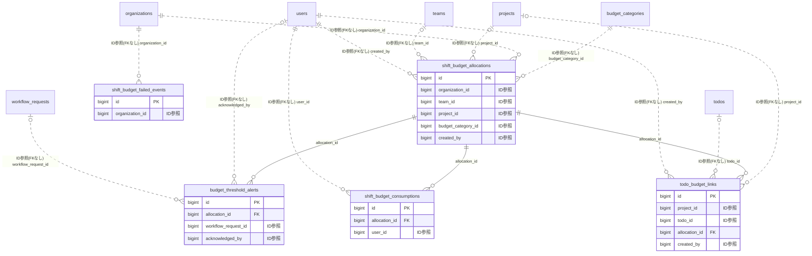

# shiftbudget ドメイン ER 図

> このファイルは自動生成されます。手で編集しないでください。再生成: `cd backend && ./gradlew generateErDiagrams`

- テーブル数: 5
- ビュー数: 0

## ER 図

実線 = 外部キー、点線 = ID参照(FKなし)。図中の `FK` は実外部キーの列だけ（ID参照列は `FK` を付けず "ID参照" と注記）。図にはキー列（PK / FK / 参照推定列 / 単一列 UNIQUE）のみを描く。全列は下の「テーブル定義」を参照。

## 被参照（他ドメインから）

このドメインのテーブルを参照している他ドメインの側（実 FK と ID参照のみ。多態参照と推定不能参照は含まない。同一ドメイン内の参照は上の図を参照）。

なし

## 推定不能参照

| テーブル | 列 | 理由 |
| --- | --- | --- |
| `shift_budget_allocations` | `fiscal_year_id` | 参照先テーブルを特定できない |
| `shift_budget_consumptions` | `shift_id` | 参照先テーブルを特定できない |
| `shift_budget_consumptions` | `slot_id` | 参照先テーブルを特定できない |
| `shift_budget_failed_events` | `source_id` | 参照先テーブルを特定できない |

## テーブル定義

### `budget_threshold_alerts`

| 列名 | 型 | NULL | 既定値 | コメント |
| --- | --- | --- | --- | --- |
| `id` | `bigint unsigned` | NO | （なし） auto_increment |  |
| `allocation_id` | `bigint unsigned` | NO | （なし） |  |
| `threshold_percent` | `smallint unsigned` | NO | （なし） |  |
| `triggered_at` | `datetime` | NO | `CURRENT_TIMESTAMP` （式） |  |
| `consumed_amount_at_trigger` | `decimal(12,0)` | NO | （なし） |  |
| `notified_user_ids` | `json` | NO | （なし） |  |
| `workflow_request_id` | `bigint unsigned` | YES | NULL |  |
| `acknowledged_at` | `datetime` | YES | NULL |  |
| `acknowledged_by` | `bigint unsigned` | YES | NULL |  |
| `created_at` | `datetime` | NO | `CURRENT_TIMESTAMP` （式） |  |
| `updated_at` | `datetime` | NO | `CURRENT_TIMESTAMP` （式） |  |

### `shift_budget_allocations`

| 列名 | 型 | NULL | 既定値 | コメント |
| --- | --- | --- | --- | --- |
| `id` | `bigint unsigned` | NO | （なし） auto_increment |  |
| `organization_id` | `bigint unsigned` | NO | （なし） |  |
| `team_id` | `bigint unsigned` | YES | NULL |  |
| `project_id` | `bigint unsigned` | YES | NULL |  |
| `fiscal_year_id` | `bigint unsigned` | NO | （なし） |  |
| `budget_category_id` | `bigint unsigned` | NO | （なし） |  |
| `period_start` | `date` | NO | （なし） |  |
| `period_end` | `date` | NO | （なし） |  |
| `allocated_amount` | `decimal(12,0)` | NO | （なし） |  |
| `consumed_amount` | `decimal(12,0)` | NO | `0` |  |
| `confirmed_amount` | `decimal(12,0)` | NO | `0` |  |
| `currency` | `char(3)` | NO | `JPY` |  |
| `note` | `varchar(500)` | YES | NULL |  |
| `created_by` | `bigint unsigned` | NO | （なし） |  |
| `version` | `bigint` | NO | `0` |  |
| `created_at` | `datetime` | NO | `CURRENT_TIMESTAMP` （式） |  |
| `updated_at` | `datetime` | NO | `CURRENT_TIMESTAMP` （式） |  |
| `deleted_at` | `datetime` | YES | NULL |  |

### `shift_budget_consumptions`

| 列名 | 型 | NULL | 既定値 | コメント |
| --- | --- | --- | --- | --- |
| `id` | `bigint unsigned` | NO | （なし） auto_increment |  |
| `allocation_id` | `bigint unsigned` | NO | （なし） |  |
| `shift_id` | `bigint unsigned` | NO | （なし） |  |
| `slot_id` | `bigint unsigned` | NO | （なし） |  |
| `user_id` | `bigint unsigned` | NO | （なし） |  |
| `hourly_rate_snapshot` | `decimal(10,2)` | NO | （なし） |  |
| `hours` | `decimal(5,2)` | NO | （なし） |  |
| `amount` | `decimal(12,2)` | NO | （なし） |  |
| `currency` | `char(3)` | NO | `JPY` |  |
| `status` | `varchar(20)` | NO | `PLANNED` |  |
| `recorded_at` | `datetime` | NO | `CURRENT_TIMESTAMP` （式） |  |
| `confirmed_at` | `datetime` | YES | NULL |  |
| `cancelled_at` | `datetime` | YES | NULL |  |
| `cancel_reason` | `varchar(40)` | YES | NULL |  |
| `created_at` | `datetime` | NO | `CURRENT_TIMESTAMP` （式） |  |
| `updated_at` | `datetime` | NO | `CURRENT_TIMESTAMP` （式） |  |
| `deleted_at` | `datetime` | YES | NULL |  |
| `deleted_at_uq` | `datetime` | NO | （なし） |  |

### `shift_budget_failed_events`

| 列名 | 型 | NULL | 既定値 | コメント |
| --- | --- | --- | --- | --- |
| `id` | `bigint unsigned` | NO | （なし） auto_increment |  |
| `organization_id` | `bigint unsigned` | NO | （なし） |  |
| `event_type` | `varchar(40)` | NO | （なし） |  |
| `source_id` | `bigint unsigned` | YES | NULL |  |
| `payload` | `json` | NO | （なし） |  |
| `error_message` | `text` | YES | NULL |  |
| `retry_count` | `int` | NO | `0` |  |
| `last_retried_at` | `datetime` | YES | NULL |  |
| `status` | `varchar(20)` | NO | `PENDING` |  |
| `created_at` | `datetime` | NO | `CURRENT_TIMESTAMP` （式） |  |
| `updated_at` | `datetime` | NO | `CURRENT_TIMESTAMP` （式） |  |

### `todo_budget_links`

| 列名 | 型 | NULL | 既定値 | コメント |
| --- | --- | --- | --- | --- |
| `id` | `bigint unsigned` | NO | （なし） auto_increment |  |
| `project_id` | `bigint unsigned` | YES | NULL |  |
| `todo_id` | `bigint unsigned` | YES | NULL |  |
| `allocation_id` | `bigint unsigned` | NO | （なし） |  |
| `link_amount` | `decimal(12,0)` | YES | NULL |  |
| `link_percentage` | `decimal(5,2)` | YES | NULL |  |
| `currency` | `char(3)` | NO | `JPY` |  |
| `created_by` | `bigint unsigned` | NO | （なし） |  |
| `created_at` | `datetime` | NO | `CURRENT_TIMESTAMP` （式） |  |
| `updated_at` | `datetime` | NO | `CURRENT_TIMESTAMP` （式） |  |
