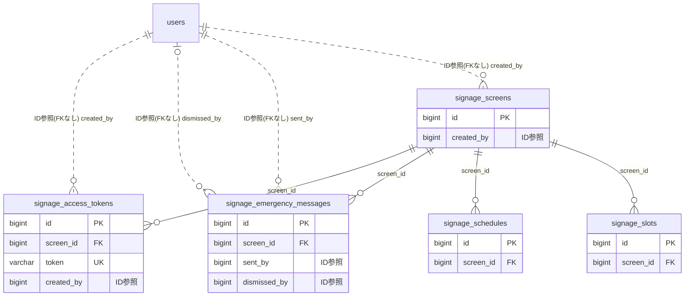

# signage ドメイン ER 図

> このファイルは自動生成されます。手で編集しないでください。再生成: `cd backend && ./gradlew generateErDiagrams`

- テーブル数: 5
- ビュー数: 0

## ER 図

実線 = 外部キー、点線 = ID参照(FKなし)。図中の `FK` は実外部キーの列だけ（ID参照列は `FK` を付けず "ID参照" と注記）。図にはキー列（PK / FK / 参照推定列 / 単一列 UNIQUE）のみを描く。全列は下の「テーブル定義」を参照。

## 被参照（他ドメインから）

このドメインのテーブルを参照している他ドメインの側（実 FK と ID参照のみ。多態参照と推定不能参照は含まない。同一ドメイン内の参照は上の図を参照）。

なし

## 多態参照（線を引かない）

| テーブル | 種別列 | ID列 |
| --- | --- | --- |
| `signage_screens` | `scope_type` | `scope_id` |

## テーブル定義

### `signage_access_tokens`

| 列名 | 型 | NULL | 既定値 | コメント |
| --- | --- | --- | --- | --- |
| `id` | `bigint unsigned` | NO | （なし） auto_increment |  |
| `screen_id` | `bigint unsigned` | NO | （なし） |  |
| `token` | `varchar(36)` | NO | （なし） | UUID v4 |
| `name` | `varchar(100)` | NO | （なし） |  |
| `is_active` | `tinyint(1)` | NO | `1` |  |
| `allowed_ips` | `json` | YES | NULL | CIDR表記の許可IPリスト。NULLは全許可 |
| `expired_at` | `datetime` | YES | NULL | トークン有効期限。NULLは無期限 |
| `last_accessed_at` | `datetime` | YES | NULL |  |
| `last_accessed_ip` | `varchar(45)` | YES | NULL |  |
| `created_by` | `bigint unsigned` | NO | （なし） |  |
| `created_at` | `datetime` | NO | （なし） |  |
| `updated_at` | `datetime` | NO | （なし） |  |

### `signage_emergency_messages`

| 列名 | 型 | NULL | 既定値 | コメント |
| --- | --- | --- | --- | --- |
| `id` | `bigint unsigned` | NO | （なし） auto_increment |  |
| `screen_id` | `bigint unsigned` | NO | （なし） |  |
| `message` | `varchar(500)` | NO | （なし） |  |
| `background_color` | `varchar(7)` | NO | `#FF0000` |  |
| `text_color` | `varchar(7)` | NO | `#FFFFFF` |  |
| `is_active` | `tinyint(1)` | NO | `0` |  |
| `sent_by` | `bigint unsigned` | NO | （なし） |  |
| `dismissed_at` | `datetime` | YES | NULL |  |
| `dismissed_by` | `bigint unsigned` | YES | NULL |  |
| `created_at` | `datetime` | NO | （なし） |  |

### `signage_schedules`

| 列名 | 型 | NULL | 既定値 | コメント |
| --- | --- | --- | --- | --- |
| `id` | `bigint unsigned` | NO | （なし） auto_increment |  |
| `screen_id` | `bigint unsigned` | NO | （なし） |  |
| `name` | `varchar(100)` | NO | （なし） |  |
| `day_of_week` | `varchar(20)` | NO | （なし） | WEEKDAY/WEEKEND/EVERYDAY/MON/TUE/WED/THU/FRI/SAT/SUN |
| `start_time` | `time` | NO | （なし） |  |
| `end_time` | `time` | NO | （なし） |  |
| `slot_ids` | `json` | NO | （なし） | 表示するslot_idの配列 |
| `priority` | `int` | NO | `0` | 数値が大きいほど優先 |
| `created_at` | `datetime` | NO | （なし） |  |
| `updated_at` | `datetime` | NO | （なし） |  |

### `signage_screens`

| 列名 | 型 | NULL | 既定値 | コメント |
| --- | --- | --- | --- | --- |
| `id` | `bigint unsigned` | NO | （なし） auto_increment |  |
| `scope_type` | `varchar(50)` | NO | （なし） |  |
| `scope_id` | `bigint unsigned` | NO | （なし） |  |
| `name` | `varchar(100)` | NO | （なし） |  |
| `layout` | `varchar(20)` | NO | `LANDSCAPE` | LANDSCAPE/PORTRAIT/STANDARD |
| `default_slide_duration` | `int` | NO | `10` | 秒 |
| `transition_effect` | `varchar(20)` | NO | `FADE` | FADE/SLIDE/NONE |
| `is_clock_shown` | `tinyint(1)` | NO | `1` |  |
| `is_weather_shown` | `tinyint(1)` | NO | `0` |  |
| `weather_location` | `varchar(200)` | YES | NULL | 天気予報の地名 |
| `background_color` | `varchar(7)` | NO | `#000000` |  |
| `is_active` | `tinyint(1)` | NO | `1` |  |
| `created_by` | `bigint unsigned` | NO | （なし） |  |
| `version` | `bigint` | NO | `0` |  |
| `created_at` | `datetime` | NO | （なし） |  |
| `updated_at` | `datetime` | NO | （なし） |  |
| `deleted_at` | `datetime` | YES | NULL |  |

### `signage_slots`

| 列名 | 型 | NULL | 既定値 | コメント |
| --- | --- | --- | --- | --- |
| `id` | `bigint unsigned` | NO | （なし） auto_increment |  |
| `screen_id` | `bigint unsigned` | NO | （なし） |  |
| `slot_order` | `int` | NO | （なし） |  |
| `slot_type` | `varchar(30)` | NO | （なし） | ANNOUNCEMENT/SCHEDULE/ACTIVITY_HIGHLIGHT/RANKING/FREE_TEXT/FREE_IMAGE/WEATHER/CLOCK |
| `title` | `varchar(200)` | YES | NULL |  |
| `slide_duration` | `int` | YES | NULL | NULLの場合はscreen.default_slide_durationを使用 |
| `content_config` | `json` | YES | NULL | スロット固有の設定 |
| `is_active` | `tinyint(1)` | NO | `1` |  |
| `created_at` | `datetime` | NO | （なし） |  |
| `updated_at` | `datetime` | NO | （なし） |  |
