# social ドメイン ER 図

> このファイルは自動生成されます。手で編集しないでください。再生成: `cd backend && ./gradlew generateErDiagrams`

- テーブル数: 11
- ビュー数: 0

## ER 図

実線 = 外部キー、点線 = ID参照(FKなし)。図中の `FK` は実外部キーの列だけ（ID参照列は `FK` を付けず "ID参照" と注記）。図にはキー列（PK / FK / 参照推定列 / 単一列 UNIQUE）のみを描く。全列は下の「テーブル定義」を参照。

```mermaid
erDiagram
    announcement_feed_group_snapshots {
        binary id PK
        bigint feed_id FK
        bigint team_id "ID参照"
    }
    announcement_feeds {
        bigint id PK
        bigint pinned_by "ID参照"
    }
    announcement_range_templates {
        bigint id PK
        bigint created_by "ID参照"
    }
    announcement_read_status {
        bigint id PK
        bigint announcement_feed_id FK
        bigint user_id "ID参照"
        bigint proxy_input_record_id "ID参照"
    }
    follows {
        bigint id PK
    }
    friend_content_forwards {
        bigint id PK
        bigint source_team_id "ID参照"
        bigint forwarding_team_id "ID参照"
        bigint forwarded_by "ID参照"
        bigint revoked_by "ID参照"
    }
    social_notification_outbox {
        binary id PK
        binary idempotency_key UK
        bigint organization_id "ID参照"
    }
    team_friend_folder_members {
        bigint id PK
        bigint folder_id FK
        bigint team_friend_id FK
        bigint added_by "ID参照"
    }
    team_friend_folders {
        bigint id PK
        bigint team_id "ID参照"
    }
    team_friends {
        bigint id PK
        bigint a_follow_id FK
        bigint b_follow_id FK
    }
    user_social_profiles {
        bigint id PK
        bigint user_id "ID参照"
        varchar handle UK
    }
    organizations
    proxy_input_records
    teams
    users
    announcement_feeds ||--o{ announcement_feed_group_snapshots : "feed_id"
    teams ||..o{ announcement_feed_group_snapshots : "ID参照(FKなし) team_id"
    users |o..o{ announcement_feeds : "ID参照(FKなし) pinned_by"
    users |o..o{ announcement_range_templates : "ID参照(FKなし) created_by"
    announcement_feeds ||--o{ announcement_read_status : "announcement_feed_id"
    proxy_input_records |o..o{ announcement_read_status : "ID参照(FKなし) proxy_input_record_id"
    users ||..o{ announcement_read_status : "ID参照(FKなし) user_id"
    teams ||..o{ friend_content_forwards : "ID参照(FKなし) forwarding_team_id"
    teams ||..o{ friend_content_forwards : "ID参照(FKなし) source_team_id"
    users ||..o{ friend_content_forwards : "ID参照(FKなし) forwarded_by"
    users |o..o{ friend_content_forwards : "ID参照(FKなし) revoked_by"
    organizations |o..o{ social_notification_outbox : "ID参照(FKなし) organization_id"
    team_friend_folders ||--o{ team_friend_folder_members : "folder_id"
    team_friends ||--o{ team_friend_folder_members : "team_friend_id"
    users |o..o{ team_friend_folder_members : "ID参照(FKなし) added_by"
    teams ||..o{ team_friend_folders : "ID参照(FKなし) team_id"
    follows ||--o{ team_friends : "a_follow_id"
    follows ||--o{ team_friends : "b_follow_id"
    users ||..o{ user_social_profiles : "ID参照(FKなし) user_id"
```

## 被参照（他ドメインから）

このドメインのテーブルを参照している他ドメインの側（実 FK と ID参照のみ。多態参照と推定不能参照は含まない。同一ドメイン内の参照は上の図を参照）。

| 参照元ドメイン | 参照元テーブル | 列 | 種別 | 参照先テーブル |
| --- | --- | --- | --- | --- |
| [advertising](advertising.md) | `ad_announcement_deliveries` | `announcement_feed_id` | ID参照 | `announcement_feeds` |

## 多態参照（線を引かない）

| テーブル | 種別列 | ID列 |
| --- | --- | --- |
| `announcement_feeds` | `scope_type` | `scope_id` |
| `announcement_feeds` | `source_type` | `source_id` |
| `announcement_range_templates` | `scope_type` | `scope_id` |
| `follows` | `followed_type` | `followed_id` |
| `follows` | `follower_type` | `follower_id` |

## 推定不能参照

| テーブル | 列 | 理由 |
| --- | --- | --- |
| `announcement_feed_group_snapshots` | `group_id` | 参照先テーブルを特定できない |
| `announcement_feeds` | `author_id` | 参照先テーブルを特定できない |
| `friend_content_forwards` | `forwarded_post_id` | 参照先テーブルを特定できない |
| `friend_content_forwards` | `source_post_id` | 参照先テーブルを特定できない |
| `team_friends` | `team_a_id` | 参照先テーブルを特定できない |
| `team_friends` | `team_b_id` | 参照先テーブルを特定できない |

## テーブル定義

### `announcement_feed_group_snapshots`

| 列名 | 型 | NULL | 既定値 | コメント |
| --- | --- | --- | --- | --- |
| `id` | `binary(16)` | NO | （なし） |  |
| `feed_id` | `bigint unsigned` | NO | （なし） | announcement_feeds.id（同一ドメイン） |
| `group_id` | `char(36)` | NO | （なし） | 送信時に展開したチームグループID（UUID文字列・クロスドメインFKなし） |
| `team_id` | `bigint unsigned` | NO | （なし） | 送信時点でそのグループに ACTIVE で所属していたチームID |

### `announcement_feeds`

| 列名 | 型 | NULL | 既定値 | コメント |
| --- | --- | --- | --- | --- |
| `id` | `bigint unsigned` | NO | （なし） auto_increment |  |
| `scope_type` | `varchar(20)` | NO | （なし） | 表示スコープ種別: TEAM / ORGANIZATION / ADVERTISER_AD |
| `scope_id` | `bigint unsigned` | NO | （なし） | 表示スコープのID（teams.id / organizations.id） |
| `source_type` | `varchar(30)` | NO | （なし） | 元コンテンツ種別: BLOG_POST / BULLETIN_THREAD / TIMELINE_POST / CIRCULATION_DOCUMENT / SURVEY / COMMITTEE_DECISION / COMMITTEE_MINUTES / COMMITTEE_CIRCULATION / COMMITTEE_MESSAGE |
| `source_id` | `bigint unsigned` | NO | （なし） | 元コンテンツのID（ポリモルフィック参照） |
| `author_id` | `bigint unsigned` | YES | NULL | お知らせ表示フラグを付けた操作者（退会時 NULL） |
| `title_cache` | `varchar(200)` | NO | （なし） | 表示用タイトル（元コンテンツから非正規化） |
| `excerpt_cache` | `varchar(300)` | YES | NULL | 本文抜粋（非正規化、リスト表示用） |
| `priority` | `varchar(20)` | NO | `NORMAL` | お知らせ優先度: URGENT / IMPORTANT / NORMAL |
| `is_pinned` | `tinyint(1)` | NO | `0` | ピン留めフラグ（ADMIN のみ変更可、スコープごと最大5件） |
| `pinned_at` | `datetime` | YES | NULL | ピン留め操作日時 |
| `pinned_by` | `bigint unsigned` | YES | NULL | ピン留めした ADMIN のユーザーID（退会時 NULL） |
| `visibility` | `varchar(30)` | NO | `MEMBERS_AND_ABOVE` | 閲覧可能範囲（元コンテンツから継承・同期）。値: PUBLIC / SUPPORTERS_AND_ABOVE / MEMBERS_AND_ABOVE（内輪・応援者除外） |
| `target_team_ids` | `json` | YES | NULL | 組織告知でのチーム絞り込み（NULL=全チーム対象）。TEAM スコープでは常に NULL。F02.8 §7 参照 |
| `starts_at` | `datetime` | YES | NULL | 表示開始日時（NULL = 即時） |
| `expires_at` | `datetime` | YES | NULL | 表示終了日時（NULL = 期限なし） |
| `source_deleted_at` | `datetime` | YES | NULL | 元コンテンツ削除検出日時（ApplicationEvent 経由でセット。90日後バッチで物理削除） |
| `created_at` | `datetime` | NO | `CURRENT_TIMESTAMP` （式） |  |
| `updated_at` | `datetime` | NO | `CURRENT_TIMESTAMP` （式） |  |
| `is_advertisement` | `tinyint(1)` | NO | `0` | F09.17 広告主キャンペーン由来フラグ |
| `target_group_ids` | `json` | YES | NULL | グループ宛て: 送信時に範囲を展開したチームグループID（UUID文字列配列）。表示は閲覧時に所属と照合 |
| `include_unassigned` | `tinyint(1)` | NO | `0` | グループ宛て: 未分類チームも表示対象にするか |
| `target_audience` | `json` | YES | NULL | 送信時の宛先指定の記録（グループ名・範囲・push 宛先数）。表示判定には使わない |

### `announcement_range_templates`

| 列名 | 型 | NULL | 既定値 | コメント |
| --- | --- | --- | --- | --- |
| `id` | `bigint unsigned` | NO | （なし） auto_increment |  |
| `scope_type` | `enum('TEAM','ORGANIZATION')` | NO | （なし） | 適用スコープ種別 |
| `scope_id` | `bigint unsigned` | NO | （なし） | 適用スコープID (teams.id / organizations.id) |
| `name` | `varchar(100)` | NO | （なし） | テンプレート名（1〜100文字） |
| `target_role` | `enum('MEMBERS_AND_ABOVE','SUPPORTERS_AND_ABOVE','PUBLIC')` | NO | `MEMBERS_AND_ABOVE` | 告知対象ロール（MEMBERS_AND_ABOVE=内輪・応援者除外） |
| `target_team_ids` | `json` | YES | NULL | 組織告知でのチーム絞り込み。NULL=全チーム対象。[1,3,5] のように team.id の配列 |
| `preferred_channel` | `varchar(30)` | YES | NULL | 優先チャネル: BULLETIN_THREAD / TIMELINE_POST / BLOG_POST / TODO / SCHEDULE / SURVEY |
| `is_default` | `tinyint(1)` | NO | `0` | スコープごとのデフォルトテンプレートフラグ（1スコープあたり最大1件） |
| `created_by` | `bigint unsigned` | YES | NULL | FK → users(id) ON DELETE SET NULL |
| `created_at` | `datetime` | NO | `CURRENT_TIMESTAMP` （式） |  |
| `updated_at` | `datetime` | NO | `CURRENT_TIMESTAMP` （式） |  |
| `target_group_ids` | `json` | YES | NULL | 個別選択したチームグループID（UUID文字列配列） |
| `target_group_range` | `json` | YES | NULL | 並び順の範囲指定 {"from_group_id":..,"to_group_id":..} |
| `include_unassigned` | `tinyint(1)` | NO | `0` | 未分類チームを含めるか |

### `announcement_read_status`

| 列名 | 型 | NULL | 既定値 | コメント |
| --- | --- | --- | --- | --- |
| `id` | `bigint unsigned` | NO | （なし） auto_increment |  |
| `announcement_feed_id` | `bigint unsigned` | NO | （なし） | お知らせフィードID（CASCADE 削除） |
| `user_id` | `bigint unsigned` | NO | （なし） | 既読したユーザーID（CASCADE 削除） |
| `read_at` | `datetime` | NO | `CURRENT_TIMESTAMP` （式） | 既読日時 |
| `is_proxy_confirmed` | `tinyint(1)` | NO | `0` | 代理確認フラグ（0=本人既読, 1=代理確認） |
| `proxy_input_record_id` | `bigint unsigned` | YES | NULL | 代理入力記録ID（proxy_input_records.id） |

### `follows`

| 列名 | 型 | NULL | 既定値 | コメント |
| --- | --- | --- | --- | --- |
| `id` | `bigint unsigned` | NO | （なし） auto_increment |  |
| `follower_type` | `varchar(20)` | NO | （なし） |  |
| `follower_id` | `bigint unsigned` | NO | （なし） |  |
| `followed_type` | `varchar(20)` | NO | （なし） |  |
| `followed_id` | `bigint unsigned` | NO | （なし） |  |
| `created_at` | `datetime` | NO | `CURRENT_TIMESTAMP` （式） |  |

### `friend_content_forwards`

| 列名 | 型 | NULL | 既定値 | コメント |
| --- | --- | --- | --- | --- |
| `id` | `bigint unsigned` | NO | （なし） auto_increment |  |
| `source_post_id` | `bigint unsigned` | NO | （なし） | FK -&gt; timeline_posts.id（転送元） |
| `source_team_id` | `bigint unsigned` | NO | （なし） | FK -&gt; teams.id（投稿元チーム） |
| `forwarding_team_id` | `bigint unsigned` | NO | （なし） | FK -&gt; teams.id（転送実行チーム） |
| `forwarded_post_id` | `bigint unsigned` | NO | （なし） | FK -&gt; timeline_posts.id（転送先投稿） |
| `target` | `varchar(30)` | NO | （なし） | MEMBER / MEMBER_AND_SUPPORTER (Phase 1 は MEMBER のみ) |
| `comment` | `varchar(500)` | YES | NULL |  |
| `is_revoked` | `tinyint(1)` | NO | `0` | 取消フラグ |
| `forwarded_by` | `bigint unsigned` | NO | （なし） | FK -&gt; users.id（転送実行者） |
| `revoked_by` | `bigint unsigned` | YES | NULL | FK -&gt; users.id（取消実行者） |
| `forwarded_at` | `datetime(6)` | NO | `CURRENT_TIMESTAMP(6)` （式） |  |
| `revoked_at` | `datetime(6)` | YES | NULL |  |
| `created_at` | `datetime(6)` | NO | `CURRENT_TIMESTAMP(6)` （式） |  |
| `updated_at` | `datetime(6)` | NO | `CURRENT_TIMESTAMP(6)` （式） |  |

### `social_notification_outbox`

| 列名 | 型 | NULL | 既定値 | コメント |
| --- | --- | --- | --- | --- |
| `id` | `binary(16)` | NO | （なし） |  |
| `idempotency_key` | `binary(16)` | NO | （なし） | fan-out の冪等キー（notification_fanout_jobs.source_event_uuid と同じ値） |
| `message_kind` | `varchar(32)` | NO | （なし） | FANOUT / FANOUT_WITH_AUDIENCE |
| `payload_version` | `smallint unsigned` | NO | （なし） | payload_json の版（reader を先、writer を後に展開する） |
| `payload_json` | `json` | NO | （なし） |  |
| `notification_type` | `varchar(64)` | NO | （なし） | 運用・監視用の写し |
| `organization_id` | `bigint unsigned` | YES | NULL | テナント（運用用。クロスドメインFKなし） |
| `status` | `varchar(16)` | NO | `PENDING` |  |
| `attempt_count` | `int unsigned` | NO | `0` |  |
| `next_attempt_at` | `datetime(6)` | NO | （なし） |  |
| `claim_token` | `binary(16)` | YES | NULL | claim の世代。mark はこの値が一致するときだけ当たる |
| `claimed_at` | `datetime(6)` | YES | NULL |  |
| `relayed_at` | `datetime(6)` | YES | NULL |  |
| `dead_at` | `datetime(6)` | YES | NULL |  |
| `last_error` | `varchar(500)` | YES | NULL |  |
| `created_at` | `datetime(6)` | NO | `utc_timestamp(6)` （式） |  |
| `updated_at` | `datetime(6)` | NO | `utc_timestamp(6)` （式） |  |

### `team_friend_folder_members`

| 列名 | 型 | NULL | 既定値 | コメント |
| --- | --- | --- | --- | --- |
| `id` | `bigint unsigned` | NO | （なし） auto_increment |  |
| `folder_id` | `bigint unsigned` | NO | （なし） |  |
| `team_friend_id` | `bigint unsigned` | NO | （なし） |  |
| `added_by` | `bigint unsigned` | YES | NULL | FK -&gt; users.id（追加実行者） |
| `added_at` | `datetime(6)` | NO | `CURRENT_TIMESTAMP(6)` （式） |  |

### `team_friend_folders`

| 列名 | 型 | NULL | 既定値 | コメント |
| --- | --- | --- | --- | --- |
| `id` | `bigint unsigned` | NO | （なし） auto_increment |  |
| `team_id` | `bigint unsigned` | NO | （なし） | FK -&gt; teams.id（このフォルダを所有するチーム = 自チーム） |
| `name` | `varchar(50)` | NO | （なし） |  |
| `description` | `varchar(300)` | YES | NULL |  |
| `color` | `varchar(7)` | NO | `#6B7280` | カラーコード (#RRGGBB) |
| `is_default` | `tinyint(1)` | NO | `0` |  |
| `sort_order` | `int` | NO | `0` |  |
| `deleted_at` | `datetime(6)` | YES | NULL | 論理削除日時 |
| `created_at` | `datetime(6)` | NO | `CURRENT_TIMESTAMP(6)` （式） |  |
| `updated_at` | `datetime(6)` | NO | `CURRENT_TIMESTAMP(6)` （式） |  |

### `team_friends`

| 列名 | 型 | NULL | 既定値 | コメント |
| --- | --- | --- | --- | --- |
| `id` | `bigint unsigned` | NO | （なし） auto_increment |  |
| `team_a_id` | `bigint unsigned` | NO | （なし） | FK -&gt; teams.id（小さい方のID） |
| `team_b_id` | `bigint unsigned` | NO | （なし） | FK -&gt; teams.id（大きい方のID） |
| `established_at` | `datetime(6)` | NO | `CURRENT_TIMESTAMP(6)` （式） | 相互フォロー成立日時 |
| `a_follow_id` | `bigint unsigned` | NO | （なし） | A→B follow の follows.id |
| `b_follow_id` | `bigint unsigned` | NO | （なし） | B→A follow の follows.id |
| `is_public` | `tinyint(1)` | NO | `0` | 公開設定（デフォルト非公開） |
| `created_at` | `datetime(6)` | NO | `CURRENT_TIMESTAMP(6)` （式） |  |
| `updated_at` | `datetime(6)` | NO | `CURRENT_TIMESTAMP(6)` （式） |  |

### `user_social_profiles`

| 列名 | 型 | NULL | 既定値 | コメント |
| --- | --- | --- | --- | --- |
| `id` | `bigint unsigned` | NO | （なし） auto_increment |  |
| `user_id` | `bigint unsigned` | NO | （なし） |  |
| `handle` | `varchar(30)` | NO | （なし） |  |
| `display_name` | `varchar(50)` | YES | NULL |  |
| `avatar_url` | `varchar(500)` | YES | NULL |  |
| `bio` | `varchar(300)` | YES | NULL |  |
| `is_active` | `tinyint(1)` | NO | `1` |  |
| `created_at` | `datetime` | NO | `CURRENT_TIMESTAMP` （式） |  |
| `updated_at` | `datetime` | NO | `CURRENT_TIMESTAMP` （式） |  |
