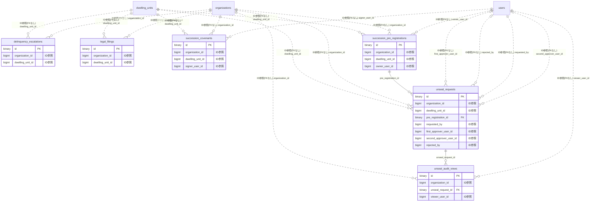

# succession ドメイン ER 図

> このファイルは自動生成されます。手で編集しないでください。再生成: `cd backend && ./gradlew generateErDiagrams`

- テーブル数: 6
- ビュー数: 0

## ER 図

実線 = 外部キー、点線 = ID参照(FKなし)。図中の `FK` は実外部キーの列だけ（ID参照列は `FK` を付けず "ID参照" と注記）。図にはキー列（PK / FK / 参照推定列 / 単一列 UNIQUE）のみを描く。全列は下の「テーブル定義」を参照。

## 被参照（他ドメインから）

このドメインのテーブルを参照している他ドメインの側（実 FK と ID参照のみ。多態参照と推定不能参照は含まない。同一ドメイン内の参照は上の図を参照）。

なし

## 推定不能参照

| テーブル | 列 | 理由 |
| --- | --- | --- |
| `delinquency_escalations` | `resident_registry_id` | 参照先テーブルを特定できない |
| `legal_filings` | `resident_registry_id` | 参照先テーブルを特定できない |
| `succession_covenants` | `resident_registry_id` | 参照先テーブルを特定できない |
| `succession_pre_registrations` | `resident_registry_id` | 参照先テーブルを特定できない |
| `unseal_audit_views` | `request_id` | 参照先テーブルを特定できない |
| `unseal_requests` | `resident_registry_id` | 参照先テーブルを特定できない |

## テーブル定義

### `delinquency_escalations`

| 列名 | 型 | NULL | 既定値 | コメント |
| --- | --- | --- | --- | --- |
| `id` | `binary(16)` | NO | （なし） |  |
| `organization_id` | `bigint unsigned` | NO | （なし） |  |
| `dwelling_unit_id` | `bigint unsigned` | NO | （なし） |  |
| `resident_registry_id` | `bigint unsigned` | NO | （なし） |  |
| `current_stage` | `varchar(30)` | NO | `STAGE_1_REMINDER` |  |
| `delinquency_started_at` | `date` | NO | （なし） |  |
| `last_contact_attempt_at` | `datetime(6)` | YES | NULL |  |
| `stage_1_completed_at` | `datetime(6)` | YES | NULL |  |
| `stage_2_completed_at` | `datetime(6)` | YES | NULL |  |
| `stage_3_completed_at` | `datetime(6)` | YES | NULL |  |
| `stage_4_completed_at` | `datetime(6)` | YES | NULL |  |
| `stage_5_completed_at` | `datetime(6)` | YES | NULL |  |
| `frozen_at` | `datetime(6)` | YES | NULL |  |
| `frozen_reason` | `text` | YES | NULL |  |
| `resolved_at` | `datetime(6)` | YES | NULL |  |
| `resolved_reason` | `varchar(50)` | YES | NULL |  |
| `deleted_at` | `datetime(6)` | YES | NULL |  |
| `created_at` | `datetime(6)` | NO | `CURRENT_TIMESTAMP(6)` （式） |  |
| `updated_at` | `datetime(6)` | NO | `CURRENT_TIMESTAMP(6)` （式） |  |

### `legal_filings`

| 列名 | 型 | NULL | 既定値 | コメント |
| --- | --- | --- | --- | --- |
| `id` | `binary(16)` | NO | （なし） |  |
| `organization_id` | `bigint unsigned` | NO | （なし） |  |
| `dwelling_unit_id` | `bigint unsigned` | NO | （なし） |  |
| `resident_registry_id` | `bigint unsigned` | NO | （なし） |  |
| `filing_type` | `varchar(40)` | NO | （なし） |  |
| `template_pdf_s3_key` | `varchar(500)` | YES | NULL |  |
| `evidence_package_s3_key` | `varchar(500)` | YES | NULL |  |
| `evidence_built_at` | `datetime(6)` | YES | NULL |  |
| `evidence_sha256` | `char(64)` | YES | NULL |  |
| `filed_externally_at` | `datetime(6)` | YES | NULL |  |
| `external_case_number` | `varchar(100)` | YES | NULL |  |
| `note` | `text` | YES | NULL |  |
| `deleted_at` | `datetime(6)` | YES | NULL |  |
| `created_at` | `datetime(6)` | NO | `CURRENT_TIMESTAMP(6)` （式） |  |
| `updated_at` | `datetime(6)` | NO | `CURRENT_TIMESTAMP(6)` （式） |  |

### `succession_covenants`

| 列名 | 型 | NULL | 既定値 | コメント |
| --- | --- | --- | --- | --- |
| `id` | `binary(16)` | NO | （なし） |  |
| `organization_id` | `bigint unsigned` | NO | （なし） |  |
| `dwelling_unit_id` | `bigint unsigned` | NO | （なし） |  |
| `resident_registry_id` | `bigint unsigned` | NO | （なし） |  |
| `signer_user_id` | `bigint unsigned` | NO | （なし） |  |
| `covenant_type` | `varchar(40)` | NO | （なし） |  |
| `covenant_version` | `varchar(20)` | NO | （なし） |  |
| `pdf_s3_key` | `varchar(500)` | NO | （なし） |  |
| `pdf_sha256` | `char(64)` | NO | （なし） |  |
| `internal_signature_token` | `varchar(500)` | NO | （なし） |  |
| `signed_at` | `datetime(6)` | NO | （なし） |  |
| `revoked_at` | `datetime(6)` | YES | NULL |  |
| `deleted_at` | `datetime(6)` | YES | NULL |  |
| `created_at` | `datetime(6)` | NO | `CURRENT_TIMESTAMP(6)` （式） |  |
| `updated_at` | `datetime(6)` | NO | `CURRENT_TIMESTAMP(6)` （式） |  |

### `succession_pre_registrations`

| 列名 | 型 | NULL | 既定値 | コメント |
| --- | --- | --- | --- | --- |
| `id` | `binary(16)` | NO | （なし） |  |
| `organization_id` | `bigint unsigned` | NO | （なし） |  |
| `dwelling_unit_id` | `bigint unsigned` | NO | （なし） |  |
| `resident_registry_id` | `bigint unsigned` | NO | （なし） |  |
| `owner_user_id` | `bigint unsigned` | NO | （なし） |  |
| `seal_status` | `varchar(20)` | NO | `SEALED` |  |
| `emergency_contacts` | `text` | YES | NULL |  |
| `inheritance_candidates` | `text` | YES | NULL |  |
| `will_memo` | `text` | YES | NULL |  |
| `frozen_account_info` | `text` | YES | NULL |  |
| `expected_absence_periods` | `json` | YES | NULL |  |
| `last_updated_by_owner_at` | `datetime(6)` | YES | NULL |  |
| `auto_reseal_at` | `datetime(6)` | YES | NULL |  |
| `deleted_at` | `datetime(6)` | YES | NULL |  |
| `created_at` | `datetime(6)` | NO | `CURRENT_TIMESTAMP(6)` （式） |  |
| `updated_at` | `datetime(6)` | NO | `CURRENT_TIMESTAMP(6)` （式） |  |

### `unseal_audit_views`

| 列名 | 型 | NULL | 既定値 | コメント |
| --- | --- | --- | --- | --- |
| `id` | `binary(16)` | NO | （なし） |  |
| `organization_id` | `bigint unsigned` | NO | （なし） |  |
| `unseal_request_id` | `binary(16)` | NO | （なし） |  |
| `viewer_user_id` | `bigint unsigned` | NO | （なし） |  |
| `viewed_at` | `datetime(6)` | NO | `CURRENT_TIMESTAMP(6)` （式） |  |
| `ip_address` | `varchar(45)` | YES | NULL |  |
| `user_agent` | `varchar(500)` | YES | NULL |  |
| `request_id` | `varchar(64)` | YES | NULL |  |
| `deleted_at` | `datetime(6)` | YES | NULL |  |
| `created_at` | `datetime(6)` | NO | `CURRENT_TIMESTAMP(6)` （式） |  |

### `unseal_requests`

| 列名 | 型 | NULL | 既定値 | コメント |
| --- | --- | --- | --- | --- |
| `id` | `binary(16)` | NO | （なし） |  |
| `organization_id` | `bigint unsigned` | NO | （なし） |  |
| `dwelling_unit_id` | `bigint unsigned` | NO | （なし） |  |
| `resident_registry_id` | `bigint unsigned` | NO | （なし） |  |
| `pre_registration_id` | `binary(16)` | NO | （なし） |  |
| `requested_by` | `bigint unsigned` | NO | （なし） |  |
| `request_reason` | `text` | NO | （なし） |  |
| `first_approver_user_id` | `bigint unsigned` | YES | NULL |  |
| `first_approved_at` | `datetime(6)` | YES | NULL |  |
| `second_approver_user_id` | `bigint unsigned` | YES | NULL |  |
| `second_approved_at` | `datetime(6)` | YES | NULL |  |
| `unseal_completed_at` | `datetime(6)` | YES | NULL |  |
| `auto_reseal_at` | `datetime(6)` | YES | NULL |  |
| `re_sealed_at` | `datetime(6)` | YES | NULL |  |
| `rejected_at` | `datetime(6)` | YES | NULL |  |
| `rejected_by` | `bigint unsigned` | YES | NULL |  |
| `deleted_at` | `datetime(6)` | YES | NULL |  |
| `created_at` | `datetime(6)` | NO | `CURRENT_TIMESTAMP(6)` （式） |  |
| `updated_at` | `datetime(6)` | NO | `CURRENT_TIMESTAMP(6)` （式） |  |
