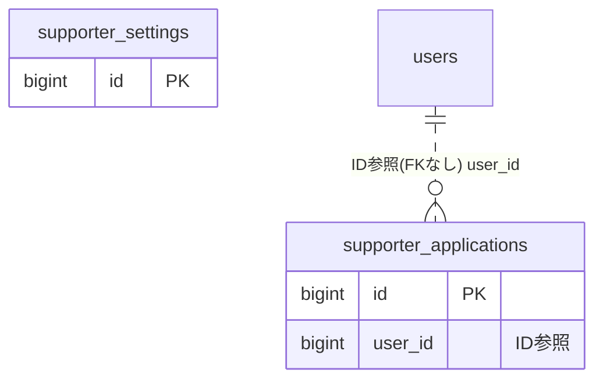

# supporter ドメイン ER 図

> このファイルは自動生成されます。手で編集しないでください。再生成: `cd backend && ./gradlew generateErDiagrams`

- テーブル数: 2
- ビュー数: 0

## ER 図

実線 = 外部キー、点線 = ID参照(FKなし)。図中の `FK` は実外部キーの列だけ（ID参照列は `FK` を付けず "ID参照" と注記）。図にはキー列（PK / FK / 参照推定列 / 単一列 UNIQUE）のみを描く。全列は下の「テーブル定義」を参照。

## 被参照（他ドメインから）

このドメインのテーブルを参照している他ドメインの側（実 FK と ID参照のみ。多態参照と推定不能参照は含まない。同一ドメイン内の参照は上の図を参照）。

なし

## 多態参照（線を引かない）

| テーブル | 種別列 | ID列 |
| --- | --- | --- |
| `supporter_applications` | `scope_type` | `scope_id` |
| `supporter_settings` | `scope_type` | `scope_id` |

## テーブル定義

### `supporter_applications`

| 列名 | 型 | NULL | 既定値 | コメント |
| --- | --- | --- | --- | --- |
| `id` | `bigint` | NO | （なし） auto_increment |  |
| `scope_type` | `varchar(20)` | NO | （なし） | TEAM または ORGANIZATION |
| `scope_id` | `bigint unsigned` | NO | （なし） | チームID または 組織ID |
| `user_id` | `bigint unsigned` | NO | （なし） | 申請者ユーザーID |
| `message` | `text` | YES | NULL | 申請メッセージ（任意） |
| `status` | `varchar(20)` | NO | `PENDING` | PENDING / APPROVED / REJECTED |
| `created_at` | `datetime(6)` | NO | （なし） |  |
| `updated_at` | `datetime(6)` | NO | （なし） |  |

### `supporter_settings`

| 列名 | 型 | NULL | 既定値 | コメント |
| --- | --- | --- | --- | --- |
| `id` | `bigint` | NO | （なし） auto_increment |  |
| `scope_type` | `varchar(20)` | NO | （なし） | TEAM または ORGANIZATION |
| `scope_id` | `bigint unsigned` | NO | （なし） | チームID または 組織ID |
| `auto_approve` | `tinyint(1)` | NO | `1` | 自動承認: 1=ON, 0=OFF |
