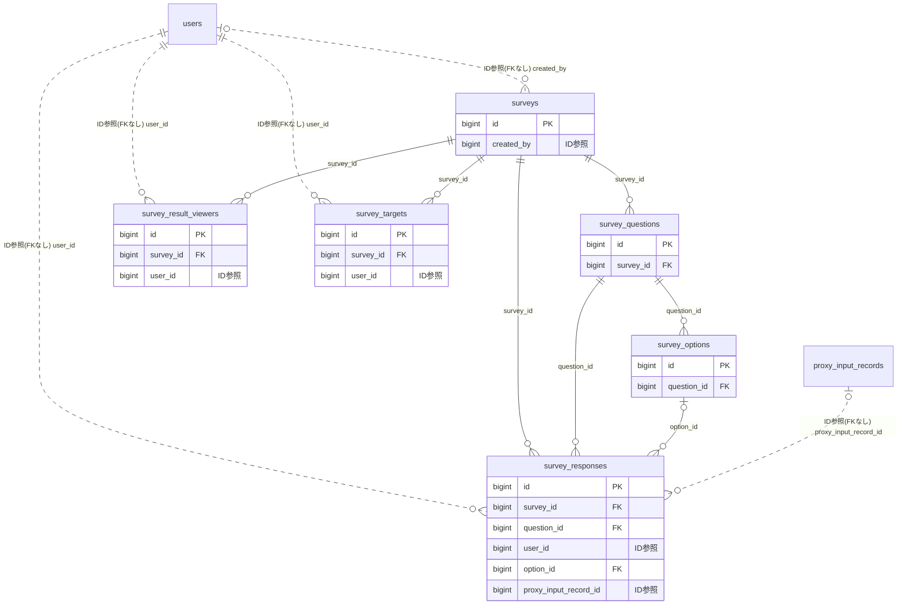

# survey ドメイン ER 図

> このファイルは自動生成されます。手で編集しないでください。再生成: `cd backend && ./gradlew generateErDiagrams`

- テーブル数: 6
- ビュー数: 0

## ER 図

実線 = 外部キー、点線 = ID参照(FKなし)。図中の `FK` は実外部キーの列だけ（ID参照列は `FK` を付けず "ID参照" と注記）。図にはキー列（PK / FK / 参照推定列 / 単一列 UNIQUE）のみを描く。全列は下の「テーブル定義」を参照。

## 被参照（他ドメインから）

このドメインのテーブルを参照している他ドメインの側（実 FK と ID参照のみ。多態参照と推定不能参照は含まない。同一ドメイン内の参照は上の図を参照）。

| 参照元ドメイン | 参照元テーブル | 列 | 種別 | 参照先テーブル |
| --- | --- | --- | --- | --- |
| [event](event.md) | `events` | `post_survey_id` | ID参照 | `surveys` |
| [event](event.md) | `events` | `pre_survey_id` | ID参照 | `surveys` |

## 多態参照（線を引かない）

| テーブル | 種別列 | ID列 |
| --- | --- | --- |
| `surveys` | `scope_type` | `scope_id` |

## 推定不能参照

| テーブル | 列 | 理由 |
| --- | --- | --- |
| `surveys` | `series_id` | 参照先テーブルを特定できない |

## テーブル定義

### `survey_options`

| 列名 | 型 | NULL | 既定値 | コメント |
| --- | --- | --- | --- | --- |
| `id` | `bigint unsigned` | NO | （なし） auto_increment |  |
| `question_id` | `bigint unsigned` | NO | （なし） |  |
| `option_text` | `varchar(200)` | NO | （なし） |  |
| `display_order` | `int` | NO | `0` |  |

### `survey_questions`

| 列名 | 型 | NULL | 既定値 | コメント |
| --- | --- | --- | --- | --- |
| `id` | `bigint unsigned` | NO | （なし） auto_increment |  |
| `survey_id` | `bigint unsigned` | NO | （なし） |  |
| `question_type` | `varchar(20)` | NO | （なし） |  |
| `question_text` | `varchar(500)` | NO | （なし） |  |
| `is_required` | `tinyint(1)` | NO | `1` |  |
| `display_order` | `int` | NO | `0` |  |
| `max_selections` | `int` | YES | NULL |  |
| `scale_min` | `int` | YES | NULL |  |
| `scale_max` | `int` | YES | NULL |  |
| `scale_min_label` | `varchar(50)` | YES | NULL |  |
| `scale_max_label` | `varchar(50)` | YES | NULL |  |
| `created_at` | `datetime` | NO | `CURRENT_TIMESTAMP` （式） |  |

### `survey_responses`

| 列名 | 型 | NULL | 既定値 | コメント |
| --- | --- | --- | --- | --- |
| `id` | `bigint unsigned` | NO | （なし） auto_increment |  |
| `survey_id` | `bigint unsigned` | NO | （なし） |  |
| `question_id` | `bigint unsigned` | NO | （なし） |  |
| `user_id` | `bigint unsigned` | NO | （なし） |  |
| `option_id` | `bigint unsigned` | YES | NULL |  |
| `text_response` | `text` | YES | NULL |  |
| `created_at` | `datetime` | NO | `CURRENT_TIMESTAMP` （式） |  |
| `updated_at` | `datetime` | NO | `CURRENT_TIMESTAMP` （式） |  |
| `is_proxy_input` | `tinyint(1)` | NO | `0` | 代理入力フラグ（0=本人入力, 1=代理入力）（F14.1） |
| `proxy_input_record_id` | `bigint unsigned` | YES | NULL | 代理入力ログID FK→proxy_input_records.id（F14.1） |

### `survey_result_viewers`

| 列名 | 型 | NULL | 既定値 | コメント |
| --- | --- | --- | --- | --- |
| `id` | `bigint unsigned` | NO | （なし） auto_increment |  |
| `survey_id` | `bigint unsigned` | NO | （なし） |  |
| `user_id` | `bigint unsigned` | NO | （なし） |  |
| `created_at` | `datetime` | NO | `CURRENT_TIMESTAMP` （式） |  |

### `survey_targets`

| 列名 | 型 | NULL | 既定値 | コメント |
| --- | --- | --- | --- | --- |
| `id` | `bigint unsigned` | NO | （なし） auto_increment |  |
| `survey_id` | `bigint unsigned` | NO | （なし） |  |
| `user_id` | `bigint unsigned` | NO | （なし） |  |
| `created_at` | `datetime` | NO | `CURRENT_TIMESTAMP` （式） |  |

### `surveys`

| 列名 | 型 | NULL | 既定値 | コメント |
| --- | --- | --- | --- | --- |
| `id` | `bigint unsigned` | NO | （なし） auto_increment |  |
| `scope_type` | `enum('ORGANIZATION','TEAM')` | NO | （なし） | 正準スコープ種別: ORGANIZATION / TEAM |
| `scope_id` | `bigint unsigned` | NO | （なし） |  |
| `title` | `varchar(200)` | NO | （なし） |  |
| `description` | `text` | YES | NULL |  |
| `status` | `varchar(20)` | NO | `DRAFT` |  |
| `is_anonymous` | `tinyint(1)` | NO | `0` |  |
| `allow_multiple_submissions` | `tinyint(1)` | NO | `0` |  |
| `results_visibility` | `varchar(20)` | NO | `AFTER_RESPONSE` |  |
| `distribution_mode` | `varchar(20)` | NO | `ALL` |  |
| `unresponded_visibility` | `varchar(30)` | NO | `CREATOR_AND_ADMIN` | 未回答者一覧の公開範囲: HIDDEN / CREATOR_AND_ADMIN / ALL_MEMBERS |
| `auto_post_to_timeline` | `tinyint(1)` | NO | `0` |  |
| `include_supporters` | `tinyint(1)` | NO | `0` | 配信母集団にサポーター（応援者）を含めるか |
| `team_breakdown_enabled` | `tinyint(1)` | NO | `0` | アンケート集計をチーム別内訳（by_team）でも収集・表示するか |
| `series_id` | `varchar(50)` | YES | NULL |  |
| `remind_before_hours` | `json` | YES | NULL |  |
| `manual_remind_count` | `int` | NO | `0` |  |
| `last_reminded_at` | `timestamp` | YES | NULL | 最終督促送信時刻。NULL = 一度も督促していない |
| `starts_at` | `datetime` | YES | NULL |  |
| `expires_at` | `datetime` | YES | NULL |  |
| `response_count` | `int` | NO | `0` |  |
| `target_count` | `int` | NO | `0` |  |
| `created_by` | `bigint unsigned` | YES | NULL |  |
| `published_at` | `datetime` | YES | NULL |  |
| `closed_at` | `datetime` | YES | NULL |  |
| `version` | `bigint unsigned` | NO | `0` |  |
| `created_at` | `datetime` | NO | `CURRENT_TIMESTAMP` （式） |  |
| `updated_at` | `datetime` | NO | `CURRENT_TIMESTAMP` （式） |  |
| `post_announcement_on_publish` | `tinyint(1)` | NO | `0` | 公開時に自動でお知らせウィジェットに登録する |
| `deleted_at` | `datetime` | YES | NULL |  |
