# team ドメイン ER 図

> このファイルは自動生成されます。手で編集しないでください。再生成: `cd backend && ./gradlew generateErDiagrams`

- テーブル数: 10
- ビュー数: 0

## ER 図

実線 = 外部キー、点線 = ID参照(FKなし)。図中の `FK` は実外部キーの列だけ（ID参照列は `FK` を付けず "ID参照" と注記）。図にはキー列（PK / FK / 参照推定列 / 単一列 UNIQUE）のみを描く。全列は下の「テーブル定義」を参照。

```mermaid
erDiagram
    team_blocks {
        bigint id PK
        bigint team_id "ID参照"
        bigint user_id "ID参照"
        bigint blocked_by "ID参照"
    }
    team_custom_fields {
        bigint id PK
        bigint team_id "ID参照"
    }
    team_notification_outbox {
        binary id PK
        binary idempotency_key UK
        bigint organization_id "ID参照"
    }
    team_officers {
        bigint id PK
        bigint team_id "ID参照"
    }
    team_org_affiliation_restrictions {
        binary id PK
        bigint organization_id "ID参照"
        bigint team_id "ID参照"
        bigint created_by "ID参照"
    }
    team_org_memberships {
        bigint id PK
        bigint team_id "ID参照"
        bigint organization_id "ID参照"
        bigint invited_by "ID参照"
        bigint responded_by "ID参照"
    }
    team_shift_settings {
        bigint id PK
        bigint team_id UK "ID参照"
    }
    team_slug_history {
        binary id PK
        bigint team_id "ID参照"
        varchar old_slug UK
    }
    team_uniform_set {
        binary id PK
        bigint team_id "ID参照"
    }
    teams {
        bigint id PK
        varchar slug UK
    }
    organizations
    users
    teams ||..o{ team_blocks : "ID参照(FKなし) team_id"
    users ||..o{ team_blocks : "ID参照(FKなし) blocked_by"
    users ||..o{ team_blocks : "ID参照(FKなし) user_id"
    teams ||..o{ team_custom_fields : "ID参照(FKなし) team_id"
    organizations |o..o{ team_notification_outbox : "ID参照(FKなし) organization_id"
    teams ||..o{ team_officers : "ID参照(FKなし) team_id"
    organizations ||..o{ team_org_affiliation_restrictions : "ID参照(FKなし) organization_id"
    teams ||..o{ team_org_affiliation_restrictions : "ID参照(FKなし) team_id"
    users |o..o{ team_org_affiliation_restrictions : "ID参照(FKなし) created_by"
    organizations ||..o{ team_org_memberships : "ID参照(FKなし) organization_id"
    teams ||..o{ team_org_memberships : "ID参照(FKなし) team_id"
    users |o..o{ team_org_memberships : "ID参照(FKなし) invited_by"
    users |o..o{ team_org_memberships : "ID参照(FKなし) responded_by"
    teams ||..o| team_shift_settings : "ID参照(FKなし) team_id"
    teams ||..o{ team_slug_history : "ID参照(FKなし) team_id"
    teams ||..o{ team_uniform_set : "ID参照(FKなし) team_id"
```

## 被参照（他ドメインから）

このドメインのテーブルを参照している他ドメインの側（実 FK と ID参照のみ。多態参照と推定不能参照は含まない。同一ドメイン内の参照は上の図を参照）。

| 参照元ドメイン | 参照元テーブル | 列 | 種別 | 参照先テーブル |
| --- | --- | --- | --- | --- |
| [actionmemo](actionmemo.md) | `action_memos` | `posted_team_id` | ID参照 | `teams` |
| [actionmemo](actionmemo.md) | `user_action_memo_settings` | `default_post_team_id` | ID参照 | `teams` |
| [admin](admin.md) | `beta_restriction_config` | `max_team_id` | ID参照 | `teams` |
| [advertising](advertising.md) | `equipment_ranking_exclusions` | `team_id` | ID参照 | `teams` |
| [auth](auth.md) | `audit_logs` | `team_id` | ID参照 | `teams` |
| [chart](chart.md) | `chart_custom_fields` | `team_id` | ID参照 | `teams` |
| [chart](chart.md) | `chart_intake_form_templates` | `team_id` | ID参照 | `teams` |
| [chart](chart.md) | `chart_record_templates` | `team_id` | ID参照 | `teams` |
| [chart](chart.md) | `chart_records` | `team_id` | ID参照 | `teams` |
| [chart](chart.md) | `chart_section_settings` | `team_id` | ID参照 | `teams` |
| [chat](chat.md) | `chat_channels` | `team_id` | ID参照 | `teams` |
| [cms](cms.md) | `blog_post_series` | `team_id` | ID参照 | `teams` |
| [cms](cms.md) | `blog_post_shares` | `team_id` | ID参照 | `teams` |
| [cms](cms.md) | `blog_posts` | `team_id` | ID参照 | `teams` |
| [cms](cms.md) | `blog_tags` | `team_id` | ID参照 | `teams` |
| [equipment](equipment.md) | `equipment_items` | `team_id` | ID参照 | `teams` |
| [event](event.md) | `event_delegations` | `team_id` | ID参照 | `teams` |
| [family](family.md) | `coin_toss_results` | `team_id` | ID参照 | `teams` |
| [family](family.md) | `duty_rotations` | `team_id` | ID参照 | `teams` |
| [family](family.md) | `presence_events` | `team_id` | ID参照 | `teams` |
| [family](family.md) | `shopping_lists` | `team_id` | ID参照 | `teams` |
| [family](family.md) | `team_anniversaries` | `team_id` | ID参照 | `teams` |
| [family](family.md) | `team_presence_icons` | `team_id` | ID参照 | `teams` |
| [family](family.md) | `team_role_aliases` | `team_id` | ID参照 | `teams` |
| [filesharing](filesharing.md) | `shared_folders` | `team_id` | ID参照 | `teams` |
| [gallery](gallery.md) | `photo_albums` | `team_id` | ID参照 | `teams` |
| [jobmatching](jobmatching.md) | `job_postings` | `team_id` | ID参照 | `teams` |
| [joinrequest](joinrequest.md) | `join_requests` | `team_id` | ID参照 | `teams` |
| [loyalty](loyalty.md) | `team_loyalty_accounts` | `team_id` | ID参照 | `teams` |
| [loyalty](loyalty.md) | `team_loyalty_programs` | `team_id` | ID参照 | `teams` |
| [loyalty](loyalty.md) | `team_loyalty_rewards` | `team_id` | ID参照 | `teams` |
| [loyalty](loyalty.md) | `team_loyalty_rules` | `team_id` | ID参照 | `teams` |
| [match](match.md) | `match_events` | `recorded_by_team_id` | ID参照 | `teams` |
| [match](match.md) | `match_score_entries` | `competitor_team_id` | ID参照 | `teams` |
| [match](match.md) | `matches` | `opponent_team_id` | ID参照 | `teams` |
| [match](match.md) | `matches` | `team_id` | ID参照 | `teams` |
| [match](match.md) | `player_appearances` | `owning_team_id` | ID参照 | `teams` |
| [matching](matching.md) | `match_notification_preferences` | `team_id` | ID参照 | `teams` |
| [matching](matching.md) | `match_proposals` | `cancelled_by_team_id` | ID参照 | `teams` |
| [matching](matching.md) | `match_proposals` | `proposing_team_id` | ID参照 | `teams` |
| [matching](matching.md) | `match_request_templates` | `team_id` | ID参照 | `teams` |
| [matching](matching.md) | `match_requests` | `team_id` | ID参照 | `teams` |
| [matching](matching.md) | `match_reviews` | `reviewee_team_id` | ID参照 | `teams` |
| [matching](matching.md) | `match_reviews` | `reviewer_team_id` | ID参照 | `teams` |
| [matching](matching.md) | `ng_teams` | `blocked_team_id` | ID参照 | `teams` |
| [matching](matching.md) | `ng_teams` | `team_id` | ID参照 | `teams` |
| [member](member.md) | `member_profile_fields` | `team_id` | ID参照 | `teams` |
| [member](member.md) | `team_pages` | `team_id` | ID参照 | `teams` |
| [memberinfo](memberinfo.md) | `team_member_info_fields` | `team_id` | ID参照 | `teams` |
| [memberinfo](memberinfo.md) | `team_member_info_responses` | `team_id` | ID参照 | `teams` |
| [notification](notification.md) | `notification_fanout_audience_teams` | `team_id` | ID参照 | `teams` |
| [payment](payment.md) | `payment_beneficiary_settings` | `team_id` | ID参照 | `teams` |
| [payment](payment.md) | `payment_items` | `team_id` | ID参照 | `teams` |
| [payment](payment.md) | `team_access_requirements` | `team_id` | ID参照 | `teams` |
| [payment](payment.md) | `team_payment_advances` | `team_id` | ID参照 | `teams` |
| [payment](payment.md) | `team_subscriptions` | `team_id` | ID参照 | `teams` |
| [performance](performance.md) | `performance_metrics` | `team_id` | ID参照 | `teams` |
| [provisioning](provisioning.md) | `provisioning_invitations` | `team_id` | ID参照 | `teams` |
| [proxyvote](proxyvote.md) | `proxy_vote_sessions` | `team_id` | ID参照 | `teams` |
| [publicview](publicview.md) | `team_name_disclosure_change_logs` | `team_id` | ID参照 | `teams` |
| [recruitment](recruitment.md) | `recruitment_cancellation_records` | `team_id` | ID参照 | `teams` |
| [recruitment](recruitment.md) | `recruitment_friend_targets` | `team_id` | ID参照 | `teams` |
| [recruitment](recruitment.md) | `recruitment_participants` | `team_id` | ID参照 | `teams` |
| [reservation](reservation.md) | `emergency_closures` | `team_id` | ID参照 | `teams` |
| [reservation](reservation.md) | `reservation_blocked_times` | `team_id` | ID参照 | `teams` |
| [reservation](reservation.md) | `reservation_business_hours` | `team_id` | ID参照 | `teams` |
| [reservation](reservation.md) | `reservation_lines` | `team_id` | ID参照 | `teams` |
| [reservation](reservation.md) | `reservation_menus` | `team_id` | ID参照 | `teams` |
| [reservation](reservation.md) | `reservation_notification_recipients` | `team_id` | ID参照 | `teams` |
| [reservation](reservation.md) | `reservation_policies` | `team_id` | ID参照 | `teams` |
| [reservation](reservation.md) | `reservation_recurring_blocked_times` | `team_id` | ID参照 | `teams` |
| [reservation](reservation.md) | `reservation_slot_templates` | `team_id` | ID参照 | `teams` |
| [reservation](reservation.md) | `reservation_slots` | `team_id` | ID参照 | `teams` |
| [reservation](reservation.md) | `reservation_team_settings` | `team_id` | ID参照 | `teams` |
| [reservation](reservation.md) | `reservation_waitlist_entries` | `team_id` | ID参照 | `teams` |
| [reservation](reservation.md) | `reservations` | `team_id` | ID参照 | `teams` |
| [resident](resident.md) | `dwelling_units` | `team_id` | ID参照 | `teams` |
| [returnstayplan](returnstayplan.md) | `return_stay_plan_team_visibilities` | `team_id` | ID参照 | `teams` |
| [role](role.md) | `invite_tokens` | `team_id` | ID参照 | `teams` |
| [role](role.md) | `ownership_transfer_offers` | `team_id` | ID参照 | `teams` |
| [role](role.md) | `permission_groups` | `team_id` | ID参照 | `teams` |
| [role](role.md) | `user_roles` | `team_id` | ID参照 | `teams` |
| [schedule](schedule.md) | `schedule_annual_copy_logs` | `team_id` | ID参照 | `teams` |
| [schedule](schedule.md) | `schedule_delegations` | `team_id` | ID参照 | `teams` |
| [schedule](schedule.md) | `schedule_event_categories` | `team_id` | ID参照 | `teams` |
| [schedule](schedule.md) | `schedule_keeps` | `team_id` | ID参照 | `teams` |
| [schedule](schedule.md) | `schedules` | `team_id` | ID参照 | `teams` |
| [school](school.md) | `attendance_location_changes` | `team_id` | ID参照 | `teams` |
| [school](school.md) | `attendance_requirement_rules` | `team_id` | ID参照 | `teams` |
| [school](school.md) | `attendance_transition_alerts` | `team_id` | ID参照 | `teams` |
| [school](school.md) | `class_homerooms` | `team_id` | ID参照 | `teams` |
| [school](school.md) | `daily_attendance_records` | `team_id` | ID参照 | `teams` |
| [school](school.md) | `family_attendance_notices` | `team_id` | ID参照 | `teams` |
| [school](school.md) | `period_attendance_records` | `team_id` | ID参照 | `teams` |
| [school](school.md) | `student_attendance_summaries` | `team_id` | ID参照 | `teams` |
| [service](service.md) | `service_record_fields` | `team_id` | ID参照 | `teams` |
| [service](service.md) | `service_record_settings` | `team_id` | ID参照 | `teams` |
| [service](service.md) | `service_record_templates` | `team_id` | ID参照 | `teams` |
| [service](service.md) | `service_records` | `team_id` | ID参照 | `teams` |
| [shift](shift.md) | `member_availability_defaults` | `team_id` | ID参照 | `teams` |
| [shift](shift.md) | `member_work_constraints` | `team_id` | ID参照 | `teams` |
| [shift](shift.md) | `shift_hourly_rates` | `team_id` | ID参照 | `teams` |
| [shift](shift.md) | `shift_positions` | `team_id` | ID参照 | `teams` |
| [shift](shift.md) | `shift_schedules` | `team_id` | ID参照 | `teams` |
| [shiftbudget](shiftbudget.md) | `shift_budget_allocations` | `team_id` | ID参照 | `teams` |
| [social](social.md) | `announcement_feed_group_snapshots` | `team_id` | ID参照 | `teams` |
| [social](social.md) | `friend_content_forwards` | `forwarding_team_id` | ID参照 | `teams` |
| [social](social.md) | `friend_content_forwards` | `source_team_id` | ID参照 | `teams` |
| [social](social.md) | `team_friend_folders` | `team_id` | ID参照 | `teams` |
| [template](template.md) | `team_enabled_modules` | `team_id` | ID参照 | `teams` |
| [ticket](ticket.md) | `ticket_books` | `team_id` | ID参照 | `teams` |
| [ticket](ticket.md) | `ticket_payments` | `team_id` | ID参照 | `teams` |
| [ticket](ticket.md) | `ticket_products` | `team_id` | ID参照 | `teams` |
| [timetable](timetable.md) | `personal_timetable_share_targets` | `team_id` | ID参照 | `teams` |
| [timetable](timetable.md) | `personal_timetable_slots` | `linked_team_id` | ID参照 | `teams` |
| [timetable](timetable.md) | `timetable_terms` | `team_id` | ID参照 | `teams` |
| [timetable](timetable.md) | `timetables` | `team_id` | ID参照 | `teams` |
| [tournament](tournament.md) | `league_transfer` | `team_id` | ID参照 | `teams` |
| [tournament](tournament.md) | `tournament_entry_templates` | `team_id` | ID参照 | `teams` |
| [tournament](tournament.md) | `tournament_fee_target` | `team_id` | ID参照 | `teams` |
| [tournament](tournament.md) | `tournament_participants` | `team_id` | ID参照 | `teams` |
| [tournament](tournament.md) | `tournament_promotion_records` | `team_id` | ID参照 | `teams` |
| [tournament](tournament.md) | `tournament_submission_requirement_target` | `team_id` | ID参照 | `teams` |
| [village](village.md) | `village_match_recruit_applications` | `applicant_team_id` | ID参照 | `teams` |
| [village](village.md) | `village_match_recruits` | `posted_by_team_id` | ID参照 | `teams` |

## 推定不能参照

| テーブル | 列 | 理由 |
| --- | --- | --- |
| `team_org_memberships` | `group_id` | 参照先テーブルを特定できない |
| `teams` | `template_id` | 参照先テーブルを特定できない |

## テーブル定義

### `team_blocks`

| 列名 | 型 | NULL | 既定値 | コメント |
| --- | --- | --- | --- | --- |
| `id` | `bigint unsigned` | NO | （なし） auto_increment |  |
| `team_id` | `bigint unsigned` | NO | （なし） |  |
| `user_id` | `bigint unsigned` | NO | （なし） |  |
| `blocked_by` | `bigint unsigned` | NO | （なし） |  |
| `reason` | `varchar(500)` | YES | NULL |  |
| `created_at` | `datetime` | NO | （なし） |  |

### `team_custom_fields`

| 列名 | 型 | NULL | 既定値 | コメント |
| --- | --- | --- | --- | --- |
| `id` | `bigint unsigned` | NO | （なし） auto_increment |  |
| `team_id` | `bigint unsigned` | NO | （なし） | FK → teams |
| `label` | `varchar(100)` | NO | （なし） | 項目ラベル |
| `value` | `text` | NO | （なし） | 項目値（最大1000文字） |
| `display_order` | `int unsigned` | NO | `0` | 並び順 |
| `is_visible` | `tinyint(1)` | NO | `1` | 個別表示可否 |
| `created_at` | `datetime` | NO | `CURRENT_TIMESTAMP` （式） |  |
| `updated_at` | `datetime` | NO | `CURRENT_TIMESTAMP` （式） |  |

### `team_notification_outbox`

| 列名 | 型 | NULL | 既定値 | コメント |
| --- | --- | --- | --- | --- |
| `id` | `binary(16)` | NO | （なし） |  |
| `idempotency_key` | `binary(16)` | NO | （なし） | fan-out の冪等キー（notification_fanout_jobs.source_event_uuid と同じ値） |
| `message_kind` | `varchar(32)` | NO | （なし） | FANOUT / FANOUT_WITH_AUDIENCE |
| `payload_version` | `smallint unsigned` | NO | （なし） | payload_json の版（reader を先、writer を後に展開する） |
| `payload_json` | `json` | NO | （なし） |  |
| `notification_type` | `varchar(64)` | NO | （なし） | 運用・監視用の写し |
| `organization_id` | `bigint unsigned` | YES | NULL | テナント（運用用。クロスドメインFKなし） |
| `status` | `varchar(16)` | NO | `PENDING` |  |
| `attempt_count` | `int unsigned` | NO | `0` |  |
| `next_attempt_at` | `datetime(6)` | NO | （なし） |  |
| `claim_token` | `binary(16)` | YES | NULL | claim の世代。mark はこの値が一致するときだけ当たる |
| `claimed_at` | `datetime(6)` | YES | NULL |  |
| `relayed_at` | `datetime(6)` | YES | NULL |  |
| `dead_at` | `datetime(6)` | YES | NULL |  |
| `last_error` | `varchar(500)` | YES | NULL |  |
| `created_at` | `datetime(6)` | NO | `utc_timestamp(6)` （式） |  |
| `updated_at` | `datetime(6)` | NO | `utc_timestamp(6)` （式） |  |

### `team_officers`

| 列名 | 型 | NULL | 既定値 | コメント |
| --- | --- | --- | --- | --- |
| `id` | `bigint unsigned` | NO | （なし） auto_increment |  |
| `team_id` | `bigint unsigned` | NO | （なし） | FK → teams |
| `name` | `varchar(100)` | NO | （なし） | 役員名 |
| `title` | `varchar(100)` | NO | （なし） | 役職名 |
| `display_order` | `int unsigned` | NO | `0` | 並び順 |
| `is_visible` | `tinyint(1)` | NO | `1` | 個別表示可否 |
| `created_at` | `datetime` | NO | `CURRENT_TIMESTAMP` （式） |  |
| `updated_at` | `datetime` | NO | `CURRENT_TIMESTAMP` （式） |  |

### `team_org_affiliation_restrictions`

| 列名 | 型 | NULL | 既定値 | コメント |
| --- | --- | --- | --- | --- |
| `id` | `binary(16)` | NO | （なし） | UUIDv7 |
| `organization_id` | `bigint unsigned` | NO | （なし） | 組織ID（クロスドメインFKなし） |
| `team_id` | `bigint unsigned` | NO | （なし） | チームID（FKは張らない） |
| `direction` | `varchar(20)` | NO | （なし） | 止める向き: TEAM_APPLY / ORG_INVITE |
| `kind` | `varchar(20)` | NO | （なし） | COOLDOWN=期限付き / BLOCK=無期限ブロック |
| `reason` | `varchar(20)` | NO | （なし） | REJECTED / DECLINED / WITHDRAWN / CANCELLED |
| `restricted_until` | `datetime` | YES | NULL | COOLDOWN の期限（アプリの壁時計・JST）。BLOCK は NULL |
| `created_by` | `bigint unsigned` | YES | NULL |  |
| `created_at` | `datetime` | NO | `CURRENT_TIMESTAMP` （式） |  |
| `updated_at` | `datetime` | NO | `CURRENT_TIMESTAMP` （式） |  |

### `team_org_memberships`

| 列名 | 型 | NULL | 既定値 | コメント |
| --- | --- | --- | --- | --- |
| `id` | `bigint unsigned` | NO | （なし） auto_increment |  |
| `team_id` | `bigint unsigned` | NO | （なし） |  |
| `organization_id` | `bigint unsigned` | NO | （なし） |  |
| `status` | `varchar(20)` | NO | `PENDING` |  |
| `invited_by` | `bigint unsigned` | YES | NULL |  |
| `responded_by` | `bigint unsigned` | YES | NULL |  |
| `invited_at` | `datetime` | NO | （なし） |  |
| `responded_at` | `datetime` | YES | NULL |  |
| `created_at` | `datetime` | NO | （なし） |  |
| `direction` | `varchar(20)` | NO | `ORG_INVITE` | 起点: ORG_INVITE=組織からの招待 / TEAM_APPLY=チームからの申請 |
| `group_id` | `binary(16)` | YES | NULL | チームグループID（org_team_groups.id・クロスドメインFKなし） |
| `message` | `varchar(500)` | YES | NULL | 申請・招待時の添え書き（PENDING の間だけ意味を持つ） |
| `updated_at` | `datetime` | NO | `CURRENT_TIMESTAMP` （式） |  |
| `invite_notified_at` | `datetime` | YES | NULL | 招待の受信通知を outbox に予約した瞬間（UTC 壁時計）。NULL の招待は相手のチームがまだ知らない |
| `org_closure_generation` | `bigint` | NO | `0` | 作成時点の組織の閉鎖の世代（organizations.closure_generation）。これより組織の世代が進んでいれば閉鎖前の行 |
| `team_closure_generation` | `bigint` | NO | `0` | 作成時点のチームの閉鎖の世代（teams.closure_generation）。これよりチームの世代が進んでいれば閉鎖前の行 |

### `team_shift_settings`

| 列名 | 型 | NULL | 既定値 | コメント |
| --- | --- | --- | --- | --- |
| `id` | `bigint unsigned` | NO | （なし） auto_increment |  |
| `team_id` | `bigint unsigned` | NO | （なし） |  |
| `reminder_48h_enabled` | `tinyint(1)` | NO | `1` |  |
| `reminder_24h_enabled` | `tinyint(1)` | NO | `1` |  |
| `reminder_12h_enabled` | `tinyint(1)` | NO | `0` |  |
| `created_at` | `datetime` | NO | `CURRENT_TIMESTAMP` （式） |  |
| `updated_at` | `datetime` | NO | `CURRENT_TIMESTAMP` （式） |  |

### `team_slug_history`

| 列名 | 型 | NULL | 既定値 | コメント |
| --- | --- | --- | --- | --- |
| `id` | `binary(16)` | NO | （なし） | UUIDv7（原則6） |
| `team_id` | `bigint unsigned` | NO | （なし） | リネーム対象チーム（teams.id・FK なし／原則1） |
| `old_slug` | `varchar(30)` | NO | （なし） | リネーム前の旧 slug（恒久予約・301 解決のキー） |
| `created_at` | `datetime` | NO | `CURRENT_TIMESTAMP` （式） | リネーム実施日時 |

### `team_uniform_set`

| 列名 | 型 | NULL | 既定値 | コメント |
| --- | --- | --- | --- | --- |
| `id` | `binary(16)` | NO | （なし） | UUIDv7（原則6） |
| `team_id` | `bigint unsigned` | NO | （なし） | team ドメインへの ID 参照（teams.id・FK なし／原則1） |
| `kind` | `varchar(16)` | NO | （なし） | FP=フィールドプレイヤー / GK_PRIMARY=GK正 / GK_SECONDARY=GK副 |
| `label` | `varchar(64)` | YES | NULL | 表示名（例「ホーム白」） |
| `shirt_color` | `varchar(32)` | NO | （なし） | シャツ色（色名 or HEX を文字列で保持） |
| `shorts_color` | `varchar(32)` | NO | （なし） | パンツ色 |
| `socks_color` | `varchar(32)` | NO | （なし） | ソックス色 |
| `created_at` | `datetime` | NO | `CURRENT_TIMESTAMP` （式） |  |
| `updated_at` | `datetime` | NO | `CURRENT_TIMESTAMP` （式） |  |
| `deleted_at` | `datetime` | YES | NULL | 論理削除（再利用テンプレの履歴保持） |

### `teams`

| 列名 | 型 | NULL | 既定値 | コメント |
| --- | --- | --- | --- | --- |
| `id` | `bigint unsigned` | NO | （なし） auto_increment |  |
| `name` | `varchar(100)` | NO | （なし） |  |
| `icon_url` | `varchar(500)` | YES | NULL | アイコン画像R2キー |
| `banner_url` | `varchar(500)` | YES | NULL | バナー画像R2キー |
| `name_kana` | `varchar(100)` | YES | NULL |  |
| `nickname1` | `varchar(50)` | YES | NULL |  |
| `nickname2` | `varchar(50)` | YES | NULL |  |
| `template` | `varchar(30)` | YES | NULL |  |
| `prefecture` | `varchar(20)` | YES | NULL |  |
| `city` | `varchar(50)` | YES | NULL |  |
| `prefecture_code` | `char(2)` | YES | NULL | 都道府県コード（JIS X 0401）。prefectures.code 参照（FKなし） |
| `city_code` | `char(5)` | YES | NULL | 市区町村コード（JIS X 0402）。cities.code 参照（FKなし） |
| `visibility` | `enum('PUBLIC','GUESTS_AND_ABOVE','SUPPORTERS_AND_ABOVE','MEMBERS_AND_ABOVE')` | NO | `GUESTS_AND_ABOVE` |  |
| `supporter_enabled` | `tinyint(1)` | NO | `1` |  |
| `version` | `bigint` | NO | `0` |  |
| `archived_at` | `datetime` | YES | NULL |  |
| `deleted_at` | `datetime` | YES | NULL |  |
| `created_at` | `datetime` | NO | （なし） |  |
| `updated_at` | `datetime` | NO | （なし） |  |
| `template_id` | `bigint unsigned` | YES | NULL |  |
| `homepage_url` | `varchar(512)` | YES | NULL | ホームページURL（http/https のみ） |
| `established_date` | `date` | YES | NULL | 設立年月日（日不明時は01で埋める） |
| `established_date_precision` | `enum('YEAR','YEAR_MONTH','FULL')` | YES | NULL | 設立日精度 |
| `philosophy` | `text` | YES | NULL | チーム理念・フィロソフィー（最大2000文字） |
| `profile_visibility` | `json` | YES | NULL | プロフィール項目ごとの公開可否フラグ |
| `member_count` | `bigint` | NO | `0` | F15.4: アクティブメンバー数の事前集計（user_roles.team_id COUNT）。リスナーで同期、夜次バッチで補正 |
| `map_embed_url` | `varchar(2048)` | YES | NULL | Google Maps 埋め込み URL（未ログイン公開店舗詳細ページで iframe 表示） |
| `supporter_name_disclosure` | `enum('DISPLAY_NAME','REAL_NAME')` | NO | `DISPLAY_NAME` | サポーター向け氏名表示モード（F19.1 Phase 2 で機能活性化、Phase 1 ではカラム追加のみ） |
| `public_events_enabled` | `tinyint(1)` | NO | `0` | 公開ページでチームイベント一覧を表示するか（F19.1 Phase 4 で機能活性化、Phase 1 ではカラム追加のみ） |
| `timeline_posts_public` | `tinyint(1)` | NO | `0` | タイムライン投稿を公開ページに表示するか（FALSE=非公開、管理者が明示的に有効化） |
| `slug` | `varchar(30)` | NO | （なし） |  |
| `timezone` | `varchar(64)` | NO | `Asia/Tokyo` |  |
| `lifecycle_status` | `varchar(20)` | NO | `ACTIVE` | PROVISIONED/ACTIVE。承諾前の事前作成状態 |
| `name_trimmed` | `varchar(100)` | YES | NULL | 柱③-A 同名確認フロー用: TRIM(name)の生成列（索引対象） |
| `closure_generation` | `bigint` | NO | `0` | 閉鎖の世代番号。アーカイブ・論理削除のたびに +1（解除・復元では変えない） |
