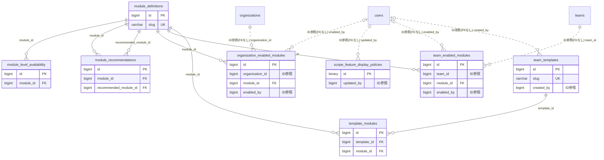

# template ドメイン ER 図

> このファイルは自動生成されます。手で編集しないでください。再生成: `cd backend && ./gradlew generateErDiagrams`

- テーブル数: 8
- ビュー数: 0

## ER 図

実線 = 外部キー、点線 = ID参照(FKなし)。図中の `FK` は実外部キーの列だけ（ID参照列は `FK` を付けず "ID参照" と注記）。図にはキー列（PK / FK / 参照推定列 / 単一列 UNIQUE）のみを描く。全列は下の「テーブル定義」を参照。

## 被参照（他ドメインから）

このドメインのテーブルを参照している他ドメインの側（実 FK と ID参照のみ。多態参照と推定不能参照は含まない。同一ドメイン内の参照は上の図を参照）。

なし

## 多態参照（線を引かない）

| テーブル | 種別列 | ID列 |
| --- | --- | --- |
| `scope_feature_display_policies` | `scope_type` | `scope_id` |

## テーブル定義

### `module_definitions`

| 列名 | 型 | NULL | 既定値 | コメント |
| --- | --- | --- | --- | --- |
| `id` | `bigint unsigned` | NO | （なし） auto_increment |  |
| `name` | `varchar(100)` | NO | （なし） |  |
| `slug` | `varchar(50)` | NO | （なし） |  |
| `description` | `varchar(500)` | YES | NULL |  |
| `module_type` | `varchar(20)` | NO | （なし） |  |
| `module_number` | `int` | NO | （なし） |  |
| `requires_paid_plan` | `tinyint(1)` | NO | `0` |  |
| `feature_flag` | `varchar(50)` | YES | NULL |  |
| `trial_days` | `int` | YES | `0` |  |
| `is_active` | `tinyint(1)` | NO | `1` |  |
| `deleted_at` | `datetime` | YES | NULL |  |
| `created_at` | `datetime` | NO | （なし） |  |
| `updated_at` | `datetime` | NO | （なし） |  |

### `module_level_availability`

| 列名 | 型 | NULL | 既定値 | コメント |
| --- | --- | --- | --- | --- |
| `id` | `bigint unsigned` | NO | （なし） auto_increment |  |
| `module_id` | `bigint unsigned` | NO | （なし） |  |
| `level` | `varchar(20)` | NO | （なし） |  |
| `is_available` | `tinyint(1)` | NO | `1` |  |
| `note` | `varchar(200)` | YES | NULL |  |
| `created_at` | `datetime` | NO | （なし） |  |
| `updated_at` | `datetime` | NO | （なし） |  |

### `module_recommendations`

| 列名 | 型 | NULL | 既定値 | コメント |
| --- | --- | --- | --- | --- |
| `id` | `bigint unsigned` | NO | （なし） auto_increment |  |
| `module_id` | `bigint unsigned` | NO | （なし） |  |
| `recommended_module_id` | `bigint unsigned` | NO | （なし） |  |
| `reason` | `varchar(200)` | YES | NULL |  |
| `sort_order` | `int` | NO | `0` |  |
| `created_at` | `datetime` | NO | （なし） |  |

### `organization_enabled_modules`

| 列名 | 型 | NULL | 既定値 | コメント |
| --- | --- | --- | --- | --- |
| `id` | `bigint unsigned` | NO | （なし） auto_increment |  |
| `organization_id` | `bigint unsigned` | NO | （なし） |  |
| `module_id` | `bigint unsigned` | NO | （なし） |  |
| `is_enabled` | `tinyint(1)` | NO | `1` |  |
| `is_grandfathered` | `tinyint(1)` | NO | `0` |  |
| `enabled_at` | `datetime` | YES | NULL |  |
| `disabled_at` | `datetime` | YES | NULL |  |
| `enabled_by` | `bigint unsigned` | YES | NULL |  |
| `created_at` | `datetime` | NO | `CURRENT_TIMESTAMP` （式） |  |
| `updated_at` | `datetime` | NO | `CURRENT_TIMESTAMP` （式） |  |

### `scope_feature_display_policies`

| 列名 | 型 | NULL | 既定値 | コメント |
| --- | --- | --- | --- | --- |
| `id` | `binary(16)` | NO | （なし） |  |
| `scope_type` | `varchar(20)` | NO | （なし） |  |
| `scope_id` | `bigint unsigned` | NO | （なし） |  |
| `feature_key` | `varchar(64)` | NO | （なし） |  |
| `member_visible` | `tinyint(1)` | NO | `1` |  |
| `supporter_visible` | `tinyint(1)` | NO | `1` |  |
| `updated_by` | `bigint unsigned` | NO | （なし） |  |
| `created_at` | `datetime(6)` | NO | （なし） |  |
| `updated_at` | `datetime(6)` | NO | （なし） |  |

### `team_enabled_modules`

| 列名 | 型 | NULL | 既定値 | コメント |
| --- | --- | --- | --- | --- |
| `id` | `bigint unsigned` | NO | （なし） auto_increment |  |
| `team_id` | `bigint unsigned` | NO | （なし） |  |
| `module_id` | `bigint unsigned` | NO | （なし） |  |
| `is_enabled` | `tinyint(1)` | NO | `1` |  |
| `is_grandfathered` | `tinyint(1)` | NO | `0` |  |
| `enabled_at` | `datetime` | YES | NULL |  |
| `disabled_at` | `datetime` | YES | NULL |  |
| `enabled_by` | `bigint unsigned` | YES | NULL |  |
| `trial_expires_at` | `datetime` | YES | NULL |  |
| `trial_used` | `tinyint(1)` | NO | `0` |  |
| `created_at` | `datetime` | NO | （なし） |  |
| `updated_at` | `datetime` | NO | （なし） |  |

### `team_templates`

| 列名 | 型 | NULL | 既定値 | コメント |
| --- | --- | --- | --- | --- |
| `id` | `bigint unsigned` | NO | （なし） auto_increment |  |
| `name` | `varchar(100)` | NO | （なし） |  |
| `slug` | `varchar(50)` | NO | （なし） |  |
| `description` | `varchar(500)` | YES | NULL |  |
| `icon_url` | `varchar(500)` | YES | NULL |  |
| `category` | `varchar(50)` | YES | NULL |  |
| `is_active` | `tinyint(1)` | NO | `1` |  |
| `created_by` | `bigint unsigned` | YES | NULL |  |
| `deleted_at` | `datetime` | YES | NULL |  |
| `created_at` | `datetime` | NO | （なし） |  |
| `updated_at` | `datetime` | NO | （なし） |  |

### `template_modules`

| 列名 | 型 | NULL | 既定値 | コメント |
| --- | --- | --- | --- | --- |
| `id` | `bigint unsigned` | NO | （なし） auto_increment |  |
| `template_id` | `bigint unsigned` | NO | （なし） |  |
| `module_id` | `bigint unsigned` | NO | （なし） |  |
| `created_at` | `datetime` | NO | （なし） |  |
