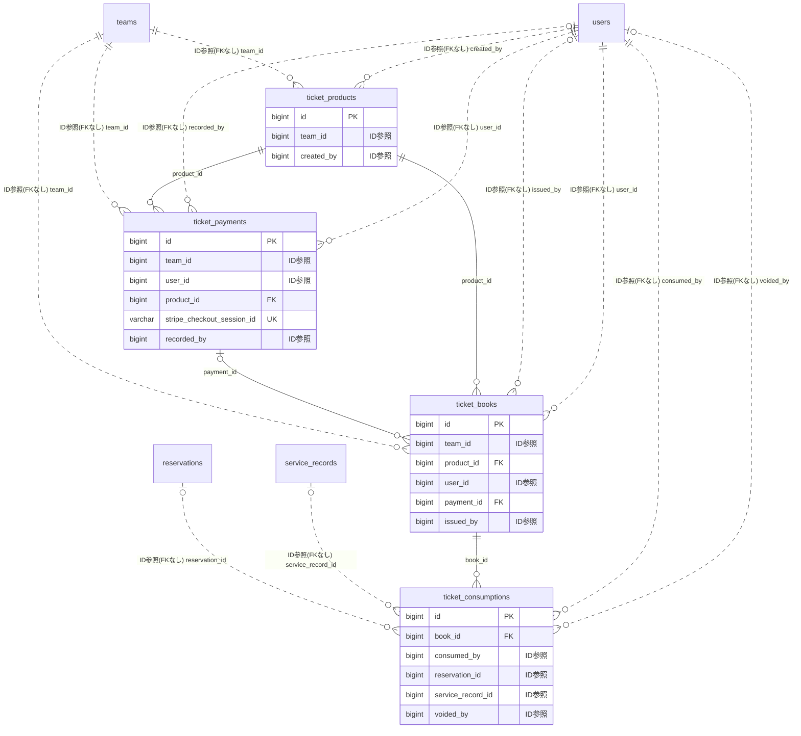

# ticket ドメイン ER 図

> このファイルは自動生成されます。手で編集しないでください。再生成: `cd backend && ./gradlew generateErDiagrams`

- テーブル数: 4
- ビュー数: 0

## ER 図

実線 = 外部キー、点線 = ID参照(FKなし)。図中の `FK` は実外部キーの列だけ（ID参照列は `FK` を付けず "ID参照" と注記）。図にはキー列（PK / FK / 参照推定列 / 単一列 UNIQUE）のみを描く。全列は下の「テーブル定義」を参照。

## 被参照（他ドメインから）

このドメインのテーブルを参照している他ドメインの側（実 FK と ID参照のみ。多態参照と推定不能参照は含まない。同一ドメイン内の参照は上の図を参照）。

なし

## 推定不能参照

| テーブル | 列 | 理由 |
| --- | --- | --- |
| `ticket_payments` | `stripe_checkout_session_id` | 参照先テーブルを特定できない |
| `ticket_payments` | `stripe_payment_intent_id` | 参照先テーブルを特定できない |
| `ticket_payments` | `stripe_refund_id` | 型が参照先 refunds.id と不一致（varchar ≠ binary） |
| `ticket_products` | `stripe_price_id` | 参照先テーブルを特定できない |
| `ticket_products` | `stripe_product_id` | 参照先テーブルを特定できない |

## テーブル定義

### `ticket_books`

| 列名 | 型 | NULL | 既定値 | コメント |
| --- | --- | --- | --- | --- |
| `id` | `bigint unsigned` | NO | （なし） auto_increment |  |
| `team_id` | `bigint unsigned` | NO | （なし） |  |
| `product_id` | `bigint unsigned` | NO | （なし） |  |
| `user_id` | `bigint unsigned` | NO | （なし） |  |
| `total_tickets` | `int` | NO | （なし） |  |
| `used_tickets` | `int` | NO | `0` |  |
| `remaining_tickets` | `int` | YES | NULL |  |
| `status` | `varchar(20)` | NO | `PENDING` |  |
| `purchased_at` | `datetime` | YES | NULL |  |
| `expires_at` | `datetime` | YES | NULL |  |
| `payment_id` | `bigint unsigned` | YES | NULL |  |
| `issued_by` | `bigint unsigned` | YES | NULL |  |
| `note` | `varchar(500)` | YES | NULL |  |
| `created_at` | `datetime` | NO | `CURRENT_TIMESTAMP` （式） |  |
| `updated_at` | `datetime` | NO | `CURRENT_TIMESTAMP` （式） |  |

### `ticket_consumptions`

| 列名 | 型 | NULL | 既定値 | コメント |
| --- | --- | --- | --- | --- |
| `id` | `bigint unsigned` | NO | （なし） auto_increment |  |
| `book_id` | `bigint unsigned` | NO | （なし） |  |
| `consumed_by` | `bigint unsigned` | NO | （なし） |  |
| `reservation_id` | `bigint unsigned` | YES | NULL |  |
| `service_record_id` | `bigint unsigned` | YES | NULL |  |
| `consumed_at` | `datetime` | NO | `CURRENT_TIMESTAMP` （式） |  |
| `note` | `varchar(500)` | YES | NULL |  |
| `is_voided` | `tinyint(1)` | NO | `0` |  |
| `voided_at` | `datetime` | YES | NULL |  |
| `voided_by` | `bigint unsigned` | YES | NULL |  |

### `ticket_payments`

| 列名 | 型 | NULL | 既定値 | コメント |
| --- | --- | --- | --- | --- |
| `id` | `bigint unsigned` | NO | （なし） auto_increment |  |
| `team_id` | `bigint unsigned` | NO | （なし） |  |
| `user_id` | `bigint unsigned` | NO | （なし） |  |
| `product_id` | `bigint unsigned` | NO | （なし） |  |
| `payment_method` | `varchar(20)` | NO | （なし） |  |
| `amount` | `int` | NO | （なし） |  |
| `stripe_checkout_session_id` | `varchar(200)` | YES | NULL |  |
| `stripe_payment_intent_id` | `varchar(200)` | YES | NULL |  |
| `stripe_refund_id` | `varchar(200)` | YES | NULL |  |
| `status` | `varchar(20)` | NO | `PENDING` |  |
| `refund_amount` | `int` | YES | NULL |  |
| `recorded_by` | `bigint unsigned` | YES | NULL |  |
| `paid_at` | `datetime` | YES | NULL |  |
| `webhook_received_at` | `datetime` | YES | NULL |  |
| `note` | `varchar(500)` | YES | NULL |  |
| `created_at` | `datetime` | NO | `CURRENT_TIMESTAMP` （式） |  |
| `updated_at` | `datetime` | NO | `CURRENT_TIMESTAMP` （式） |  |

### `ticket_products`

| 列名 | 型 | NULL | 既定値 | コメント |
| --- | --- | --- | --- | --- |
| `id` | `bigint unsigned` | NO | （なし） auto_increment |  |
| `team_id` | `bigint unsigned` | NO | （なし） |  |
| `name` | `varchar(200)` | NO | （なし） |  |
| `description` | `text` | YES | NULL |  |
| `total_tickets` | `int` | NO | （なし） |  |
| `price` | `int` | NO | （なし） |  |
| `tax_rate` | `decimal(5,2)` | NO | `10.00` |  |
| `validity_days` | `int` | YES | NULL |  |
| `stripe_product_id` | `varchar(100)` | YES | NULL |  |
| `stripe_price_id` | `varchar(100)` | YES | NULL |  |
| `image_url` | `varchar(500)` | YES | NULL |  |
| `is_online_purchasable` | `tinyint(1)` | NO | `1` |  |
| `is_active` | `tinyint(1)` | NO | `1` |  |
| `sort_order` | `int` | NO | `0` |  |
| `created_by` | `bigint unsigned` | NO | （なし） |  |
| `deleted_at` | `datetime` | YES | NULL |  |
| `created_at` | `datetime` | NO | `CURRENT_TIMESTAMP` （式） |  |
| `updated_at` | `datetime` | NO | `CURRENT_TIMESTAMP` （式） |  |
