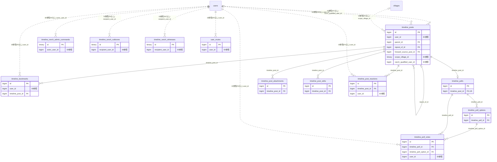

# timeline ドメイン ER 図

> このファイルは自動生成されます。手で編集しないでください。再生成: `cd backend && ./gradlew generateErDiagrams`

- テーブル数: 12
- ビュー数: 0

## ER 図

実線 = 外部キー、点線 = ID参照(FKなし)。図中の `FK` は実外部キーの列だけ（ID参照列は `FK` を付けず "ID参照" と注記）。図にはキー列（PK / FK / 参照推定列 / 単一列 UNIQUE）のみを描く。全列は下の「テーブル定義」を参照。

## 被参照（他ドメインから）

このドメインのテーブルを参照している他ドメインの側（実 FK と ID参照のみ。多態参照と推定不能参照は含まない。同一ドメイン内の参照は上の図を参照）。

| 参照元ドメイン | 参照元テーブル | 列 | 種別 | 参照先テーブル |
| --- | --- | --- | --- | --- |
| [actionmemo](actionmemo.md) | `action_memos` | `timeline_post_id` | ID参照 | `timeline_posts` |
| [cms](cms.md) | `blog_posts` | `timeline_post_id` | ID参照 | `timeline_posts` |
| [property](property.md) | `property_work_packages` | `timeline_post_id` | ID参照 | `timeline_posts` |
| [village](village.md) | `village_festival_live_posts` | `timeline_post_id` | ID参照 | `timeline_posts` |

## 自己参照

mermaid は同一テーブルの自己参照を複数描けず 1 本に畳むため、図に線が欠けることがある。自己参照はこの表を正とする。

| テーブル | 列 | 種別 |
| --- | --- | --- |
| `timeline_posts` | `forward_source_post_id` | 外部キー |
| `timeline_posts` | `parent_id` | 外部キー |
| `timeline_posts` | `repost_of_id` | 外部キー |

## 多態参照（線を引かない）

| テーブル | 種別列 | ID列 |
| --- | --- | --- |
| `timeline_posts` | `posted_as_type` | `posted_as_id` |
| `timeline_posts` | `scope_type` | `scope_id` |
| `user_mutes` | `muted_type` | `muted_id` |

## 推定不能参照

| テーブル | 列 | 理由 |
| --- | --- | --- |
| `timeline_posts` | `social_profile_id` | 参照先テーブルを特定できない |
| `timeline_ranch_outboxes` | `canonical_scope_id` | 参照先テーブルを特定できない |
| `timeline_ranch_witnesses` | `canonical_source_id` | 参照先テーブルを特定できない |
| `timeline_ranch_witnesses` | `content_key_id` | 参照先テーブルを特定できない |
| `timeline_ranch_witnesses` | `event_id` | 型が参照先 events.id と不一致（binary ≠ bigint） |

## テーブル定義

### `timeline_bookmarks`

| 列名 | 型 | NULL | 既定値 | コメント |
| --- | --- | --- | --- | --- |
| `id` | `bigint unsigned` | NO | （なし） auto_increment |  |
| `user_id` | `bigint unsigned` | NO | （なし） |  |
| `timeline_post_id` | `bigint unsigned` | NO | （なし） |  |
| `created_at` | `datetime` | NO | `CURRENT_TIMESTAMP` （式） |  |

### `timeline_poll_options`

| 列名 | 型 | NULL | 既定値 | コメント |
| --- | --- | --- | --- | --- |
| `id` | `bigint unsigned` | NO | （なし） auto_increment |  |
| `timeline_poll_id` | `bigint unsigned` | NO | （なし） |  |
| `option_text` | `varchar(100)` | NO | （なし） |  |
| `vote_count` | `int` | NO | `0` |  |
| `sort_order` | `smallint` | NO | `0` |  |

### `timeline_poll_votes`

| 列名 | 型 | NULL | 既定値 | コメント |
| --- | --- | --- | --- | --- |
| `id` | `bigint unsigned` | NO | （なし） auto_increment |  |
| `timeline_poll_id` | `bigint unsigned` | NO | （なし） |  |
| `timeline_poll_option_id` | `bigint unsigned` | NO | （なし） |  |
| `user_id` | `bigint unsigned` | NO | （なし） |  |
| `created_at` | `datetime` | NO | `CURRENT_TIMESTAMP` （式） |  |

### `timeline_polls`

| 列名 | 型 | NULL | 既定値 | コメント |
| --- | --- | --- | --- | --- |
| `id` | `bigint unsigned` | NO | （なし） auto_increment |  |
| `timeline_post_id` | `bigint unsigned` | NO | （なし） |  |
| `question` | `varchar(200)` | NO | （なし） |  |
| `total_vote_count` | `int` | NO | `0` |  |
| `expires_at` | `datetime` | YES | NULL |  |
| `is_closed` | `tinyint(1)` | NO | `0` |  |
| `created_at` | `datetime` | NO | `CURRENT_TIMESTAMP` （式） |  |

### `timeline_post_attachments`

| 列名 | 型 | NULL | 既定値 | コメント |
| --- | --- | --- | --- | --- |
| `id` | `bigint unsigned` | NO | （なし） auto_increment |  |
| `timeline_post_id` | `bigint unsigned` | NO | （なし） |  |
| `attachment_type` | `varchar(20)` | NO | （なし） | 添付種別: IMAGE / VIDEO_FILE / VIDEO_LINK / LINK_PREVIEW |
| `file_key` | `varchar(500)` | YES | NULL |  |
| `original_filename` | `varchar(255)` | YES | NULL |  |
| `file_size` | `bigint unsigned` | YES | NULL | ファイルサイズ（bytes）。IMAGE / VIDEO_FILE の場合。動画対応のため INT → BIGINT UNSIGNED に拡張 |
| `mime_type` | `varchar(100)` | YES | NULL |  |
| `image_width` | `smallint unsigned` | YES | NULL | 画像幅（px）。IMAGE の場合 |
| `image_height` | `smallint unsigned` | YES | NULL | 画像高さ（px）。IMAGE の場合 |
| `video_url` | `varchar(2048)` | YES | NULL |  |
| `video_thumbnail_url` | `varchar(2048)` | YES | NULL |  |
| `video_thumbnail_key` | `varchar(500)` | YES | NULL | VIDEO_FILE のサムネイル画像の R2 オブジェクトキー（Cloudflare Workers が非同期生成） |
| `video_duration_seconds` | `int unsigned` | YES | NULL | 動画の再生時間（秒）。VIDEO_FILE のみ。Workers がメタデータ解析時に格納 |
| `video_codec` | `varchar(30)` | YES | NULL | 動画コーデック（例: h264, h265, vp9）。VIDEO_FILE のみ |
| `video_width` | `smallint unsigned` | YES | NULL | 動画解像度 幅（px）。VIDEO_FILE のみ |
| `video_height` | `smallint unsigned` | YES | NULL | 動画解像度 高さ（px）。VIDEO_FILE のみ |
| `video_processing_status` | `enum('PENDING','PROCESSING','READY','FAILED')` | YES | NULL | VIDEO_FILE の後処理ステータス: アップロード直後 PENDING → Workers 実行中 PROCESSING → 完了で READY。FAILED 時はフロントで再生不可表示。IMAGE / VIDEO_LINK / LINK_PREVIEW の場合は NULL |
| `video_title` | `varchar(500)` | YES | NULL |  |
| `link_url` | `varchar(2048)` | YES | NULL |  |
| `og_title` | `varchar(500)` | YES | NULL |  |
| `og_description` | `varchar(1000)` | YES | NULL |  |
| `og_image_url` | `varchar(2048)` | YES | NULL |  |
| `og_site_name` | `varchar(200)` | YES | NULL |  |
| `sort_order` | `smallint` | NO | `0` |  |
| `created_at` | `datetime` | NO | `CURRENT_TIMESTAMP` （式） |  |

### `timeline_post_edits`

| 列名 | 型 | NULL | 既定値 | コメント |
| --- | --- | --- | --- | --- |
| `id` | `bigint unsigned` | NO | （なし） auto_increment |  |
| `timeline_post_id` | `bigint unsigned` | NO | （なし） |  |
| `content_before` | `text` | YES | NULL |  |
| `edited_at` | `datetime` | NO | `CURRENT_TIMESTAMP` （式） |  |

### `timeline_post_reactions`

| 列名 | 型 | NULL | 既定値 | コメント |
| --- | --- | --- | --- | --- |
| `id` | `bigint unsigned` | NO | （なし） auto_increment |  |
| `timeline_post_id` | `bigint unsigned` | NO | （なし） |  |
| `user_id` | `bigint unsigned` | NO | （なし） |  |
| `created_at` | `datetime` | NO | `CURRENT_TIMESTAMP` （式） |  |

### `timeline_posts`

| 列名 | 型 | NULL | 既定値 | コメント |
| --- | --- | --- | --- | --- |
| `id` | `bigint unsigned` | NO | （なし） auto_increment |  |
| `scope_type` | `varchar(20)` | NO | （なし） |  |
| `scope_id` | `bigint unsigned` | NO | `0` |  |
| `user_id` | `bigint unsigned` | YES | NULL | システム投稿は投稿者ユーザー不在（NULL） |
| `social_profile_id` | `bigint unsigned` | YES | NULL |  |
| `posted_as_type` | `varchar(20)` | NO | `USER` |  |
| `posted_as_id` | `bigint unsigned` | YES | NULL |  |
| `parent_id` | `bigint unsigned` | YES | NULL |  |
| `content` | `text` | YES | NULL |  |
| `repost_of_id` | `bigint unsigned` | YES | NULL |  |
| `repost_count` | `int` | NO | `0` |  |
| `status` | `varchar(20)` | NO | `PUBLISHED` |  |
| `scheduled_at` | `datetime` | YES | NULL |  |
| `is_pinned` | `tinyint(1)` | NO | `0` |  |
| `reaction_count` | `int` | NO | `0` |  |
| `reply_count` | `int` | NO | `0` |  |
| `attachment_count` | `smallint` | NO | `0` |  |
| `edit_count` | `smallint` | NO | `0` |  |
| `deleted_at` | `datetime` | YES | NULL |  |
| `created_at` | `datetime` | NO | `CURRENT_TIMESTAMP` （式） |  |
| `updated_at` | `datetime` | NO | `CURRENT_TIMESTAMP` （式） |  |
| `share_with_friends` | `tinyint(1)` | NO | `0` | フレンドチームへの配信許可（Phase 1 から有効） |
| `forward_source_post_id` | `bigint unsigned` | YES | NULL | FK -&gt; timeline_posts.id（転送元投稿・Phase 3 利用） |
| `forward_target_range` | `varchar(30)` | YES | NULL | MEMBER / MEMBER_AND_SUPPORTER（Phase 3 利用） |
| `scope_village_id` | `binary(16)` | YES | NULL | scope_type=VILLAGE のとき村ID（FK 張らない / 原則1） |
| `author_real_name_snapshot` | `varchar(100)` | YES | NULL |  |
| `public_visible` | `tinyint(1)` | NO | `1` |  |
| `system_post_type` | `varchar(40)` | YES | NULL | NULL=通常投稿 / 非NULL=システム自動投稿の種別（VillageEventNotificationType.name()） |
| `source_event_uuid` | `binary(16)` | YES | NULL | システム投稿の対象行事UUID（FK非付与・原則1）。通常投稿はNULL |
| `delivery_scope` | `varchar(20)` | NO | `DIRECT` | 配下配信範囲: DIRECT/CHILDREN/DESCENDANTS |
| `is_ranch_origin_known` | `tinyint(1)` | NO | `0` |  |
| `ranch_qualified_at` | `datetime(6)` | YES | NULL |  |
| `ranch_qualified_user_id` | `bigint unsigned` | YES | NULL |  |

### `timeline_ranch_admin_commands`

| 列名 | 型 | NULL | 既定値 | コメント |
| --- | --- | --- | --- | --- |
| `id` | `binary(16)` | NO | （なし） |  |
| `actor_user_id` | `bigint unsigned` | NO | （なし） |  |
| `idempotency_key` | `binary(16)` | NO | （なし） |  |
| `command_type` | `varchar(30)` | NO | （なし） |  |
| `body_hash` | `binary(32)` | NO | （なし） |  |
| `result_json` | `json` | NO | （なし） |  |
| `completed_at` | `datetime(6)` | NO | （なし） |  |
| `created_at` | `datetime(6)` | NO | （なし） |  |
| `updated_at` | `datetime(6)` | NO | （なし） |  |

### `timeline_ranch_outboxes`

| 列名 | 型 | NULL | 既定値 | コメント |
| --- | --- | --- | --- | --- |
| `id` | `binary(16)` | NO | （なし） |  |
| `schema_version` | `int` | NO | （なし） |  |
| `event_type` | `varchar(40)` | NO | （なし） |  |
| `scope_type` | `varchar(20)` | NO | （なし） |  |
| `scope_id_type` | `varchar(8)` | YES | NULL |  |
| `canonical_scope_id` | `varbinary(80)` | YES | NULL |  |
| `recipient_user_id` | `bigint unsigned` | NO | （なし） |  |
| `canonical_key` | `varbinary(240)` | NO | （なし） |  |
| `payload_json` | `json` | NO | （なし） |  |
| `occurred_at` | `datetime(6)` | NO | （なし） |  |
| `status` | `varchar(20)` | NO | （なし） |  |
| `terminal_outcome` | `varchar(40)` | YES | NULL |  |
| `attempt_count` | `int` | NO | `0` |  |
| `next_attempt_at` | `datetime(6)` | NO | （なし） |  |
| `lease_token` | `binary(16)` | YES | NULL |  |
| `lease_expires_at` | `datetime(6)` | YES | NULL |  |
| `last_error_code` | `varchar(80)` | YES | NULL |  |
| `acked_at` | `datetime(6)` | YES | NULL |  |
| `created_at` | `datetime(6)` | NO | （なし） |  |
| `updated_at` | `datetime(6)` | NO | （なし） |  |

### `timeline_ranch_witnesses`

| 列名 | 型 | NULL | 既定値 | コメント |
| --- | --- | --- | --- | --- |
| `id` | `binary(16)` | NO | （なし） |  |
| `source_id_type` | `varchar(8)` | NO | （なし） |  |
| `canonical_source_id` | `varbinary(80)` | NO | （なし） |  |
| `recipient_user_id` | `bigint unsigned` | NO | （なし） |  |
| `kind` | `varchar(20)` | NO | （なし） |  |
| `qualifying_at` | `datetime(6)` | YES | NULL |  |
| `event_id` | `binary(16)` | YES | NULL |  |
| `content_week` | `date` | YES | NULL |  |
| `content_version` | `varchar(64)` | YES | NULL |  |
| `content_key_id` | `binary(32)` | YES | NULL |  |
| `content_digest` | `binary(32)` | YES | NULL |  |
| `created_at` | `datetime(6)` | NO | （なし） |  |
| `updated_at` | `datetime(6)` | NO | （なし） |  |

### `user_mutes`

| 列名 | 型 | NULL | 既定値 | コメント |
| --- | --- | --- | --- | --- |
| `id` | `bigint unsigned` | NO | （なし） auto_increment |  |
| `user_id` | `bigint unsigned` | NO | （なし） |  |
| `muted_type` | `varchar(20)` | NO | （なし） |  |
| `muted_id` | `bigint unsigned` | NO | （なし） |  |
| `created_at` | `datetime` | NO | `CURRENT_TIMESTAMP` （式） |  |
