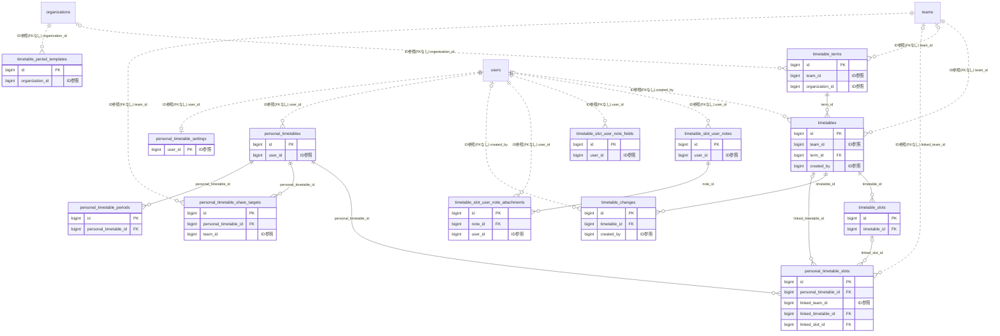

# timetable ドメイン ER 図

> このファイルは自動生成されます。手で編集しないでください。再生成: `cd backend && ./gradlew generateErDiagrams`

- テーブル数: 13
- ビュー数: 0

## ER 図

実線 = 外部キー、点線 = ID参照(FKなし)。図中の `FK` は実外部キーの列だけ（ID参照列は `FK` を付けず "ID参照" と注記）。図にはキー列（PK / FK / 参照推定列 / 単一列 UNIQUE）のみを描く。全列は下の「テーブル定義」を参照。

## 被参照（他ドメインから）

このドメインのテーブルを参照している他ドメインの側（実 FK と ID参照のみ。多態参照と推定不能参照は含まない。同一ドメイン内の参照は上の図を参照）。

| 参照元ドメイン | 参照元テーブル | 列 | 種別 | 参照先テーブル |
| --- | --- | --- | --- | --- |
| [school](school.md) | `period_attendance_records` | `timetable_change_id` | ID参照 | `timetable_changes` |
| [school](school.md) | `period_attendance_records` | `timetable_slot_id` | ID参照 | `timetable_slots` |

## 推定不能参照

| テーブル | 列 | 理由 |
| --- | --- | --- |
| `timetable_slot_user_notes` | `slot_id` | 参照先テーブルを特定できない |

## テーブル定義

### `personal_timetable_periods`

| 列名 | 型 | NULL | 既定値 | コメント |
| --- | --- | --- | --- | --- |
| `id` | `bigint unsigned` | NO | （なし） auto_increment |  |
| `personal_timetable_id` | `bigint unsigned` | NO | （なし） | FK → personal_timetables.id |
| `period_number` | `tinyint unsigned` | NO | （なし） | 時限番号（1〜15） |
| `label` | `varchar(50)` | NO | （なし） | 表示名（例: "1限", "夜間1"） |
| `start_time` | `time` | NO | （なし） | 開始時刻 |
| `end_time` | `time` | NO | （なし） | 終了時刻 |
| `is_break` | `tinyint(1)` | NO | `0` | 休憩枠（コマ割当不可） |
| `created_at` | `datetime` | NO | `CURRENT_TIMESTAMP` （式） |  |
| `updated_at` | `datetime` | NO | `CURRENT_TIMESTAMP` （式） |  |

### `personal_timetable_settings`

| 列名 | 型 | NULL | 既定値 | コメント |
| --- | --- | --- | --- | --- |
| `user_id` | `bigint unsigned` | NO | （なし） | PK + FK → users.id |
| `auto_reflect_class_changes_to_calendar` | `tinyint(1)` | NO | `1` | チーム時間割の臨時変更を個人カレンダー自動反映 |
| `notify_team_slot_note_updates` | `tinyint(1)` | NO | `1` | チーム時間割コマ共通メモ更新の通知を受け取る |
| `default_period_template` | `varchar(20)` | NO | `CUSTOM` | デフォルト時限テンプレート |
| `visible_default_fields` | `json` | NO | （なし） | メモエディタ表示項目 ["preparation","review","items_to_bring","free_memo"] |
| `created_at` | `datetime` | NO | `CURRENT_TIMESTAMP` （式） |  |
| `updated_at` | `datetime` | NO | `CURRENT_TIMESTAMP` （式） |  |

### `personal_timetable_share_targets`

| 列名 | 型 | NULL | 既定値 | コメント |
| --- | --- | --- | --- | --- |
| `id` | `bigint unsigned` | NO | （なし） auto_increment |  |
| `personal_timetable_id` | `bigint unsigned` | NO | （なし） | FK → personal_timetables.id |
| `team_id` | `bigint unsigned` | NO | （なし） | FK → teams.id（FAMILY 限定。アプリ層で検証） |
| `created_at` | `datetime` | NO | `CURRENT_TIMESTAMP` （式） |  |

### `personal_timetable_slots`

| 列名 | 型 | NULL | 既定値 | コメント |
| --- | --- | --- | --- | --- |
| `id` | `bigint unsigned` | NO | （なし） auto_increment |  |
| `personal_timetable_id` | `bigint unsigned` | NO | （なし） | FK → personal_timetables.id |
| `day_of_week` | `varchar(3)` | NO | （なし） | MON/TUE/WED/THU/FRI/SAT/SUN |
| `period_number` | `tinyint unsigned` | NO | （なし） | personal_timetable_periods.period_number |
| `week_pattern` | `varchar(5)` | NO | `EVERY` | EVERY / A / B |
| `subject_name` | `varchar(200)` | NO | （なし） | 講義名・教科名 |
| `course_code` | `varchar(50)` | YES | NULL | 履修番号（大学向け） |
| `teacher_name` | `varchar(100)` | YES | NULL | 担当教員 |
| `room_name` | `varchar(200)` | YES | NULL | 教室・建物名 |
| `credits` | `decimal(3,1)` | YES | NULL | 単位数（0.0〜9.9） |
| `color` | `varchar(7)` | YES | NULL | HEX カラー |
| `linked_team_id` | `bigint unsigned` | YES | NULL | FK → teams.id（リンク先チーム） |
| `linked_timetable_id` | `bigint unsigned` | YES | NULL | FK → timetables.id（リンク先チーム時間割） |
| `linked_slot_id` | `bigint unsigned` | YES | NULL | FK → timetable_slots.id（リンク先コマ） |
| `auto_sync_changes` | `tinyint(1)` | NO | `1` | 臨時変更を個人カレンダーに自動反映するか |
| `notes` | `varchar(300)` | YES | NULL | コマ自体の備考（個人メモとは別） |
| `created_at` | `datetime` | NO | `CURRENT_TIMESTAMP` （式） |  |
| `updated_at` | `datetime` | NO | `CURRENT_TIMESTAMP` （式） |  |

### `personal_timetables`

| 列名 | 型 | NULL | 既定値 | コメント |
| --- | --- | --- | --- | --- |
| `id` | `bigint unsigned` | NO | （なし） auto_increment |  |
| `user_id` | `bigint unsigned` | NO | （なし） | FK → users.id（所有者） |
| `name` | `varchar(200)` | NO | （なし） | 表示名（例: "2026年度 前期"） |
| `academic_year` | `smallint` | YES | NULL | 年度（任意・ソート用） |
| `term_label` | `varchar(50)` | YES | NULL | 学期ラベル（例: "前期", "夏期講習"） |
| `effective_from` | `date` | NO | （なし） | 適用開始日 |
| `effective_until` | `date` | YES | NULL | 適用終了日（NULL=未定） |
| `status` | `varchar(20)` | NO | `DRAFT` | DRAFT / ACTIVE / ARCHIVED |
| `visibility` | `varchar(20)` | NO | `PRIVATE` | PRIVATE / FAMILY_SHARED |
| `week_pattern_enabled` | `tinyint(1)` | NO | `0` | A/B週切替 |
| `week_pattern_base_date` | `date` | YES | NULL | A週起点（week_pattern_enabled=TRUE 時必須） |
| `notes` | `varchar(500)` | YES | NULL | 本人向けメモ（時間割全体） |
| `created_at` | `datetime` | NO | `CURRENT_TIMESTAMP` （式） |  |
| `updated_at` | `datetime` | NO | `CURRENT_TIMESTAMP` （式） |  |
| `deleted_at` | `datetime` | YES | NULL | 論理削除 |

### `timetable_changes`

| 列名 | 型 | NULL | 既定値 | コメント |
| --- | --- | --- | --- | --- |
| `id` | `bigint unsigned` | NO | （なし） auto_increment |  |
| `timetable_id` | `bigint unsigned` | NO | （なし） |  |
| `target_date` | `date` | NO | （なし） | 変更対象日 |
| `period_number` | `tinyint unsigned` | YES | NULL | 変更対象時限（NULL=全コマ対象: DAY_OFF時） |
| `change_type` | `varchar(10)` | NO | （なし） | REPLACE/CANCEL/ADD/DAY_OFF |
| `subject_name` | `varchar(100)` | YES | NULL | 変更後の教科名（REPLACE/ADD時に必須） |
| `teacher_name` | `varchar(100)` | YES | NULL | 変更後の担当者名 |
| `room_name` | `varchar(100)` | YES | NULL | 変更後の教室 |
| `reason` | `varchar(300)` | YES | NULL | 変更理由 |
| `notify_members` | `tinyint(1)` | NO | `1` | メンバーへの通知要否 |
| `created_by` | `bigint unsigned` | YES | NULL |  |
| `created_at` | `datetime` | NO | `CURRENT_TIMESTAMP` （式） |  |
| `updated_at` | `datetime` | NO | `CURRENT_TIMESTAMP` （式） |  |

### `timetable_period_templates`

| 列名 | 型 | NULL | 既定値 | コメント |
| --- | --- | --- | --- | --- |
| `id` | `bigint unsigned` | NO | （なし） auto_increment |  |
| `organization_id` | `bigint unsigned` | NO | （なし） |  |
| `period_number` | `tinyint unsigned` | NO | （なし） | 時限番号（1〜15）。表示順もこの値で決定 |
| `label` | `varchar(50)` | NO | （なし） | 表示名（例: 1限目, 朝の会, 昼休み） |
| `start_time` | `time` | NO | （なし） |  |
| `end_time` | `time` | NO | （なし） |  |
| `is_break` | `tinyint(1)` | NO | `0` | 休憩枠フラグ（TRUE=昼休み等。コマ割当対象外） |
| `created_at` | `datetime` | NO | `CURRENT_TIMESTAMP` （式） |  |
| `updated_at` | `datetime` | NO | `CURRENT_TIMESTAMP` （式） |  |

### `timetable_slot_user_note_attachments`

| 列名 | 型 | NULL | 既定値 | コメント |
| --- | --- | --- | --- | --- |
| `id` | `bigint unsigned` | NO | （なし） auto_increment |  |
| `note_id` | `bigint unsigned` | NO | （なし） | FK → timetable_slot_user_notes.id |
| `user_id` | `bigint unsigned` | NO | （なし） | FK → users.id（認可ショートサーキット用に冗長保持） |
| `r2_object_key` | `varchar(500)` | NO | （なし） | R2 オブジェクトキー user/{user_id}/timetable-notes/{uuid} |
| `original_filename` | `varchar(255)` | NO | （なし） | 元ファイル名 |
| `mime_type` | `varchar(100)` | NO | （なし） | MIME タイプ |
| `size_bytes` | `int unsigned` | NO | （なし） | バイトサイズ |
| `created_at` | `datetime` | NO | `CURRENT_TIMESTAMP` （式） |  |
| `deleted_at` | `datetime` | YES | NULL | 論理削除（30日後に R2 物理削除） |

### `timetable_slot_user_note_fields`

| 列名 | 型 | NULL | 既定値 | コメント |
| --- | --- | --- | --- | --- |
| `id` | `bigint unsigned` | NO | （なし） auto_increment |  |
| `user_id` | `bigint unsigned` | NO | （なし） | FK → users.id |
| `label` | `varchar(50)` | NO | （なし） | 項目名（例: "演習問題"） |
| `placeholder` | `varchar(100)` | YES | NULL | 入力欄プレースホルダ |
| `sort_order` | `tinyint unsigned` | NO | `0` | 表示順 |
| `max_length` | `smallint unsigned` | NO | `2000` | 文字数上限（500/2000/5000） |
| `created_at` | `datetime` | NO | `CURRENT_TIMESTAMP` （式） |  |
| `updated_at` | `datetime` | NO | `CURRENT_TIMESTAMP` （式） |  |

### `timetable_slot_user_notes`

| 列名 | 型 | NULL | 既定値 | コメント |
| --- | --- | --- | --- | --- |
| `id` | `bigint unsigned` | NO | （なし） auto_increment |  |
| `user_id` | `bigint unsigned` | NO | （なし） | FK → users.id（所有者） |
| `slot_kind` | `varchar(10)` | NO | （なし） | TEAM / PERSONAL |
| `slot_id` | `bigint unsigned` | NO | （なし） | TEAM=timetable_slots.id, PERSONAL=personal_timetable_slots.id（論理参照） |
| `preparation` | `text` | YES | NULL | 予習メモ（最大2,000字） |
| `review` | `text` | YES | NULL | 復習メモ（最大2,000字） |
| `items_to_bring` | `text` | YES | NULL | 持参物メモ（最大2,000字） |
| `free_memo` | `text` | YES | NULL | 自由メモ（最大10,000字） |
| `custom_fields` | `json` | YES | NULL | カスタムフィールド値 [{"field_id":1,"value":"..."}] |
| `target_date` | `date` | YES | NULL | 日付限定メモ（NULL=常設メモ） |
| `created_at` | `datetime` | NO | `CURRENT_TIMESTAMP` （式） |  |
| `updated_at` | `datetime` | NO | `CURRENT_TIMESTAMP` （式） |  |
| `deleted_at` | `datetime` | YES | NULL | 論理削除 |

### `timetable_slots`

| 列名 | 型 | NULL | 既定値 | コメント |
| --- | --- | --- | --- | --- |
| `id` | `bigint unsigned` | NO | （なし） auto_increment |  |
| `timetable_id` | `bigint unsigned` | NO | （なし） |  |
| `day_of_week` | `varchar(3)` | NO | （なし） | MON/TUE/WED/THU/FRI/SAT/SUN |
| `period_number` | `tinyint unsigned` | NO | （なし） | 時限番号 |
| `week_pattern` | `varchar(5)` | NO | `EVERY` | EVERY/A/B（A/B週パターン） |
| `subject_name` | `varchar(100)` | NO | （なし） | 教科名 |
| `teacher_name` | `varchar(100)` | YES | NULL | 担当者名 |
| `room_name` | `varchar(100)` | YES | NULL | 教室・場所 |
| `color` | `varchar(7)` | YES | NULL | 表示色（HEXカラーコード） |
| `notes` | `varchar(300)` | YES | NULL | 備考 |
| `created_at` | `datetime` | NO | `CURRENT_TIMESTAMP` （式） |  |
| `updated_at` | `datetime` | NO | `CURRENT_TIMESTAMP` （式） |  |

### `timetable_terms`

| 列名 | 型 | NULL | 既定値 | コメント |
| --- | --- | --- | --- | --- |
| `id` | `bigint unsigned` | NO | （なし） auto_increment |  |
| `team_id` | `bigint unsigned` | YES | NULL | チーム固有の学期（NULL=組織レベル） |
| `organization_id` | `bigint unsigned` | YES | NULL | 組織レベルの学期テンプレート（NULL=チーム固有） |
| `academic_year` | `smallint` | NO | （なし） | 年度（例: 2026） |
| `name` | `varchar(100)` | NO | （なし） | 学期名（例: 1学期, 前期, 春学期） |
| `start_date` | `date` | NO | （なし） |  |
| `end_date` | `date` | NO | （なし） |  |
| `sort_order` | `tinyint unsigned` | NO | `0` | 年度内の表示順 |
| `created_at` | `datetime` | NO | `CURRENT_TIMESTAMP` （式） |  |
| `updated_at` | `datetime` | NO | `CURRENT_TIMESTAMP` （式） |  |
| `deleted_at` | `datetime` | YES | NULL | 論理削除 |

### `timetables`

| 列名 | 型 | NULL | 既定値 | コメント |
| --- | --- | --- | --- | --- |
| `id` | `bigint unsigned` | NO | （なし） auto_increment |  |
| `team_id` | `bigint unsigned` | NO | （なし） |  |
| `term_id` | `bigint unsigned` | NO | （なし） |  |
| `name` | `varchar(200)` | NO | （なし） | 時間割名 |
| `status` | `varchar(20)` | NO | `DRAFT` | DRAFT / ACTIVE / ARCHIVED |
| `visibility` | `varchar(20)` | NO | `MEMBERS_ONLY` | MEMBERS_ONLY / PUBLIC |
| `effective_from` | `date` | NO | （なし） | 適用開始日 |
| `effective_until` | `date` | YES | NULL | 適用終了日（NULL=学期終了まで） |
| `week_pattern_enabled` | `tinyint(1)` | NO | `0` | A/B週パターン有効化フラグ |
| `week_pattern_base_date` | `date` | YES | NULL | A週の起点日（week_pattern_enabled=TRUE時は必須） |
| `period_override` | `json` | YES | NULL | チーム独自の時限定義（NULL=組織テンプレート継承） |
| `notes` | `text` | YES | NULL | 管理者向けメモ |
| `created_by` | `bigint unsigned` | YES | NULL |  |
| `created_at` | `datetime` | NO | `CURRENT_TIMESTAMP` （式） |  |
| `updated_at` | `datetime` | NO | `CURRENT_TIMESTAMP` （式） |  |
| `deleted_at` | `datetime` | YES | NULL | 論理削除 |
